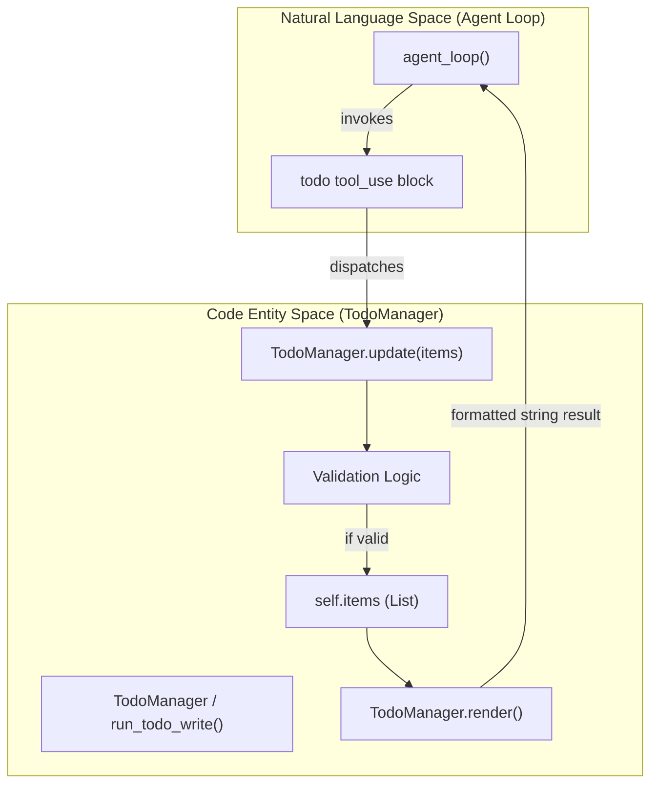
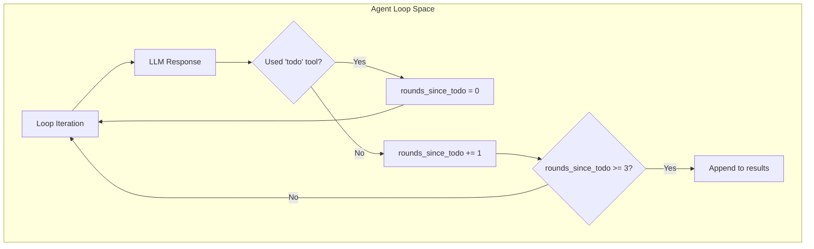
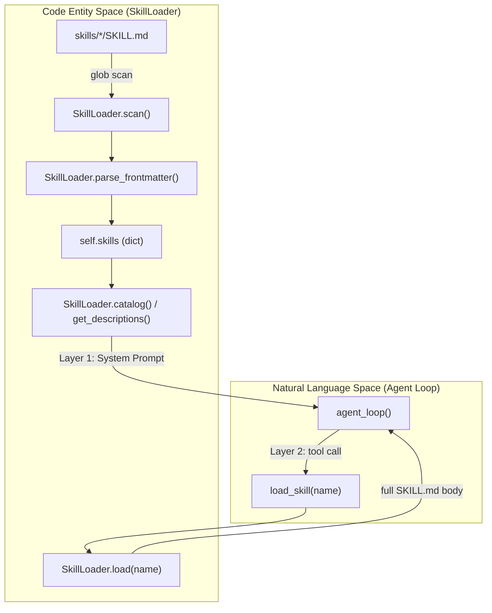

<!-- source: DeepWiki mcp.deepwiki.com · repo shareAI-lab/learn-claude-code · page 5.1 TodoManager and SkillLoader · fetched 2026-10-29 -->

# TodoManager and SkillLoader

Relevant source files

The following files were used as context for generating this wiki page:

- [agents/s03_todo_write.py](agents/s03_todo_write.py)
- [agents/s05_skill_loading.py](agents/s05_skill_loading.py)
- [s07_skill_loading/code.py](s07_skill_loading/code.py)
- [tests/test_todo_write_string_input.py](tests/test_todo_write_string_input.py)

## Purpose and Scope

This page provides a technical reference for two foundational manager components in the harness: `TodoManager` and `SkillLoader`. `TodoManager` maintains an in-memory task list with strict validation rules and nag reminders to keep the agent on track. `SkillLoader` handles dynamic skill discovery, YAML frontmatter parsing, and a two-layer injection architecture that exposes skill summaries in the system prompt while deferring full instruction bodies until requested via tool calls.

---

## TodoManager Architecture and Validation

The `TodoManager` class maintains an in-memory list of tasks to help the agent track multi-step execution paths without losing context.

**Data Flow**: The agent issues a `todo` tool call containing a list of task objects. The harness dispatches this payload to `TodoManager.update()`, which validates list size (maximum 20 items), ensures text descriptions are present, validates status enums (`pending`, `in_progress`, `completed`), and enforces the constraint that at most one task can be `in_progress` at a time [agents/s03_todo_write.py:58-80](). Once validated, `render()` generates a text summary returned to the agent [agents/s03_todo_write.py:81-92]().

Sources: [agents/s03_todo_write.py:58-92](), [tests/test_todo_write_string_input.py:117-160]()

---

## Nag Reminder Mechanism

To prevent the agent from abandoning its task list during long execution sequences, the harness implements a nag reminder counter.

If the agent completes three consecutive turns without calling the `todo` tool, the harness automatically injects a reminder message into the conversation transcript to prompt progress updates [agents/s03_todo_write.py:165-188]().

Sources: [agents/s03_todo_write.py:165-188]()

---

## SkillLoader Architecture and Discovery

`SkillLoader` discovers specialized domain knowledge packaged as `SKILL.md` files inside the `skills/` directory [s07_skill_loading/code.py:53-108]().

**Data Flow**: On startup, `SkillLoader` scans `skills/` for all `SKILL.md` manifests [s07_skill_loading/code.py:83-89](). It parses YAML frontmatter (extracting `name` and `description`) and separates it from the markdown body [s07_skill_loading/code.py:60-81](). The descriptions are injected into the system prompt (Layer 1) [s07_skill_loading/code.py:128-134](), while the full body is returned on demand when the agent invokes `load_skill` (Layer 2) [s07_skill_loading/code.py:117-123]().

Sources: [s07_skill_loading/code.py:53-125](), [agents/s05_skill_loading.py:64-113]()

---

