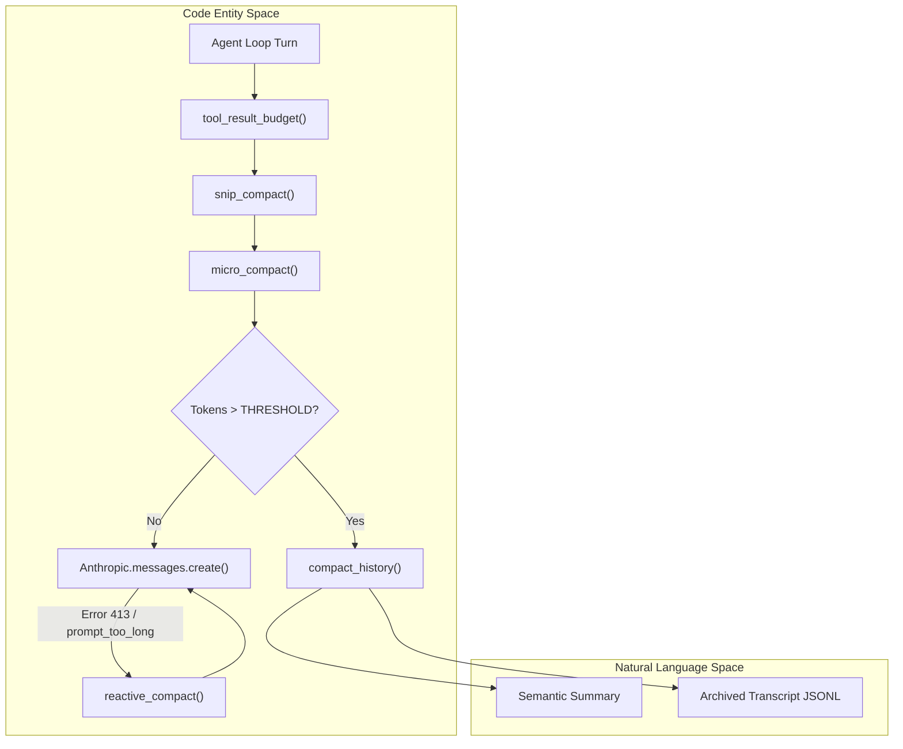
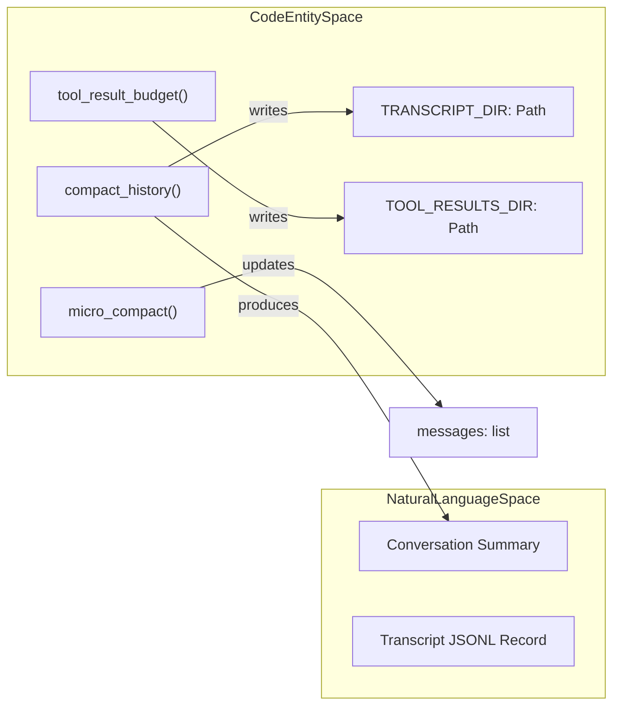

<!-- source: DeepWiki mcp.deepwiki.com · repo shareAI-lab/learn-claude-code · page 5.2 Context Compression Pipeline · fetched 2026-10-29 -->

# Context Compression Pipeline

<details>
<summary>Relevant source files</summary>

The following files were used as context for generating this wiki page:

- [agents/s06_context_compact.py](agents/s06_context_compact.py)
- [s08_context_compact/code.py](s08_context_compact/code.py)
- [s08_context_compact/images/micro-compact.en.svg](s08_context_compact/images/micro-compact.en.svg)
- [s08_context_compact/images/micro-compact.ja.svg](s08_context_compact/images/micro-compact.ja.svg)
- [s09_memory/code.py](s09_memory/code.py)

</details>


## Purpose and Scope

The Context Compression Pipeline is a multi-layered memory management system designed to solve the "finite context window" problem. Without compression, an agent's `messages` list accumulates file contents, shell outputs, and conversation history until the LLM API rejects the request with a `prompt_too_long` error [s08_context_compact/README.en.md:12-20]().

The pipeline implements a "cheap first, expensive last" strategy, using structural pruning, token estimation, transcript archiving, and local text manipulation before resorting to LLM-powered summarization [s08_context_compact/README.en.md:30-32]().

Sources: [s08_context_compact/README.en.md:12-32]()

## System Architecture

The pipeline consists of four primary layers and a reactive error recovery mechanism executed prior to model calls [s08_context_compact/code.py:5-32]().

Title: "FourLayerCompressionPipelineArchitecture"


| Layer | Function Name | Trigger | Mechanism | Cost |
| :--- | :--- | :--- | :--- | :--- |
| **L1** | `snip_compact` | > 50 messages | Trims the middle of the conversation history while preserving boundaries. | 0 API Calls |
| **L2** | `micro_compact` | > 3 tool results | Replaces old tool outputs with one-line placeholders, preserving `read_file`. | 0 API Calls |
| **L3** | `tool_result_budget` | > 200KB results | Persists large outputs to `.task_outputs/tool-results/`, leaving a preview. | 0 API Calls |
| **L4** | `compact_history` | > Token Threshold | LLM generates a summary; archives full transcript to `.transcripts/`. | 1 API Call |

Sources: [s08_context_compact/README.en.md:34-36](), [s08_context_compact/code.py:5-37](), [agents/s06_context_compact.py:6-33]()

## Layer 1: snip_compact (Conversation Trimming)

When the conversation length exceeds a set limit (default 50 messages), `snip_compact` preserves the beginning (initial instructions) and the end (current task), while removing the middle [s08_context_compact/README.en.md:38-42]().

**Implementation Logic:**
- It keeps the first few messages and the recent tail messages [s08_context_compact/README.en.md:48]().
- **Boundary Guard**: It ensures an `assistant(tool_use)` message is never separated from its corresponding `user(tool_result)` message, avoiding orphaned tool results [s08_context_compact/README.en.md:42-55]().

Sources: [s08_context_compact/README.en.md:45-59]()

## Layer 2: micro_compact (Placeholder Replacement)

This layer addresses the accumulation of tool outputs. Even if the message count is low, a single tool result can consume significant context space [s08_context_compact/README.en.md:61-67]().

**Logic:**
- It scans history for `tool_result` blocks within user messages [agents/s06_context_compact.py:75-82]().
- It preserves the most recent `KEEP_RECENT` (default: 3) tool results [s08_context_compact/README.en.md:72-76](), [agents/s06_context_compact.py:65]().
- Older results have their content replaced with a placeholder [agents/s06_context_compact.py:104]().
- **Exception**: `read_file` results are preserved as reference material because compacting them forces the agent to repeatedly re-read files [agents/s06_context_compact.py:66,94-103]().

Sources: [s08_context_compact/README.en.md:74-82](), [agents/s06_context_compact.py:69-105]()

## Layer 3: tool_result_budget (Disk Persistence)

This layer prevents a single large output from overwhelming the context window [s08_context_compact/README.en.md:84-86]().

**Implementation:**
- It evaluates the total size of all `tool_result` blocks in the latest user message [s08_context_compact/README.en.md:95-99]().
- If the total exceeds `max_bytes` (default 200KB), oversized results are written to `.task_outputs/tool-results/` [s08_context_compact/README.en.md:92-106]().
- The active context retains a persistence marker and a preview string [s08_context_compact/README.en.md:92]().

Sources: [s08_context_compact/README.en.md:95-109]()

## Layer 4: compact_history (Semantic Summary & Archiving)

When structural pruning is insufficient and tokens exceed the threshold, the system executes semantic compression via `compact_history` [s08_context_compact/README.en.md:113-117]().

**The Three-Step Process:**
1. **Archive**: The full conversation is serialized to `.transcripts/` in JSONL format [agents/s06_context_compact.py:110-116]().
2. **Summarize**: The LLM client calls `client.messages.create()` with a specialized prompt requesting goals, current state, and key decisions [agents/s06_context_compact.py:122-130]().
3. **Replace**: The entire `messages` list is replaced with a single user message containing the summary and transcript reference path [agents/s06_context_compact.py:135-137]().

Sources: [s08_context_compact/README.en.md:119-131](), [agents/s06_context_compact.py:108-138]()

## Reactive Error Recovery & Token Estimation

If the API returns a `prompt_too_long` error despite pre-emptive checks, `reactive_compact` is invoked to retry once [s08_context_compact/code.py:36]().

**Token Estimation Heuristic:**
To avoid API latency and costs during checks, token count is approximated using character length [agents/s06_context_compact.py:69-71]():
```python
def estimate_tokens(messages: list) -> int:
    """Rough token count: ~4 chars per token."""
    return len(str(messages)) // 4
```

Sources: [s08_context_compact/code.py:33-37](), [agents/s06_context_compact.py:69-71]()

## Code Entity Integration

Title: "CompressionPipelineDataFlowMapping"


**Execution Order in `agent_loop`:**
The order of operations is strictly enforced. `tool_result_budget` must run before `micro_compact` because `micro_compact` overwrites older results with placeholders, which would destroy the full content needed for disk persistence [s08_context_compact/code.py:5-32]().

Sources: [s08_context_compact/code.py:5-32](), [agents/s06_context_compact.py:69-138]()

---

