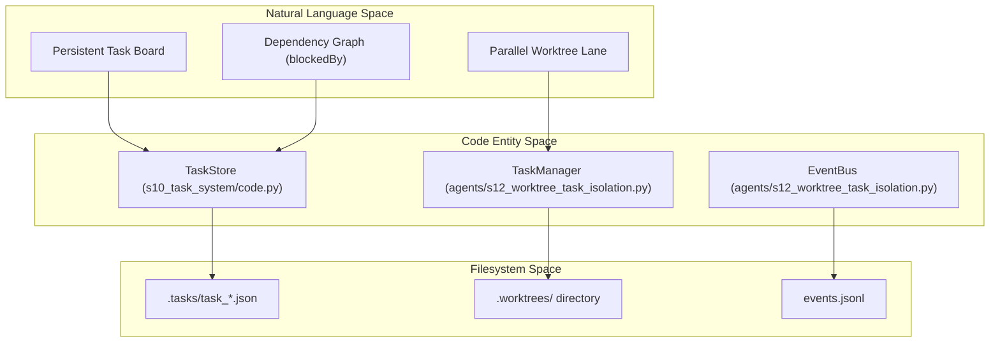
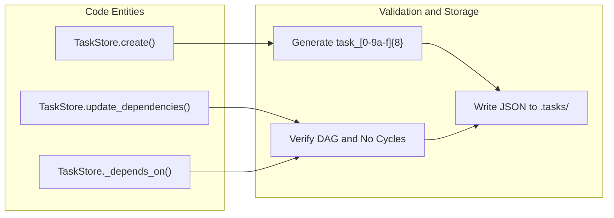
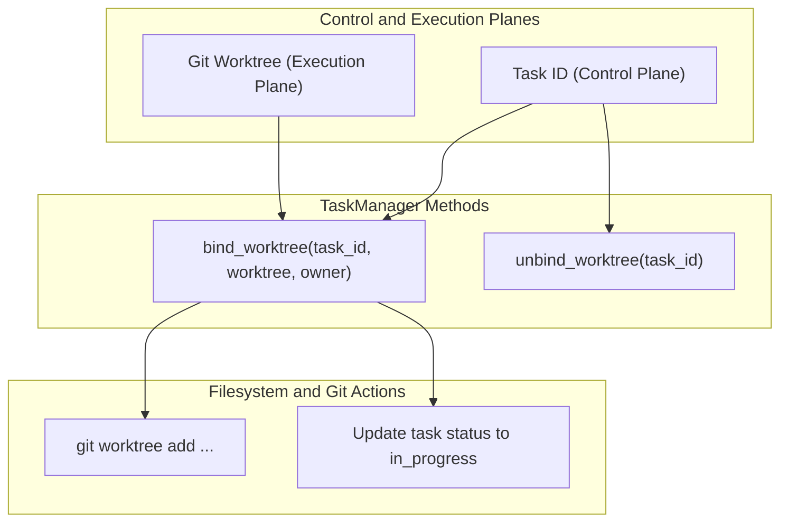

<!-- source: DeepWiki mcp.deepwiki.com · repo shareAI-lab/learn-claude-code · page 5.3 TaskManager and Worktree Binding · fetched 2026-10-29 -->

# TaskManager and Worktree Binding

<details>
<summary>Relevant source files</summary>

The following files were used as context for generating this wiki page:

- [agents/s07_task_system.py](agents/s07_task_system.py)
- [agents/s12_worktree_task_isolation.py](agents/s12_worktree_task_isolation.py)
- [s10_task_system/code.py](s10_task_system/code.py)

</details>


## Purpose and Scope

The `TaskManager` and worktree binding systems provide file-backed persistent task management and directory-level isolation for parallel agent execution. Tasks are stored as discrete JSON files in `.tasks/`, ensuring task state survives context compression, process restarts, and session boundaries [agents/s07_task_system.py:6-7] [s10_task_system/code.py:5-9](). Git worktrees establish independent execution lanes bound to specific task IDs, preventing file collisions during parallel multi-agent operations [agents/s12_worktree_task_isolation.py:4-7]().

Sources: [agents/s07_task_system.py:1-23](), [s10_task_system/code.py:1-22](), [agents/s12_worktree_task_isolation.py:1-31]()

---

## Architecture and Code Entity Mapping

This section bridges the natural language concepts of task management and worktree isolation to their concrete Python implementations and filesystem artifacts.


Sources: [s10_task_system/code.py:78-196](), [agents/s12_worktree_task_isolation.py:88-206]()

---

## Task Data Model and Storage

Tasks are serialized as JSON files. In advanced lessons like `s10_task_system`, task IDs use cryptographically secure hexadecimal strings (`task_[0-9a-f]{8}`), while older implementations use auto-incrementing integer IDs [s10_task_system/code.py:64-65]() [agents/s07_task_system.py:57-61]().

| Field | Type | Description |
|-------|------|-------------|
| `id` | `str` / `int` | Unique task identifier (`task_a1b2c3d4` or integer) |
| `subject` | `str` | Short task title |
| `description` | `str` | Detailed task description |
| `status` | `str` | One of `"pending"`, `"in_progress"`, `"completed"` |
| `owner` | `str` | Agent or teammate assigned to the task |
| `blockedBy` | `list` | Prerequisites that must finish before starting |
| `worktree` | `str` | Git worktree name bound to the task |

**Example task file** (`.tasks/task_12.json`):
```json
{
  "id": 12,
  "subject": "Implement auth refactor",
  "description": "Refactor authentication module",
  "status": "in_progress",
  "owner": "agent-1",
  "worktree": "auth-refactor",
  "blockedBy": [],
  "created_at": 1700000000.0,
  "updated_at": 1700003600.0
}
```

Sources: [s10_task_system/code.py:68-76](), [agents/s12_worktree_task_isolation.py:155-166]()

---

## CRUD Operations and Dependency Graph

The task store manages creation, loading, and dependency validation, including cycle detection via `_depends_on()` [s10_task_system/code.py:127-139]().



### Dependency Validation and Cascade
When updating dependencies, `update_dependencies()` checks for self-references and transitive cycles (`_depends_on`) [s10_task_system/code.py:141-171](). When a task is marked `completed`, dependency clearance removes the completed task ID from all other tasks' `blockedBy` lists [agents/s07_task_system.py:101-108]().

Sources: [agents/s07_task_system.py:73-108](), [s10_task_system/code.py:102-171]()

---

## Git Worktree Binding and Lifecycle

Tasks act as the control plane while git worktrees provide the execution plane [agents/s12_worktree_task_isolation.py:7-8](). Worktrees establish independent directories and branches for isolated task processing.



### Binding Operations
- `bind_worktree(task_id, worktree, owner)`: Associates a worktree name with a task, assigns an owner, and automatically transitions the task status from `"pending"` to `"in_progress"` [agents/s12_worktree_task_isolation.py:189-198]().
- `unbind_worktree(task_id)`: Clears the worktree association from the task record upon worktree cleanup [agents/s12_worktree_task_isolation.py:200-205]().

Sources: [agents/s12_worktree_task_isolation.py:7-15](), [agents/s12_worktree_task_isolation.py:189-205]()

---

## Event Bus and Observability

Lifecycle events involving tasks and worktrees are recorded via an append-only `EventBus` to provide transparency and auditing during multi-task operations [agents/s12_worktree_task_isolation.py:88-113](). Each emitted event captures timestamps, task payloads, and worktree states in a JSONL log file [agents/s12_worktree_task_isolation.py:103-112]().

Sources: [agents/s12_worktree_task_isolation.py:88-124]()

---

