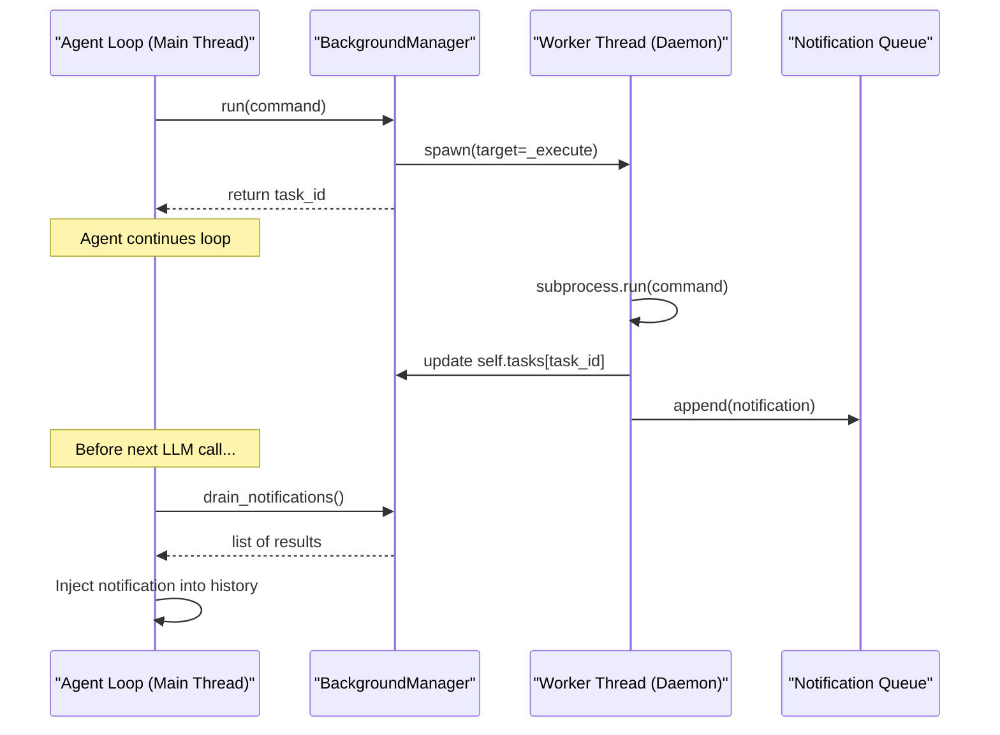
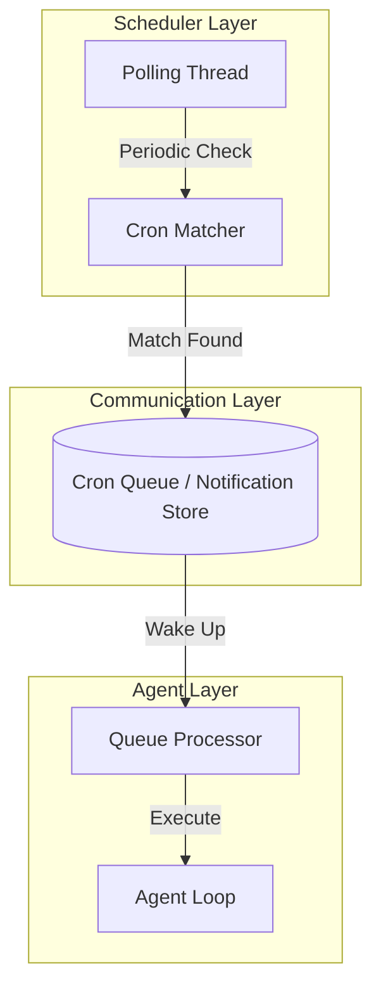

<!-- source: DeepWiki mcp.deepwiki.com · repo shareAI-lab/learn-claude-code · page 5.4 BackgroundManager and CronScheduler · fetched 2026-10-29 -->

# BackgroundManager and CronScheduler

<details>
<summary>Relevant source files</summary>

The following files were used as context for generating this wiki page:

- [agents/s08_background_tasks.py](agents/s08_background_tasks.py)
- [agents/s_full.py](agents/s_full.py)
- [s11_background_tasks/code.py](s11_background_tasks/code.py)
- [s12_cron_scheduler/code.py](s12_cron_scheduler/code.py)
- [tests/test_s_full_background.py](tests/test_s_full_background.py)

</details>


## Purpose and Scope

The `BackgroundManager` and `CronScheduler` are core infrastructure components that enable asynchronous command execution and time-based task scheduling. Introduced in progressive lessons such as `s11_background_tasks` and `s12_cron_scheduler` (as well as legacy tracks like `agents/s08_background_tasks.py`), these components allow agents to run long-running processes without blocking the main cognitive loop and to schedule deferred or recurring actions via cron expressions.

The `BackgroundManager` manages daemon thread spawning, output collection, process cleanup, and thread-safe notification queues. The `CronScheduler` provides a durable, file-persistent system for executing prompts based on cron specifications, utilizing an independent polling thread to trigger work.

Sources: `[agents/s08_background_tasks.py:3-26]`, `[s11_background_tasks/code.py:3-12]`, `[s12_cron_scheduler/code.py:3-14]`

---

## BackgroundManager Architecture

### Execution Model and Threading

The `BackgroundManager` implements a asynchronous execution model where shell commands or tasks run in daemon threads, allowing the main agent loop to continue processing other inputs or tools.

Title: "Background Manager Execution Flow"


Sources: `[agents/s08_background_tasks.py:9-25]`, `[agents/s08_background_tasks.py:56-71]`

### Data Structures and Thread Safety

The manager tracks task state in an internal dictionary while utilizing thread synchronization primitives to manage concurrent updates and notifications safely.

| Field | Type | Description |
| :--- | :--- | :--- |
| `tasks` | `dict` | Maps unique `task_id` strings to state dictionaries (`status`, `result`, `command`). |
| `_notification_queue` | `list` | Ephemeral list accumulating completed task summaries. |
| `_lock` | `threading.Lock` | Synchronizes access to the notification queue across threads. |

Sources: `[agents/s08_background_tasks.py:56-61]`

### Task Lifecycle and Timeouts

Worker threads execute subprocesses under configurable timeouts (defaulting to 300 seconds in background runs), capturing both `stdout` and `stderr`.

*   **`running`**: The background thread is active and the subprocess is executing.
*   **`completed`**: The process finished successfully with an exit code or output.
*   **`timeout`**: A `subprocess.TimeoutExpired` exception occurred.
*   **`error`**: An unhandled exception or operational error occurred during execution.

Sources: `[agents/s08_background_tasks.py:72-96]`, `[tests/test_s_full_background.py:65-77]`

---

## CronScheduler Architecture

The `CronScheduler` introduces temporal autonomy, allowing tasks or agent prompts to be scheduled using standard cron expressions.

### CronJob Persistence and Data Structure

Scheduled jobs are backed by durable storage (`.scheduled_tasks.json`) to survive process restarts and interruptions.

```python
@dataclass
class CronJob:
    id: str
    cron: str          # Cron expression string
    prompt: str        # The instruction or task prompt
    recurring: bool = True
    durable: bool = True
```

Sources: `[s12_cron_scheduler/code.py:23-25]`, `[s12_cron_scheduler/code.py:44-46]`

### Polling and Dispatch Architecture

Title: "Cron Scheduler Polling and Dispatch Flow"


1.  **Polling Thread**: Periodically checks registered jobs against the current local time using cron matching rules.
2.  **Queue**: Decouples temporal trigger logic from the main execution thread.
3.  **Queue Processor**: Injects matching prompts into the agent's message queue when the agent is idle or at turn boundaries.

Sources: `[s12_cron_scheduler/code.py:5-14]`, `[s12_cron_scheduler/code.py:16-25]`

---

## Notification Injection and Drain Flow

Asynchronous events from both background processes and cron schedules must be injected into the conversation history so the model is aware of them on its next turn.

```python
# Notification and cron injection pattern
def drain_notifications(self) -> list:
    with self._lock:
        notifs = list(self._notification_queue)
        self._notification_queue.clear()
    return notifs
```

Sources: `[agents/s08_background_tasks.py:109-115]`, `[tests/test_s_full_background.py:79-162]`

---

## Tool Interface Reference

The background and cron managers expose tool interfaces to the LLM:

| Component | Tool Name | Description |
| :--- | :--- | :--- |
| **Background** | `background_run` | Spawns a long-running shell command in a background thread. |
| **Background** | `check_background` | Polls the status or retrieves output of background tasks. |
| **Cron** | `schedule_cron` | Registers a new recurring or one-time cron job. |
| **Cron** | `list_crons` | Lists all currently active scheduled jobs. |
| **Cron** | `cancel_cron` | Removes a job from the scheduler and storage. |

Sources: `[agents/s08_background_tasks.py:169-176]`, `[s12_cron_scheduler/code.py:123-148]`

---

