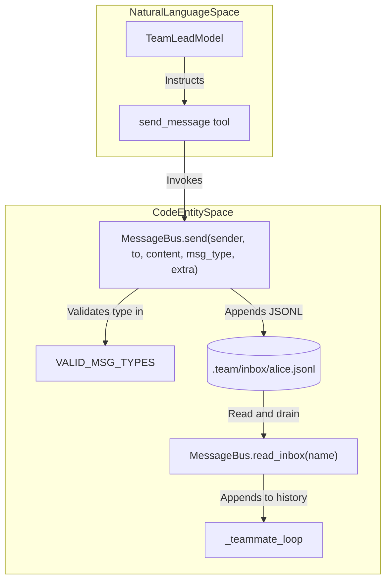
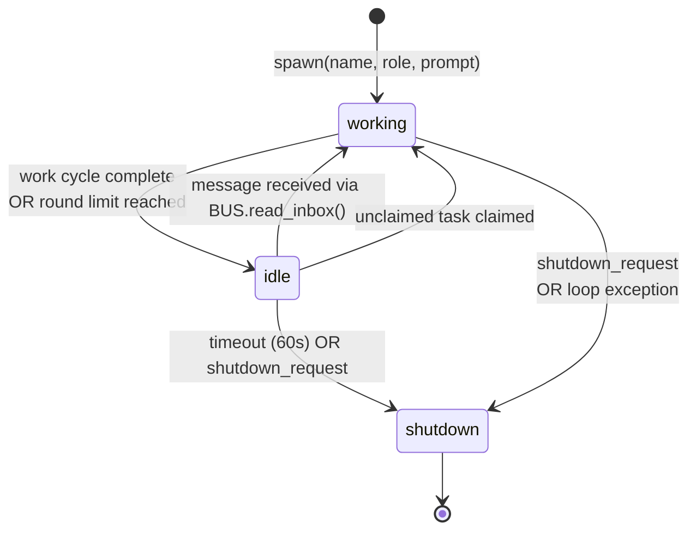
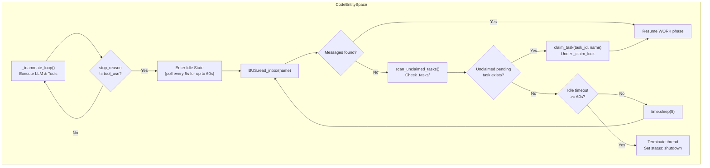
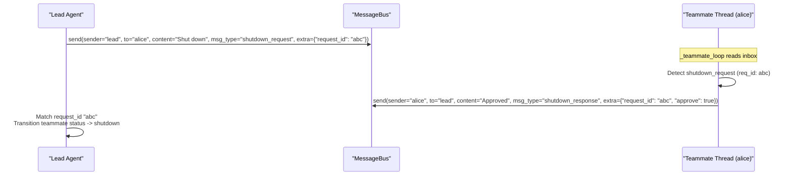

<!-- source: DeepWiki mcp.deepwiki.com · repo shareAI-lab/learn-claude-code · page 5.5 TeammateManager and MessageBus · fetched 2026-10-29 -->

# TeammateManager and MessageBus

Relevant source files

The following files were used as context for generating this wiki page:

- [agents/s09_agent_teams.py](agents/s09_agent_teams.py)
- [agents/s10_team_protocols.py](agents/s10_team_protocols.py)
- [agents/s11_autonomous_agents.py](agents/s11_autonomous_agents.py)

## Purpose and Scope

The `TeammateManager` and `MessageBus` classes form the multi-agent coordination backbone of the codebase [agents/s09_agent_teams.py:84-131](), enabling persistent, long-running agent teammates that execute in isolated threads and communicate asynchronously via file-based JSONL message queues. Unlike ephemeral subagents (see [s06: Subagents]()) that execute once and return a summary, teammates persist across multiple work cycles, transition between working, idle, and shutdown states, participate in structured request-response protocols, and can autonomously poll and claim tasks from a shared task board.

This page documents the internal architecture of `MessageBus` and `TeammateManager`, detailing JSONL inbox message passing, thread lifecycle management, idle polling cycles, and protocol state validation via request correlation.

**Sources:** [agents/s09_agent_teams.py:84-195](), [agents/s10_team_protocols.py:87-140](), [agents/s11_autonomous_agents.py:86-130]()

---

## MessageBus Implementation and JSONL Inboxes

The `MessageBus` class provides an append-only, file-backed messaging system where each teammate and the team lead have a dedicated `.jsonl` file inside the `.team/inbox/` directory [agents/s09_agent_teams.py:84-128]().

### Message Schema and Validation

Every message sent through the `MessageBus` must conform to valid message types declared in `VALID_MSG_TYPES` [agents/s09_agent_teams.py:74-80]():

| Message Type | Description |
|--------------|-------------|
| `"message"` | Direct point-to-point text message between teammates or lead |
| `"broadcast"` | Message dispatched to all active teammates simultaneously |
| `"shutdown_request"` | Request sent to initiate a graceful teammate shutdown sequence [agents/s10_team_protocols.py:82]() |
| `"shutdown_response"` | Approval or rejection of a pending shutdown request [agents/s10_team_protocols.py:83]() |
| `"plan_approval_response"` | Approval or rejection of a teammate's submitted plan [agents/s10_team_protocols.py:84]() |

### Core Methods

- `send(sender: str, to: str, content: str, msg_type: str = "message", extra: dict = None) -> str`: Validates `msg_type`, constructs a payload containing `type`, `from`, `content`, `timestamp` (and any optional `extra` fields like `request_id`), and appends it atomically as a JSON line to `inbox_dir / f"{to}.jsonl"` [agents/s09_agent_teams.py:89-107]().
- `read_inbox(name: str, clear: bool = True) -> list`: Reads all non-empty lines from `inbox_dir / f"{name}.jsonl"`, parses them into dictionaries, and optionally clears the inbox file after reading (draining it) [agents/s09_agent_teams.py:109-119]().
- `broadcast(sender: str, content: str, teammates: list) -> str`: Iterates through all known teammates, excluding the sender, and invokes `send()` with `msg_type="broadcast"` [agents/s09_agent_teams.py:121-127]().

**Sources:** [agents/s09_agent_teams.py:74-128](), [agents/s10_team_protocols.py:79-137]()

---

## TeammateManager Architecture and Thread Lifecycle

The `TeammateManager` class orchestrates persistent teammates through file-based configuration (`.team/config.json`), thread management (`threading.Thread`), and status tracking [agents/s09_agent_teams.py:131-180]().

### Configuration Persistence

Configuration is stored in `.team/config.json` containing the team name and an array of member records. Each member record tracks `name`, `role`, and `status` (`working`, `idle`, or `shutdown`) [agents/s09_agent_teams.py:139-162]().

### Spawning and Thread Creation

The `spawn()` method checks if the member exists and validates that their current status permits spawning (i.e. `"idle"` or `"shutdown"`). If valid, it updates the status to `"working"`, persists the configuration, and spawns a daemon thread running `_teammate_loop` [agents/s09_agent_teams.py:153-172]().

**Sources:** [agents/s09_agent_teams.py:131-180](), [agents/s11_autonomous_agents.py:173-208]()

---

## Idle Cycles and Autonomous Task Polling

In advanced agent team implementations (such as s11 autonomous agents), teammates do not exit immediately after completing their initial work prompt. Instead, they enter an **idle cycle** when no immediate tool use is pending [agents/s11_autonomous_agents.py:10-30]().

### Autonomous Task Claiming

Idle teammates periodically scan the `.tasks/` directory for pending tasks that have no owner and no unresolved `blockedBy` dependencies [agents/s11_autonomous_agents.py:134-143](). Using `claim_task()`, they atomically acquire ownership under an exclusive threading lock (`_claim_lock`), transition the task to `in_progress`, and resume their work loop [agents/s11_autonomous_agents.py:146-162]().

**Sources:** [agents/s11_autonomous_agents.py:10-30](), [agents/s11_autonomous_agents.py:134-162]()

---

## Protocol State Validation and Correlation

To ensure reliable coordination, multi-agent protocols utilize a `request_id` correlation pattern tracked across asynchronous messages [agents/s10_team_protocols.py:7-48]().

### Protocol Flow: Shutdown and Plan Approval

### Request Trackers and State Machines

Global dictionaries (`shutdown_requests`, `plan_requests`) synchronized via `_tracker_lock` map each unique `request_id` to its target, sender, and current status (`pending`, `approved`, `rejected`) [agents/s10_team_protocols.py:45-90](). When responses arrive via the `MessageBus`, the harness validates the `request_id` before executing state transitions.

**Sources:** [agents/s10_team_protocols.py:7-90](), [agents/s10_team_protocols.py:355-380]()

---

