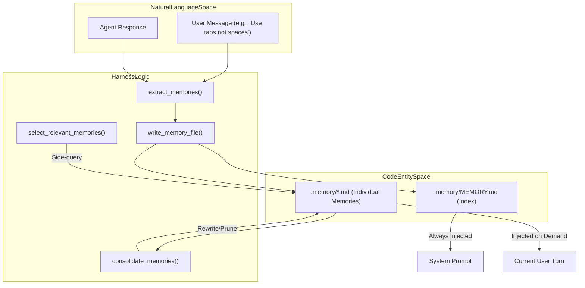
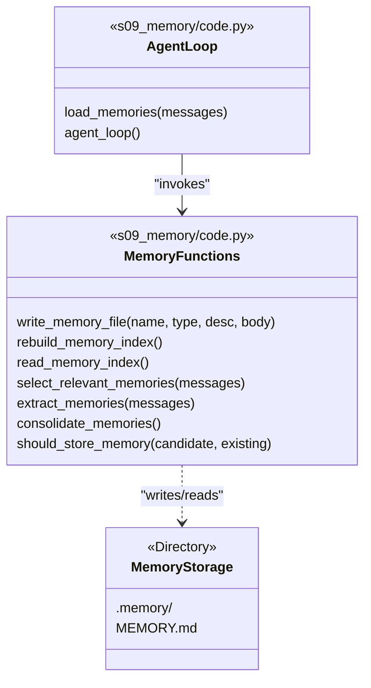

<!-- source: DeepWiki mcp.deepwiki.com · repo shareAI-lab/learn-claude-code · page 5.6 Memory System Internals · fetched 2026-10-29 -->

# Memory System Internals

Relevant source files

The following files were used as context for generating this wiki page:

- [s08_context_compact/code.py](s08_context_compact/code.py)
- [s09_memory/README.ja.md](s09_memory/README.ja.md)
- [s09_memory/README.md](s09_memory/README.md)
- [s09_memory/README.zh.md](s09_memory/README.zh.md)
- [s09_memory/code.py](s09_memory/code.py)
- [s09_memory/images/memory-overview.svg](s09_memory/images/memory-overview.svg)

## Purpose and Scope
This page covers the technical internals of the `.memory/` persistence layer implemented in `s09_memory/code.py`. The memory system allows the coding agent to accumulate, recall, extract, and consolidate durable cross-session knowledge—such as user preferences, project architectural facts, and process feedback—without polluting the active conversation context.

Sources: `[s09_memory/code.py:1-12]()`, `[s09_memory/README.md:1-16]()`

---

## Architectural Overview and Lifecycle

The memory system operates on a **Load-Inject-Extract-Consolidate** lifecycle. Knowledge is stored as individual Markdown files inside the `.memory/` directory, indexed by `MEMORY.md`, and dynamically recalled or updated based on agent interactions.

**Memory Subsystems and Data Flow**

Sources: `[s09_memory/code.py:11-39]()`, `[s09_memory/README.md:34-70]()`

---

## Storage and Data Format

Memories are saved as standalone Markdown files under `.memory/`. Each file contains YAML frontmatter defining its metadata `name`, `description`, and `type` `[s09_memory/code.py:141-148]()`.

### The Four Memory Types
The system categorizes all records into four types `[s09_memory/code.py:44]()`:
| Type | Purpose | Example |
| :--- | :--- | :--- |
| `user` | Persistent identity/preferences | `"User prefers tabs over spaces"` |
| `feedback` | Process-oriented corrections | `"Don't mock the database in integration tests"` |
| `project` | Context about the current work | `"The auth rewrite is compliance-driven"` |
| `reference` | Pointers to locations/resources | `"Pipeline logic is located in src/ingest/"` |

### Persistence Layer Functions
* `memory_slug(name)`: Sanitizes memory names into safe filename slugs using regular expressions `[s09_memory/code.py:84-86]()`.
* `memory_path(filename)`: Validates that memory file paths do not escape the `.memory/` root workspace boundary `[s09_memory/code.py:88-100]()`.
* `write_memory_file(name, mem_type, description, body)`: Writes the formatted memory document to disk and triggers index reconstruction `[s09_memory/code.py:149-163]()`.
* `rebuild_memory_index()`: Scans all `.md` files in `.memory/` (excluding `MEMORY.md`), parses their frontmatter, and rewrites the central `MEMORY.md` index `[s09_memory/code.py:165-184]()`.

Sources: `[s09_memory/code.py:44-184]()`, `[s09_memory/README.md:34-70]()`

---

## Memory Retrieval (Recall)

Loading relevant memory records relies on a two-tier strategy:

1. **Index Path**: `read_memory_index()` reads `MEMORY.md`, which is permanently injected into the system prompt. This gives the agent awareness of existing memories without loading their full texts `[s09_memory/code.py:186-191]()`.
2. **Content Path**: `select_relevant_memories()` queries a lightweight model instance with recent messages and the memory catalog to pick up to 5 relevant indices `[s09_memory/README.md:73-94]()`. If the model call or JSON parsing fails, it falls back to keyword matching.

Loaded memory content is constrained by `RECALL_CHAR_LIMIT` (`20,000` characters) to prevent context saturation `[s09_memory/code.py:66]()`.

Sources: `[s09_memory/code.py:186-210]`, `[s09_memory/README.md:73-94]()`

---

## Memory Maintenance: Extraction and Consolidation

### Extraction
After an agent response completes without pending tool calls, `extract_memories(messages)` analyzes the dialogue and proposes candidate records `[s09_memory/README.md:96-118]()`. 

`should_store_memory(candidate, existing)` acts as the final admission gate, rejecting:
* Records lacking a `persistent` scope `[s09_memory/code.py:112-113]()`.
* Unknown memory types `[s09_memory/code.py:114-115]()`.
* Candidates containing temporary session markers (e.g., `"this session"`, `"current task"`) `[s09_memory/code.py:124-125]()`.
* Duplicates matching existing slugs, descriptions, or bodies `[s09_memory/code.py:130-138]()`.

### Consolidation
When the total memory count reaches `CONSOLIDATE_THRESHOLD` (`10`), `consolidate_memories()` invokes the model to deduplicate, merge, and prune outdated records `[s09_memory/code.py:67]()`. The routine takes an in-memory snapshot of all files before wiping them; if writing the consolidated list fails, it restores the previous state from the snapshot and rebuilds the index `[s09_memory/README.md:120-152]()`.

Sources: `[s09_memory/code.py:67-139]`, `[s09_memory/README.md:96-155]()`

---

## Implementation Mapping

This diagram maps the core functions and classes of the memory system to their corresponding codebase files.

**Code Entity Mapping**

Sources: `[s09_memory/code.py:36-199]()`, `[s09_memory/README.md:158-168]()`

---

