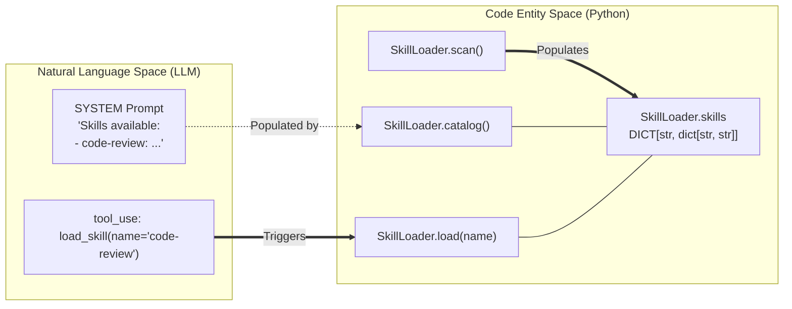

<!-- source: DeepWiki mcp.deepwiki.com · repo shareAI-lab/learn-claude-code · page 6 Skills System Deep Dive · fetched 2026-10-29 -->

# Skills System Deep Dive

Relevant source files

The following files were used as context for generating this wiki page:

- [s07_skill_loading/code.py](s07_skill_loading/code.py)

This page provides a comprehensive guide to the skills system architecture within `learn-claude-code`. The skills system provides the agent with on-demand domain expertise via modular instructions stored in the filesystem, avoiding context window exhaustion.

For detailed technical breakdowns, refer to the child pages:
- [Understanding Skills](#6.1) — What skills are, `SKILL.md` frontmatter, and bundled skills.
- [Two-Layer Injection Strategy](#6.2) — Layer 1 catalog in the system prompt versus Layer 2 full body via `tool_result`, and token economics.
- [Creating Custom Skills](#6.3) — Authoring custom `SKILL.md` files, using agent-builder templates, and registering skills with `SkillLoader`.

---

## 1. Understanding Skills

Skills are modular capability packages stored as subdirectories inside the central `skills/` directory `[s07_skill_loading/code.py:46-46]()`. Each skill directory contains a `SKILL.md` file that defines its name, summary description, and operational instructions `[s07_skill_loading/code.py:89-107]()`.

The `SkillLoader` class scans this directory at startup, parses the YAML frontmatter of each manifest, and maintains an in-memory dictionary of available skills `[s07_skill_loading/code.py:53-108]()`.

For full details on skill anatomy, frontmatter parsing, and the bundled skills (`agent-builder`, `code-review`, `mcp-builder`, `pdf`), see [Understanding Skills](#6.1).

Sources: [s07_skill_loading/code.py:46-46](), [s07_skill_loading/code.py:53-108]()

---

## 2. Two-Layer Injection Strategy

To balance capability breadth with context window efficiency, the harness implements a Two-Layer Injection Strategy. Instead of loading all documentation upfront, the model receives a compact catalog initially and fetches full instructions on demand.

### Layer 1 vs Layer 2 Architecture

Sources: [s07_skill_loading/code.py:53-123](), [s07_skill_loading/code.py:128-134]()

For a detailed analysis of token economics, context preservation, and the runtime sequence, see [Two-Layer Injection Strategy](#6.2).

---

## 3. Creating Custom Skills

Extending the agent's expertise requires zero changes to the core agent loop or tool dispatch map. By adding a new directory under `skills/` containing a properly formatted `SKILL.md` file, the `SkillLoader` automatically discovers and incorporates the skill during initialization `[s07_skill_loading/code.py:83-108]`.

Developers can leverage built-in templates and scaffolding scripts (such as `agent-builder`) to structure new capabilities correctly `[s07_skill_loading/code.py:10-15]()`.

For step-by-step instructions on authoring custom skills and registering them with `SkillLoader`, see [Creating Custom Skills](#6.3).

Sources: [s07_skill_loading/code.py:10-15](), [s07_skill_loading/code.py:83-108]()

---

