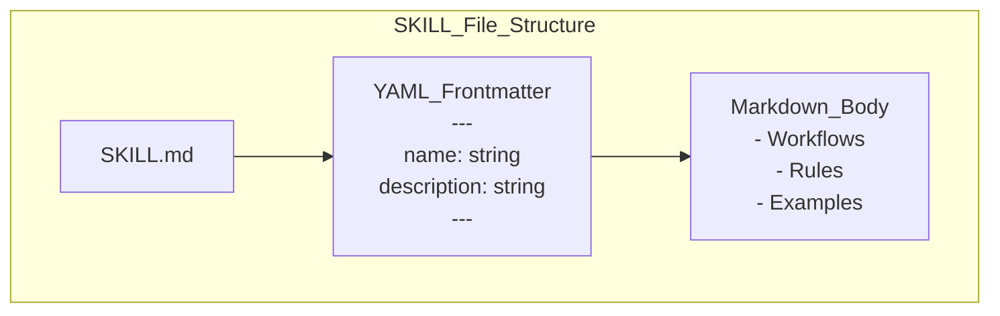
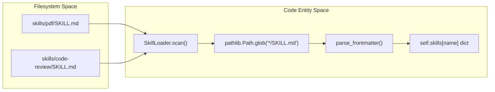
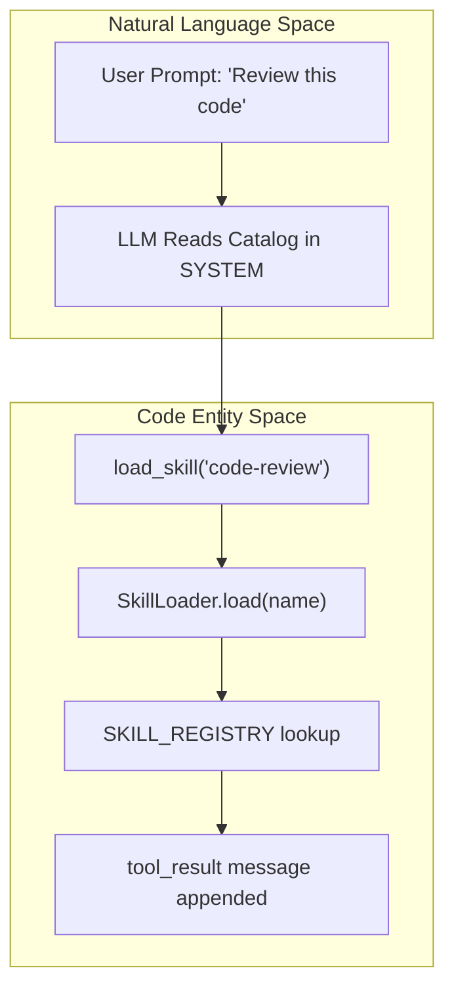

<!-- source: DeepWiki mcp.deepwiki.com · repo shareAI-lab/learn-claude-code · page 6.1 Understanding Skills · fetched 2026-10-29 -->

# Understanding Skills

Relevant source files

The following files were used as context for generating this wiki page:

- [s07_skill_loading/README.ja.md](s07_skill_loading/README.ja.md)
- [s07_skill_loading/README.md](s07_skill_loading/README.md)
- [s07_skill_loading/README.zh.md](s07_skill_loading/README.zh.md)
- [skills/agent-builder/references/minimal-agent.py](skills/agent-builder/references/minimal-agent.py)

This page covers the core architecture of skills in the `learn-claude-code` harness: what skills are, the `SKILL.md` file format specification, YAML frontmatter metadata, and the four bundled skills (`agent-builder`, `code-review`, `mcp-builder`, `pdf`). For details on runtime token injection, see [Two-Layer Injection Strategy](#6.2). For authoring guidelines, see [Creating Custom Skills](#6.3).

Sources: [s07_skill_loading/README.md:1-10]()

## Purpose and Scope

Skills are static, domain-specific knowledge packages that agents load on-demand rather than maintaining in the system prompt permanently. This section examines:
- Conceptual foundations and the token-waste problem in LLM context windows
- The `SKILL.md` anatomy and YAML frontmatter schema
- The four built-in reference skills provided in the repository (`agent-builder`, `code-review`, `mcp-builder`, `pdf`)
- The distinction between static skills and executable tools

Sources: [s07_skill_loading/README.md:12-40]()

## What Are Skills?

Skills are **static knowledge packages** stored as Markdown files. Each skill contains specialized instructions, workflows, or rules for a specific domain (e.g., building agents, reviewing code, writing MCP servers, or parsing PDFs). A skill is *not* executable code; it is reference documentation that the model reads via tool calls to guide its actions.

**The Token Optimization Problem**: Loading all domain guides into the system prompt permanently consumes context-window space and input tokens for every single LLM call. Skills use a two-layer approach: a lightweight catalog in the system prompt, and full file retrieval via `load_skill` only when triggered.

Sources: [s07_skill_loading/README.md:13-27]()

## SKILL.md File Format and Frontmatter

Every skill is structured as a directory containing a `SKILL.md` file, which combines YAML frontmatter with a Markdown instruction body.

**Diagram: SKILL.md File Structure**

Sources: [s07_skill_loading/README.md:43-54]()

### Metadata Schema

| Field | Type | Required | Description |
|-------|------|----------|-------------|
| `name` | string | No | Unique skill identifier; defaults to parent directory name if omitted. |
| `description` | string | Yes | Short summary displayed in the system prompt catalog during initialization. |

Sources: [s07_skill_loading/README.md:58-81]()

## Bundled Skills Reference

The harness includes four built-in skills located under the `skills/` directory:

1. **`agent-builder`**: Guides agents through creating custom minimal agents and harness extensions, incorporating workflow references like `skills/agent-builder/references/minimal-agent.py` [skills/agent-builder/references/minimal-agent.py:1-149]().
2. **`code-review`**: Provides rigorous code review checklists, error-handling heuristics, and formatting rules.
3. **`mcp-builder`**: Specifications and boilerplate patterns for constructing Model Context Protocol (MCP) servers.
4. **`pdf`**: Workflows for parsing, extracting, and manipulating PDF documents using command-line tools.

Sources: [s07_skill_loading/README.md:47-53]()

## Directory Structure and Discovery Mechanism

The harness discovers skills by scanning the filesystem at startup via the `SkillLoader` class.

**Diagram: Skill Discovery and Registration Flow**

During `SkillLoader.scan()`, each manifest file is read, frontmatter is extracted, and dictionaries are populated for runtime lookups [s07_skill_loading/README.md:58-81]().

Sources: [s07_skill_loading/README.md:58-81]()

## Skills vs Tools Distinction

| Dimension | Skills | Tools |
|-----------|--------|-------|
| **Nature** | Static documentation (`SKILL.md`) | Executable Python functions (`TOOL_HANDLERS`) |
| **Invocation** | Loaded via `load_skill(name)` | Executed directly via `tool_use` blocks |
| **Persistence** | Injected into message history as a `tool_result` | Executed, returning output string to message history |
| **State Impact** | Read-only knowledge for the model | Can mutate workspace files, run shell commands, etc. |

Sources: [s07_skill_loading/README.md:34-40](), [skills/agent-builder/references/minimal-agent.py:67-94]()

## Skill System Architecture

**Diagram: Natural Language Request to Code Execution Mapping**

Sources: [s07_skill_loading/README.md:93-116]()

---

