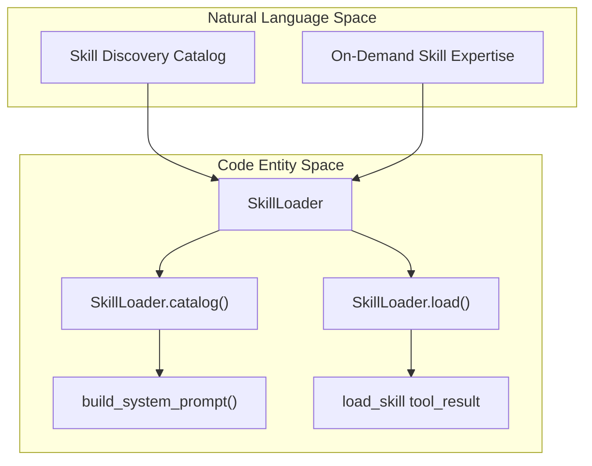

<!-- source: DeepWiki mcp.deepwiki.com · repo shareAI-lab/learn-claude-code · page 6.2 Two-Layer Injection Strategy · fetched 2026-10-29 -->

# Two-Layer Injection Strategy

<details>
<summary>Relevant source files</summary>

The following files were used as context for generating this wiki page:

- [s07_skill_loading/code.py](s07_skill_loading/code.py)
- [tests/test_skill_loading.py](tests/test_skill_loading.py)

</details>


This document explains the technical implementation of the two-layer skill injection strategy found in `s07_skill_loading/code.py`. This strategy prevents system prompt bloat by splitting skill knowledge into lightweight metadata (always present in Layer 1) and full instruction content (loaded on-demand via Layer 2).

Sources: [s07_skill_loading/code.py:1-20]()

---

## The Problem: System Prompt Token Waste

Loading all domain knowledge into the system prompt upfront creates massive token waste. Putting everything in the system prompt wastes tokens on unused skills—10 skills at 2000 tokens each consumes 20,000 tokens on every API call, even though most tasks only need a fraction of that knowledge.

| Approach | Tokens Per Call | Tokens Wasted | Cost Impact |
|----------|----------------|---------------|-------------|
| All skills upfront | 20,000 | ~18,000 | High multiplier on every request |
| Two-layer strategy | ~100 per skill (Layer 1) | ~0 | Only pay for what's used |

Sources: [s07_skill_loading/code.py:5-11]()

---

## The Two-Layer Architecture

The solution splits skill knowledge into two distinct layers managed by the `SkillLoader` class:

**Layer 1: Skill Descriptions (System Prompt)**
- Injected via `build_system_prompt()` during startup. [s07_skill_loading/code.py:128-134]()
- Contains only metadata: skill names and one-line descriptions derived from frontmatter or content. [s07_skill_loading/code.py:95-107]()
- Cost: ~100 tokens per skill. [s07_skill_loading/code.py:6]()
- Purpose: Enables the model to know what skills are available for discovery. [s07_skill_loading/code.py:5-7]()

**Layer 2: Skill Content (Tool Result)**
- Injected via `tool_result` after the agent calls the `load_skill` tool. [s07_skill_loading/code.py:17-19]()
- Contains the full `SKILL.md` content, including instructions and workflows. [s07_skill_loading/code.py:117-120]()
- Cost: ~2000 tokens per skill. [s07_skill_loading/code.py:11]()
- Purpose: Provides the actual expertise needed to execute a task. [s07_skill_loading/code.py:17-20]()

### Two-Layer Flow Diagram (Natural Language to Code Entity)



Sources: [s07_skill_loading/code.py:53-134]()

---

## Layer 1: System Prompt Injection

Layer 1 is implemented by the `SkillLoader` class scanning the `skills/` directory at startup and building a catalog of available capabilities. [s07_skill_loading/code.py:53-115]()

### Skill Discovery and Parsing
The `SkillLoader.scan` method iterates through `SKILLS_DIR`, finds `SKILL.md` files, and parses YAML frontmatter using `SkillLoader.parse_frontmatter`. [s07_skill_loading/code.py:60-107]()

```python
class SkillLoader:
    def __init__(self, skills_dir: Path):
        self.skills_dir = skills_dir
        self.skills: dict[str, dict[str, str]] = {}
        self.scan()
    
    @staticmethod
    def parse_frontmatter(text: str) -> tuple[dict, str]:
        # Parses YAML frontmatter and body
        ...
```
Sources: [s07_skill_loading/code.py:53-82]()

### System Prompt Assembly
The `build_system_prompt` function calls `SKILL_LOADER.catalog()` to generate the summary list and embeds it into the system prompt string. [s07_skill_loading/code.py:109-134]()

```python
def build_system_prompt() -> str:
    return (
        f"You are a coding agent at {WORKDIR}. Use tools to solve tasks. "
        "Act, don't explain.\n\n"
        f"Skills available:\n{SKILL_LOADER.catalog()}\n\n"
        "Use load_skill to read the full instructions when a skill applies."
    )
```
Sources: [s07_skill_loading/code.py:128-134]()

---

## Layer 2: On-Demand Content Loading

Layer 2 is triggered when the model determines it requires detailed instructions for a registered skill.

### load_skill Tool Implementation
The `load_skill` handler retrieves the raw markdown string stored in `SKILL_LOADER.load(name)` and returns it as a tool result. [s07_skill_loading/code.py:117-122]()

```python
    def load(self, name: str) -> str:
        skill = self.skills.get(name)
        if skill:
            return skill["content"]
        available = ", ".join(self.skills) or "none"
        return f"Error: Unknown skill '{name}'. Available: {available}"
```
Sources: [s07_skill_loading/code.py:117-122]()

---

## Implementation Flow: From Discovery to Injection

```mermaid
sequenceDiagram
    participant Startup as "Script Startup"
    participant Loader as "SkillLoader"
    participant FS as "FileSystem (skills/)"
    participant LLM as "Anthropic API"
    participant Loop as "Agent Loop"
    
    Note over Startup,FS: Layer 1 Initialization
    Startup->>Loader: SkillLoader(SKILLS_DIR)
    Loader->>FS: scan() -> glob(*/SKILL.md)
    FS-->>Loader: SKILL.md contents + YAML frontmatter
    Startup->>Loader: catalog()
    Loader-->>Startup: Skill names + descriptions
    Startup->>Loop: Initialize SYSTEM prompt with catalog
    
    Note over Loop,LLM: Layer 2 Runtime Execution
    Loop->>LLM: Send messages + SYSTEM
    LLM-->>Loop: tool_use: load_skill(name="code-review")
    Loop->>Loader: load("code-review")
    Loader-->>Loop: Return full SKILL.md content
    Loop->>LLM: Append tool_result (Layer 2 payload)
    LLM-->>Loop: Response guided by full skill instructions
```

Sources: [s07_skill_loading/code.py:53-134](), [tests/test_skill_loading.py:67-94]()

---

## Token Economics Comparison

The two-layer strategy dramatically reduces baseline token consumption by loading expensive instruction sets only when requested.

| Scenario | Layer 1 Only | Layer 1 + 2 | Traditional (All in System) |
|----------|--------------|-------------|----------------------------|
| **Baseline (no skills)** | ~1,000 tokens | ~1,000 tokens | 20,000 tokens |
| **1 skill needed** | ~1,000 tokens | ~3,000 tokens | 20,000 tokens |
| **3 skills needed** | ~1,000 tokens | ~7,000 tokens | 20,000 tokens |

**Key Insight**: The two-layer approach ensures that the model only consumes tokens for skills it is actively utilizing during the conversation session.

Sources: [s07_skill_loading/code.py:5-20]()

---

## Code Entity Reference

The strategy relies on these key code entities:

| Component | File | Lines | Purpose |
|-----------|------|-------|---------|
| `SkillLoader` | `s07_skill_loading/code.py` | 53-123 | Class managing skill discovery, frontmatter parsing, cataloging, and loading. |
| `SkillLoader.parse_frontmatter` | `s07_skill_loading/code.py` | 60-81 | Extracts YAML metadata and markdown body from skill files. |
| `SkillLoader.scan` | `s07_skill_loading/code.py` | 83-107 | Scans filesystem and populates internal skill dictionary. |
| `SkillLoader.catalog` | `s07_skill_loading/code.py` | 109-115 | **Layer 1**: Generates summary list for system prompt. |
| `SkillLoader.load` | `s07_skill_loading/code.py` | 117-122 | **Layer 2**: Retrieves full SKILL.md content on demand. |
| `build_system_prompt` | `s07_skill_loading/code.py` | 128-134 | Assembles final system prompt string containing the skill catalog. |

Sources: [s07_skill_loading/code.py:53-134](), [tests/test_skill_loading.py:67-94]()

---

