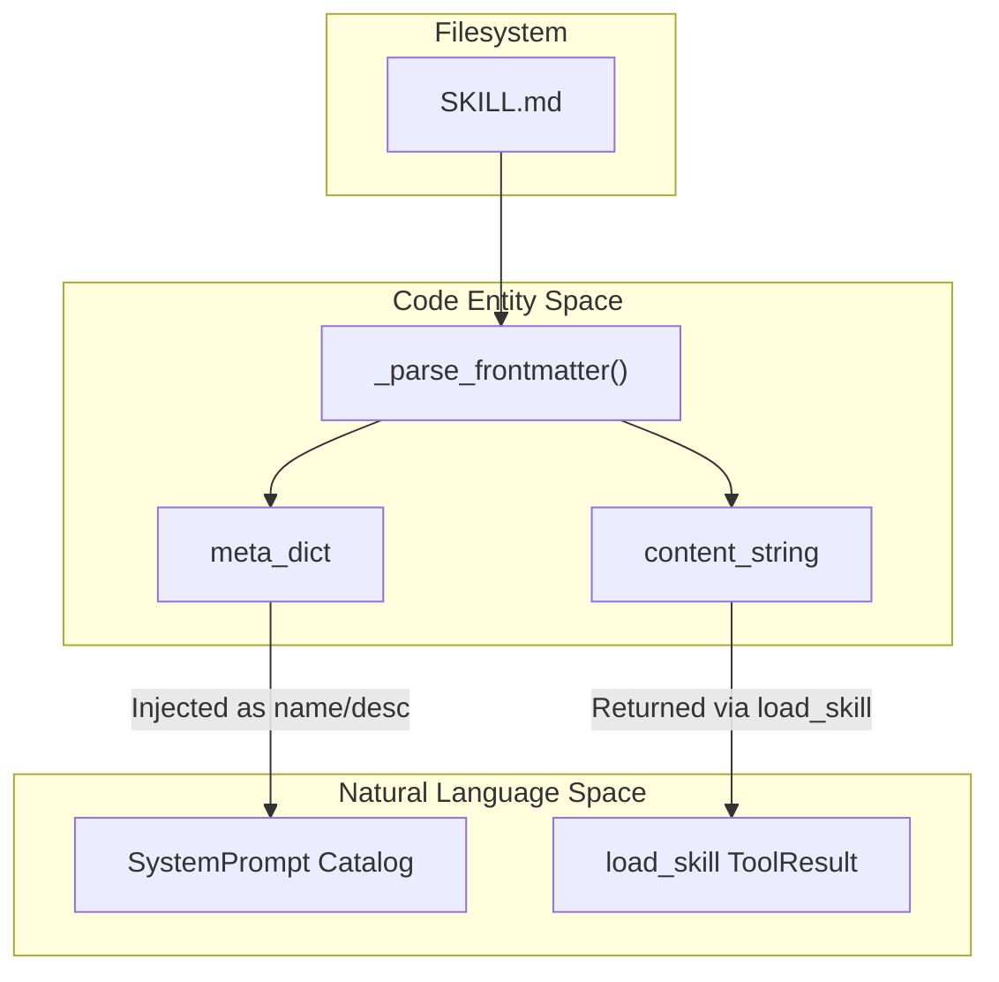
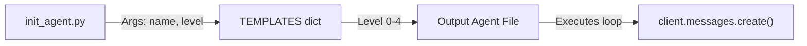
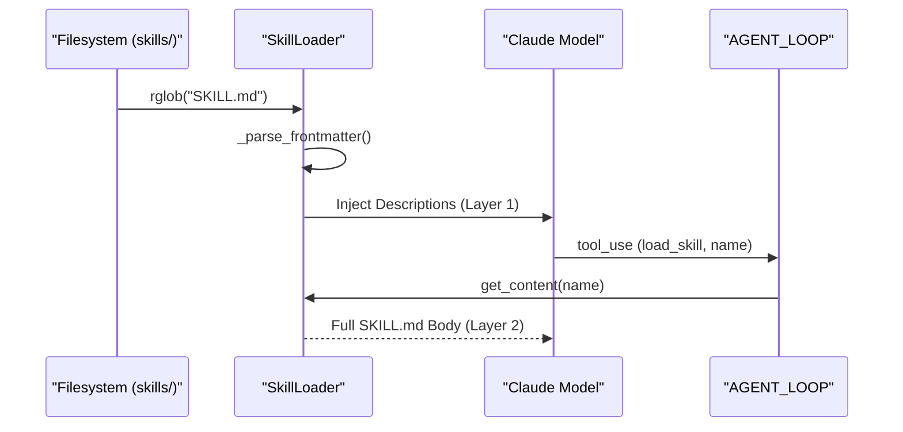

<!-- source: DeepWiki mcp.deepwiki.com · repo shareAI-lab/learn-claude-code · page 6.3 Creating Custom Skills · fetched 2026-10-29 -->

# Creating Custom Skills

Relevant source files

The following files were used as context for generating this wiki page:

- [skills/agent-builder/references/tool-templates.py](skills/agent-builder/references/tool-templates.py)
- [skills/agent-builder/scripts/init_agent.py](skills/agent-builder/scripts/init_agent.py)

This page covers the practical process of authoring custom `SKILL.md` files, leveraging agent-builder scripts and templates for bootstrapping, and registering new skills with the harness's skill loader architecture. For foundational concepts on what skills are, see [6.1 Understanding Skills](). For details on the architectural rationale behind two-layer injection, see [6.2 Two-Layer Injection Strategy]().

## SKILL.md File Anatomy

Each custom skill is encapsulated in a single `SKILL.md` file containing YAML frontmatter for metadata (Layer 1) and a markdown body for instructions (Layer 2).

### File Structure and Frontmatter

The skill file structure relies on `---` delimiters to separate configuration from content. 

Title: SkillFileAnatomyAndParsing

**Key Code Entities:**
- **Frontmatter Parser**: Extracts metadata fields (`name`, `description`, `tags`) [skills/agent-builder/references/tool-templates.py:1]().
- **Body Content**: Contains step-by-step instructions, workflows, and example commands [skills/agent-builder/references/tool-templates.py:1]().

Sources: [skills/agent-builder/references/tool-templates.py:1-51]()

## Using Agent-Builder Scripts and Templates

The `skills/agent-builder/` directory provides utility scripts and templates to bootstrap custom agents and skills with predefined tool sets and safety wrappers.

### Bootstrapping with `init_agent.py`

The scaffold script `skills/agent-builder/scripts/init_agent.py` generates new agent projects across multiple architectural levels (from minimal bash-only agents to fully featured harnesses) [skills/agent-builder/scripts/init_agent.py:3-13]().

Title: AgentInitializationWorkflow

**Key Code Entities:**
- `init_agent.py`: CLI script taking an agent name and optional level parameter [skills/agent-builder/scripts/init_agent.py:15-17]().
- `TEMPLATES`: Dictionary mapping complexity levels (0 to 4) to generated python code strings [skills/agent-builder/scripts/init_agent.py:20-200]().
- `run_bash` / `safe_path`: Core utility functions embedded in generated agents to ensure path safety and command execution guardrails [skills/agent-builder/references/tool-templates.py:141-180]().

Sources: [skills/agent-builder/scripts/init_agent.py:1-185](), [skills/agent-builder/references/tool-templates.py:141-221]()

## Registration and Tool Integration

To make a custom skill discoverable by the harness, it must be placed within the designated directory scanned by the loader, aligning with the `load_skill` tool dispatch mechanism.

### Registration Pipeline

Skills are discovered recursively, parsed, and exposed to the model through dynamic system prompt catalog generation.

Title: SkillRegistrationAndDispatch

**Key Code Entities:**
- `SkillLoader`: Manages discovery, parsing, and caching of all `SKILL.md` files [skills/agent-builder/references/tool-templates.py:1]().
- `load_skill`: Tool definition allowing the agent to request full instructions on demand.

Sources: [skills/agent-builder/references/tool-templates.py:1-51]()

## Writing and Validation

When authoring custom skills, ensure conformance with token limits and structural conventions.

### Best Practices for Authoring Skills
1. **Frontmatter Precision**: Keep descriptions under 100 tokens so the system prompt catalog remains concise [skills/agent-builder/references/tool-templates.py:1]().
2. **Actionable Instructions**: Provide concrete code snippets and exact invocation patterns in the markdown body.
3. **Safety Boundaries**: Include checks for workspace isolation using helpers like `safe_path()` [skills/agent-builder/references/tool-templates.py:141-149]().

Sources: [skills/agent-builder/references/tool-templates.py:141-149]()

---

