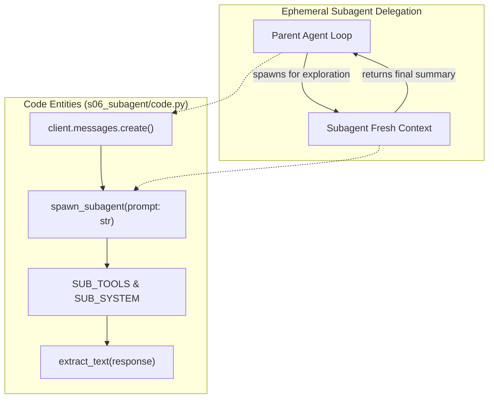
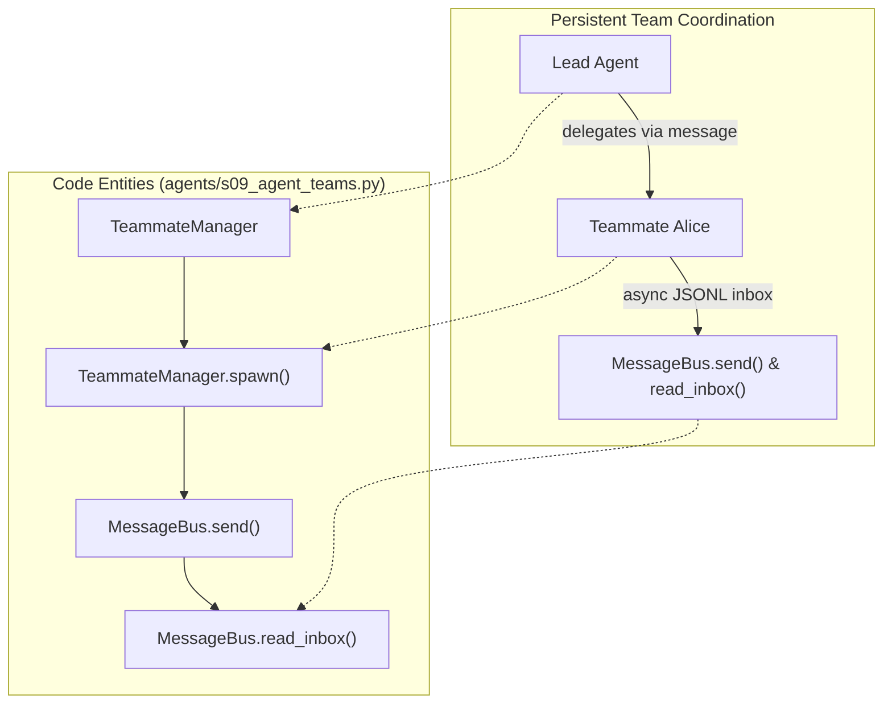

<!-- source: DeepWiki mcp.deepwiki.com · repo shareAI-lab/learn-claude-code · page 7.1 Evolution: Subagents to Teams · fetched 2026-10-29 -->

# Evolution: Subagents to Teams

<details>
<summary>Relevant source files</summary>

The following files were used as context for generating this wiki page:

- [docs/en/s08-background-tasks.md](docs/en/s08-background-tasks.md)
- [docs/en/s09-agent-teams.md](docs/en/s09-agent-teams.md)
- [s05_todo_write/code.py](s05_todo_write/code.py)
- [s06_subagent/code.py](s06_subagent/code.py)

</details>


## Purpose and Scope

This page traces the architectural evolution of multi-agent coordination across progressive harness lessons and legacy reference tracks: from ephemeral subagents (`s06`), to persistent teammates and communication protocols (`s13` / legacy `agents/s09_agent_teams.py`), up to autonomous task claiming and the legacy `s09–s12` `agents/` lineage. It explains how coordination mechanisms scale from single-context isolation to thread-safe file-mediated messaging and self-organizing teams.

Sources: [s06_subagent/code.py:1-19](), [docs/en/s09-agent-teams.md:1-36]()

---

## Stage 1: Ephemeral Subagents (s06)

### Context Isolation Problem

The subagent pattern solves the problem of context pollution. When a parent agent explores complex subtasks, tool results and intermediate reasoning steps accumulate in the main `messages[]` array, bloating the context window with noise. 


**Diagram: Subagent Delegation Mapping**

### Implementation Details

In `s06_subagent/code.py`, subagents run with a fresh message list, a restricted toolset that excludes recursive subagent spawning, and a summary-only return path.

```python
# From s06_subagent/code.py
def spawn_subagent(prompt: str) -> str:
    sub_messages = [{"role": "user", "content": prompt}]
    for _ in range(30):
        response = client.messages.create(
            model=MODEL, system=SUB_SYSTEM, messages=sub_messages,
            tools=SUB_TOOLS, max_tokens=8000,
        )
        sub_messages.append({"role": "assistant", "content": response.content})
        if response.stop_reason != "tool_use":
            return extract_text(response)
        # Tool dispatch logic executes here...
```

Sources: [s06_subagent/code.py:1-19](), [s06_subagent/code.py:183-201]()

---

## Stage 2: Persistent Teammates and Protocols (s13)

### From Ephemeral to Persistent Teammates

While subagents are disposable and execute synchronously within a single parent turn, advanced multi-agent harnesses (consolidated in `s13` and documented in `agents/s09_agent_teams.py`) introduce persistent teammates. Teammates run in daemon threads, maintain independent execution states, and communicate asynchronously via file-backed JSONL mailboxes.


**Diagram: Persistent Team Architecture Mapping**

### Core Components: `TeammateManager` and `MessageBus`

- `TeammateManager`: Manages team rosters stored in `.team/config.json`, spawning daemon threads for each registered teammate (`spawn()`) [docs/en/s09-agent-teams.md:43-64]().
- `MessageBus`: Provides atomic append operations (`send()`) and read-drain cycles (`read_inbox()`) using `.team/inbox/{name}.jsonl` files [docs/en/s09-agent-teams.md:69-84]().

```python
class MessageBus:
    def send(self, sender, to, content, msg_type="message", extra=None):
        msg = {"type": msg_type, "from": sender, "content": content, "timestamp": time.time()}
        if extra:
            msg.update(extra)
        with open(self.dir / f"{to}.jsonl", "a") as f:
            f.write(json.dumps(msg) + "\n")

    def read_inbox(self, name):
        path = self.dir / f"{name}.jsonl"
        if not path.exists(): return "[]"
        msgs = [json.loads(l) for l in path.read_text(encoding="utf-8").strip().splitlines() if l]
        path.write_text("", encoding="utf-8")  # drain
        return json.dumps(msgs, indent=2)
```

Sources: [docs/en/s09-agent-teams.md:43-84]()

---

## Stage 3: Autonomous Claiming and the Legacy Lineage (`s09–s12`)

### Autonomous Task Claiming

As harnesses evolved past explicit manual task assignment, agents gained the ability to autonomously scan shared task boards (`.tasks/`) and claim work items when idle. This shifts multi-agent architectures from command-and-control hierarchies to self-organizing cooperative teams.

### The Legacy `s09–s12` Reference Lineage

The legacy `agents/` reference track established the stepping stones for advanced harness capabilities prior to the 17-lesson modular course consolidation:
- `s09_agent_teams.py`: Introduced persistent teammate threads and JSONL mailboxes.
- `s10_task_system.py`: File-backed task graphs with dependency tracking (`blockedBy`).
- `s11_autonomous_agents.py`: Idle cycles and autonomous task claiming.
- `s12_integrated_harness.py`: Capstone combining memory, tasks, teams, and background workers.

Sources: [docs/en/s09-agent-teams.md:1-36](), [docs/en/s08-background-tasks.md:1-32]()

---

## Key Architectural Differences

| Dimension | Ephemeral Subagents (`s06`) | Persistent Teammates (`s13`) | Autonomous Teams (`s17`) |
|-----------|-----------------------------|------------------------------|--------------------------|
| **Lifecycle** | Spawn → execute → destroy | Persistent daemon threads | Persistent + proactive idle loops |
| **Context** | Fresh `messages[]` per call | Thread-local message history | Thread-local history + task state |
| **Communication** | Return text summary only | Async JSONL mailboxes | Mailboxes + shared task board |
| **Assignment** | Inline parent invocation | Lead agent message passing | Self-directed task claiming |

Sources: [s06_subagent/code.py:5-16](), [docs/en/s09-agent-teams.md:103-113]()

---

