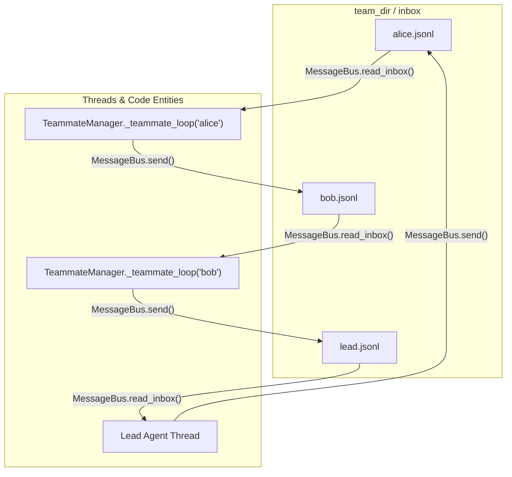
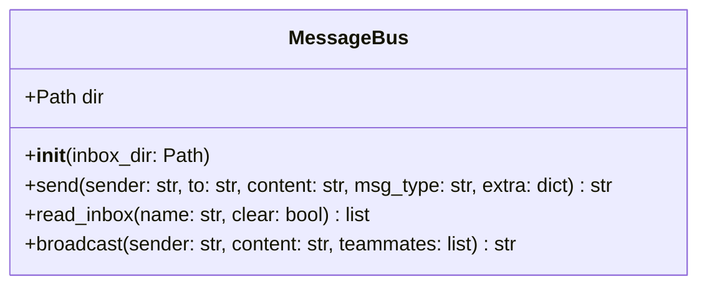
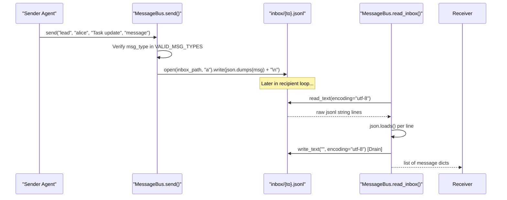
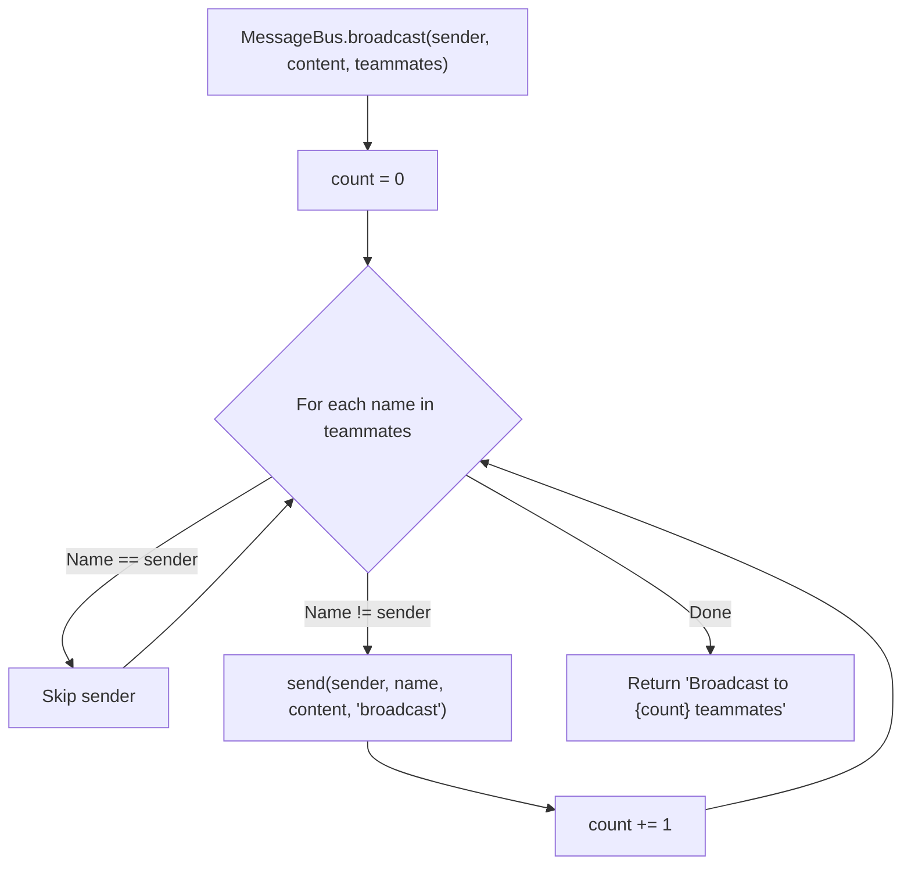
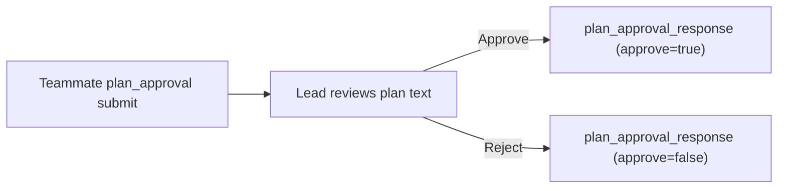

<!-- source: DeepWiki mcp.deepwiki.com · repo shareAI-lab/learn-claude-code · page 7.2 Team Communication and Protocols · fetched 2026-10-29 -->

# Team Communication and Protocols

<details>
<summary>Relevant source files</summary>

The following files were used as context for generating this wiki page:

- [agents/s09_agent_teams.py](agents/s09_agent_teams.py)
- [agents/s10_team_protocols.py](agents/s10_team_protocols.py)
- [docs/ja/s08-background-tasks.md](docs/ja/s08-background-tasks.md)
- [docs/ja/s09-agent-teams.md](docs/ja/s09-agent-teams.md)
- [docs/zh/s08-background-tasks.md](docs/zh/s08-background-tasks.md)
- [docs/zh/s09-agent-teams.md](docs/zh/s09-agent-teams.md)
- [s15_integrated_harness/code.py](s15_integrated_harness/code.py)
- [tests/test_agent_teams_runtime.py](tests/test_agent_teams_runtime.py)
- [tests/test_goal_loop.py](tests/test_goal_loop.py)
- [tests/test_web_scenarios.py](tests/test_web_scenarios.py)
- [tests/test_workflow_goal_lessons.py](tests/test_workflow_goal_lessons.py)
- [web/src/components/visualizations/index.tsx](web/src/components/visualizations/index.tsx)
- [web/src/data/execution-flows.ts](web/src/data/execution-flows.ts)

</details>


This page details the file-based asynchronous communication system and structured protocol state machines used for multi-agent coordination. It covers the `MessageBus` architecture, JSONL mailbox format, message types, broadcast mechanisms, inbox draining patterns, and strict protocol handshakes like shutdown sequences and plan approvals coordinated via `request_id`.

---

## 1. Core Architecture and JSONL Mailboxes

Multi-agent coordination requires persistent, non-blocking communication channels between agents running in separate threads. The harness solves this via **file-based JSONL mailboxes** located in the team directory, where each agent owns an append-only `.jsonl` file.



Sources: [agents/s09_agent_teams.py:84-126](), [agents/s10_team_protocols.py:93-136]()

---

## 2. MessageBus Implementation and Message Types

The `MessageBus` class handles message transmission, validation against allowed message types, and atomic appending.

### Message Validation and Schema

Every message must adhere to `VALID_MSG_TYPES`, which includes standard text communications as well as protocol-level control messages.

| Message Type | Purpose | Code Entity / Context |
|--------------|---------|-----------------------|
| `message` | Normal text communication between agents | `MessageBus.send()` |
| `broadcast` | Dispatched to all active teammates simultaneously | `MessageBus.broadcast()` |
| `shutdown_request` | Initiates graceful shutdown handshake | `TeammateManager` / Protocol FSM |
| `shutdown_response` | Acknowledges or rejects shutdown request | `request_id` correlation tracker |
| `plan_approval_response` | Approves or rejects a submitted agent work plan | `request_id` correlation tracker |

Sources: [agents/s09_agent_teams.py:74-80](), [agents/s10_team_protocols.py:79-85]()

### `MessageBus` Class Methods



Sources: [agents/s09_agent_teams.py:84-126](), [agents/s10_team_protocols.py:93-136]()

---

## 3. Atomic Sends and Inbox Draining

The communication pattern relies on two primitive operations: append-only writing and drain-on-read reading.



### Key Properties of Draining
- **Zero-Contention Appends:** Using append mode (`"a"`) avoids read-modify-write races across concurrent agent threads.
- **Drain on Read:** `read_inbox()` clears the file content immediately after reading (`path.write_text("", encoding="utf-8")`), ensuring messages are processed exactly once.

Sources: [agents/s09_agent_teams.py:89-125](), [agents/s10_team_protocols.py:99-135]()

---

## 4. Broadcast Mechanism

The `MessageBus.broadcast()` method iterates through all active teammate identifiers, excluding the sender, and routes copies of the broadcast message.



Sources: [agents/s09_agent_teams.py:118-125](), [agents/s10_team_protocols.py:128-135]()

---

## 5. Protocol Handshakes and Request Correlation

Advanced multi-agent behaviors (such as graceful shutdown and plan approvals) require bidirectional state machines correlated via unique `request_id` values.

### Shutdown Protocol FSM

```mermaid
graph LR
    Idle["Teammate Working"] -->|shutdown_request with request_id| Pending["Pending Shutdown"]
    Pending -->|shutdown_response (approve=true)| Approved["Status -> 'shutdown' <br/> Thread Stops"]
    Pending -->|shutdown_response (approve=false)| Rejected["Resume Working"]
```

Sources: [agents/s10_team_protocols.py:9-29](), [agents/s10_team_protocols.py:88-90]()

### Plan Approval Protocol FSM



Sources: [agents/s10_team_protocols.py:30-46](), [agents/s10_team_protocols.py:88-90]()

### Correlation Trackers
Global dictionaries track pending requests thread-safely under `_tracker_lock`:

```python
shutdown_requests = {}
plan_requests = {}
_tracker_lock = threading.Lock()
```

Sources: [agents/s10_team_protocols.py:87-90]()

---

