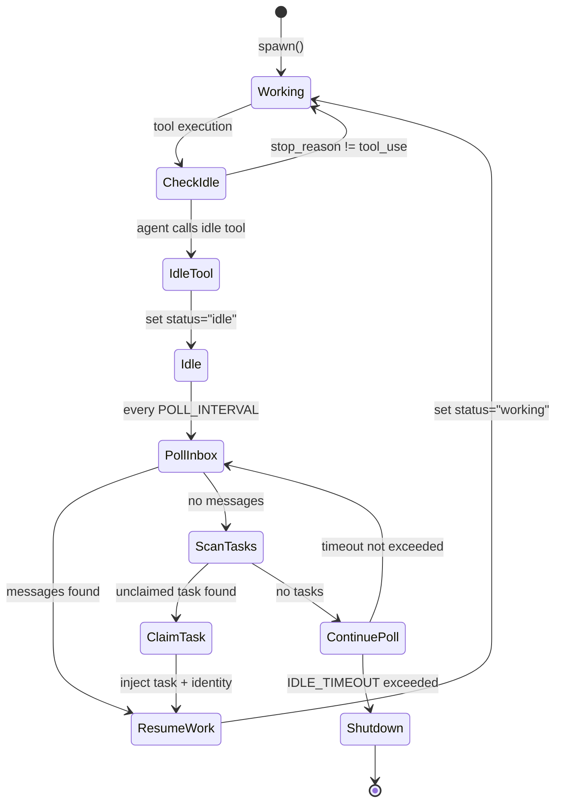
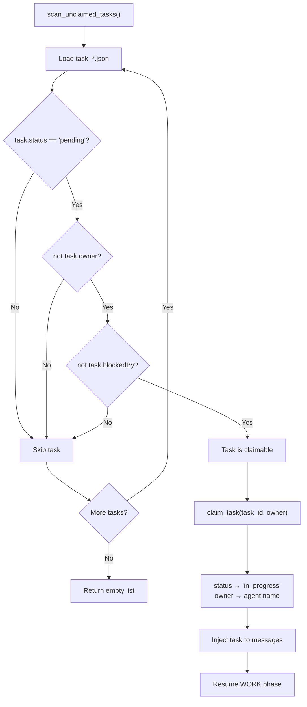
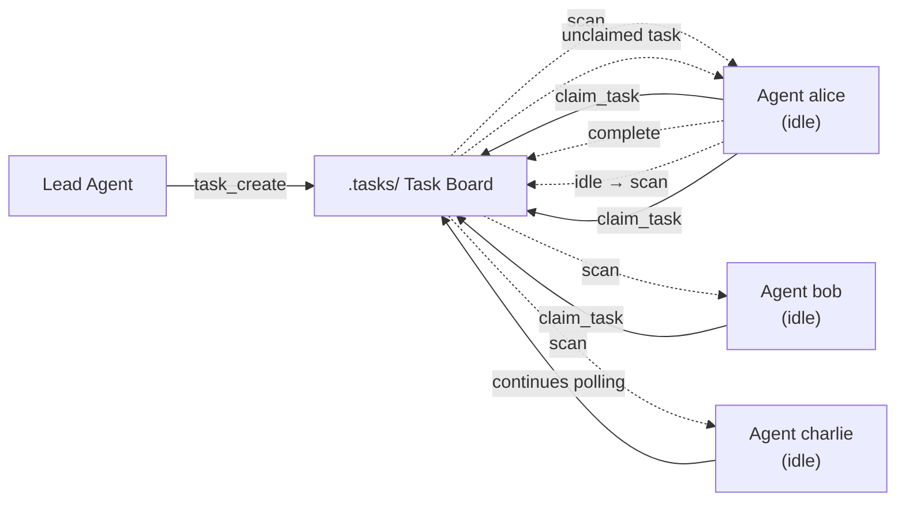
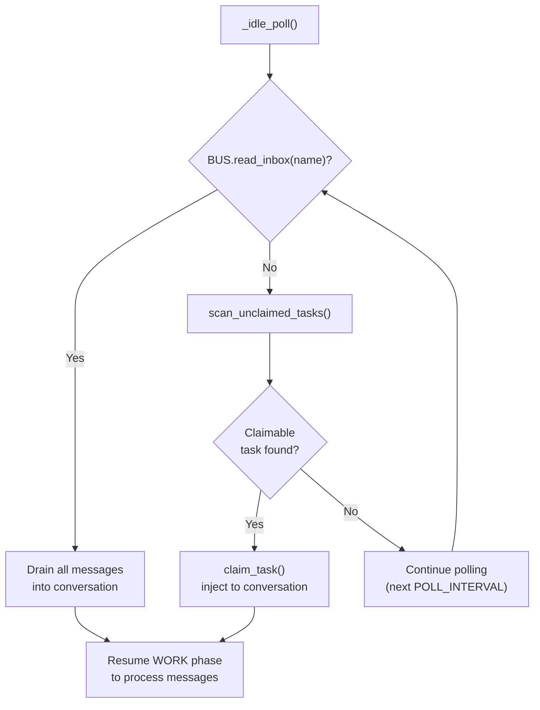

<!-- source: DeepWiki mcp.deepwiki.com · repo shareAI-lab/learn-claude-code · page 7.3 Autonomous Task Claiming · fetched 2026-10-29 -->

# Autonomous Task Claiming

<details>
<summary>Relevant source files</summary>

The following files were used as context for generating this wiki page:

- [agents/s11_autonomous_agents.py](agents/s11_autonomous_agents.py)
- [docs/en/s01-the-agent-loop.md](docs/en/s01-the-agent-loop.md)
- [docs/en/s03-todo-write.md](docs/en/s03-todo-write.md)
- [docs/en/s04-subagent.md](docs/en/s04-subagent.md)
- [docs/en/s10-team-protocols.md](docs/en/s10-team-protocols.md)
- [docs/en/s11-autonomous-agents.md](docs/en/s11-autonomous-agents.md)

</details>


This document describes the autonomous task claiming mechanism introduced in session s11, which enables teammates to proactively scan the task board and claim unassigned work without explicit delegation. This transforms passive agents that wait for instructions into self-organizing teams that pull work from a shared backlog.

For information about the broader team coordination system, see [s15: Agent Teams](). For details on the task board structure and dependency management, see [s12: Task System](). For the evolution from subagents to persistent teams, see [7.1 Evolution: Subagents to Teams]().

## Purpose and Scope

Autonomous task claiming addresses a fundamental limitation in the team system: teammates typically only work when explicitly assigned tasks through `spawn_teammate` prompts or when receiving messages. Once they complete their assigned work, they sit idle until manually given new instructions. This creates a coordination bottleneck where the lead agent must constantly monitor and redistribute work [docs/en/s11-autonomous-agents.md:9-16]().

Session s11 introduces the **idle cycle pattern**: after completing assigned work, teammates enter an idle state where they periodically poll for two events:

1. **Inbox messages** from other team members [agents/s11_autonomous_agents.py:277-278]()
2. **Unclaimed tasks** on the shared task board [agents/s11_autonomous_agents.py:285-286]()

If an unclaimed task exists (status `pending`, no owner, not blocked), the agent autonomously claims it and resumes work. This enables teams to self-organize around a shared backlog without central coordination [agents/s11_autonomous_agents.py:35-36]().

**Sources:** [agents/s11_autonomous_agents.py:9-36](), [agents/s11_autonomous_agents.py:216-311](), [docs/en/s11-autonomous-agents.md:9-16]()

## Work-Idle-Scan-Claim Cycle

The autonomous agent lifecycle alternates between two phases: **work** and **idle**. The work phase executes up to 50 LLM turns, while the idle phase polls for new work opportunities.



**Key Transition Points:**

| Transition | File Reference | Description |
|------------|----------------|-------------|
| Work → Idle | [agents/s11_autonomous_agents.py:253-270]() | Agent calls `idle` tool or loop finishes, status set to `"idle"` |
| Idle → Poll | [agents/s11_autonomous_agents.py:274-275]() | Loop for `IDLE_TIMEOUT // POLL_INTERVAL` iterations |
| Poll → Scan | [agents/s11_autonomous_agents.py:285-289]() | Call `scan_unclaimed_tasks()` to check `.tasks/` |
| Scan → Claim | [agents/s11_autonomous_agents.py:291]() | Call `claim_task(task['id'], name)` |
| Claim → Resume | [agents/s11_autonomous_agents.py:297-300]() | Inject task details into messages array |

**Sources:** [agents/s11_autonomous_agents.py:216-311](), [docs/en/s11-autonomous-agents.md:19-46]()

## The `idle` Tool

Teammates signal work completion by calling the `idle` tool, which has no parameters. This tool is only available to teammates, not the lead agent.

**Tool Schema:**

```json
{
  "name": "idle",
  "description": "Signal you are done and wait for messages or tasks.",
  "input_schema": {
    "type": "object",
    "properties": {}
  }
}
```

**Handler Implementations:**

- **Teammate:** [agents/s11_autonomous_agents.py:253-255]() - Sets `idle_requested = True` flag.
- **Lead:** [agents/s11_autonomous_agents.py:379]() - Returns error "Lead does not idle."

The `idle_requested` flag breaks out of the 50-turn work loop at [agents/s11_autonomous_agents.py:269-270](), triggering the transition to idle phase at [agents/s11_autonomous_agents.py:272]().

**Sources:** [agents/s11_autonomous_agents.py:253-270](), [agents/s11_autonomous_agents.py:379](), [agents/s11_autonomous_agents.py:426-433]()

## Task Board Scanning Logic

During the idle phase, agents scan the `.tasks/` directory for claimable tasks. The scanning logic applies three filters to determine eligibility:



**Scanning Implementation:** [agents/s11_autonomous_agents.py:127-136]()

```python
def scan_unclaimed_tasks() -> list:
    TASKS_DIR.mkdir(exist_ok=True)
    unclaimed = []
    for f in sorted(TASKS_DIR.glob("task_*.json")):
        task = json.loads(f.read_text(encoding="utf-8"))
        if (task.get("status") == "pending"
                and not task.get("owner")
                and not task.get("blockedBy")):
            unclaimed.append(task)
    return unclaimed
```

**Claim Operation:** [agents/s11_autonomous_agents.py:139-161]()

```python
def claim_task(task_id: int, owner: str) -> str:
    with _claim_lock:
        path = TASKS_DIR / f"task_{task_id}.json"
        if not path.exists():
            return f"Error: Task {task_id} not found"
        task = json.loads(path.read_text(encoding="utf-8"))
        if existing_owner := task.get("owner"):
            return f"Error: Task {task_id} has already been claimed by {existing_owner}"
        if (status := task.get("status")) != "pending":
            return f"Error: Task {task_id} cannot be claimed because its status is '{status}'"
        if task.get("blockedBy"):
            return f"Error: Task {task_id} is blocked by other task(s) and cannot be claimed yet"
        task["owner"] = owner
        task["status"] = "in_progress"
        path.write_text(json.dumps(task, indent=2), encoding="utf-8")
    return f"Claimed task #{task_id} for {owner}"
```

**Sources:** [agents/s11_autonomous_agents.py:127-161](), [docs/en/s11-autonomous-agents.md:98-107]()

## Identity Re-injection for Compressed Contexts

When agents operate for extended periods, context compression may remove their initial identity information. To prevent confusion after claiming a task from the idle state, the system re-injects identity context if the message history is short [agents/s11_autonomous_agents.py:293-296]().

**Re-injection Logic:** [agents/s11_autonomous_agents.py:293-296]()

```python
if len(messages) <= 3:
    messages.insert(0, make_identity_block(name, role, team_name))
    messages.insert(1, {"role": "assistant", "content": f"I am {name}. Continuing."})
```

**Identity Block:** [agents/s11_autonomous_agents.py:160-164]()

```python
def make_identity_block(name: str, role: str, team_name: str) -> dict:
    return {
        "role": "user",
        "content": f"<identity>You are '{name}', role: {role}, team: {team_name}. Continue your work.</identity>",
    }
```

**Task Injection:** [agents/s11_autonomous_agents.py:297-300]()

```python
messages.append({"role": "user", "content":
    f"<auto-claimed>Task #{task['id']}: {task['subject']}</auto-claimed>"})
messages.append({"role": "assistant", "content": f"Claimed task #{task['id']}. Working on it."})
```

**Sources:** [agents/s11_autonomous_agents.py:160-164](), [agents/s11_autonomous_agents.py:293-300](), [docs/en/s11-autonomous-agents.md:109-118]()

## Polling Configuration

The idle cycle is governed by two constants that control polling behavior:

| Constant | Default | Location | Purpose |
|----------|---------|----------|---------|
| `POLL_INTERVAL` | 5 seconds | [agents/s11_autonomous_agents.py:66]() | Sleep duration between inbox/task checks |
| `IDLE_TIMEOUT` | 60 seconds | [agents/s11_autonomous_agents.py:67]() | Maximum idle time before shutdown |

**Polling Loop:** [agents/s11_autonomous_agents.py:274-275]()

```python
for _ in range(IDLE_TIMEOUT // POLL_INTERVAL):
    time.sleep(POLL_INTERVAL)
    # Check inbox...
    # Scan tasks...
```

With defaults, this yields `60 // 5 = 12` poll iterations before timeout. If no work is found after 12 polls, the agent shuts down at [agents/s11_autonomous_agents.py:309-311]().

**Sources:** [agents/s11_autonomous_agents.py:66-67](), [agents/s11_autonomous_agents.py:274-311]()

## Self-Organization Patterns

Autonomous claiming enables several self-organization patterns that emerge from the shared task board architecture:



**Pattern Characteristics:**

1. **Pull-Based Coordination:** Agents pull work when ready, rather than receiving pushed assignments.
2. **First-Come-First-Served:** Tasks are sorted by filename (`sorted(TASKS_DIR.glob("task_*.json"))`), and the first agent to scan claims the first unclaimed task [agents/s11_autonomous_agents.py:130]().
3. **Concurrency Safety:** The `_claim_lock` threading lock prevents two agents from claiming the same task simultaneously [agents/s11_autonomous_agents.py:83](), [agents/s11_autonomous_agents.py:140]().
4. **Work Continuity:** Agents who complete work quickly claim the next task without lead intervention.

**Sources:** [agents/s11_autonomous_agents.py:83](), [agents/s11_autonomous_agents.py:127-161](), [agents/s11_autonomous_agents.py:285-291]()

## Message Priority vs Task Claiming

The idle loop checks inbox messages **before** scanning for tasks at [agents/s11_autonomous_agents.py:277-284](). This creates a priority hierarchy:



**Inbox Check:** [agents/s11_autonomous_agents.py:277-284]()

```python
inbox = BUS.read_inbox(name)
if inbox:
    for msg in inbox:
        if msg.get("type") == "shutdown_request":
            return False # Triggers shutdown
        messages.append({"role": "user", "content": json.dumps(msg)})
    return True # Triggers resume WORK
```

This ensures that explicit messages (e.g., shutdown requests, direct assignments, coordination) take precedence over opportunistic task claiming.

**Sources:** [agents/s11_autonomous_agents.py:274-302]()

## Integration with Team System

Autonomous claiming integrates with three other systems:

### 1. `TeammateManager` Status Tracking

The `TeammateManager` maintains a `config.json` file at `.team/config.json` with status for each teammate [agents/s11_autonomous_agents.py:172-179]().

**Status Transitions:**

- `_set_status(name, "idle")` at [agents/s11_autonomous_agents.py:272]() when entering idle phase.
- `_set_status(name, "working")` at [agents/s11_autonomous_agents.py:307]() when resuming work.
- `_set_status(name, "shutdown")` at [agents/s11_autonomous_agents.py:310]() on timeout.

**Sources:** [agents/s11_autonomous_agents.py:172-195](), [agents/s11_autonomous_agents.py:272](), [agents/s11_autonomous_agents.py:307-310]()

### 2. Task Dependency Graph

The auto-claim logic respects task dependencies by checking `task.get("blockedBy")` at [agents/s11_autonomous_agents.py:134]() and [agents/s11_autonomous_agents.py:151-152](). Tasks with dependencies are not claimable until the blocking tasks are removed or marked complete.

**Sources:** [agents/s11_autonomous_agents.py:134](), [agents/s11_autonomous_agents.py:151-152]()

### 3. `MessageBus` Shutdown Protocol

The idle loop respects shutdown requests by checking `msg.get("type") == "shutdown_request"` at [agents/s11_autonomous_agents.py:279-280](). Shutdown requests cause `_idle_poll` to return `False`, terminating the agent thread.

**Sources:** [agents/s11_autonomous_agents.py:279-280](), [agents/s11_autonomous_agents.py:308-311]()

## Comparison: s10 vs s11 Teammate Loops

The key difference between s10 and s11 is the addition of the autonomous idle phase:

| Feature | s10 (Protocols) | s11 (Autonomous) |
|---------|-----------------|------------------|
| Work loop | 50 iterations, then exit | 50 iterations, then idle phase |
| Post-work behavior | Status → `"idle"`, thread exits | Status → `"idle"`, enter `_idle_poll()` |
| Task discovery | None (manual assignment) | `scan_unclaimed_tasks()` every 5s |
| Auto-claiming | Not implemented | Implemented at [agents/s11_autonomous_agents.py:139]() |
| Idle timeout | N/A | `IDLE_TIMEOUT` (60s) before shutdown |
| Identity re-injection | Not implemented | `make_identity_block()` for short contexts |

**s11 Teammate Loop:** [agents/s11_autonomous_agents.py:216-311]() - Work phase + idle phase with polling.

**Sources:** [agents/s11_autonomous_agents.py:216-311](), [docs/en/s11-autonomous-agents.md:122-130]()

---

