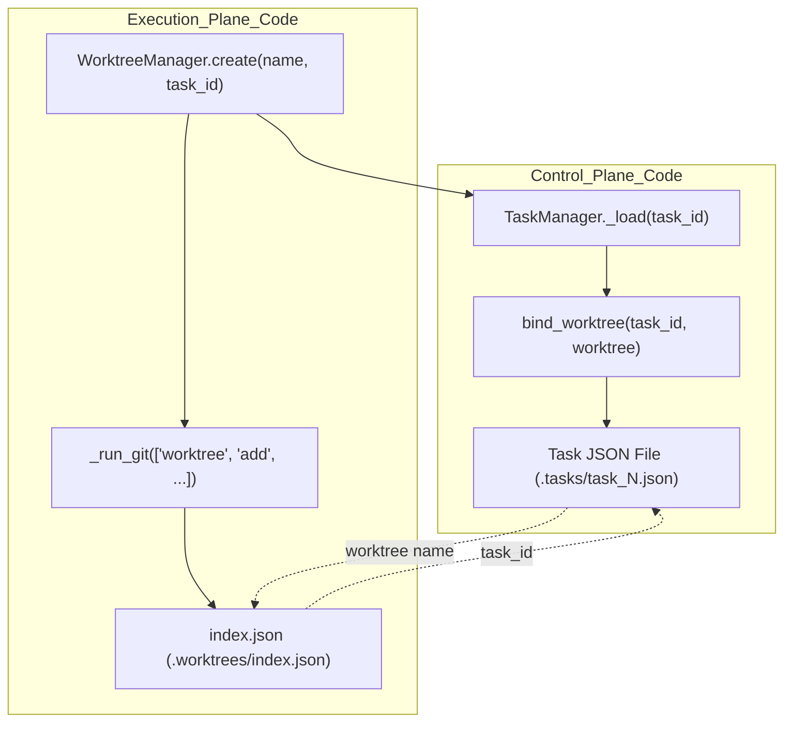
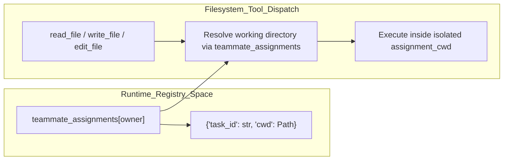

<!-- source: DeepWiki mcp.deepwiki.com · repo shareAI-lab/learn-claude-code · page 7.4 Task Isolation with Worktrees · fetched 2026-10-29 -->

# Task Isolation with Worktrees

Relevant source files

The following files were used as context for generating this wiki page:

- [agents/s12_worktree_task_isolation.py](agents/s12_worktree_task_isolation.py)
- [docs/zh/s01-the-agent-loop.md](docs/zh/s01-the-agent-loop.md)
- [docs/zh/s04-subagent.md](docs/zh/s04-subagent.md)
- [docs/zh/s12-worktree-task-isolation.md](docs/zh/s12-worktree-task-isolation.md)
- [s15_integrated_harness/code.py](s15_integrated_harness/code.py)
- [tests/test_agent_teams_runtime.py](tests/test_agent_teams_runtime.py)
- [tests/test_goal_loop.py](tests/test_goal_loop.py)
- [tests/test_web_scenarios.py](tests/test_web_scenarios.py)
- [tests/test_workflow_goal_lessons.py](tests/test_workflow_goal_lessons.py)
- [web/src/components/visualizations/index.tsx](web/src/components/visualizations/index.tsx)
- [web/src/data/execution-flows.ts](web/src/data/execution-flows.ts)

## Purpose and Scope

This page covers task isolation using Git worktrees and directory-level redirection in the `learn-claude-code` codebase. It details how tasks act as the control plane while worktrees serve as the execution plane, how `assignment_cwd` redirection routes file operations to isolated teammate directories, and how collision prevention and cleanup mechanisms operate [agents/s12_worktree_task_isolation.py:1-31](), [s15_integrated_harness/code.py:140-174]().

Sources: [agents/s12_worktree_task_isolation.py:1-31](), [s15_integrated_harness/code.py:1-19]()

---

## The Problem: Shared Directory Conflicts & Parallel Lanes

Up through early lessons, all agents operate inside a single working directory (`WORKDIR`). When multiple agents or teammates run concurrently and edit the same files, their changes mix, causing uncommitted cross-pollution and preventing clean rollbacks [docs/en/s12-worktree-task-isolation.md:9-11](). 

The task board (`.tasks/`) tracks *what* work needs to be done, but lacks an execution environment constraint [docs/en/s12-worktree-task-isolation.md:13-13](). Task isolation solves this by assigning each task its own Git worktree—a separate checkout tied to a dedicated branch [docs/en/s12-worktree-task-isolation.md:11-13]().

As expressed in the module design principle: **"Isolate by directory, coordinate by task ID."** [agents/s12_worktree_task_isolation.py:30-30]()

Sources: [agents/s12_worktree_task_isolation.py:1-31](), [docs/en/s12-worktree-task-isolation.md:9-13]()

---

## Git Worktree Binding to Tasks

The control plane (`TaskManager`) and execution plane (`WorktreeManager`) are linked via two-way references: task files store a `worktree` attribute, while worktree registry entries store a `task_id` [agents/s12_worktree_task_isolation.py:189-198](), [agents/s12_worktree_task_isolation.py:231-232]().

Sources: [agents/s12_worktree_task_isolation.py:122-217](), [agents/s12_worktree_task_isolation.py:283-335]()

---

## `assignment_cwd` Redirection

In advanced multi-agent runtime environments (such as integrated teams and the capstone harness), agents and teammates are allocated specific tasks and isolated directories via `teammate_assignments` [s15_integrated_harness/code.py:148-150]().

Every filesystem tool resolves its current working directory dynamically through this assignment registry using `task_store_lock` serialization [s15_integrated_harness/code.py:154-174]().

Sources: [s15_integrated_harness/code.py:140-174]()

---

## Collision Prevention and Cleanup

To prevent destructive collisions and ensure clean teardowns, the harness enforces strict name validations, dangerous command blocklists, and atomic lifecycle transitions [agents/s12_worktree_task_isolation.py:277-281](), [agents/s12_worktree_task_isolation.py:368-470]().

- **Name Validation:** `_validate_name()` enforces regex constraints (`^[A-Za-z0-9._-]{1,40}$`) before invoking any Git subprocess [agents/s12_worktree_task_isolation.py:277-281]().
- **Event Logging:** `EventBus` records append-only lifecycle events into `.worktrees/events.jsonl` (e.g., `worktree.create.before`, `worktree.create.after`, `worktree.remove.after`) [agents/s12_worktree_task_isolation.py:89-112]().
- **Teardown & Keep Actions:** `WorktreeManager.remove()` supports `complete_task=True`, which automatically updates the task status to completed and unbinds the worktree in a single atomic step [agents/s12_worktree_task_isolation.py:393-470](). Alternatively, `WorktreeManager.keep()` preserves the directory state for later inspection [agents/s12_worktree_task_isolation.py:460-470]().

Sources: [agents/s12_worktree_task_isolation.py:277-470](), [docs/en/s12-worktree-task-isolation.md:77-96]()

---

