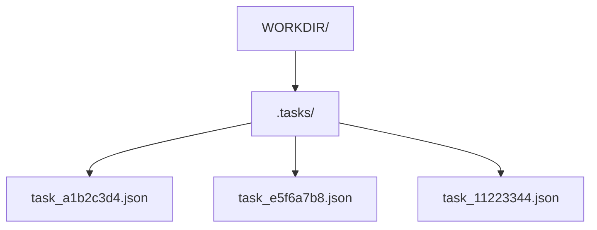
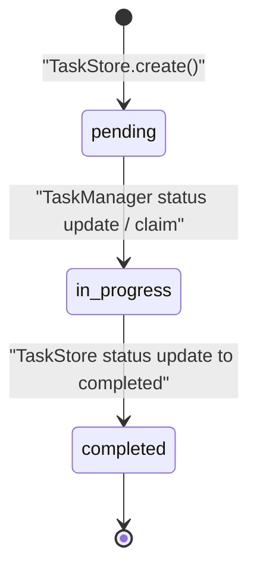
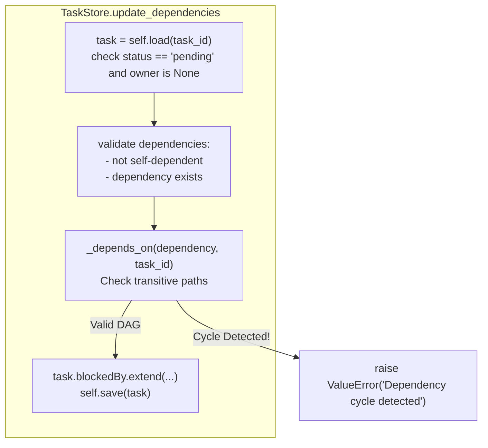
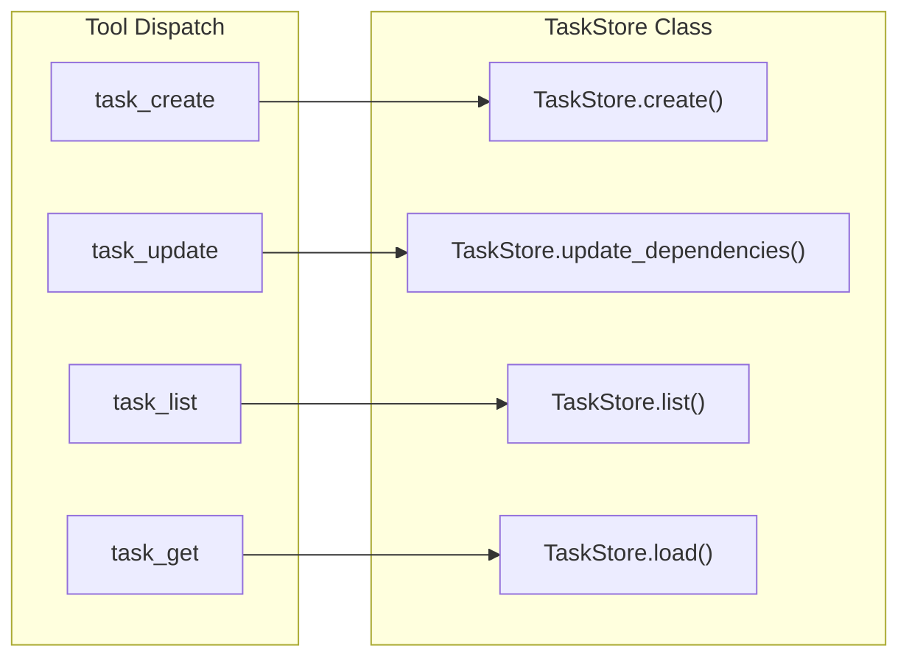

<!-- source: DeepWiki mcp.deepwiki.com · repo shareAI-lab/learn-claude-code · page 7.5 Shared Task Board Architecture · fetched 2026-10-29 -->

# Shared Task Board Architecture

Relevant source files

The following files were used as context for generating this wiki page:

- [docs/en/s02-tool-use.md](docs/en/s02-tool-use.md)
- [docs/en/s05-skill-loading.md](docs/en/s05-skill-loading.md)
- [docs/en/s07-task-system.md](docs/en/s07-task-system.md)
- [docs/ja/s05-skill-loading.md](docs/ja/s05-skill-loading.md)
- [docs/ja/s07-task-system.md](docs/ja/s07-task-system.md)
- [docs/zh/s05-skill-loading.md](docs/zh/s05-skill-loading.md)
- [docs/zh/s07-task-system.md](docs/zh/s07-task-system.md)
- [docs/zh/s11-autonomous-agents.md](docs/zh/s11-autonomous-agents.md)
- [s10_task_system/code.py](s10_task_system/code.py)

This page documents the shared task board architecture: the `.tasks/` filesystem-based coordination plane, the `TaskStore` class that manages it, dependency graph structures with `blockedBy` relationships, status state machine transitions, cycle detection semantics, and multi-agent coordination patterns.

---

## Overview

The shared task board is a flat directory of JSON files at `.tasks/` that serves as the coordination plane for multi-agent systems. Each `task_<8_hex>.json` file represents one persistent task, independent of any agent's conversation context. This filesystem-based architecture provides:

1. **Persistence across context compression** — tasks survive compression because they live on disk, not in `messages[]` [s10_task_system/code.py:5-9]()
2. **Multi-agent coordination** — multiple agents access the same `.tasks/` directory [s10_task_system/code.py:64]()
3. **Dependency ordering & cycle detection** — `blockedBy` fields create a directed acyclic graph (DAG) enabling topological task execution and cycle prevention [s10_task_system/code.py:10-17](), [s10_task_system/code.py:127-164]()
4. **Atomic allocation & uniqueness** — cryptographic hex tokens prevent race conditions during concurrent task creation [s10_task_system/code.py:108-125]()

Sources: [s10_task_system/code.py:1-22](), [docs/en/s07-task-system.md:1-22]()

---

## Storage Layout & Task Schema

**Diagram: On-Disk Layout of the Task Board**

Sources: [s10_task_system/code.py:5-9](), [s10_task_system/code.py:64-65]()

Each task file is named using the pattern `task_[0-9a-f]{8}.json` [s10_task_system/code.py:65](). The `TaskStore` class validates paths to ensure they never escape the workspace [s10_task_system/code.py:78-97]().

### Task Schema

| Field | Type | Description |
| :--- | :--- | :--- |
| `id` | `str` | Unique runtime-generated identifier matching `^task_[0-9a-f]{8}$` [s10_task_system/code.py:65](), [s10_task_system/code.py:69]() |
| `subject` | `str` | Non-empty short title summarizing the task [s10_task_system/code.py:71](), [s10_task_system/code.py:103]() |
| `description` | `str` | Optional detailed description of the task requirements [s10_task_system/code.py:72]() |
| `status` | `str` | State machine value: `"pending"`, `"in_progress"`, or `"completed"` [s10_task_system/code.py:73](), [s10_task_system/code.py:184]() |
| `owner` | `str | None` | Identifier of the agent claiming the task, or `None` [s10_task_system/code.py:74]() |
| `blockedBy` | `list[str]` | List of prerequisite task IDs that must complete first [s10_task_system/code.py:75]() |

Sources: [s10_task_system/code.py:68-76](), [docs/en/s07-task-system.md:17-21]()

---

## Task Status State Machine

**Diagram: Task Status Transitions**

Sources: [s10_task_system/code.py:21](), [s10_task_system/code.py:184]()

The `TaskStore.load()` method strictly validates task status upon reading from disk, raising a `ValueError` if an unknown status is encountered [s10_task_system/code.py:184-185]().

---

## Dependency Graph, Cycle Detection, and Topological Ordering

Tasks form a directed acyclic graph (DAG) via `blockedBy` fields. `TaskStore` protects the integrity of this graph by inspecting transitive dependencies during updates [s10_task_system/code.py:127-164]().

**Diagram: Dependency Validation and Cycle Detection in `TaskStore`**

Sources: [s10_task_system/code.py:127-171]()

### Transitive Cycle Detection (`_depends_on`)

Before appending new items to `blockedBy`, `TaskStore.update_dependencies()` calls `_depends_on(dependency, task_id)` to traverse existing edges and ensure adding the dependency does not create a circular reference [s10_task_system/code.py:127-164]().

Sources: [s10_task_system/code.py:127-164](), [docs/en/s07-task-system.md:30-45]()

---

## Filesystem-Mediated Multi-Agent Coordination

Because all task state resides in `.tasks/` on the filesystem, multiple separate agent processes or threads can coordinate without a centralized database server.

**Diagram: Tool Dispatch to `TaskStore` Methods**

Sources: [s10_task_system/code.py:179-204](), [docs/en/s07-task-system.md:99-106]()

### Task Management API Functions

| Function | Underlying Method | Purpose |
| :--- | :--- | :--- |
| `create_task(subject, description)` | `TaskStore.create()` | Allocates a new JSON task record with a unique hex ID [s10_task_system/code.py:102](), [s10_task_system/code.py:199]() |
| `update_task(task_id, addBlockedBy)` | `TaskStore.update_dependencies()` | Validates and adds prerequisites to a pending task [s10_task_system/code.py:141](), [s10_task_system/code.py:203]() |

Sources: [s10_task_system/code.py:199-204](), [docs/en/s07-task-system.md:54-106]()

---

## Persistence and Context Resilience

The task board acts as the external long-term memory for agents. When compaction routines run in response to token budget constraints, conversation transcripts may be summarized or truncated, but the task graph on disk remains fully intact [docs/en/s07-task-system.md:13](), [docs/en/s07-task-system.md:119](). Agents recover their position simply by listing or querying `.tasks/` via tool execution.

Sources: [s10_task_system/code.py:5-9](), [docs/en/s07-task-system.md:111-120]()

---

