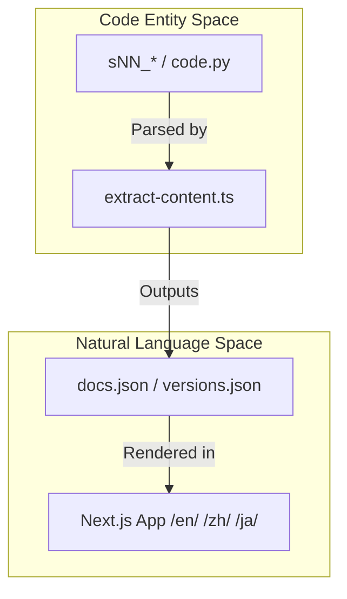
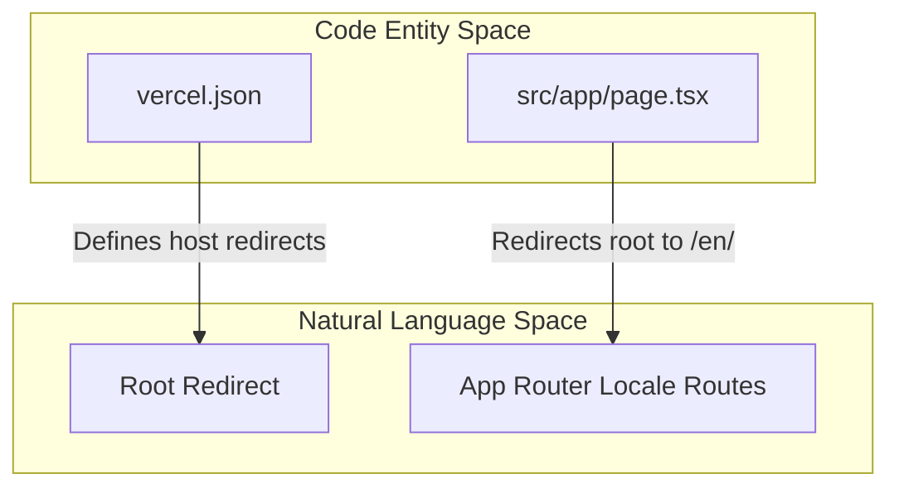

<!-- source: DeepWiki mcp.deepwiki.com · repo shareAI-lab/learn-claude-code · page 8 Web Learning Platform · fetched 2026-10-29 -->

# Web Learning Platform

Relevant source files

The following files were used as context for generating this wiki page:

- [web/src/app/page.tsx](web/src/app/page.tsx)
- [web/vercel.json](web/vercel.json)

The Web Learning Platform is an interactive Next.js application located under `web/` that provides visualizations, step-through diagrams, and course documentation for the `learn-claude-code` repository [web/vercel.json:1-20](), [web/src/app/page.tsx:1-5](). It serves as the graphical companion to the Python session scripts, helping users grasp complex agent loops, multi-agent coordination, and harness architectures.

Sources: [web/vercel.json:1-20](), [web/src/app/page.tsx:1-5]()

---

## 8.1 Content Generation Pipeline

The content generation pipeline is responsible for turning raw lesson files (`code.py`, `README.md` across various locales) into structured JSON assets (`docs.json` and `versions.json`) consumed by the web platform [web/vercel.json:1-20](), [web/src/app/page.tsx:1-5](). This decoupled approach ensures that runtime rendering is fast and relies on pre-compiled artifacts rather than disk-scanning markdown or python files on every request.

For details, see [Content Generation Pipeline](#8.1).

Sources: [web/vercel.json:1-20](), [web/src/app/page.tsx:1-5]()

---

## 8.2 Visualizations and Execution Flows

The web platform features specialized interactive components and architectural diagrams driven by `EXECUTION_FLOWS` metadata [web/vercel.json:1-20](), [web/src/app/page.tsx:1-5](). These components illustrate step-by-step message flows, tool dispatch execution, and state transitions across lessons.

For details, see [Visualizations and Execution Flows](#8.2).

Sources: [web/vercel.json:1-20](), [web/src/app/page.tsx:1-5]()

---

## 8.3 Site Layout, i18n and Deployment

The site is built using Next.js App Router conventions, supporting localized paths (`en`, `zh`, `ja`), shared navigation layouts, and production configurations handled via `vercel.json` [web/vercel.json:1-20](), [web/src/app/page.tsx:1-5](). Root requests are redirected seamlessly to language-specific entry points [web/src/app/page.tsx:1-5]().

Sources: [web/vercel.json:1-20](), [web/src/app/page.tsx:1-5]()

For details, see [Site Layout, i18n and Deployment](#8.3).

Sources: [web/vercel.json:1-20](), [web/src/app/page.tsx:1-5]()

---

