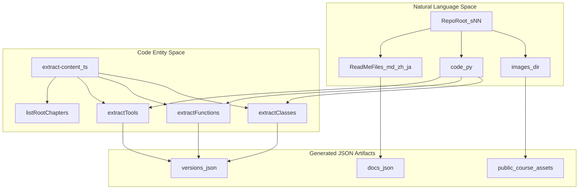
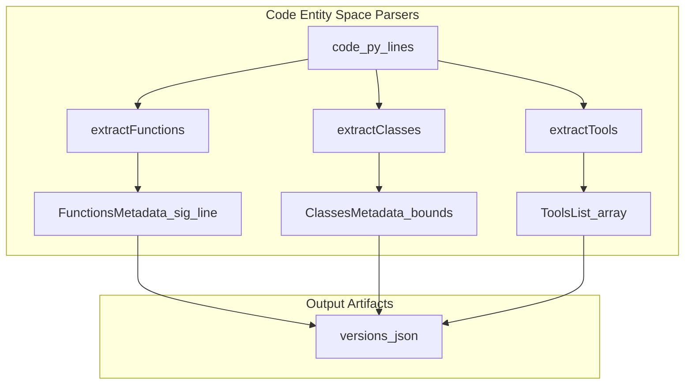

<!-- source: DeepWiki mcp.deepwiki.com · repo shareAI-lab/learn-claude-code · page 8.1 Content Generation Pipeline · fetched 2026-10-29 -->

# Content Generation Pipeline

Relevant source files

The following files were used as context for generating this wiki page:

- [web/scripts/extract-content.ts](web/scripts/extract-content.ts)
- [web/src/data/generated/docs.json](web/src/data/generated/docs.json)
- [web/src/data/generated/versions.json](web/src/data/generated/versions.json)

## Purpose and Scope

The content generation pipeline is responsible for transforming raw pedagogical source material—consisting of lesson directories `sNN_*/` containing Python source code (`code.py`), multilingual markdown documentation (`README.md`, `README.zh.md`, `README.ja.md`), and accompanying asset diagrams (`images/`)—into structured, pre-bundled JSON datasets (`docs.json` and `versions.json`) consumed by the Next.js interactive web learning platform (`web/`) [web/scripts/extract-content.ts:1-58](). This script, executed at build time, eliminates runtime file-system overhead on the client and structures metadata for course navigation, tool tracking, and code inspection.

Sources: `web/scripts/extract-content.ts:1-58]()`

## Pipeline Architecture and Data Flow

The extraction script `web/scripts/extract-content.ts` acts as an offline build tool. It reads the repository root for directories matching the `sNN_*` pattern, extracts metadata, classes, functions, tool declarations, copies asset images to the public directory, and writes normalized JSON payloads to `web/src/data/generated/`.

Diagram Title: "Extraction Pipeline Data Flow from Repository to Generated Artifacts"

Sources: `web/scripts/extract-content.ts:1-221]()`

## Chapter Discovery and Parsing Mechanics

The pipeline discovers chapters by scanning the repository root for directories matching the regular expression `/^s\d{2}_/` [web/scripts/extract-content.ts:42-58](). For each valid directory containing a `code.py` file, it performs static analysis using regular expressions rather than full AST parsing, ensuring resilience against syntax variations or partial execution states.

### Core Parsing Functions
- `listRootChapters()`: Scans `REPO_ROOT` for `sNN_*` directories and verifies the presence of `code.py` [web/scripts/extract-content.ts:42-58]().
- `extractClasses()`: Scans source lines for class declarations matching `^class\s+(\w+)` and determines block boundaries [web/scripts/extract-content.ts:60-90]().
- `extractFunctions()`: Detects sync and async function definitions using the regex `/^(async\s+)?def\s+(\w+)\((.*?)\)/` [web/scripts/extract-content.ts:92-109]().
- `extractTools()`: Locates tool definition assignments (`TOOLS`, `BASE_TOOLS`, etc.) and extracts tool names via `"name": "([\w-]+)"` patterns, parsing bracket/brace bodies robustly with quote- and comment-aware scanners [web/scripts/extract-content.ts:111-178]().

Diagram Title: "Static Analysis Mapping in Code Entity Space"

Sources: `web/scripts/extract-content.ts:60-178]()`

## Output Generation: `docs.json` and `versions.json`

Once extraction and asset copying are complete, the pipeline compiles two principal JSON structures:

1. **`versions.json`**: Contains version metadata, line counts (LOC) computed via `countLoc()`, registered tool sets, newly introduced tools, core additions, key insights, classes, functions, full source code strings, and image references [web/src/data/generated/versions.json:1-3833]().
2. **`docs.json`**: Consolidates multilingual markdown files (`README.md`, `README.zh.md`, `README.ja.md`) associated with each lesson, extracting titles and formatting content blocks for site rendering [web/src/data/generated/docs.json:1-308]() [web/src/data/generated/versions.json:1-3833]().

### Summary of Extracted Metadata Fields

| Field Name | Type | Description |
|------------|------|-------------|
| `id` | `string` | Version identifier (e.g. `"s01"`) parsed from directory or filename [web/scripts/extract-content.ts:29-40]() |
| `filename` | `string` | Relative path to the lesson source file (`s01_agent_loop/code.py`) [web/src/data/generated/versions.json:1-38](). |
| `loc` | `number` | Source lines of code excluding comments and blank lines [web/scripts/extract-content.ts:180-185](). |
| `tools` | `string[]` | Array of tools available in the lesson [web/src/data/generated/versions.json:1-38](). |
| `functions` | `Object[]` | List of functions with name, signature, and starting line [web/scripts/extract-content.ts:92-109](). |
| `source` | `string` | Full text content of `code.py` included for in-browser inspection [web/src/data/generated/versions.json:1-38](). |

Sources: `web/scripts/extract-content.ts:29-185]()`, `web/src/data/generated/versions.json:1-3833]()`, `web/src/data/generated/docs.json:1-308]()`

---

