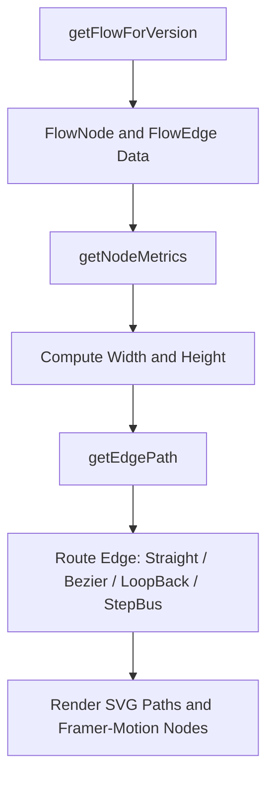
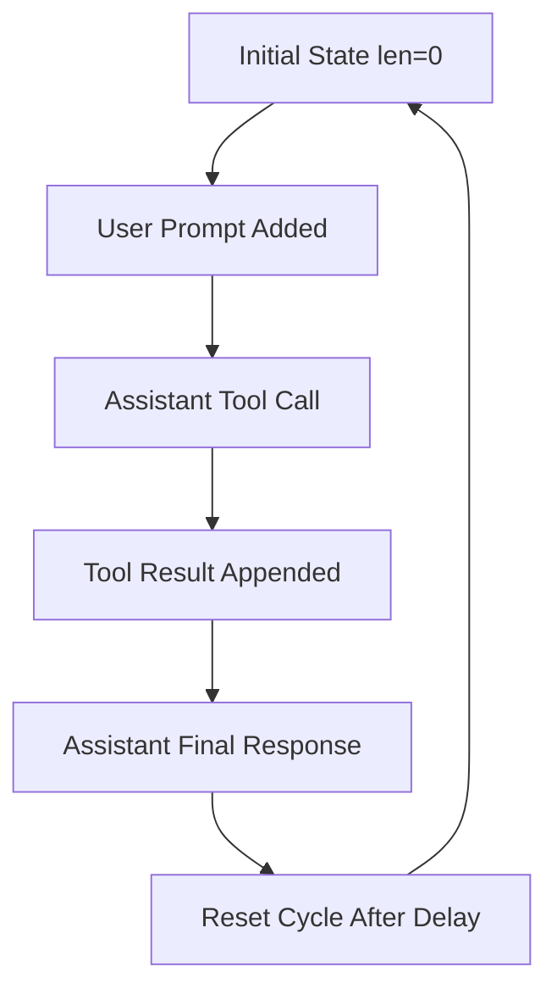
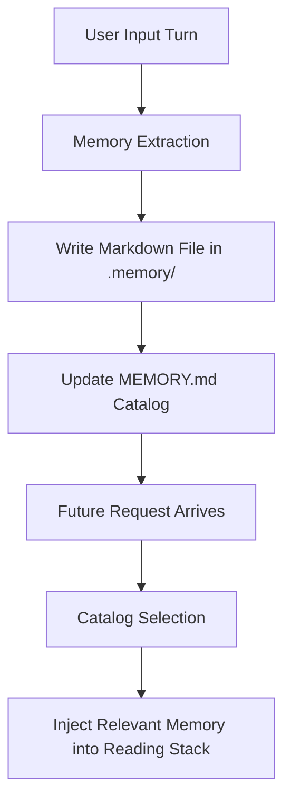
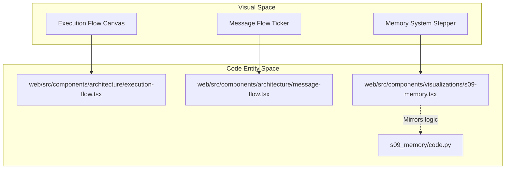
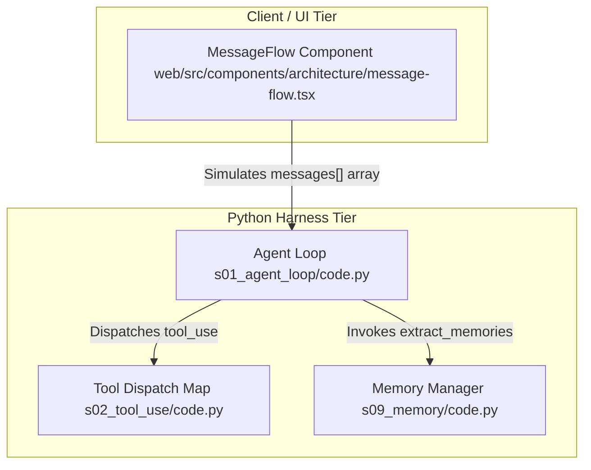

<!-- source: DeepWiki mcp.deepwiki.com · repo shareAI-lab/learn-claude-code · page 8.2 Visualizations and Execution Flows · fetched 2026-10-29 -->

# Visualizations and Execution Flows

Relevant source files

The following files were used as context for generating this wiki page:

- [web/src/components/architecture/execution-flow.tsx](web/src/components/architecture/execution-flow.tsx)
- [web/src/components/architecture/message-flow.tsx](web/src/components/architecture/message-flow.tsx)
- [web/src/components/visualizations/s09-memory.tsx](web/src/components/visualizations/s09-memory.tsx)

This page details the implementation, data flow, and architecture of the interactive visualization components within the `learn-claude-code` web platform (`web/src/`). It covers the execution flow rendering engine, message-flow timelines, per-lesson stepped visualizations (such as the s09 memory system), and how natural language concepts map to concrete codebase entities.

---

## 1. Execution Flow Engine Architecture

The execution flow engine renders interactive node-and-edge graphs for different course lessons and architectures. Located in `web/src/components/architecture/execution-flow.tsx`, it dynamically computes node bounds, handles multi-line wrapping, and routes complex paths including loopbacks and step buses.

### Core Functions and Metrics
- **`getNodeMetrics`**: Calculates dynamic node widths and heights based on text length and node type (`start`, `process`, `decision`, `subprocess`, `end`) [web/src/components/architecture/execution-flow.tsx:49-74]().
- **`getEdgePath`**: Evaluates edge relationships to produce SVG cubic bezier paths. It detects loop-back conditions (`isLoopBack`) and step routing (`shouldUseStepRoute`) to route edges cleanly around node boundaries [web/src/components/architecture/execution-flow.tsx:133-181]().
- **`getFlowForVersion`**: Fetches the structured node and edge metadata corresponding to a specific course version or lesson [web/src/components/architecture/execution-flow.tsx:5]().

### Mermaid: Execution Flow Rendering Pipeline

Sources: `web/src/components/architecture/execution-flow.tsx`

---

## 2. Message Flow Pipeline Component

The `MessageFlow` component (`web/src/components/architecture/message-flow.tsx`) models the turn-by-turn evolution of the `messages[]` array during an agent execution loop. It animates discrete message roles transitioning from the user prompt through assistant reasoning, tool invocation, and tool results.

### Data Model and State Control
- **`FLOW_STEPS`**: An ordered array defining the lifecycle of a multi-turn conversation containing alternating roles (`user`, `assistant`, `tool_call`, `tool_result`) [web/src/components/architecture/message-flow.tsx:6-15]().
- **Timer Management**: Uses a self-scheduling `useEffect` hook (`step` function) with distinct delays (800ms during progression, 1500ms when holding at completion) to advance the visible slice of `messages[]` without state drift [web/src/components/architecture/message-flow.tsx:21-36]().
- **`framer-motion` Integration**: Renders incoming message badges with layout animations, opacity fades, and scaling transitions (`initial={{ opacity: 0, scale: 0.6 }}`) [web/src/components/architecture/message-flow.tsx:50-55]().

### Mermaid: Message Flow Loop Sequence

Sources: `web/src/components/architecture/message-flow.tsx`

---

## 3. Per-Lesson Stepped Visualizations: Memory System (`s09`)

Per-lesson visualizations provide step-by-step interactive breakdowns of complex modules. The s09 memory system visualization (`web/src/components/visualizations/s09-memory.tsx`) guides users through persistent memory management.

### Key Components and State Flow
- **`MemoryFile` Interface**: Defines structured memory entries with `id`, `type` (`feedback`, `project`, `reference`), `title`, `filename`, `description`, and `body` [web/src/components/visualizations/s09-memory.tsx:11-19]().
- **`STEPS` Constant**: An 8-phase instructional progression moving from user input through memory extraction, `MEMORY.md` catalog updates, selective retrieval, and context injection [web/src/components/visualizations/s09-memory.tsx:49-82]().
- **Visual Surfaces**: Utilizes sub-components like `Surface`, `CatalogRow`, and `MemoryDetail` wrapped in `framer-motion` `AnimatePresence` for fluid transitions between memory states [web/src/components/visualizations/s09-memory.tsx:90-199]().

### Mermaid: Memory Lifecycle in `s09`

Sources: `web/src/components/visualizations/s09-memory.tsx`

---

## 4. Natural Language to Code Entity Mapping

To bridge conceptual explanations with actual implementation files, the architecture diagrams below map visualization abstractions directly to their corresponding codebase symbols and modules.

### Diagram: Execution Flow Mapping to Codebase

Sources: `web/src/components/architecture/execution-flow.tsx`, `web/src/components/architecture/message-flow.tsx`, `web/src/components/visualizations/s09-memory.tsx`

### Diagram: Tool Dispatch and Message Flow Entity Binding

Sources: `web/src/components/architecture/message-flow.tsx`, `web/src/components/architecture/execution-flow.tsx`

---

