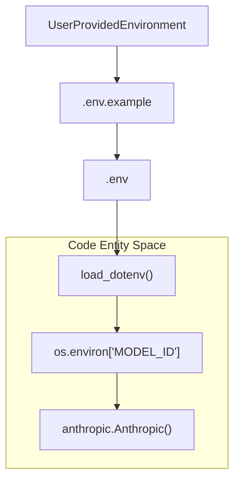
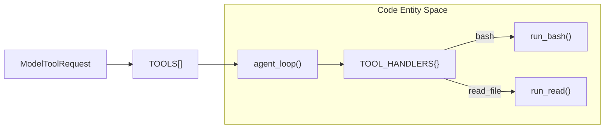

<!-- source: DeepWiki mcp.deepwiki.com · repo shareAI-lab/learn-claude-code · page 9 Reference · fetched 2026-10-29 -->

# Reference

Relevant source files

The following files were used as context for generating this wiki page:

- [README-ja.md](README-ja.md)
- [README-zh.md](README-zh.md)
- [README.md](README.md)
- [s01_agent_loop/README.ja.md](s01_agent_loop/README.ja.md)
- [s01_agent_loop/README.md](s01_agent_loop/README.md)

## Purpose and Scope

This page serves as the high-level technical reference portal for the `learn-claude-code` codebase. It outlines the core configuration boundaries, tool schema definitions, documentation conventions, and testing infrastructures that support the 17-lesson progressive course and legacy tracks. 

As a parent page, this document provides a structural summary of the repository's reference specifications. For deep technical implementations, schemas, and instructions, refer to the dedicated child pages linked below.

- For environment settings, API endpoints, and ignore rules, see [Environment Variables and Configuration](#9.1).
- For complete parameter listings of bash, file I/O, task, memory, and MCP tools, see [Tool Schemas Reference](#9.2).
- For essay structures, translation synchronization, and localization guidelines, see [Documentation Set and Translations](#9.3).
- For the `pytest` test harness and CI/CD pipelines, see [Testing Infrastructure](#9.4).

Sources: [README.md:1-12](), [s01_agent_loop/README.md:1-12]()

---

## Configuration and Environment Mapping

The harness relies on external environment configuration to establish model bindings, API tokens, and base paths. Initialization sequences read keys from the local environment to instantiate clients and secure workspaces.

**Diagram: Natural Language Space to Code Entity Space for Configuration**

Sources: [s01_agent_loop/README.md:124-131]()

---

## Tool Dispatch and Schema Architecture

The harness delegates execution through defined tool schemas and handler dispatch mappings. Each lesson extends the base capabilities—ranging from basic bash execution (`run_bash`) to specialized task graphs and Model Context Protocol (MCP) integrations.

**Diagram: Natural Language Space to Code Entity Space for Tool Dispatch**

Sources: [s01_agent_loop/README.md:43-115]()

---

## Sub-Topics and Child Pages

### 9.1 Environment Variables and Configuration

Configuration parameters govern model selection (`MODEL_ID`), API authentication (`ANTHROPIC_AUTH_TOKEN`, `ANTHROPIC_API_KEY`), and network routing (`ANTHROPIC_BASE_URL`). Repository hygiene is maintained through strict `.gitignore` patterns preventing secret leakage.

For details, see [Environment Variables and Configuration](#9.1).

Sources: [s01_agent_loop/README.md:124-131]()

### 9.2 Tool Schemas Reference

The harness exposes a growing suite of tools across lessons `s01` through `s17`. These include foundational file operations (`read_file`, `write_file`, `edit_file`, `glob`), planning constructs (`todo_write`), task engines (`task_*`), skill loaders (`load_skill`), compaction handlers (`compact`), background daemons (`background_*`), and team/MCP protocols.

For details, see [Tool Schemas Reference](#9.2).

Sources: [README.md:96-108]()

### 9.3 Documentation Set and Translations

The documentation structure includes multilingual lesson guides (`README.md`, `README.zh.md`, `README.ja.md`) and architectural essays across the curriculum. Translation workflows enforce synchronization rules and formatting standards defined in project contribution guidelines.

For details, see [Documentation Set and Translations](#9.3).

Sources: [README.md:1-2](), [s01_agent_loop/README.md:1-3]()

### 9.4 Testing Infrastructure

Automated validation is powered by `pytest` test suites located under `tests/`. These cover foundational smoke tests, compaction behaviors, agent team runtimes, goal loops, and web scenario integrations, orchestrated via GitHub Actions CI workflows.

For details, see [Testing Infrastructure](#9.4).

Sources: [s01_agent_loop/README.md:127-136]()

---

