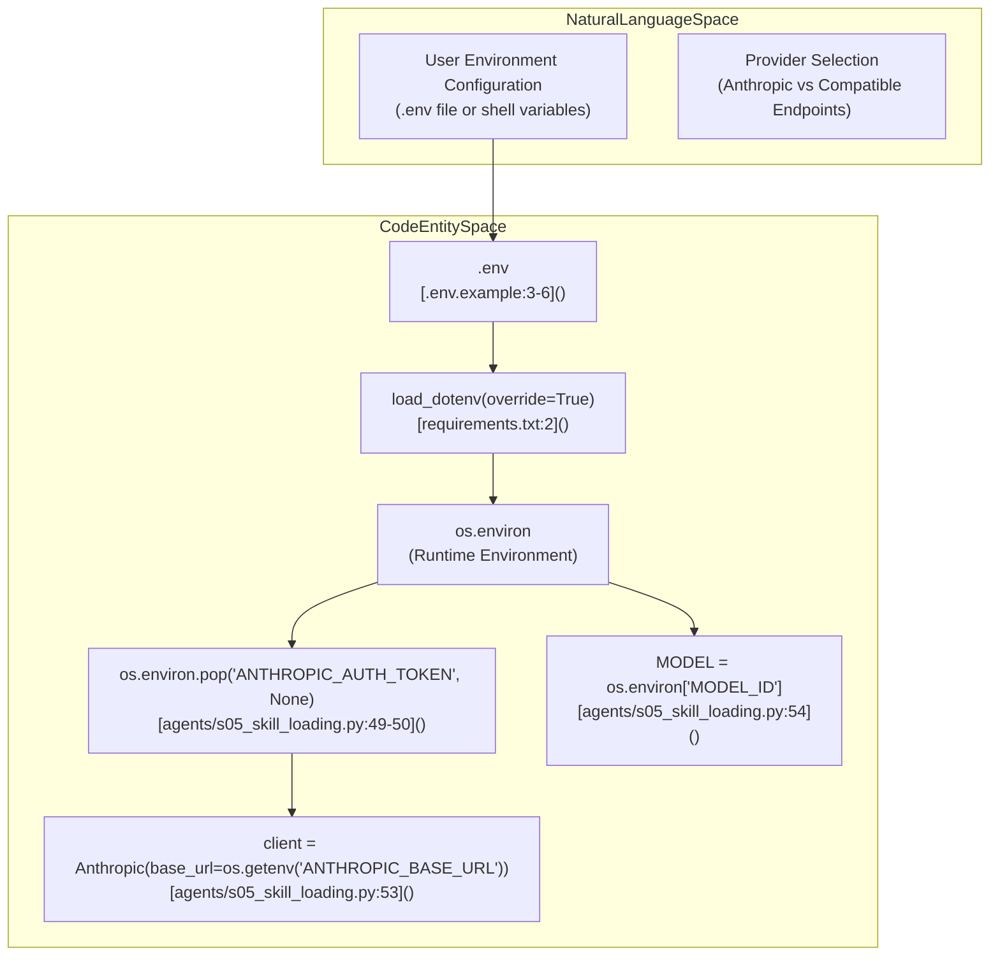
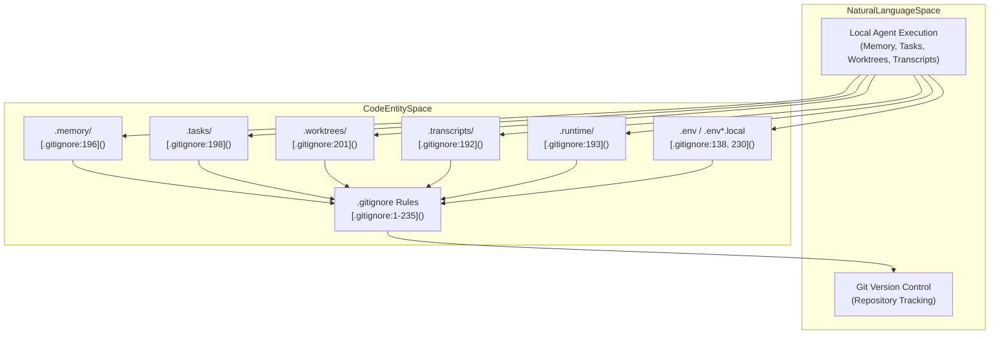

<!-- source: DeepWiki mcp.deepwiki.com · repo shareAI-lab/learn-claude-code · page 9.1 Environment Variables and Configuration · fetched 2026-10-29 -->

# Environment Variables and Configuration

Relevant source files

The following files were used as context for generating this wiki page:

- [.env.example](.env.example)
- [.gitignore](.gitignore)
- [requirements.txt](requirements.txt)

This page provides a complete reference for all environment variables used to configure the agent harness, detailing settings from [.env.example]() and artifact exclusion patterns from [.gitignore](). These configurations control API connectivity, model selection, provider compatibility, and workspace runtime isolation across all course lessons.

## Configuration Loading Architecture

The harness relies on `python-dotenv` [requirements.txt:2]() to load configuration from a local `.env` file into the process environment. This enables seamless switching between Anthropic and compatible third-party providers without modifying codebase source files [.env.example:8-30]().

### Configuration Flow and Client Initialization

**Diagram: Natural Language Space to Code Entity Space — Configuration Loading Pipeline**

Sources: [.env.example:1-30](), [requirements.txt:2](), [agents/s05_skill_loading.py:47-54]()

---

## Environment Variable Reference

### ANTHROPIC_API_KEY

| Property | Value |
|----------|-------|
| **Required** | Yes [.env.example:1-3]() |
| **Format** | String starting with `sk-ant-` [.env.example:3]() |
| **Default** | None |
| **Purpose** | Authenticates HTTP requests sent to the Anthropic API or compatible providers [.env.example:1-3]() |

The Anthropic Python client library reads `ANTHROPIC_API_KEY` automatically from `os.environ`. When using custom base URLs, this variable may serve as the bearer token or authentication header for third-party endpoints [.env.example:8-30]().

Sources: [.env.example:1-3](), [requirements.txt:1]()

---

### MODEL_ID

| Property | Value |
|----------|-------|
| **Required** | Yes [.env.example:5-6]() |
| **Format** | Provider-specific model string [.env.example:6, 17-21]() |
| **Default** | None — missing key raises a `KeyError` [.env.example:5-6]() |
| **Purpose** | Identifies the LLM passed to `client.messages.create` [.env.example:6]() |

The codebase expects `MODEL_ID` to be present in `os.environ` [.env.example:5-6](). It is typically assigned to a module-level constant (e.g., `MODEL = os.environ["MODEL_ID"]`) [agents/s05_skill_loading.py:54](). Selected models must support tool use (`tool_use` stop reason) for agent loops to execute correctly.

Sources: [.env.example:5-30](), [agents/s05_skill_loading.py:54]()

---

### ANTHROPIC_BASE_URL

| Property | Value |
|----------|-------|
| **Required** | No [.env.example:8-9]() |
| **Format** | Valid HTTPS URL [.env.example:36-75]() |
| **Default** | `https://api.anthropic.com` [.env.example:16]() |
| **Purpose** | Redirects API traffic to proxies or Anthropic-compatible endpoints [.env.example:8-30]() |

When `ANTHROPIC_BASE_URL` is set, the harness removes `ANTHROPIC_AUTH_TOKEN` from the runtime environment to prevent header conflicts [agents/s05_skill_loading.py:49-50](). Compatible providers listed in [.env.example]() include MiniMax, GLM (Zhipu), Kimi (Moonshot), and DeepSeek [.env.example:17-21]().

Sources: [.env.example:8-77](), [agents/s05_skill_loading.py:49-50]()

---

## Provider Compatibility and Settings

The [.env.example]() file provides pre-configured templates for international and China mainland endpoints [.env.example:33-77](). 

### Provider Configuration Matrix

| Provider | Region | Sample `MODEL_ID` | Sample `ANTHROPIC_BASE_URL` |
|----------|--------|-------------------|-----------------------------|
| Anthropic | Global | `claude-sonnet-4-6` [.env.example:16]() | `https://api.anthropic.com` (Default) [.env.example:9, 16]() |
| MiniMax | International / China | `MiniMax-M3` [.env.example:37, 60]() | `https://api.minimax.io/anthropic` [.env.example:36]() |
| GLM (Zhipu) | International / China | `glm-5.2` [.env.example:43, 66]() | `https://api.z.ai/api/anthropic` [.env.example:42]() |
| Kimi (Moonshot) | International / China | `kimi-k2.7-code` [.env.example:47, 70]() | `https://api.moonshot.ai/anthropic` [.env.example:46]() |
| DeepSeek | Global | `deepseek-v4-pro` [.env.example:53, 76]() | `https://api.deepseek.com/anthropic` [.env.example:52, 75]() |

Note that Anthropic-compatible providers may differ in parameters, thinking defaults, content blocks, and tool-use history requirements [.env.example:25-30]().

Sources: [.env.example:11-77]()

---

## Workspace Artifact Management and .gitignore Conventions

The harness generates numerous runtime artifacts, caches, and persistent state directories during agent execution. The [.gitignore]() file defines explicit exclusion rules to keep version control clean [.gitignore:1-235]().

### Artifact Routing and GitIgnore Mapping

**Diagram: Natural Language Space to Code Entity Space — Workspace Artifacts & .gitignore**

### Key Ignored Artifact Categories

1. **Environment & Secrets:** `.env`, `.envrc`, `.env*.local` [.gitignore:138-139, 230]() preventing accidental credential commits.
2. **Runtime Memory & State:** `.memory/`, `.tasks/`, `.task_outputs/`, `.teams/`, `.mailboxes/`, `.worktrees/`, `.scheduled_tasks.json` [.gitignore:196-202]() storing multi-agent communication, persistent memory, and task graphs.
3. **Transcripts & Logs:** `.transcripts/`, `analysis/`, `htmlcov/`, `*.log` [.gitignore:40, 59, 192, 234]() recording compression logs and test runs.
4. **Web UI Artifacts:** `web/node_modules/`, `web/.next/`, `web/out/`, `.vercel` [.gitignore:226-229]() produced by the Next.js learning platform.

Sources: [.gitignore:1-235]()

---

## Common Configuration Issues

### KeyError: MODEL_ID

- **Symptom:** Agent execution terminates immediately with a `KeyError: 'MODEL_ID'`.
- **Cause:** The `MODEL_ID` variable is missing from `.env` or the shell environment, and the harness performs a hard dictionary lookup `os.environ["MODEL_ID"]` [agents/s05_skill_loading.py:54]().
- **Solution:** Populate `MODEL_ID` in your local `.env` file following [.env.example:6]().

### Credential Conflict with Custom Base URLs

- **Symptom:** Authentication failures when setting `ANTHROPIC_BASE_URL`.
- **Cause:** Retaining `ANTHROPIC_AUTH_TOKEN` alongside a custom endpoint can cause header collision.
- **Solution:** The initialization script automatically calls `os.environ.pop('ANTHROPIC_AUTH_TOKEN', None)` when `ANTHROPIC_BASE_URL` is detected [agents/s05_skill_loading.py:49-50](). Ensure no conflicting variables are exported in your active shell.

Sources: [.env.example:8-30](), [agents/s05_skill_loading.py:47-54]()

---

