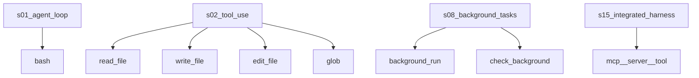
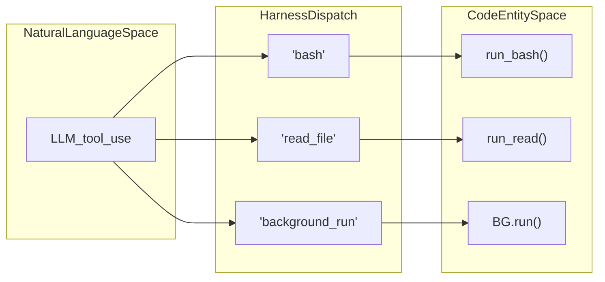

<!-- source: DeepWiki mcp.deepwiki.com · repo shareAI-lab/learn-claude-code · page 9.2 Tool Schemas Reference · fetched 2026-10-29 -->

# Tool Schemas Reference

Relevant source files

The following files were used as context for generating this wiki page:

- [agents/s08_background_tasks.py](agents/s08_background_tasks.py)
- [agents/s_full.py](agents/s_full.py)
- [s02_tool_use/code.py](s02_tool_use/code.py)
- [s15_integrated_harness/code.py](s15_integrated_harness/code.py)
- [tests/test_agent_teams_runtime.py](tests/test_agent_teams_runtime.py)
- [tests/test_goal_loop.py](tests/test_goal_loop.py)
- [tests/test_s_full_background.py](tests/test_s_full_background.py)
- [tests/test_web_scenarios.py](tests/test_web_scenarios.py)
- [tests/test_workflow_goal_lessons.py](tests/test_workflow_goal_lessons.py)
- [web/src/components/visualizations/index.tsx](web/src/components/visualizations/index.tsx)
- [web/src/data/execution-flows.ts](web/src/data/execution-flows.ts)

## Purpose and Scope

This page provides a comprehensive technical reference for the tool schemas used across the `learn-claude-code` repository. It details the JSON schemas provided to the LLM, the parameters they accept, and the underlying Python functions that implement their logic. The system follows the "The Model is the Agent" philosophy, where the harness provides tools to bridge Natural Language Space and the local execution environment.

Sources: [s15_integrated_harness/code.py:1-19](), [agents/s_full.py:1-37]()

---

## Master Reference Table

The following table summarizes the core tools across foundational and background execution lessons.

| Tool Name | Category | Handler Function / Dispatch | Key Source |
|-----------|----------|----------------------------|------------|
| `bash` | Core | `run_bash()` | [s02_tool_use/code.py:53-66](), [agents/s_full.py:86-97]() |
| `read_file` | Core | `run_read()` | [s02_tool_use/code.py:78-86](), [agents/s_full.py:98-105]() |
| `write_file` | Core | `run_write()` | [s02_tool_use/code.py:88-96](), [agents/s_full.py:106-114]() |
| `edit_file` | Core | `run_edit()` | [s02_tool_use/code.py:98-107](), [agents/s_full.py:115-126]() |
| `glob` | Core | `run_glob()` | [s02_tool_use/code.py:110-124]() |
| `background_run` | Background | `BG.run()` | [agents/s08_background_tasks.py:62-71]() |
| `check_background` | Background | `BG.check()` | [agents/s08_background_tasks.py:97-107]() |

Sources: [s02_tool_use/code.py:128-146](), [agents/s08_background_tasks.py:169-176]()

---

## Diagrams

### Progression of Tool Introduction

**Diagram: Progression of Tool Introduction**

Sources: [s02_tool_use/code.py:128-139](), [agents/s08_background_tasks.py:178-182]()

### Tool Dispatch Architecture

**Diagram: TOOL_HANDLERS Mapping**

Sources: [s02_tool_use/code.py:143-146](), [agents/s08_background_tasks.py:169-176]()

---

## Core File System Tools

These tools provide the primary interface for the agent to interact with the local filesystem, protected by workspace boundary checks (`safe_path`).

Sources: [s02_tool_use/code.py:71-75](), [agents/s_full.py:80-84]()

### `bash`
Executes shell commands in a blocking subprocess with pattern-based safety filters.
- Input Schema Property: `command` (string, required)
- Implementation: Uses `subprocess.run` with output truncation and timeouts.

Sources: [s02_tool_use/code.py:53-66](), [s02_tool_use/code.py:129-130]()

### `read_file`
Reads contents from workspace files with optional line limiting.
- Input Schema Properties: `path` (string, required), `limit` (integer, optional)

Sources: [s02_tool_use/code.py:78-86](), [s02_tool_use/code.py:131-132]()

### `write_file`
Writes full text content to a designated file path, creating parent directories as needed.
- Input Schema Properties: `path` (string, required), `content` (string, required)

Sources: [s02_tool_use/code.py:88-96](), [s02_tool_use/code.py:133-134]()

### `edit_file`
Performs surgical search-and-replace text modifications on existing files.
- Input Schema Properties: `path` (string, required), `old_text` (string, required), `new_text` (string, required)

Sources: [s02_tool_use/code.py:98-107](), [s02_tool_use/code.py:135-136]()

### `glob`
Finds files matching recursive glob patterns within the workspace.
- Input Schema Property: `pattern` (string, required)

Sources: [s02_tool_use/code.py:110-124](), [s02_tool_use/code.py:137-138]()

Sources: [s02_tool_use/code.py:53-146]()

---

## Background and Asynchronous Tools

### `background_run`
Spawns long-running shell commands in background daemon threads via `BackgroundManager`, returning a task ID immediately without blocking the agent loop.
- Input Schema Property: `command` (string, required)
- Implementation: Managed by `BackgroundManager.run()` and monitored via notification queues.

Sources: [agents/s08_background_tasks.py:62-71](), [agents/s08_background_tasks.py:174]()

### `check_background`
Inspects the status and output of a specific background task or lists all active/completed background jobs.
- Input Schema Property: `task_id` (string, optional)
- Implementation: Handled by `BackgroundManager.check()`.

Sources: [agents/s08_background_tasks.py:97-107](), [agents/s08_background_tasks.py:175]()

Sources: [agents/s08_background_tasks.py:56-116]()

---

