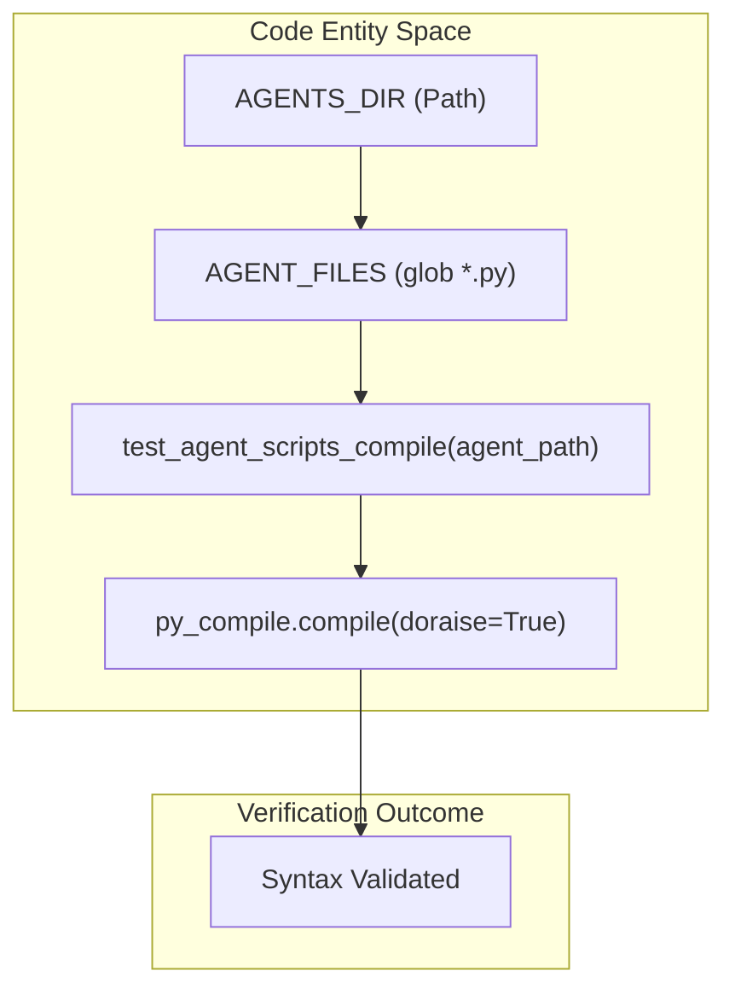
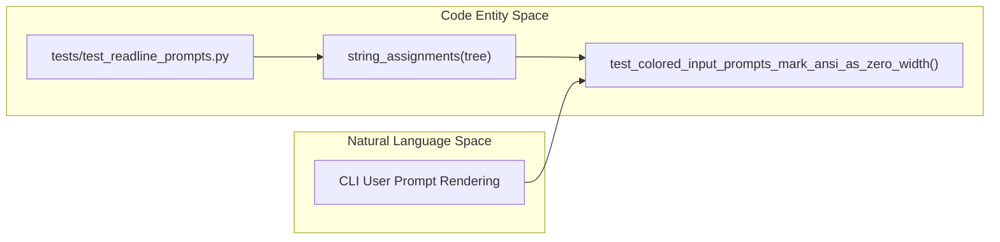
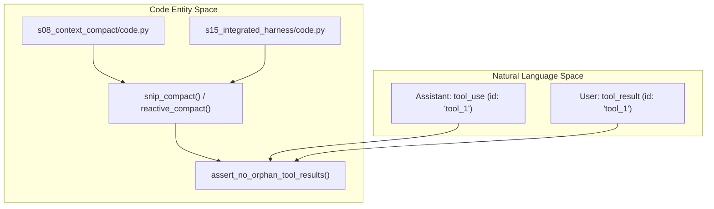
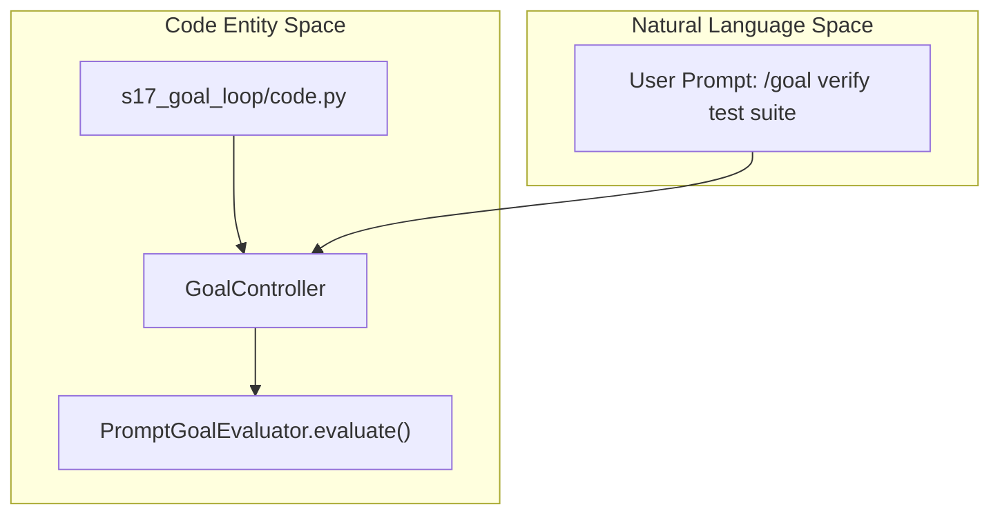

<!-- source: DeepWiki mcp.deepwiki.com · repo shareAI-lab/learn-claude-code · page 9.4 Testing Infrastructure · fetched 2026-10-29 -->

# Testing Infrastructure

<details>
<summary>Relevant source files</summary>

The following files were used as context for generating this wiki page:

- [.github/workflows/ci.yml](.github/workflows/ci.yml)
- [.github/workflows/test.yml](.github/workflows/test.yml)
- [s15_integrated_harness/code.py](s15_integrated_harness/code.py)
- [tests/test_agent_loop_boundaries.py](tests/test_agent_loop_boundaries.py)
- [tests/test_agent_teams_runtime.py](tests/test_agent_teams_runtime.py)
- [tests/test_agents_smoke.py](tests/test_agents_smoke.py)
- [tests/test_goal_loop.py](tests/test_goal_loop.py)
- [tests/test_readline_prompts.py](tests/test_readline_prompts.py)
- [tests/test_web_scenarios.py](tests/test_web_scenarios.py)
- [tests/test_workflow_goal_lessons.py](tests/test_workflow_goal_lessons.py)
- [web/src/components/visualizations/index.tsx](web/src/components/visualizations/index.tsx)
- [web/src/data/execution-flows.ts](web/src/data/execution-flows.ts)

</details>


The testing infrastructure of the `learn-claude-code` repository is designed to ensure the architectural, syntactic, and logical integrity of the progressive course lessons under `s01_*` through `s17_*`, the legacy `agents/` track, and the interactive web scenarios. Utilizing `pytest` as the primary test runner, the suite under `tests/` verifies everything from static compilation and Readline escape safety to complex multi-agent team coordination, context compaction invariants, deterministic workflow runtimes, and goal-loop evaluation [tests/test_agents_smoke.py:1-23](), [tests/test_agent_teams_runtime.py:133-149](), [tests/test_workflow_goal_lessons.py:53-64](), [tests/test_goal_loop.py:96-132](), [tests/test_web_scenarios.py:28-68]().

## Overview of Test Suites

The test suite is organized into functional modules covering different layers of the harness:

| Test File | Scope | Primary Objective |
| :--- | :--- | :--- |
| `tests/test_agents_smoke.py` | `agents/` | Verifies static syntax compilation for legacy agent scripts [tests/test_agents_smoke.py:17-20](). |
| `tests/test_readline_prompts.py` | `s*/code.py`, `agents/*.py` | Ensures ANSI escape sequences in CLI prompts use zero-width Readline markers (`\x01` and `\x02`) [tests/test_readline_prompts.py:52-84](). |
| `tests/test_agent_loop_boundaries.py` | Lesson loop implementations | Tests UTF-8 text tool input/output safety and glob wildcard matching [tests/test_agent_loop_boundaries.py:166-201](). |
| `tests/test_compaction_tool_pairs.py` | `s08`, `s09`, `s15` | Validates that compaction algorithms never orphan tool results from their tool uses [tests/test_compaction_tool_pairs.py:10-15](). |
| `tests/test_agent_teams_runtime.py` | `s13`, `s15` | Exercises task claiming, locks, teammate assignment release, and worktree integration [tests/test_agent_teams_runtime.py:134-149](). |
| `tests/test_workflow_goal_lessons.py` | `s16`, `s17` | Tests journal resumption, execution budgets, and `GoalController` evaluation flows [tests/test_workflow_goal_lessons.py:53-64](), [tests/test_goal_loop.py:96-132](). |
| `tests/test_web_scenarios.py` | `web/src/data/scenarios/` | Validates that web UI scenario steps align with actual backend runtime contracts [tests/test_web_scenarios.py:28-68](). |

Sources: [tests/test_agents_smoke.py:1-23](), [tests/test_readline_prompts.py:1-84](), [tests/test_agent_loop_boundaries.py:1-201](), [tests/test_agent_teams_runtime.py:1-188](), [tests/test_workflow_goal_lessons.py:1-202](), [tests/test_web_scenarios.py:1-191]()

---

## Smoke Testing and Structural Verification

Structural tests guarantee that all course scripts parse correctly and that CLI interactions do not corrupt terminal rendering buffers.

### Static Compilation (`test_agents_smoke.py`)
The smoke test suite scans the `agents/` directory and compiles each script using `py_compile.compile()` with `doraise=True`, ensuring syntax errors or missing dependencies are caught immediately [tests/test_agents_smoke.py:9-19]().


Sources: [tests/test_agents_smoke.py:9-20]()

### Readline Prompt Safety (`test_readline_prompts.py`)
Because interactive lessons use colored CLI prompts (e.g., `PROMPT` and `READLINE_PROMPT`), Readline can miscalculate cursor positioning when wrapping lines unless ANSI escape sequences are enclosed in zero-width markers (`\x01` and `\x02`). `tests/test_readline_prompts.py` parses AST assignments across all lessons to verify conformance [tests/test_readline_prompts.py:52-84]().


Sources: [tests/test_readline_prompts.py:1-84]()

---

## Compaction and Boundary Testing

The test suite thoroughly validates edge cases in tool execution, encoding safety, and context compaction.

### UTF-8 Encoding & Tool Boundaries (`test_agent_loop_boundaries.py`)
Tests such as `test_text_tools_use_utf8_for_non_ascii_content` ensure that `read_file`, `write_file`, and `edit_file` handle multibyte UTF-8 characters correctly across all supporting session runtimes [tests/test_agent_loop_boundaries.py:166-189](). Similarly, glob expansion tests verify that `**/*.py` recursive patterns evaluate properly [tests/test_agent_loop_boundaries.py:191-201]().

### Compaction Tool-Pair Integrity (`test_compaction_tool_pairs.py`)
Context compression pipelines (`snip_compact`, `reactive_compact`) modify conversation histories to free up token budget. If a `tool_result` message is preserved while its corresponding `tool_use` assistant message is deleted, the Anthropic API rejects the payload with an orphaned tool result error. The test suite dynamically loads session runtimes (`s08_context_compact`, `s09_memory`, `s15_integrated_harness`) using `importlib.util` and asserts that tool pairs remain intact [tests/test_compaction_tool_pairs.py:11-66]().


Sources: [tests/test_compaction_tool_pairs.py:11-135](), [tests/test_agent_loop_boundaries.py:1-201]()

---

## Runtime and Multi-Agent Tests

Advanced harness features—such as durable task systems, workflow journals, and goal evaluation loops—are verified through dedicated integration test modules.

### Agent Teams Runtime (`test_agent_teams_runtime.py`)
`tests/test_agent_teams_runtime.py` loads downstream lessons like `s13_agent_teams/code.py` and `s15_integrated_harness/code.py` in temporary directories to test atomic task claims, dependency ordering (`blockedBy`), teammate assignment tracking (`teammate_assignments`), and assignment release flows [tests/test_agent_teams_runtime.py:1-149]().

### Workflow Runtime & Goal Loops (`test_workflow_goal_lessons.py`, `test_goal_loop.py`)
- **Workflows (`s16`)**: Validates journaling resumption (`WorkflowJournal`), input validation against unsafe artifact names, execution budgets (`Budget`), and workflow run locks [tests/test_workflow_goal_lessons.py:53-202]().
- **Goal Loop (`s17`)**: Tests `GoalController` and `PromptGoalEvaluator` interactions, ensuring unmet goals automatically trigger subsequent agent turns until achieved, deferred, or limited by turn caps [tests/test_goal_loop.py:96-219]().


Sources: [tests/test_workflow_goal_lessons.py:1-202](), [tests/test_goal_loop.py:1-219]()

---

## Web Scenario Verification

Interactive lessons on the web learning platform are backed by recorded or serialized execution scenarios under `web/src/data/scenarios/`. The test suite in `tests/test_web_scenarios.py` inspects these JSON scenarios to guarantee they conform to backend code rules [tests/test_web_scenarios.py:1-191]().

For example, `test_s10_scenario_builds_the_task_graph_in_two_phases` confirms task creation and subsequent `update_task` calls reference valid generated IDs [tests/test_web_scenarios.py:28-68](). `test_s15_runtime_discovers_and_dispatches_mcp_tools` initializes `s15_integrated_harness/code.py` to confirm MCP server connection and tool namespace expansion (`mcp__deploy__status`) [tests/test_web_scenarios.py:166-185]().

Sources: [tests/test_web_scenarios.py:1-191]()

---

## GitHub Actions CI Workflows

Automated CI runs on every push and pull request to the `main` branch via GitHub Actions workflows under `.github/workflows/` [.github/workflows/test.yml:1-7](), [.github/workflows/ci.yml:1-7]().

### 1. Python Smoke & Test Workflow (`.github/workflows/test.yml`)
- **Environment**: `ubuntu-latest` running Python `3.11` [.github/workflows/test.yml:10-20]().
- **Steps**: Installs dependencies (`requirements.txt`, `pytest`) and runs `python -m pytest tests -q` [.github/workflows/test.yml:22-26]().

### 2. Web Build and Type Check (`.github/workflows/ci.yml`)
- **Environment**: Node.js `20` running inside the `web/` directory [.github/workflows/ci.yml:10-25]().
- **Steps**: Runs `npm ci`, TypeScript type checking (`npx tsc --noEmit`), and production compilation (`npm run build`) [.github/workflows/ci.yml:27-34]().

Sources: [.github/workflows/test.yml:1-27](), [.github/workflows/ci.yml:1-34]()

---

## Running Tests Locally

Developers can execute the test suite locally without needing an live Anthropic API key, as core test suites mock out client transport and environment parameters [tests/test_compaction_tool_pairs.py:43](), [tests/test_agent_teams_runtime.py:45-53]():

1. **Install Dependencies**:
   ```bash
   pip install -r requirements.txt pytest
   ```

2. **Run All Python Tests**:
   ```bash
   python -m pytest tests
   ```

3. **Run Specific Test Modules**:
   ```bash
   pytest tests/test_agent_teams_runtime.py -v
   pytest tests/test_goal_loop.py -v
   ```

Sources: [tests/test_agent_teams_runtime.py:1-188](), [tests/test_goal_loop.py:1-219]()

---

