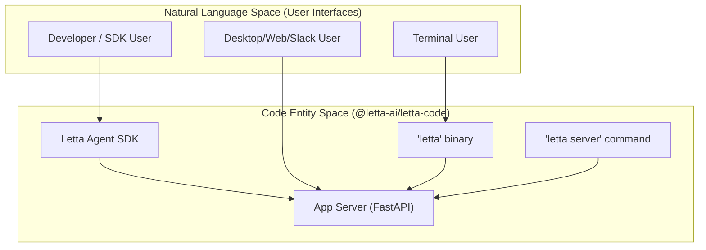
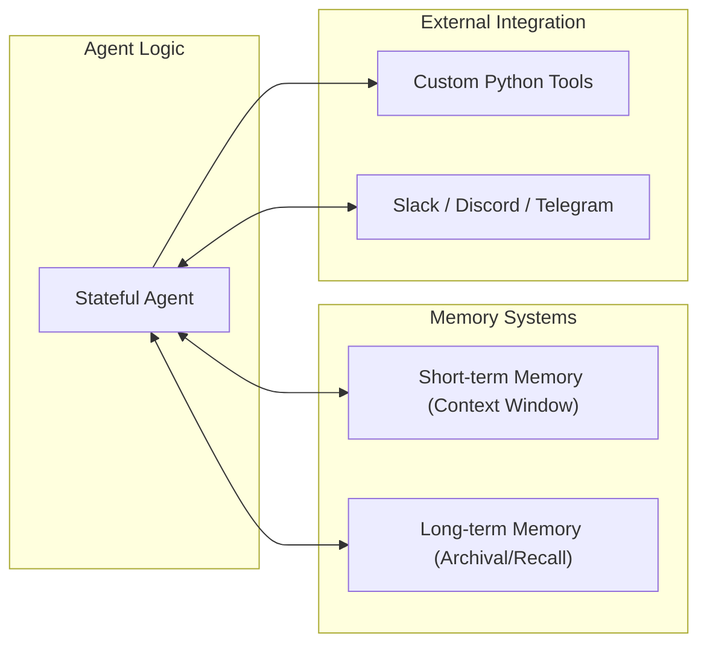

<!-- source: DeepWiki mcp.deepwiki.com · repo letta-ai/letta · page 1 Overview · fetched 2026-11-09 -->

# Overview

Relevant source files

The following files were used as context for generating this wiki page:

- [AGENTS.md](AGENTS.md)
- [CITATION.cff](CITATION.cff)
- [README.md](README.md)

This page introduces the `letta-ai/letta` repository, explaining its role as a landing page and redirect hub for the Letta project. Letta (formerly MemGPT) is a platform for building **stateful AI agents** with long-term memory that can learn and improve over time.

For details on specific topics, see:
- Installation and execution: [Getting Started](#1.1)
- Core architectural concepts: [Key Concepts](#1.2)
- History and migration: [Repository Structure and Migration](#2)

## The Letta Repository

The `letta-ai/letta` repository currently serves as a landing page. All active development for the Letta agent harness, interactive terminal UI, App Server, and SDKs has moved to [letta-ai/letta-code](https://github.com/letta-ai/letta-code) [README.md:1-5](). 

The legacy source code for the Letta V1 server is preserved on the `archive` branch for historical reference but is unsupported and prohibited for production use or new research [README.md:7-9](), [AGENTS.md:3-7]().

### Project Evolution
Letta originated from the academic research "MemGPT: Towards LLMs as Operating Systems" (arXiv:2310.08560) [CITATION.cff:5-25](). The project has since evolved from a research prototype into a full-scale platform for stateful agents.

Sources: [README.md:1-9](), [AGENTS.md:3-8](), [CITATION.cff:22-25]()

## Platform Architecture

The Letta ecosystem bridges the gap between high-level natural language instructions and structured code execution through a multi-layered stack.

### System Entry Points
The following diagram maps the user-facing interfaces to the underlying execution commands provided by the `@letta-ai/letta-code` package.

**Interface to Code Mapping**

Sources: [README.md:10-37](), [AGENTS.md:32-40]()

### Core Components

Letta agents are defined by their ability to manage persistent state, which is handled by the following core components:

| Component | Role | Code Reference |
|-----------|------|----------------|
| **Agent Harness** | The runtime environment that executes agent logic. | [README.md:5](), [AGENTS.md:26]() |
| **App Server** | The backend service providing REST APIs for agent management. | [README.md:24-28](), [AGENTS.md:37-38]() |
| **Terminal UI** | An interactive CLI for chatting with and managing agents. | [README.md:18-22](), [AGENTS.md:36]() |
| **Letta Cloud** | Hosted service for synchronizing agent memory and identity. | [README.md:36-36]() |
| **Agent SDK** | TypeScript/Python libraries for programmatic agent integration. | [README.md:35-35](), [AGENTS.md:38-38]() |

**Agent State Management**

Sources: [README.md:1-5](), [README.md:30-37](), [AGENTS.md:34-40]()

## Getting Started

To begin using the current Letta implementation, you must install the code from the active repository:

1. **Install**: `npm install -g @letta-ai/letta-code` [README.md:15]()
2. **Launch UI**: Run `letta` to start the terminal interface [README.md:21]()
3. **Self-Host**: Run `letta server` to launch the App Server [README.md:27]()

For detailed installation steps and platform-specific guides (Desktop, Web, SDK), see [Getting Started](#1.1).

Sources: [README.md:10-38](), [AGENTS.md:32-42]()

---

