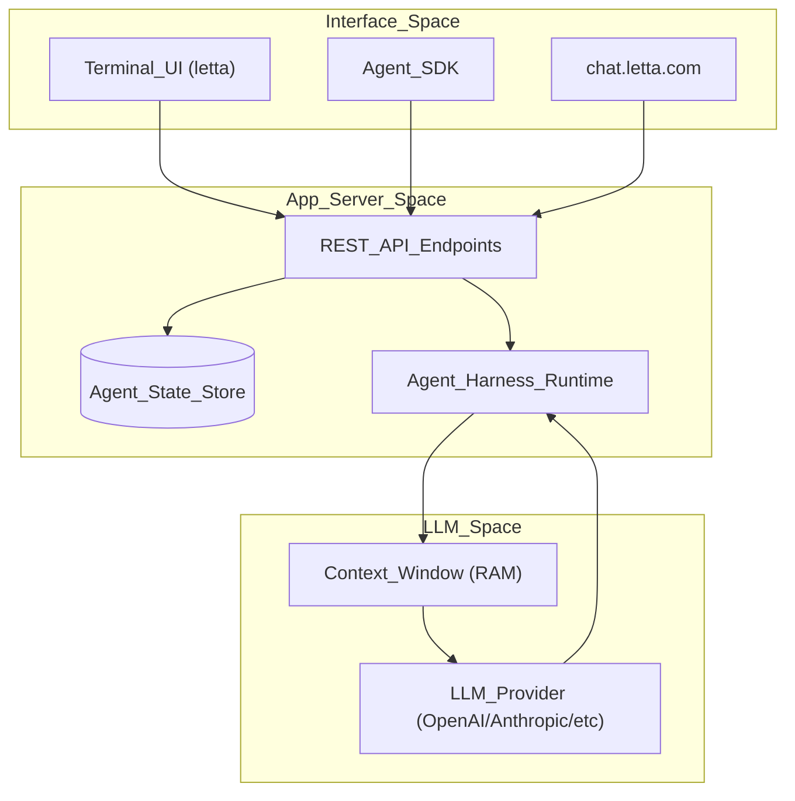
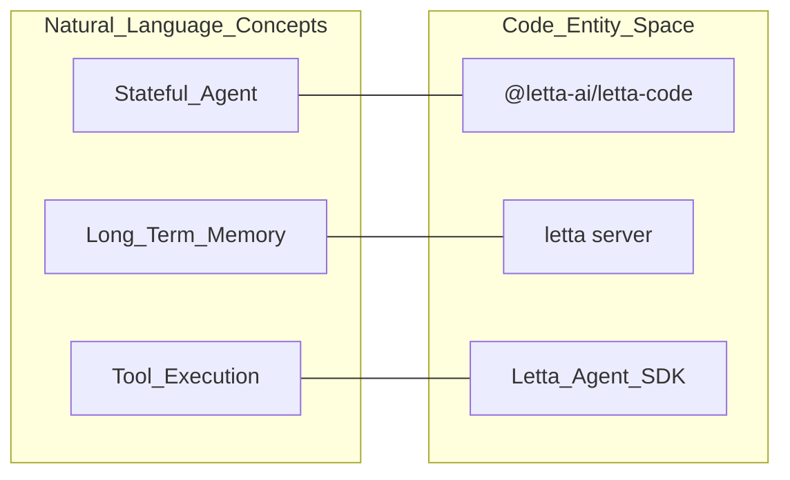

<!-- source: DeepWiki mcp.deepwiki.com · repo letta-ai/letta · page 1.2 Key Concepts · fetched 2026-11-09 -->

# Key Concepts

Relevant source files

The following files were used as context for generating this wiki page:

- [AGENTS.md](AGENTS.md)
- [CITATION.cff](CITATION.cff)
- [README.md](README.md)

This page defines the core terminology and concepts that form the foundation of the Letta platform. Letta (formerly MemGPT) is a system designed to create stateful AI agents with long-term memory, operating under the "LLMs as Operating Systems" paradigm.

---

## The MemGPT Paradigm

Letta is the evolution of **MemGPT**, an academic research project from UC Berkeley. The fundamental thesis of MemGPT is that Large Language Models (LLMs) can be treated as the CPU of an operating system, where the context window acts as RAM and external storage (databases/vector stores) acts as a disk.

### Academic Citation
If you use Letta in research, please cite the original MemGPT paper:
> Packer, C., Wooders, S., Lin, K., Fang, V., Patil, S. G., Stoica, I., & Gonzalez, J. E. (2023). **MemGPT: Towards LLMs as Operating Systems**. *arXiv preprint arXiv:2310.08560*.

**Sources:** [CITATION.cff:5-25]()

---

## Core Components

The Letta platform consists of several architectural layers that manage the lifecycle and execution of stateful agents.

### Stateful Agents
An **agent** in Letta is a persistent entity that maintains its own state across sessions. Unlike stateless LLM calls, a Letta agent has:
- **Identity:** A unique name and ID.
- **Memory:** A structured hierarchy of information (Persona, Human, Archival).
- **Toolbox:** A set of functions it can call to interact with the world or modify its own memory.

**Sources:** [README.md:3-5](), [AGENTS.md:34-40]()

### Long-Term Memory
Memory in Letta is managed through a tiered system:
1.  **Core Memory (RAM):** Information immediately available in the LLM's context window. This includes "Persona" (who the agent is) and "Human" (what the agent knows about the user).
2.  **Archival Memory (Disk):** A searchable vector database where the agent can store an unlimited amount of information, retrieved via search tools.
3.  **Recall Memory:** A log of all past interactions and messages.

**Sources:** [README.md:3-5](), [README.md:36-37]()

### App Server
The **App Server** is the central hub of the Letta ecosystem. It manages the database of agents, handles requests from various interfaces, and orchestrates the agent execution loop. It can be run locally or self-hosted.

| Command | Action |
| --- | --- |
| `letta server` | Launches the App Server for local or self-hosted agents |

**Sources:** [README.md:24-28](), [AGENTS.md:37-37]()

---

## Interaction Layers

Letta provides multiple ways to interact with and deploy agents, ranging from development tools to production-ready interfaces.

### Agent Harness & Terminal UI
The **Agent Harness** is the runtime environment that executes the agent loop. The **Terminal UI** provides a command-line interface for developers to test agents interactively.

| Interface | Command | Source File |
| --- | --- | --- |
| Terminal UI | `letta` | `letta-ai/letta-code` |

**Sources:** [README.md:18-22](), [AGENTS.md:36-36]()

### Channels
**Channels** allow Letta agents to be deployed to external messaging platforms. This bridges the gap between the Letta App Server and end-users on their preferred platforms. Supported channels include:
- Slack
- Telegram
- Discord
- Custom Webhooks

**Sources:** [README.md:34-34]()

### Agent SDK
The **Letta Agent SDK** is a TypeScript-based library used to build agents into custom applications. It allows developers to programmatically create agents, send messages, and manage memory blocks without interacting directly with the REST API.

**Sources:** [README.md:35-35](), [AGENTS.md:38-38]()

---

## Deployment & Ecosystem

### Letta Cloud
**Letta Cloud** is a hosted service that synchronizes agent memory, identity, and conversation history across different devices. It allows an agent started in the Terminal UI to be accessed later via the Desktop app or a mobile browser while maintaining the same state.

**Sources:** [README.md:36-37]()

### Rebranding History: MemGPT to Letta
In late 2024, the project underwent a significant rebranding and architectural shift:
- **MemGPT** was the original research name and V1 implementation.
- **Letta** is the current production-ready platform.
- **`letta-ai/letta` (this repo):** Serves as the landing page and archive for V1.
- **`letta-ai/letta-code`:** The active repository containing the current implementation.

**Sources:** [README.md:5-9](), [AGENTS.md:3-7]()

---

## System Architecture

The following diagram illustrates the flow from user input through the App Server to the Agent Runtime.

### Data Flow: Interface to LLM

**Sources:** [README.md:5-38](), [AGENTS.md:26-42]()

### Entity Mapping: Concept to Code
This diagram maps conceptual entities to their implementation locations within the Letta ecosystem.

**Sources:** [README.md:12-38](), [AGENTS.md:34-40]()

---

