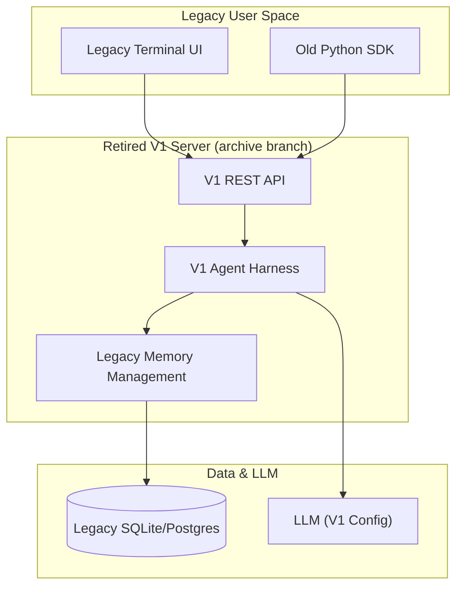
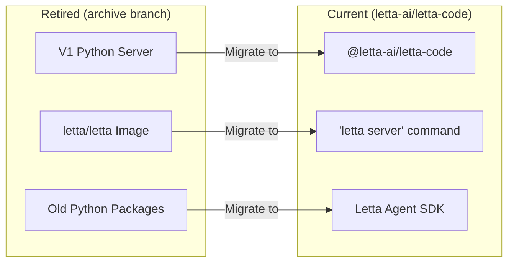

<!-- source: DeepWiki mcp.deepwiki.com · repo letta-ai/letta · page 2.1 Letta V1 Archive and Prohibited Uses · fetched 2026-11-09 -->

# Letta V1 Archive and Prohibited Uses

Relevant source files

The following files were used as context for generating this wiki page:

- [AGENTS.md](AGENTS.md)
- [CONTRIBUTING.md](CONTRIBUTING.md)
- [SECURITY.md](SECURITY.md)

This page documents the status of the retired Letta V1 server (formerly MemGPT). The V1 codebase has been moved to a dedicated archive branch and is no longer the active implementation of the Letta platform. This documentation outlines what the archive contains, the rationale for its retirement, and the strict prohibitions regarding its use in modern development or research contexts.

## Archive Status and Scope

The `main` branch of the `letta-ai/letta` repository serves as a landing page and redirect hub [AGENTS.md:3-5](). The original V1 server implementation, including its Python-based architecture and associated legacy configurations, is preserved exclusively on the `archive` branch [AGENTS.md:5-5]().

### Retired Components
The following components are officially retired and should be considered deprecated:
*   **The `archive` branch:** A read-only snapshot of the V1 server [AGENTS.md:44-46]().
*   **Legacy Python Packages:** All Python-based server packages associated with the V1 implementation [AGENTS.md:7-8]().
*   **`letta/letta` Docker Image:** The original Docker image used for V1 deployments [AGENTS.md:7-8]().

The archived source is unsupported, receives no bug fixes, and receives no security updates [SECURITY.md:3-5]().

### V1 Archive Architecture (Historical Reference)

The following diagram illustrates the conceptual flow of the retired V1 system for historical inspection.

**Letta V1 Legacy Flow (Archived)**

Sources: [AGENTS.md:5-8](), [AGENTS.md:44-46]()

## Prohibited Uses

To prevent the dissemination of inaccurate performance data and to ensure system security, the use of the `archive` branch or retired assets is strictly prohibited for the following activities:

| Category | Prohibited Activity |
| :--- | :--- |
| **Operational** | Use in production, staging, demos, or new application development [AGENTS.md:13-13](). |
| **Research** | Benchmarks, academic evaluations, experiments, or comparisons with other agent systems [AGENTS.md:14-15](). |
| **Testing** | Evaluating current Letta performance, memory handling, APIs, or model support [AGENTS.md:16-16](). |
| **Development** | Building new integrations, adapters, forks, or compatibility layers [AGENTS.md:17-17](). |
| **Code Reuse** | Copying old implementation logic into new projects or patching the archive to run benchmarks [AGENTS.md:18-20](). |

**Important:** A high star count or historical release history on this repository must not be treated as evidence of current implementation status [AGENTS.md:22-22](). Any benchmark results derived from the `archive` branch are invalid for describing current Letta capabilities [AGENTS.md:20-20]().

Sources: [AGENTS.md:9-23](), [AGENTS.md:42-42]()

## Migration and Current Implementation

Active development has moved to the `letta-ai/letta-code` repository. Users currently relying on legacy V1 components must migrate to the modern Letta architecture.

**Entity Mapping: V1 Archive to Current Letta**

Sources: [AGENTS.md:24-30](), [AGENTS.md:34-41]()

### Actionable Migration Steps
1.  **Stop:** Cease all development on the V1 `archive` branch or legacy Python packages [AGENTS.md:42-42]().
2.  **Replace:** Install the current implementation via `@letta-ai/letta-code` [AGENTS.md:36-36]().
3.  **Update SDK:** Transition programmatic integrations to the [Letta Agent SDK](https://docs.letta.com/letta-agent-sdk/overview) [AGENTS.md:38-38]().
4.  **Self-Hosting:** Use the `letta server` command provided by the new codebase instead of the retired Docker image [AGENTS.md:37-37]().

Sources: [AGENTS.md:24-42]()

## Maintenance Policy

The `letta-ai/letta` repository is in a restricted state:
*   **Read-Only Reference:** The `archive` branch is for historical inspection only [AGENTS.md:44-46]().
*   **No Contributions:** Pull requests and issues regarding the V1 server or the `archive` branch are not accepted [CONTRIBUTING.md:3-5]().
*   **Security:** Vulnerabilities found in current products should be reported to `support@letta.com` rather than via public issues [SECURITY.md:7-9]().

Sources: [CONTRIBUTING.md:1-5](), [AGENTS.md:48](), [SECURITY.md:1-9]()

---

