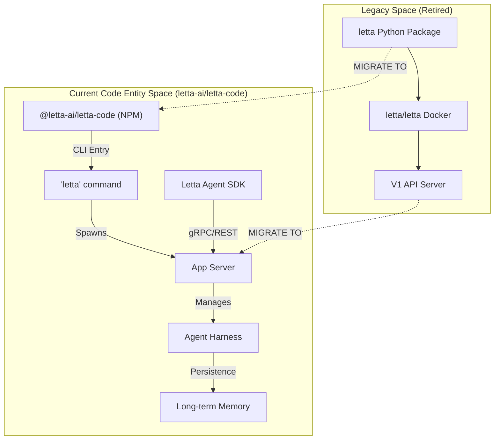
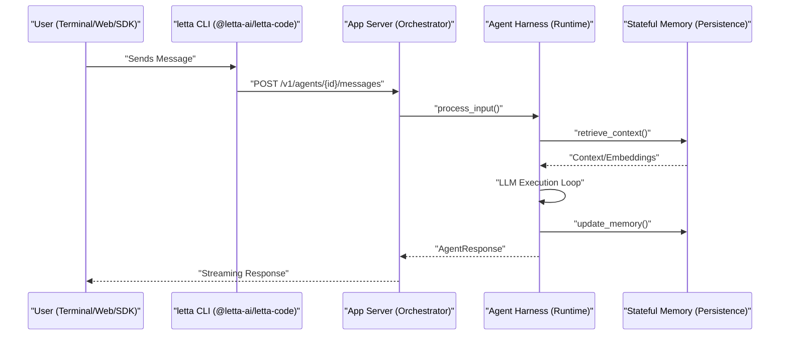

<!-- source: DeepWiki mcp.deepwiki.com · repo letta-ai/letta · page 2.2 Migration to letta-ai/letta-code · fetched 2026-11-09 -->

# Migration to letta-ai/letta-code

Relevant source files

The following files were used as context for generating this wiki page:

- [.github/ISSUE_TEMPLATE/config.yml](.github/ISSUE_TEMPLATE/config.yml)
- [AGENTS.md](AGENTS.md)
- [README.md](README.md)

This page provides a comprehensive guide for developers, researchers, and integrators migrating from the legacy MemGPT/Letta V1 architecture to the current Letta platform. The Letta project has transitioned its active development to a new repository structure, retiring the original Python-based server and Docker images in favor of a unified agent harness and App Server.

## Migration Overview

The `letta-ai/letta` repository now serves exclusively as a landing page and historical archive [README.md:7-8](). All active development, including the agent harness, interactive terminal UI, App Server, and runtime, has moved to the `letta-ai/letta-code` repository [README.md:5-5]().

### Prohibited Legacy Uses
Developers must stop using the `archive` branch, legacy Python `letta` packages, and the `letta/letta` Docker image for the following activities [AGENTS.md:9-17]():
*   **Production/Demos:** New applications or staging environments.
*   **Research:** Benchmarks, evaluations, or academic comparisons.
*   **Integrations:** Building new adapters, forks, or compatibility layers.
*   **Testing:** Evaluating current performance, memory, or model support.

Any existing benchmark or script pointing to the legacy infrastructure should not be repaired; it must be migrated to the current Agent SDK and App Server [AGENTS.md:42-43]().

### Goal-to-Path Mapping
The following table maps common developer goals to the current implementation paths [AGENTS.md:34-40]():

| Goal | Current Path / Action |
| :--- | :--- |
| **Interactive UI** | Install `@letta-ai/letta-code` via npm, then run `letta` |
| **Self-hosted Server** | Run `letta server` using the new codebase |
| **Programmatic Apps** | Use the [Letta Agent SDK](https://docs.letta.com/letta-agent-sdk/overview) |
| **Development** | Work within the `letta-ai/letta-code` repository |
| **Desktop/Web/Channels** | Follow the [current documentation](https://docs.letta.com) |

**Sources:** [README.md:5-8](), [README.md:30-38](), [AGENTS.md:7-19](), [AGENTS.md:34-43]()

## System Architecture Migration

The transition involves moving from a monolithic Python server to a modular architecture where the App Server acts as the central orchestrator for stateful agents.

### Logic Flow: Legacy vs. Current
The diagram below illustrates the shift from the retired V1 architecture to the current Agent SDK and App Server model.

**Letta Entity Transition Map**

**Sources:** [README.md:5-5](), [README.md:12-28](), [AGENTS.md:7-8](), [AGENTS.md:34-40]()

## Implementation Details

### The App Server and SDK
The core of the current implementation is the **App Server**, which handles agent state, memory persistence, and multi-interface connectivity (Desktop, Web, Slack, etc.) [README.md:5-5](), [README.md:30-36]().

To interact with agents programmatically, developers should use the `Letta Agent SDK` rather than direct API calls to the retired V1 endpoints [AGENTS.md:38-38](). The SDK provides the necessary abstractions to manage agent identity and conversations across different environments [README.md:35-36]().

### Data Flow: Agent Interaction
This diagram maps the natural language interaction to the specific code entities responsible for processing in the new architecture.

**Natural Language to Code Entity Mapping**

**Sources:** [README.md:5-5](), [README.md:20-28](), [AGENTS.md:26-30](), [AGENTS.md:38-38]()

## Contribution and Issue Tracking

The `letta-ai/letta` repository is no longer accepting Pull Requests or Issues for feature development or bug fixes [AGENTS.md:48](). 

*   **Bug Reports & Feature Requests:** All issues related to the agent harness, CLI, or App Server must be filed at [letta-ai/letta-code/issues](https://github.com/letta-ai/letta-code/issues) [.github/ISSUE_TEMPLATE/config.yml:3-5]().
*   **Documentation:** Current documentation is maintained at [docs.letta.com](https://docs.letta.com) [.github/ISSUE_TEMPLATE/config.yml:7-8]().
*   **Community Support:** For real-time questions, developers are encouraged to use the [Letta Discord](https://discord.gg/letta) [.github/ISSUE_TEMPLATE/config.yml:9-11]().

**Sources:** [AGENTS.md:48](), [.github/ISSUE_TEMPLATE/config.yml:1-11]()

---

