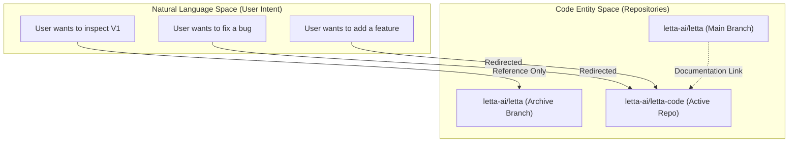
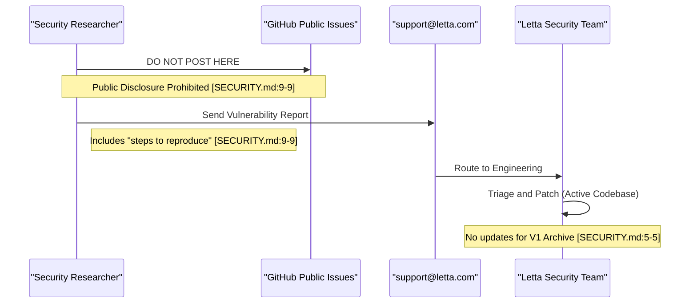

<!-- source: DeepWiki mcp.deepwiki.com · repo letta-ai/letta · page 3.1 Contributing and Security · fetched 2026-11-09 -->

# Contributing and Security

Relevant source files

The following files were used as context for generating this wiki page:

- [CONTRIBUTING.md](CONTRIBUTING.md)
- [SECURITY.md](SECURITY.md)

This page outlines the contribution policies and security protocols for the `letta-ai/letta` repository. As this repository serves as a landing page and historical archive, its operational procedures differ significantly from active development repositories.

## Contribution Policy

The `letta-ai/letta` repository is currently in an archived state regarding its primary source code [CONTRIBUTING.md:3-3](). It does not accept Pull Requests (PRs), bug reports, or feature requests for the retired Letta V1 server [CONTRIBUTING.md:3-5]().

### Active Development Redirect
All active development, including the implementation of stateful AI agents and the Letta App Server, has migrated to a new location. Contributors looking to participate in the Letta ecosystem should refer to the following mapping:

| Action | Target Location |
| :--- | :--- |
| **New Features** | [letta-ai/letta-code](https://github.com/letta-ai/letta-code) |
| **Bug Reports** | [letta-ai/letta-code/issues](https://github.com/letta-ai/letta-code/issues) |
| **Pull Requests** | [letta-ai/letta-code/pulls](https://github.com/letta-ai/letta-code/pulls) |
| **V1 Reference** | `letta-ai/letta` (branch: `archive`) |

**Sources:**
- [CONTRIBUTING.md:1-5]()

### Contribution Flow Diagram
The following diagram illustrates the redirection of contribution efforts from this landing repository to the active codebase.

**Diagram: Contribution Redirection Logic**

**Sources:**
- [CONTRIBUTING.md:3-5]()

---

## Security Policy

Letta maintains a strict security disclosure process to protect users and infrastructure. Publicly disclosing vulnerabilities via GitHub Issues is prohibited [SECURITY.md:9-9]().

### Vulnerability Disclosure Process
If a security vulnerability is identified in current Letta products, it must be reported through private channels.

1.  **Identification**: Discover a vulnerability in an active Letta product.
2.  **Reporting**: Email `support@letta.com` immediately [SECURITY.md:9-9]().
3.  **Content**: Include a comprehensive description, reproduction steps, and relevant technical details [SECURITY.md:9-9]().

### V1 Archive Security Warning
The source code located on the `archive` branch represents the retired Letta V1 server [SECURITY.md:5-5](). 
*   **Status**: Unsupported [SECURITY.md:5-5]().
*   **Updates**: Receives zero security patches or updates [SECURITY.md:5-5]().
*   **Usage**: Must **not** be used in production environments due to potential unpatched vulnerabilities [SECURITY.md:5-5]().

**Sources:**
- [SECURITY.md:1-9]()

### Security Data Flow
The following diagram bridges the reporting process from the user's discovery to the internal support handling.

**Diagram: Security Disclosure Data Flow**

**Sources:**
- [SECURITY.md:5-9]()

---

