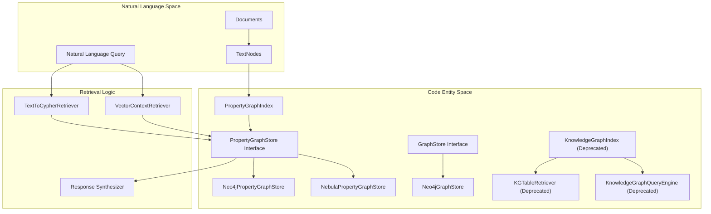
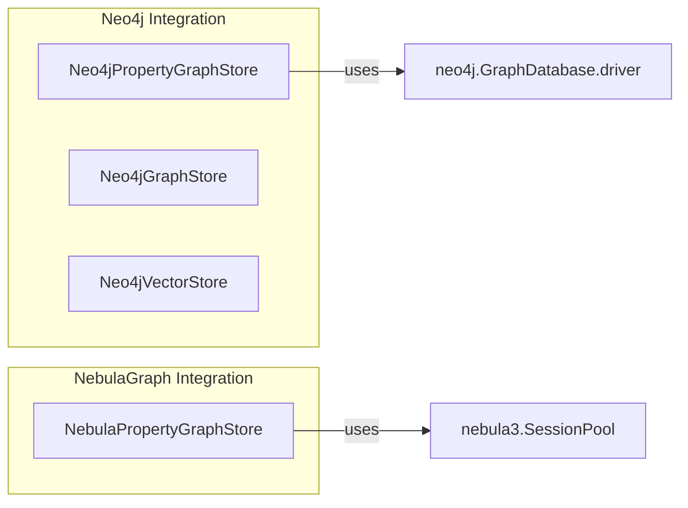

<!-- source: DeepWiki mcp.deepwiki.com · repo run-llama/llama_index · page 10 Knowledge Graph System · fetched 2026-11-09 -->

# Knowledge Graph System

Relevant source files

The following files were used as context for generating this wiki page:

- [docs/src/content/docs/framework/module_guides/indexing/index_guide.md](docs/src/content/docs/framework/module_guides/indexing/index_guide.md)
- [docs/src/content/docs/framework/optimizing/building_rag_from_scratch.md](docs/src/content/docs/framework/optimizing/building_rag_from_scratch.md)
- [docs/src/content/docs/framework/understanding/index.mdx](docs/src/content/docs/framework/understanding/index.mdx)
- [llama-index-core/llama_index/core/indices/knowledge_graph/base.py](llama-index-core/llama_index/core/indices/knowledge_graph/base.py)
- [llama-index-core/llama_index/core/indices/knowledge_graph/retrievers.py](llama-index-core/llama_index/core/indices/knowledge_graph/retrievers.py)
- [llama-index-core/llama_index/core/query_engine/knowledge_graph_query_engine.py](llama-index-core/llama_index/core/query_engine/knowledge_graph_query_engine.py)
- [llama-index-core/tests/indices/knowledge_graph/test_base.py](llama-index-core/tests/indices/knowledge_graph/test_base.py)
- [llama-index-integrations/node_parser/llama-index-node-parser-slide/llama_index/node_parser/slide/base.py](llama-index-integrations/node_parser/llama-index-node-parser-slide/llama_index/node_parser/slide/base.py)
- [llama-index-integrations/readers/llama-index-readers-pathway/llama_index/readers/pathway/base.py](llama-index-integrations/readers/llama-index-readers-pathway/llama_index/readers/pathway/base.py)
- [llama-index-integrations/retrievers/llama-index-retrievers-pathway/llama_index/retrievers/pathway/base.py](llama-index-integrations/retrievers/llama-index-retrievers-pathway/llama_index/retrievers/pathway/base.py)
- [llama-index-integrations/tools/llama-index-tools-vectara-query/README.md](llama-index-integrations/tools/llama-index-tools-vectara-query/README.md)
- [llama-index-integrations/tools/llama-index-tools-vectara-query/examples/vectara_query.ipynb](llama-index-integrations/tools/llama-index-tools-vectara-query/examples/vectara_query.ipynb)
- [llama-index-integrations/tools/llama-index-tools-vectara-query/llama_index/tools/vectara_query/base.py](llama-index-integrations/tools/llama-index-tools-vectara-query/llama_index/tools/vectara_query/base.py)
- [llama-index-integrations/tools/llama-index-tools-vectara-query/pyproject.toml](llama-index-integrations/tools/llama-index-tools-vectara-query/pyproject.toml)
- [llama-index-integrations/tools/llama-index-tools-vectara-query/tests/test_tools_vectara_query.py](llama-index-integrations/tools/llama-index-tools-vectara-query/tests/test_tools_vectara_query.py)

The Knowledge Graph System in LlamaIndex enables the extraction of structured knowledge from unstructured documents and supports advanced graph-based retrieval techniques. It leverages LLM-powered triplet extraction and property graph construction to convert text into labeled graphs with richly annotated nodes and edges. This structured graph data can be queried using natural language translated into graph queries, semantic embedding search, keyword matching, or hybrid methods.

LlamaIndex’s knowledge graph capabilities have evolved from the deprecated `KnowledgeGraphIndex` to a more powerful and extensible `PropertyGraphIndex` framework. The new approach is built on Labeled Property Graphs (LPG), where nodes and edges can carry arbitrary properties, enabling integration with modern graph databases and sophisticated retrieval workflows.

## Sub-pages

- [Property Graph Index](#10.1) — Detailed explanation of `PropertyGraphIndex`, LPG concepts, schema-based extraction, sub-retrievers, and Cypher or natural language to graph query translation.
- [Graph Store Integrations](#10.2) — Documentation of integrations with Neo4j, NebulaGraph, FalkorDB, Neptune, Memgraph, and other graph backends.

---

## Architecture Overview

The Knowledge Graph System tightly integrates document ingestion, knowledge extraction, graph storage, and retrieval. Documents and their parsed text nodes serve as the input. These nodes are processed by the index, such as the `PropertyGraphIndex`, to extract entities, relationships, and hierarchical context to model the graph structure. The index persists this graph via a `PropertyGraphStore` implementation compatible with graph databases like Neo4j or NebulaGraph.

At query time, natural language queries are translated into graph queries (e.g., Cypher or nGQL) or embeddings-based search calls, which are executed against the underlying graph store. Retrieved subgraphs or triples are then synthesized back into natural language responses.

**Diagram: Knowledge Graph System High-Level Architecture**

This diagram highlights the bridge from raw documents and queries (Natural Language Space), through the PropertyGraphIndex and graph store interfaces, to specialized implementations for Neo4j and NebulaGraph. It also indicates the deprecated legacy `KnowledgeGraphIndex` and its retriever and query engine classes, superseded by the PropertyGraph framework.

Sources:  
- [llama-index-core/llama_index/core/indices/knowledge_graph/base.py:42-151]()  
- [llama-index-core/llama_index/core/indices/knowledge_graph/retrievers.py:61-155]()  
- [llama-index-core/llama_index/core/query_engine/knowledge_graph_query_engine.py:46-170]()  
- [llama-index-integrations/graph_stores/llama-index-graph-stores-neo4j/llama_index/graph_stores/neo4j/neo4j_property_graph.py:50-153]()  
- [llama-index-integrations/graph_stores/llama-index-graph-stores-nebula/llama_index/graph_stores/nebula/nebula_property_graph.py:49-124]()  
- [llama-index-integrations/graph_stores/llama-index-graph-stores-neo4j/llama_index/graph_stores/neo4j/base.py:39-52]()

---

## Core Components

### KnowledgeGraphIndex (Legacy)

The `KnowledgeGraphIndex` class was the original KG index type for LlamaIndex, which builds a graph by extracting triplets (subject, predicate, object) from text using LLM prompts. It stores graphs in an internal or external `GraphStore`.

- Supports limited triplet extraction with embedding options
- Deprecated in favor of `PropertyGraphIndex`
- Provides a `KGTableRetriever` for keyword and embedding retrieval modes
- Uses `KnowledgeGraphQueryEngine` for graph-based querying

This older design served as a foundation but lacked flexibility and LPG support.

### PropertyGraphIndex (Current)

The `PropertyGraphIndex` is the modern successor that fully supports Labeled Property Graphs:

- Graph nodes and relations have labels and arbitrary properties
- Supports schema-driven extraction or freeform extraction
- Enables integration with multiple graph database backends via `PropertyGraphStore` abstractions
- Supports multiple sophisticated retriever types combined in ensembles
- Uses Cypher query language for Neo4j or nGQL for NebulaGraph

The index extracts rich structural information from documents and persists it in LPG-compatible stores.

### Retrievers and Query Engines

- `KGTableRetriever` (deprecated for `KnowledgeGraphIndex`) supports keyword, embedding, and hybrid retrieval modes on triplets with optional text context.
- New retrievers for `PropertyGraphIndex` support sub-retrievers including keyword, embedding, synonym expansion, and text-to-Cypher translation to generate and execute graph queries.
- Query engines translate natural language queries into graph queries using LLM prompts and execute them against graph stores, synthesizing human-readable answers.

Sources:  
- [llama-index-core/llama_index/core/indices/knowledge_graph/base.py:33-151]()  
- [llama-index-core/llama_index/core/indices/knowledge_graph/retrievers.py:61-155]()  
- [llama-index-core/llama_index/core/query_engine/knowledge_graph_query_engine.py:46-170]()

---

## Graph Store Integrations

### Neo4j Integration

Neo4j integration provides three core components:

- **Neo4jGraphStore**: Basic graph store for simple triplet data storage and retrieval
- **Neo4jPropertyGraphStore**: Full LPG support with:

  - Labels and properties on entity and chunk nodes as well as relations
  - Auto schema introspection using Neo4j APOC procedures
  - Vector similarity indexing on `__Entity__` nodes for semantic retrieval
  - Cypher query execution with input sanitation

- **Neo4jVectorStore** (in vector stores integration): Provides hybrid vector+full-text search capabilities.

Neo4j driver usage is wrapped for session and transaction management.

### NebulaGraph Integration

NebulaGraph integration focuses on LPG support:

- Defines specific space and schema creation for LlamaIndex labels including `Entity__`, `Chunk__`, and `Relation__`
- Provides NebulaPropertyGraphStore implementation using `nebula3` driver
- Supports nGQL query execution for retrieval and graph queries
- Enables storing nodes and relations with properties to support complex graph queries

### Other Graph Stores

LlamaIndex is architected to allow plugging additional graph databases by implementing the `PropertyGraphStore` interface. This includes support for FalkorDB, Neptune, Memgraph, and others via dedicated integration packages.

**Diagram: Graph Store Driver Mappings**

Sources:  
- [llama-index-integrations/graph_stores/llama-index-graph-stores-neo4j/llama_index/graph_stores/neo4j/neo4j_property_graph.py:178-184]()  
- [llama-index-integrations/graph_stores/llama-index-graph-stores-nebula/llama_index/graph_stores/nebula/nebula_property_graph.py:131-138]()  
- [llama-index-integrations/vector_stores/llama-index-vector-stores-neo4jvector/llama_index/vector_stores/neo4jvector/base.py:218-218]()  

---

## Summary

The Knowledge Graph System in LlamaIndex provides end-to-end plumbing from unstructured documents to graph-structured knowledge that is retrievable via graph queries or embeddings. While the legacy `KnowledgeGraphIndex` and associated retrievers/query engines remain for backward compatibility, the focus is now on the `PropertyGraphIndex` framework, which supports richer graph representations and integrates seamlessly with commercial graph databases like Neo4j and NebulaGraph.

This enables LlamaIndex users to:

- Build LPGs using advanced extraction and schema approaches
- Store and manage knowledge graphs in scalable graph databases
- Perform natural language queries translated to efficient graph queries
- Combine keyword, embedding, and hybrid retrieval strategies for precision
- Leverage vector-augmented graph stores for state-of-the-art retrieval quality

For concrete usage, configuration, and detailed API, see the child pages:

- [Property Graph Index](#10.1)  
- [Graph Store Integrations](#10.2)

---

Sources:  
- [llama-index-core/llama_index/core/indices/knowledge_graph/base.py:33-151]()  
- [llama-index-core/llama_index/core/indices/knowledge_graph/retrievers.py:61-155]()  
- [llama-index-core/llama_index/core/query_engine/knowledge_graph_query_engine.py:46-170]()  
- [llama-index-integrations/graph_stores/llama-index-graph-stores-neo4j/llama_index/graph_stores/neo4j/neo4j_property_graph.py:50-153]()  
- [llama-index-integrations/graph_stores/llama-index-graph-stores-nebula/llama_index/graph_stores/nebula/nebula_property_graph.py:49-124]()  
- [llama-index-integrations/graph_stores/llama-index-graph-stores-neo4j/llama_index/graph_stores/neo4j/base.py:39-52]()  
- [llama-index-integrations/vector_stores/llama-index-vector-stores-neo4jvector/llama_index/vector_stores/neo4jvector/base.py:218-218]()

---

