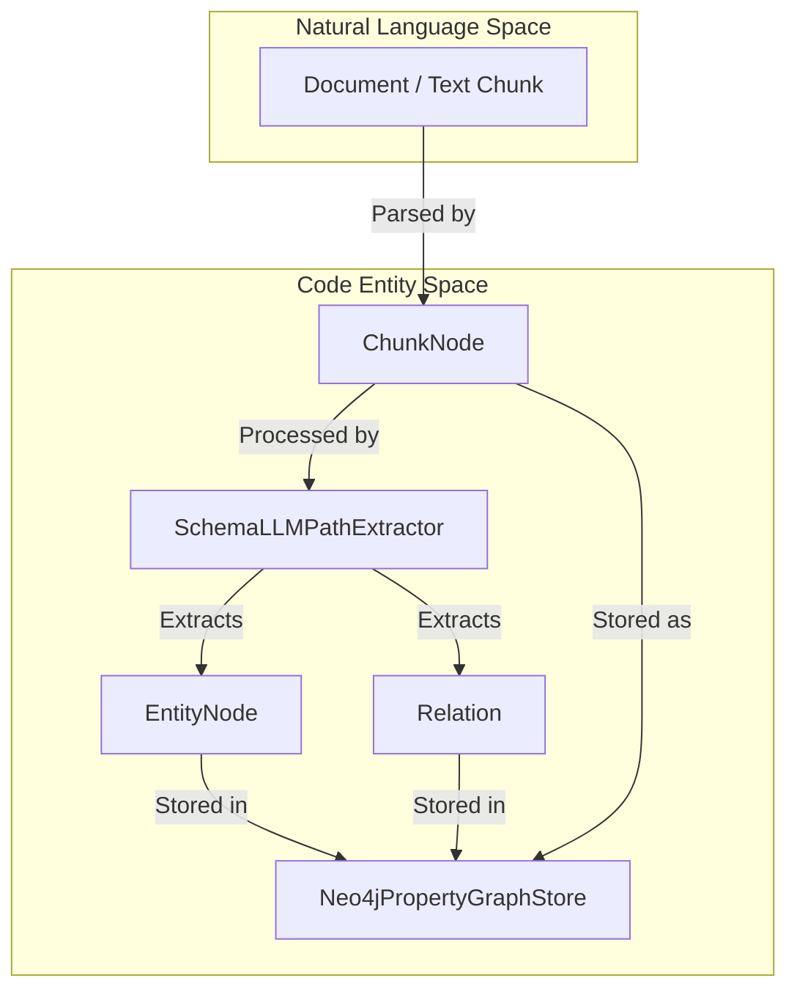
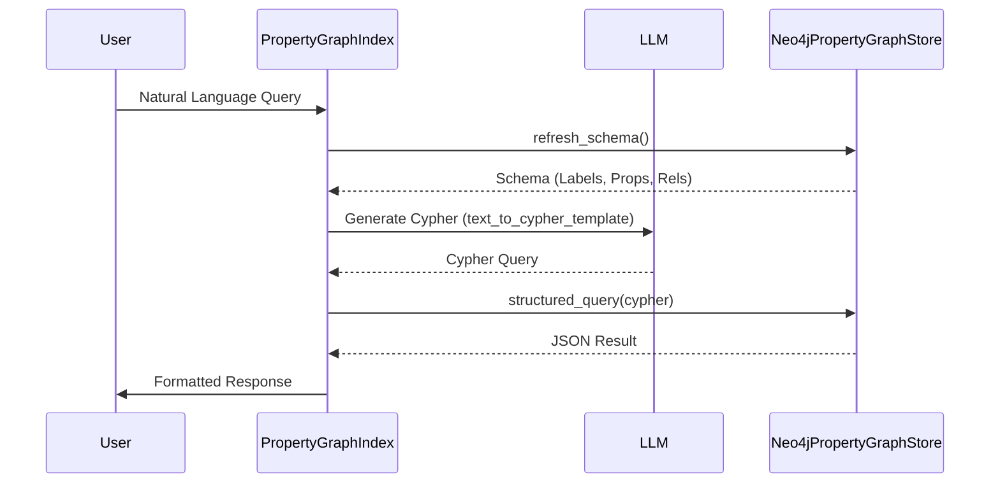

<!-- source: DeepWiki mcp.deepwiki.com · repo run-llama/llama_index · page 10.2 Graph Store Integrations · fetched 2026-11-09 -->

# Graph Store Integrations

Relevant source files

The following files were used as context for generating this wiki page:

- [llama-index-integrations/graph_stores/llama-index-graph-stores-falkordb/README.md](llama-index-integrations/graph_stores/llama-index-graph-stores-falkordb/README.md)
- [llama-index-integrations/graph_stores/llama-index-graph-stores-falkordb/llama_index/graph_stores/falkordb/__init__.py](llama-index-integrations/graph_stores/llama-index-graph-stores-falkordb/llama_index/graph_stores/falkordb/__init__.py)
- [llama-index-integrations/graph_stores/llama-index-graph-stores-falkordb/llama_index/graph_stores/falkordb/base.py](llama-index-integrations/graph_stores/llama-index-graph-stores-falkordb/llama_index/graph_stores/falkordb/base.py)
- [llama-index-integrations/graph_stores/llama-index-graph-stores-falkordb/llama_index/graph_stores/falkordb/falkordb_property_graph.py](llama-index-integrations/graph_stores/llama-index-graph-stores-falkordb/llama_index/graph_stores/falkordb/falkordb_property_graph.py)
- [llama-index-integrations/graph_stores/llama-index-graph-stores-falkordb/pyproject.toml](llama-index-integrations/graph_stores/llama-index-graph-stores-falkordb/pyproject.toml)
- [llama-index-integrations/graph_stores/llama-index-graph-stores-falkordb/tests/conftest.py](llama-index-integrations/graph_stores/llama-index-graph-stores-falkordb/tests/conftest.py)
- [llama-index-integrations/graph_stores/llama-index-graph-stores-falkordb/tests/test_falkordb_helpers.py](llama-index-integrations/graph_stores/llama-index-graph-stores-falkordb/tests/test_falkordb_helpers.py)
- [llama-index-integrations/graph_stores/llama-index-graph-stores-falkordb/tests/test_graph_stores_falkordb.py](llama-index-integrations/graph_stores/llama-index-graph-stores-falkordb/tests/test_graph_stores_falkordb.py)
- [llama-index-integrations/graph_stores/llama-index-graph-stores-falkordb/tests/test_pg_stores_falkordb.py](llama-index-integrations/graph_stores/llama-index-graph-stores-falkordb/tests/test_pg_stores_falkordb.py)
- [llama-index-integrations/graph_stores/llama-index-graph-stores-nebula/llama_index/graph_stores/nebula/nebula_property_graph.py](llama-index-integrations/graph_stores/llama-index-graph-stores-nebula/llama_index/graph_stores/nebula/nebula_property_graph.py)
- [llama-index-integrations/graph_stores/llama-index-graph-stores-nebula/pyproject.toml](llama-index-integrations/graph_stores/llama-index-graph-stores-nebula/pyproject.toml)
- [llama-index-integrations/graph_stores/llama-index-graph-stores-nebula/tests/test_property_graph.py](llama-index-integrations/graph_stores/llama-index-graph-stores-nebula/tests/test_property_graph.py)
- [llama-index-integrations/graph_stores/llama-index-graph-stores-neo4j/llama_index/graph_stores/neo4j/__init__.py](llama-index-integrations/graph_stores/llama-index-graph-stores-neo4j/llama_index/graph_stores/neo4j/__init__.py)
- [llama-index-integrations/graph_stores/llama-index-graph-stores-neo4j/llama_index/graph_stores/neo4j/base.py](llama-index-integrations/graph_stores/llama-index-graph-stores-neo4j/llama_index/graph_stores/neo4j/base.py)
- [llama-index-integrations/graph_stores/llama-index-graph-stores-neo4j/llama_index/graph_stores/neo4j/cypher_corrector.py](llama-index-integrations/graph_stores/llama-index-graph-stores-neo4j/llama_index/graph_stores/neo4j/cypher_corrector.py)
- [llama-index-integrations/graph_stores/llama-index-graph-stores-neo4j/llama_index/graph_stores/neo4j/neo4j_property_graph.py](llama-index-integrations/graph_stores/llama-index-graph-stores-neo4j/llama_index/graph_stores/neo4j/neo4j_property_graph.py)
- [llama-index-integrations/graph_stores/llama-index-graph-stores-neo4j/pyproject.toml](llama-index-integrations/graph_stores/llama-index-graph-stores-neo4j/pyproject.toml)
- [llama-index-integrations/graph_stores/llama-index-graph-stores-neo4j/tests/test_apoc_sample.py](llama-index-integrations/graph_stores/llama-index-graph-stores-neo4j/tests/test_apoc_sample.py)
- [llama-index-integrations/graph_stores/llama-index-graph-stores-neo4j/tests/test_graph_stores_neo4j.py](llama-index-integrations/graph_stores/llama-index-graph-stores-neo4j/tests/test_graph_stores_neo4j.py)
- [llama-index-integrations/graph_stores/llama-index-graph-stores-neo4j/tests/test_pg_stores_neo4j.py](llama-index-integrations/graph_stores/llama-index-graph-stores-neo4j/tests/test_pg_stores_neo4j.py)
- [llama-index-integrations/graph_stores/llama-index-graph-stores-neptune/README.md](llama-index-integrations/graph_stores/llama-index-graph-stores-neptune/README.md)
- [llama-index-integrations/graph_stores/llama-index-graph-stores-neptune/llama_index/graph_stores/neptune/__init__.py](llama-index-integrations/graph_stores/llama-index-graph-stores-neptune/llama_index/graph_stores/neptune/__init__.py)
- [llama-index-integrations/graph_stores/llama-index-graph-stores-neptune/llama_index/graph_stores/neptune/analytics.py](llama-index-integrations/graph_stores/llama-index-graph-stores-neptune/llama_index/graph_stores/neptune/analytics.py)
- [llama-index-integrations/graph_stores/llama-index-graph-stores-neptune/llama_index/graph_stores/neptune/analytics_property_graph.py](llama-index-integrations/graph_stores/llama-index-graph-stores-neptune/llama_index/graph_stores/neptune/analytics_property_graph.py)
- [llama-index-integrations/graph_stores/llama-index-graph-stores-neptune/llama_index/graph_stores/neptune/base.py](llama-index-integrations/graph_stores/llama-index-graph-stores-neptune/llama_index/graph_stores/neptune/base.py)
- [llama-index-integrations/graph_stores/llama-index-graph-stores-neptune/llama_index/graph_stores/neptune/base_property_graph.py](llama-index-integrations/graph_stores/llama-index-graph-stores-neptune/llama_index/graph_stores/neptune/base_property_graph.py)
- [llama-index-integrations/graph_stores/llama-index-graph-stores-neptune/llama_index/graph_stores/neptune/database.py](llama-index-integrations/graph_stores/llama-index-graph-stores-neptune/llama_index/graph_stores/neptune/database.py)
- [llama-index-integrations/graph_stores/llama-index-graph-stores-neptune/llama_index/graph_stores/neptune/database_property_graph.py](llama-index-integrations/graph_stores/llama-index-graph-stores-neptune/llama_index/graph_stores/neptune/database_property_graph.py)
- [llama-index-integrations/graph_stores/llama-index-graph-stores-neptune/llama_index/graph_stores/neptune/neptune.py](llama-index-integrations/graph_stores/llama-index-graph-stores-neptune/llama_index/graph_stores/neptune/neptune.py)
- [llama-index-integrations/graph_stores/llama-index-graph-stores-neptune/pyproject.toml](llama-index-integrations/graph_stores/llama-index-graph-stores-neptune/pyproject.toml)
- [llama-index-integrations/vector_stores/llama-index-vector-stores-neo4jvector/llama_index/vector_stores/neo4jvector/base.py](llama-index-integrations/vector_stores/llama-index-vector-stores-neo4jvector/llama_index/vector_stores/neo4jvector/base.py)
- [llama-index-integrations/vector_stores/llama-index-vector-stores-neo4jvector/pyproject.toml](llama-index-integrations/vector_stores/llama-index-vector-stores-neo4jvector/pyproject.toml)
- [llama-index-integrations/vector_stores/llama-index-vector-stores-neo4jvector/tests/test_vector_stores_neo4jvector.py](llama-index-integrations/vector_stores/llama-index-vector-stores-neo4jvector/tests/test_vector_stores_neo4jvector.py)

LlamaIndex provides robust support for Graph Databases, enabling the creation of Knowledge Graphs and Labeled Property Graphs (LPG). These integrations allow users to model complex relationships between data entities, perform structured Cypher queries, and execute hybrid graph-vector retrievals.

## Architecture and Core Abstractions

Graph store integrations in LlamaIndex are primarily built around two protocols: `GraphStore` for basic triplet-based storage and `PropertyGraphStore` for advanced labeled property graphs.

### Graph Store Protocols
- **`GraphStore`**: A protocol for basic subject-predicate-object (triplet) storage. It defines methods like `upsert_triplet`, `get`, `get_rel_map`, and `delete` [llama-index-integrations/graph_stores/llama-index-graph-stores-neo4j/llama_index/graph_stores/neo4j/base.py:7-39]().
- **`PropertyGraphStore`**: An extension of the graph store that supports nodes and relations with multiple labels and properties. It includes support for vector queries and structured Cypher queries [llama-index-integrations/graph_stores/llama-index-graph-stores-neo4j/llama_index/graph_stores/neo4j/neo4j_property_graph.py:94-156]().

### Data Flow: Natural Language to Graph Entities
The following diagram illustrates how natural language input is transformed into graph entities within the `PropertyGraphIndex`.

**Natural Language to Graph Entity Mapping**

Sources: [llama-index-integrations/graph_stores/llama-index-graph-stores-neo4j/llama_index/graph_stores/neo4j/neo4j_property_graph.py:4-12](), [llama-index-integrations/graph_stores/llama-index-graph-stores-neo4j/llama_index/graph_stores/neo4j/neo4j_property_graph.py:94-152]()

## Supported Graph Store Integrations

### Neo4j Integration
Neo4j is a primary graph database integration, supporting both standard triplet storage and the full Property Graph Index.

- **`Neo4jPropertyGraphStore`**: Implements the `PropertyGraphStore` interface. It manages a driver connection and handles the translation of operations into Cypher queries [llama-index-integrations/graph_stores/llama-index-graph-stores-neo4j/llama_index/graph_stores/neo4j/neo4j_property_graph.py:94-152]().
- **Schema Management**: Automatically introspects the database schema using APOC procedures (`apoc.meta.data`) to facilitate text-to-Cypher generation [llama-index-integrations/graph_stores/llama-index-graph-stores-neo4j/llama_index/graph_stores/neo4j/neo4j_property_graph.py:51-78]().
- **Vector Search**: Supports native Neo4j vector indexes. It can create a vector index on the `__Entity__` label for fast entity retrieval [llama-index-integrations/graph_stores/llama-index-graph-stores-neo4j/llama_index/graph_stores/neo4j/neo4j_property_graph.py:210-215]().
- **`Neo4jVectorStore`**: A specialized `BasePydanticVectorStore` for storing text embeddings directly on graph nodes and performing hybrid searches using `db.index.vector.queryNodes` and `db.index.fulltext.queryNodes` [llama-index-integrations/vector_stores/llama-index-vector-stores-neo4jvector/llama_index/vector_stores/neo4jvector/base.py:56-78](), [llama-index-integrations/vector_stores/llama-index-vector-stores-neo4jvector/llama_index/vector_stores/neo4jvector/base.py:184-217]().

Sources: [llama-index-integrations/graph_stores/llama-index-graph-stores-neo4j/pyproject.toml:28-60](), [llama-index-integrations/graph_stores/llama-index-graph-stores-neo4j/llama_index/graph_stores/neo4j/neo4j_property_graph.py:1-215](), [llama-index-integrations/vector_stores/llama-index-vector-stores-neo4jvector/pyproject.toml:27-59](), [llama-index-integrations/vector_stores/llama-index-vector-stores-neo4jvector/llama_index/vector_stores/neo4jvector/base.py:1-224]()

### NebulaGraph Integration
The `NebulaPropertyGraphStore` enables integration with NebulaGraph, a distributed, scalable graph database.

- **DDL Design**: Uses specific tags like `Entity__`, `Chunk__`, and `Node__` to organize data, and edges like `Relation__` and `MENTIONS` for connectivity [llama-index-integrations/graph_stores/llama-index-graph-stores-nebula/llama_index/graph_stores/nebula/nebula_property_graph.py:49-61]().
- **Schema Refresh**: Introspects the NebulaGraph space to populate `node_props` and `rel_props` for LLM context [llama-index-integrations/graph_stores/llama-index-graph-stores-nebula/llama_index/graph_stores/nebula/nebula_property_graph.py:162-185]().

Sources: [llama-index-integrations/graph_stores/llama-index-graph-stores-nebula/llama_index/graph_stores/nebula/nebula_property_graph.py:1-179]()

### FalkorDB Integration
FalkorDB is a low-latency graph database built on Redis.

- **`FalkorDBPropertyGraphStore`**: Supports structured and vector queries. It maps llama-index filter operators onto Cypher equivalents via `convert_operator` [llama-index-integrations/graph_stores/llama-index-graph-stores-falkordb/llama_index/graph_stores/falkordb/falkordb_property_graph.py:74-85](), [llama-index-integrations/graph_stores/llama-index-graph-stores-falkordb/llama_index/graph_stores/falkordb/falkordb_property_graph.py:136-189]().
- **Vector Integration**: Automatically manages vector index dimensions for labels like `__Entity__` and `Chunk` [llama-index-integrations/graph_stores/llama-index-graph-stores-falkordb/llama_index/graph_stores/falkordb/falkordb_property_graph.py:44-48](), [llama-index-integrations/graph_stores/llama-index-graph-stores-falkordb/tests/test_pg_stores_falkordb.py:179-184]().

Sources: [llama-index-integrations/graph_stores/llama-index-graph-stores-falkordb/pyproject.toml:28-60](), [llama-index-integrations/graph_stores/llama-index-graph-stores-falkordb/llama_index/graph_stores/falkordb/falkordb_property_graph.py:1-199](), [llama-index-integrations/graph_stores/llama-index-graph-stores-falkordb/llama_index/graph_stores/falkordb/base.py:1-192](), [llama-index-integrations/graph_stores/llama-index-graph-stores-falkordb/tests/test_pg_stores_falkordb.py:1-181]()

### Amazon Neptune Integration
LlamaIndex supports both Amazon Neptune Database and Neptune Analytics.

- **`NeptuneBaseGraphStore`**: An abstract base class defining shared features like triplet retrieval and relationship mapping [llama-index-integrations/graph_stores/llama-index-graph-stores-neptune/llama_index/graph_stores/neptune/base.py:10-18]().
- **Client Creation**: Provides utilities for creating signed SigV4 clients for `neptunedata` and `neptune-graph` services.

Sources: [llama-index-integrations/graph_stores/llama-index-graph-stores-neptune/pyproject.toml:27-62](), [llama-index-integrations/graph_stores/llama-index-graph-stores-neptune/llama_index/graph_stores/neptune/base.py:1-116]()

## Retrieval Mechanisms

### Text-to-Cypher Retrieval
Retrievers use LLMs to translate natural language questions into Cypher queries based on the stored graph schema.

**Text-to-Cypher Data Flow**

Sources: [llama-index-integrations/graph_stores/llama-index-graph-stores-neo4j/llama_index/graph_stores/neo4j/neo4j_property_graph.py:156-196](), [llama-index-integrations/graph_stores/llama-index-graph-stores-falkordb/llama_index/graph_stores/falkordb/base.py:121-123]()

## Comparison of Supported Graph Stores

| Feature | Neo4j | NebulaGraph | FalkorDB | Amazon Neptune |
| :--- | :--- | :--- | :--- | :--- |
| **Primary PG Class** | `Neo4jPropertyGraphStore` | `NebulaPropertyGraphStore` | `FalkorDBPropertyGraphStore` | `NeptuneDatabasePropertyGraphStore` |
| **Driver Dependency** | `neo4j` | `nebula3-python` | `falkordb` | `boto3` |
| **Vector Support** | Native Vector Index | Via Indexing | Native (`vecf32`) | Native / Analytics |
| **Query Language** | Cypher | nGQL / Cypher | Cypher | Gremlin / OpenCypher |

Sources: [llama-index-integrations/graph_stores/llama-index-graph-stores-neo4j/pyproject.toml:35-38](), [llama-index-integrations/graph_stores/llama-index-graph-stores-nebula/pyproject.toml:35-38](), [llama-index-integrations/graph_stores/llama-index-graph-stores-falkordb/pyproject.toml:36-39](), [llama-index-integrations/graph_stores/llama-index-graph-stores-neptune/pyproject.toml:35-38]()

## Implementation Details

### Node Types in Property Graphs
1. **`EntityNode`**: Represents a real-world entity (e.g., "Person"). Identified by an `id` and `label` [llama-index-integrations/graph_stores/llama-index-graph-stores-neo4j/llama_index/graph_stores/neo4j/neo4j_property_graph.py:10](), [llama-index-integrations/graph_stores/llama-index-graph-stores-falkordb/llama_index/graph_stores/falkordb/falkordb_property_graph.py:12]().
2. **`ChunkNode`**: Represents the source text chunk. Linked to entities to provide provenance [llama-index-integrations/graph_stores/llama-index-graph-stores-neo4j/llama_index/graph_stores/neo4j/neo4j_property_graph.py:11](), [llama-index-integrations/graph_stores/llama-index-graph-stores-falkordb/llama_index/graph_stores/falkordb/falkordb_property_graph.py:13]().
3. **`Relation`**: Connects two nodes with a specific relationship type and optional properties [llama-index-integrations/graph_stores/llama-index-graph-stores-neo4j/llama_index/graph_stores/neo4j/neo4j_property_graph.py:9](), [llama-index-integrations/graph_stores/llama-index-graph-stores-falkordb/llama_index/graph_stores/falkordb/falkordb_property_graph.py:11]().

### Graph Store Persistence
Integrations like Neo4j and NebulaGraph rely on the database's native persistence. For `PropertyGraphStore` implementations, the system ensures data integrity by creating constraints on node IDs during initialization, such as `CREATE CONSTRAINT ... REQUIRE n.id IS UNIQUE` [llama-index-integrations/graph_stores/llama-index-graph-stores-neo4j/llama_index/graph_stores/neo4j/neo4j_property_graph.py:200-208]().

Sources: [llama-index-integrations/graph_stores/llama-index-graph-stores-neo4j/llama_index/graph_stores/neo4j/neo4j_property_graph.py:1-215](), [llama-index-integrations/graph_stores/llama-index-graph-stores-nebula/llama_index/graph_stores/nebula/nebula_property_graph.py:36-73](), [llama-index-integrations/graph_stores/llama-index-graph-stores-falkordb/llama_index/graph_stores/falkordb/base.py:51-58]()

---

