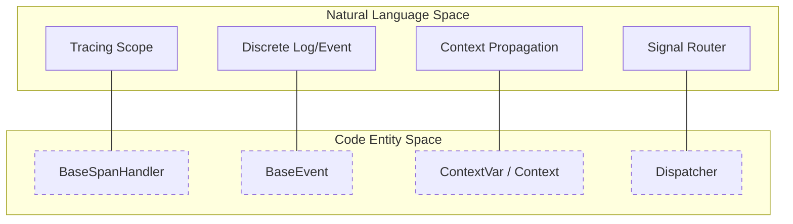
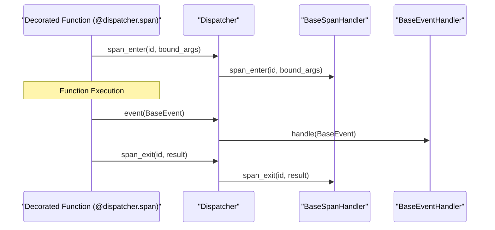
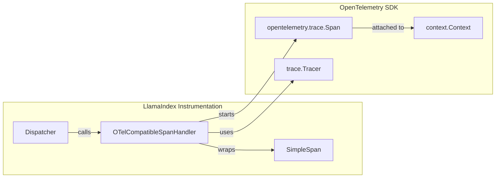

<!-- source: DeepWiki mcp.deepwiki.com · repo run-llama/llama_index · page 11.1 Instrumentation Framework · fetched 2026-11-09 -->

# Instrumentation Framework

<details>
<summary>Relevant source files</summary>

The following files were used as context for generating this wiki page:

- [llama-index-core/llama_index/core/async_utils.py](llama-index-core/llama_index/core/async_utils.py)
- [llama-index-core/llama_index/core/base/embeddings/base.py](llama-index-core/llama_index/core/base/embeddings/base.py)
- [llama-index-core/llama_index/core/base/embeddings/base_sparse.py](llama-index-core/llama_index/core/base/embeddings/base_sparse.py)
- [llama-index-core/llama_index/core/base/llms/base.py](llama-index-core/llama_index/core/base/llms/base.py)
- [llama-index-core/llama_index/core/embeddings/multi_modal_base.py](llama-index-core/llama_index/core/embeddings/multi_modal_base.py)
- [llama-index-core/llama_index/core/instrumentation/__init__.py](llama-index-core/llama_index/core/instrumentation/__init__.py)
- [llama-index-core/llama_index/core/instrumentation/base_handler.py](llama-index-core/llama_index/core/instrumentation/base_handler.py)
- [llama-index-core/llama_index/core/instrumentation/dispatcher.py](llama-index-core/llama_index/core/instrumentation/dispatcher.py)
- [llama-index-core/llama_index/core/instrumentation/event_handlers/__init__.py](llama-index-core/llama_index/core/instrumentation/event_handlers/__init__.py)
- [llama-index-core/llama_index/core/instrumentation/event_handlers/base.py](llama-index-core/llama_index/core/instrumentation/event_handlers/base.py)
- [llama-index-core/llama_index/core/instrumentation/event_handlers/null.py](llama-index-core/llama_index/core/instrumentation/event_handlers/null.py)
- [llama-index-core/llama_index/core/instrumentation/events/base.py](llama-index-core/llama_index/core/instrumentation/events/base.py)
- [llama-index-core/llama_index/core/instrumentation/events/embedding.py](llama-index-core/llama_index/core/instrumentation/events/embedding.py)
- [llama-index-core/llama_index/core/instrumentation/events/exception.py](llama-index-core/llama_index/core/instrumentation/events/exception.py)
- [llama-index-core/llama_index/core/instrumentation/events/llm.py](llama-index-core/llama_index/core/instrumentation/events/llm.py)
- [llama-index-core/llama_index/core/instrumentation/events/span.py](llama-index-core/llama_index/core/instrumentation/events/span.py)
- [llama-index-core/llama_index/core/instrumentation/span/__init__.py](llama-index-core/llama_index/core/instrumentation/span/__init__.py)
- [llama-index-core/llama_index/core/instrumentation/span/base.py](llama-index-core/llama_index/core/instrumentation/span/base.py)
- [llama-index-core/llama_index/core/instrumentation/span/simple.py](llama-index-core/llama_index/core/instrumentation/span/simple.py)
- [llama-index-core/llama_index/core/instrumentation/span_handlers/__init__.py](llama-index-core/llama_index/core/instrumentation/span_handlers/__init__.py)
- [llama-index-core/llama_index/core/instrumentation/span_handlers/base.py](llama-index-core/llama_index/core/instrumentation/span_handlers/base.py)
- [llama-index-core/llama_index/core/instrumentation/span_handlers/null.py](llama-index-core/llama_index/core/instrumentation/span_handlers/null.py)
- [llama-index-core/llama_index/core/instrumentation/span_handlers/simple.py](llama-index-core/llama_index/core/instrumentation/span_handlers/simple.py)
- [llama-index-core/llama_index/core/llms/callbacks.py](llama-index-core/llama_index/core/llms/callbacks.py)
- [llama-index-core/llama_index/core/rate_limiter.py](llama-index-core/llama_index/core/rate_limiter.py)
- [llama-index-core/llama_index/core/sparse_embeddings/__init__.py](llama-index-core/llama_index/core/sparse_embeddings/__init__.py)
- [llama-index-core/llama_index/core/sparse_embeddings/mock_sparse_embedding.py](llama-index-core/llama_index/core/sparse_embeddings/mock_sparse_embedding.py)
- [llama-index-core/tests/embeddings/test_base.py](llama-index-core/tests/embeddings/test_base.py)
- [llama-index-core/tests/embeddings/test_with_cache.py](llama-index-core/tests/embeddings/test_with_cache.py)
- [llama-index-core/tests/llms/test_callbacks.py](llama-index-core/tests/llms/test_callbacks.py)
- [llama-index-core/tests/sparse_embeddings/__init__.py](llama-index-core/tests/sparse_embeddings/__init__.py)
- [llama-index-core/tests/sparse_embeddings/test_mock_sparse_embeddings.py](llama-index-core/tests/sparse_embeddings/test_mock_sparse_embeddings.py)
- [llama-index-core/tests/test_async_utils.py](llama-index-core/tests/test_async_utils.py)
- [llama-index-core/tests/test_rate_limiter.py](llama-index-core/tests/test_rate_limiter.py)
- [llama-index-instrumentation/pyproject.toml](llama-index-instrumentation/pyproject.toml)
- [llama-index-instrumentation/src/llama_index_instrumentation/dispatcher.py](llama-index-instrumentation/src/llama_index_instrumentation/dispatcher.py)
- [llama-index-instrumentation/src/llama_index_instrumentation/event_handlers/base.py](llama-index-instrumentation/src/llama_index_instrumentation/event_handlers/base.py)
- [llama-index-instrumentation/src/llama_index_instrumentation/py.typed](llama-index-instrumentation/src/llama_index_instrumentation/py.typed)
- [llama-index-instrumentation/src/llama_index_instrumentation/span_handlers/base.py](llama-index-instrumentation/src/llama_index_instrumentation/span_handlers/base.py)
- [llama-index-instrumentation/tests/test_dispatcher.py](llama-index-instrumentation/tests/test_dispatcher.py)
- [llama-index-instrumentation/tests/test_propagation.py](llama-index-instrumentation/tests/test_propagation.py)
- [llama-index-instrumentation/tests/test_shutdown.py](llama-index-instrumentation/tests/test_shutdown.py)
- [llama-index-instrumentation/uv.lock](llama-index-instrumentation/uv.lock)
- [llama-index-integrations/observability/llama-index-observability-otel/.gitignore](llama-index-integrations/observability/llama-index-observability-otel/.gitignore)
- [llama-index-integrations/observability/llama-index-observability-otel/LICENSE](llama-index-integrations/observability/llama-index-observability-otel/LICENSE)
- [llama-index-integrations/observability/llama-index-observability-otel/Makefile](llama-index-integrations/observability/llama-index-observability-otel/Makefile)
- [llama-index-integrations/observability/llama-index-observability-otel/README.md](llama-index-integrations/observability/llama-index-observability-otel/README.md)
- [llama-index-integrations/observability/llama-index-observability-otel/llama_index/observability/otel/__init__.py](llama-index-integrations/observability/llama-index-observability-otel/llama_index/observability/otel/__init__.py)
- [llama-index-integrations/observability/llama-index-observability-otel/llama_index/observability/otel/base.py](llama-index-integrations/observability/llama-index-observability-otel/llama_index/observability/otel/base.py)
- [llama-index-integrations/observability/llama-index-observability-otel/llama_index/observability/otel/utils.py](llama-index-integrations/observability/llama-index-observability-otel/llama_index/observability/otel/utils.py)
- [llama-index-integrations/observability/llama-index-observability-otel/pyproject.toml](llama-index-integrations/observability/llama-index-observability-otel/pyproject.toml)
- [llama-index-integrations/observability/llama-index-observability-otel/tests/test_otel.py](llama-index-integrations/observability/llama-index-observability-otel/tests/test_otel.py)
- [llama-index-integrations/observability/llama-index-observability-otel/uv.lock](llama-index-integrations/observability/llama-index-observability-otel/uv.lock)
- [llama-index-integrations/sparse_embeddings/llama-index-sparse-embeddings-fastembed/Makefile](llama-index-integrations/sparse_embeddings/llama-index-sparse-embeddings-fastembed/Makefile)
- [llama-index-integrations/sparse_embeddings/llama-index-sparse-embeddings-fastembed/README.md](llama-index-integrations/sparse_embeddings/llama-index-sparse-embeddings-fastembed/README.md)

</details>


The `llama-index-instrumentation` package provides a robust, event-driven framework for observing and tracing the execution of LlamaIndex applications. It is designed to be async-task and thread-safe, allowing for accurate hierarchy maintenance in complex RAG pipelines and workflows [llama-index-instrumentation/src/llama_index_instrumentation/dispatcher.py:59-64]().

## Core Architecture

The framework is built around four primary components:
1.  **Dispatcher**: The central hub that manages handlers and routes signals [llama-index-instrumentation/src/llama_index_instrumentation/dispatcher.py:50-58]().
2.  **BaseEvent**: Data structures representing discrete points in time or state changes [llama-index-core/llama_index/core/instrumentation/events/base.py:1]().
3.  **BaseSpanHandler**: Objects that manage the lifecycle of "spans" (operations with a duration) [llama-index-core/llama_index/core/instrumentation/span_handlers/base.py:1]().
4.  **BaseEventHandler**: Objects that process individual events as they occur [llama-index-core/llama_index/core/instrumentation/event_handlers/base.py:1]().

### System Overview and Code Mapping

The following diagram bridges the natural language concepts of observability to the specific code entities in the `llama-index-instrumentation` package.

**Observability Concept to Code Entity Mapping**


Sources: [llama-index-instrumentation/src/llama_index_instrumentation/dispatcher.py:50-88](), [llama-index-core/llama_index/core/instrumentation/events/base.py:1](), [llama-index-instrumentation/src/llama_index_instrumentation/dispatcher.py:30-32]()

## The Dispatcher

The `Dispatcher` class is responsible for sending signals to enter, exit, or drop spans, and for dispatching events to registered handlers [llama-index-instrumentation/src/llama_index_instrumentation/dispatcher.py:50-58]().

### Key Functions
-   **`event(event: BaseEvent, **kwargs)`**: Dispatches an event to all registered `event_handlers`. It also attaches tags from the current `active_instrument_tags` context [llama-index-instrumentation/src/llama_index_instrumentation/dispatcher.py:137-143]().
-   **`span_enter(...)` / `span_exit(...)`**: Notifies all registered `span_handlers` about the beginning or end of a logical operation [llama-index-instrumentation/src/llama_index_instrumentation/dispatcher.py:192-230]().
-   **`@span` decorator**: A convenience wrapper that automatically manages `span_enter` and `span_exit` for a function. It is used in core utilities like `run_jobs` in `async_utils.py` [llama-index-core/llama_index/core/async_utils.py:138-140]().

### Dispatcher Hierarchy and Propagation
Dispatchers can be organized in a tree structure. By default, events and spans propagate from a child dispatcher to its parent handlers unless `propagate` is set to `False` [llama-index-instrumentation/src/llama_index_instrumentation/dispatcher.py:81-84](). The `Manager` class (referenced via `self.manager`) maintains the registry of these dispatchers [llama-index-instrumentation/src/llama_index_instrumentation/dispatcher.py:77-79]().

**Dispatcher Signal Flow**


Sources: [llama-index-instrumentation/src/llama_index_instrumentation/dispatcher.py:137-153](), [llama-index-instrumentation/src/llama_index_instrumentation/dispatcher.py:192-230]()

## Span and Event Handlers

### BaseSpanHandler
Span handlers manage the state of operations that have a duration. They are responsible for creating span objects and maintaining the trace tree.
-   **Implementation**: Developers inherit from `BaseSpanHandler` [llama-index-core/llama_index/core/instrumentation/span_handlers/base.py:1]().
-   **SimpleSpanHandler**: A basic implementation that stores spans in memory, often used as a base for more complex handlers [llama-index-core/llama_index/core/instrumentation/span_handlers/simple.py:1]().
-   **NullSpanHandler**: The default span handler that performs no operations [llama-index-instrumentation/src/llama_index_instrumentation/dispatcher.py:72-73]().

### BaseEventHandler
Event handlers react to discrete `BaseEvent` instances.
-   **Implementation**: Inherit from `BaseEventHandler` and implement the `handle()` (sync) or `ahandle()` (async) methods [llama-index-instrumentation/src/llama_index_instrumentation/event_handlers/base.py:1-10]().

## Context Propagation

The framework uses `contextvars` to maintain trace context across asynchronous boundaries and threads.
-   **`active_instrument_tags`**: A `ContextVar` that stores a dictionary of tags to be attached to every event and span within that context [llama-index-instrumentation/src/llama_index_instrumentation/dispatcher.py:30-32]().
-   **`instrument_tags` context manager**: Allows temporary addition of tags to the current context [llama-index-instrumentation/src/llama_index_instrumentation/dispatcher.py:36-42]().
-   **`active_span_id`**: A `ContextVar` used to track the ID of the currently active span [llama-index-core/llama_index/core/instrumentation/span/__init__.py:1-3]().

## OpenTelemetry Integration

The `llama-index-observability-otel` package provides an `OTelCompatibleSpanHandler` that bridges LlamaIndex instrumentation with the OpenTelemetry standard [llama-index-integrations/observability/llama-index-observability-otel/llama_index/observability/otel/base.py:48-49]().

### OTel Implementation Details
-   **`new_span`**: When a LlamaIndex span starts, the handler starts a corresponding `opentelemetry.trace.Span`. It resolves the parent context by checking `all_spans` for a same-process parent or falling back to the ambient OTel context [llama-index-integrations/observability/llama-index-observability-otel/llama_index/observability/otel/base.py:161-185]().
-   **Context Detachment**: The handler manages OTel context tokens using `_detach_context_and_end_span` to ensure that contexts are correctly reset when spans end [llama-index-integrations/observability/llama-index-observability-otel/llama_index/observability/otel/base.py:143-160]().
-   **Propagation**: The handler supports `capture_propagation_context` and `restore_propagation_context` using OTel's `propagate` module to maintain traces across distributed system boundaries [llama-index-integrations/observability/llama-index-observability-otel/llama_index/observability/otel/base.py:112-125]().

**OpenTelemetry Bridge Mapping**


Sources: [llama-index-integrations/observability/llama-index-observability-otel/llama_index/observability/otel/base.py:48-185]()

## Instrumenting Custom Code

To instrument custom logic, developers use the `get_dispatcher` function to obtain a named dispatcher and apply the `@dispatcher.span` decorator.

### LLM and Embedding Instrumentation
Core components like `BaseLLM` and `BaseEmbedding` are heavily instrumented using these patterns. For example, `BaseEmbedding.get_query_embedding` emits `EmbeddingStartEvent` and `EmbeddingEndEvent` [llama-index-core/llama_index/core/base/embeddings/base.py:150-201](). Similarly, LLM chat operations emit events like `LLMChatStartEvent` and `LLMChatEndEvent` via decorators [llama-index-core/llama_index/core/llms/callbacks.py:49-65]().

```python
import llama_index.core.instrumentation as instrument
from llama_index.core.instrumentation.events.base import BaseEvent

# 1. Get a dispatcher for the module
dispatcher = instrument.get_dispatcher(__name__)

# 2. Define a custom event
class MyCustomEvent(BaseEvent):
    message: str

@dispatcher.span
def my_complex_operation(arg1: str):
    # 3. Dispatch an event inside the span
    dispatcher.event(MyCustomEvent(message=f"Processing {arg1}"))
    return "result"
```
Sources: [llama-index-core/llama_index/core/async_utils.py:9-11](), [llama-index-instrumentation/src/llama_index_instrumentation/dispatcher.py:137-143](), [llama-index-core/llama_index/core/base/embeddings/base.py:36-37]()

---

