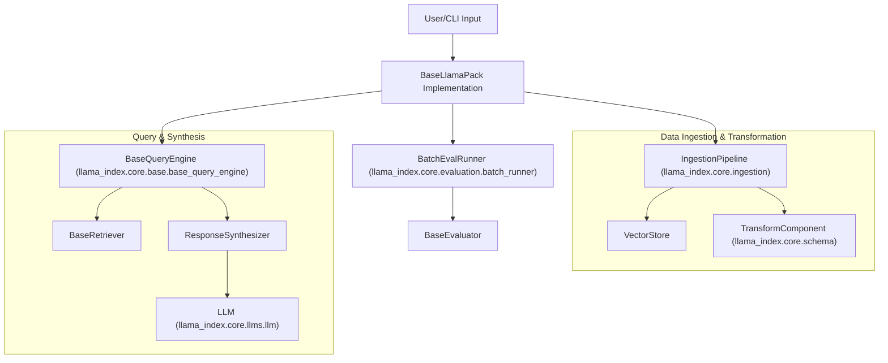
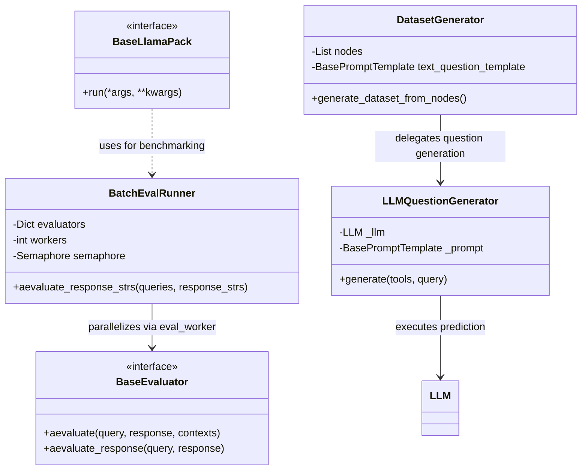

<!-- source: DeepWiki mcp.deepwiki.com · repo run-llama/llama_index · page 12.1 LlamaPacks · fetched 2026-11-09 -->

# LlamaPacks

Relevant source files

The following files were used as context for generating this wiki page:

- [docs/examples/retrievers/composable_retrievers.ipynb](docs/examples/retrievers/composable_retrievers.ipynb)
- [llama-index-core/llama_index/core/agent/react/prompts.py](llama-index-core/llama_index/core/agent/react/prompts.py)
- [llama-index-core/llama_index/core/agent/react/templates/system_header_template.md](llama-index-core/llama_index/core/agent/react/templates/system_header_template.md)
- [llama-index-core/llama_index/core/command_line/mappings.json](llama-index-core/llama_index/core/command_line/mappings.json)
- [llama-index-core/llama_index/core/command_line/upgrade.py](llama-index-core/llama_index/core/command_line/upgrade.py)
- [llama-index-core/llama_index/core/embeddings/utils.py](llama-index-core/llama_index/core/embeddings/utils.py)
- [llama-index-core/llama_index/core/evaluation/batch_runner.py](llama-index-core/llama_index/core/evaluation/batch_runner.py)
- [llama-index-core/llama_index/core/evaluation/dataset_generation.py](llama-index-core/llama_index/core/evaluation/dataset_generation.py)
- [llama-index-core/llama_index/core/evaluation/eval_utils.py](llama-index-core/llama_index/core/evaluation/eval_utils.py)
- [llama-index-core/llama_index/core/ingestion/api_utils.py](llama-index-core/llama_index/core/ingestion/api_utils.py)
- [llama-index-core/llama_index/core/question_gen/llm_generators.py](llama-index-core/llama_index/core/question_gen/llm_generators.py)
- [llama-index-core/tests/embeddings/test_utils.py](llama-index-core/tests/embeddings/test_utils.py)
- [llama-index-core/tests/evaluation/test_batch_runner.py](llama-index-core/tests/evaluation/test_batch_runner.py)
- [llama-index-core/tests/evaluation/test_dataset_generation.py](llama-index-core/tests/evaluation/test_dataset_generation.py)
- [llama-index-core/tests/question_gen/test_llm_generators.py](llama-index-core/tests/question_gen/test_llm_generators.py)
- [llama-index-integrations/callbacks/llama-index-callbacks-wandb/llama_index/callbacks/wandb/base.py](llama-index-integrations/callbacks/llama-index-callbacks-wandb/llama_index/callbacks/wandb/base.py)
- [llama-index-integrations/callbacks/llama-index-callbacks-wandb/pyproject.toml](llama-index-integrations/callbacks/llama-index-callbacks-wandb/pyproject.toml)
- [llama-index-integrations/callbacks/llama-index-callbacks-wandb/tests/test_wandb_callback.py](llama-index-integrations/callbacks/llama-index-callbacks-wandb/tests/test_wandb_callback.py)
- [llama-index-integrations/indices/llama-index-indices-managed-llama-cloud/README.md](llama-index-integrations/indices/llama-index-indices-managed-llama-cloud/README.md)
- [llama-index-integrations/indices/llama-index-indices-managed-llama-cloud/pyproject.toml](llama-index-integrations/indices/llama-index-indices-managed-llama-cloud/pyproject.toml)
- [llama-index-integrations/indices/llama-index-indices-managed-llama-cloud/uv.lock](llama-index-integrations/indices/llama-index-indices-managed-llama-cloud/uv.lock)
- [llama-index-integrations/readers/llama-index-readers-llama-parse/README.md](llama-index-integrations/readers/llama-index-readers-llama-parse/README.md)
- [llama-index-integrations/readers/llama-index-readers-llama-parse/pyproject.toml](llama-index-integrations/readers/llama-index-readers-llama-parse/pyproject.toml)

LlamaPacks are a collection of pre-packaged, "ready-to-run" templates designed to jumpstart the development of complex LLM applications. Unlike core abstractions which provide building blocks, LlamaPacks combine these blocks into full-featured pipelines for specific use cases like advanced retrieval (RAPTOR, RecursiveRetriever), evaluation, or specialized agentic workflows.

## Concept and Architecture

LlamaPacks serve as a bridge between the "Natural Language Space" of user requirements and the "Code Entity Space" of the LlamaIndex framework. Each pack typically encapsulates a complete RAG (Retrieval-Augmented Generation) pipeline, including data ingestion, indexing strategy, and query logic.

### Structural Overview

LlamaPacks are distributed as independent packages under the `llama-index-packs` namespace. They leverage `llama-index-core` for base abstractions but often include specific configurations for LLMs and embedding models. For example, many packs utilize `resolve_embed_model` to handle embedding model initialization from strings, local configurations, or the global `Settings` object [llama-index-core/llama_index/core/embeddings/utils.py:30-139]().

**System Data Flow: Pack Initialization and Execution**

The following diagram illustrates how a LlamaPack coordinates internal components to bridge user queries to core framework entities.

Sources: [llama-index-core/llama_index/core/evaluation/batch_runner.py:75-98](), [llama-index-core/llama_index/core/evaluation/dataset_generation.py:3-6](), [llama-index-core/llama_index/core/embeddings/utils.py:30-40](), [llama-index-core/llama_index/core/command_line/mappings.json:5-18]()

## Installation and CLI Usage

LlamaPacks can be managed via the `llamaindex-cli`. The CLI allows users to download packs as templates that can be customized locally. While managed services like LlamaCloud offer production-grade ingestion and retrieval via `LlamaCloudIndex` and `LlamaCloudRetriever` [llama-index-integrations/indices/llama-index-indices-managed-llama-cloud/README.md:5-11](), LlamaPacks provide a local-first, customizable alternative.

### Key CLI Commands
- **Download**: Downloads a pack from LlamaHub into a local directory for inspection and modification.
- **RAG CLI**: A built-in pack-like interface for immediate interaction with local files.

| Feature | Implementation |
| --- | --- |
| **Model Resolution** | Uses `resolve_embed_model` to instantiate `BaseEmbedding` from `Settings` or environment variables [llama-index-core/llama_index/core/embeddings/utils.py:30-36]() |
| **Evaluation** | Integrates `BatchEvalRunner` to parallelize `BaseEvaluator` tasks across multiple workers using `asyncio.Semaphore` [llama-index-core/llama_index/core/evaluation/batch_runner.py:87-95]() |
| **Data Handling** | Leverages `SimpleDirectoryReader` for initial document loading before pack processing [llama-index-integrations/indices/llama-index-indices-managed-llama-cloud/README.md:44-54]() |

Sources: [llama-index-core/llama_index/core/embeddings/utils.py:30-139](), [llama-index-core/llama_index/core/evaluation/batch_runner.py:75-98](), [llama-index-integrations/indices/llama-index-indices-managed-llama-cloud/README.md:44-58]()

## Key LlamaPacks

The ecosystem contains numerous specialized packs. Below are the most technically significant implementations.

### 1. RAPTOR (Recursive Abstractive Processing for Tree-Organized Retrieval)
RAPTOR builds a hierarchical tree of summaries from documents. It recursively clusters nodes and generates summaries, allowing the retriever to access both high-level thematic information and low-level details.
- **Logic**: It uses a recursive summarization process where clusters of nodes are summarized into parent nodes, forming a tree structure.

### 2. RecursiveRetriever
This pack implements a strategy where the retriever can follow "references" from one node to another. This is particularly useful for hierarchical documents where a summary node might point to detailed child nodes.
- **Integration**: Often paired with `LlamaParse` for high-quality document decomposition and parsing into Markdown or Text [llama-index-integrations/readers/llama-index-readers-llama-parse/README.md:5-7](), [llama-index-integrations/readers/llama-index-readers-llama-parse/README.md:33-39]().

### 3. SentenceWindowRetriever
Instead of retrieving a single chunk, this pack retrieves a specific sentence and its surrounding "window" of sentences. This provides the LLM with better context while keeping the embedding search granular.
- **Implementation**: Utilizes a `MetadataReplacementPostProcessor` to swap the retrieved sentence with the full window stored in metadata.

### 4. DenseXRetrieval
DenseX focuses on improving dense retrieval by using "propositions"—atomic expressions of thoughts—rather than standard sentences or chunks.

## Customization and Evaluation

LlamaPacks are designed to be subclassed. The standard implementation pattern involves defining a `run` method that orchestrates the internal components.

**Entity Association: Evaluation Logic to Core Components**

Sources: [llama-index-core/llama_index/core/evaluation/batch_runner.py:75-98](), [llama-index-core/llama_index/core/evaluation/dataset_generation.py:3-6](), [llama-index-core/llama_index/core/evaluation/eval_utils.py:18-26](), [llama-index-core/llama_index/core/evaluation/batch_runner.py:40-57](), [llama-index-core/llama_index/core/question_gen/llm_generators.py:20-50]()

### Automated Benchmarking
Many packs integrate with `BatchEvalRunner` to allow for asynchronous evaluation of query results [llama-index-core/llama_index/core/evaluation/batch_runner.py:195-201](). This is often paired with `DatasetGenerator` which uses an LLM (via `LLMQuestionGenerator`) to generate synthetic question-answer pairs from provided `Nodes` for testing the pack's retrieval accuracy [llama-index-core/llama_index/core/evaluation/dataset_generation.py:26-31](), [llama-index-core/llama_index/core/question_gen/llm_generators.py:67-81](). Results can be formatted into DataFrames for comparison using `get_results_df` [llama-index-core/llama_index/core/evaluation/eval_utils.py:42-74]().

Sources: [llama-index-core/llama_index/core/evaluation/batch_runner.py:75-98](), [llama-index-core/llama_index/core/evaluation/dataset_generation.py:26-31](), [llama-index-core/llama_index/core/evaluation/eval_utils.py:42-74](), [llama-index-core/llama_index/core/question_gen/llm_generators.py:67-81]()

---

