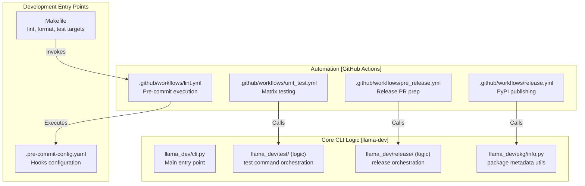
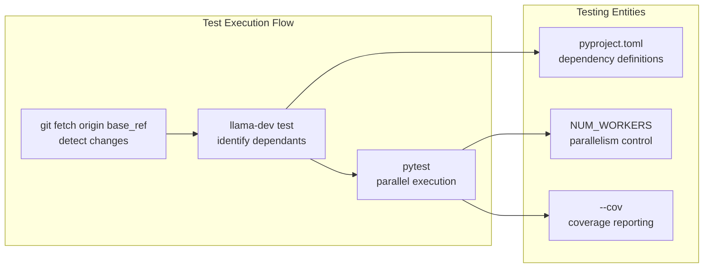

<!-- source: DeepWiki mcp.deepwiki.com · repo run-llama/llama_index · page 13 Development · fetched 2026-11-09 -->

# Development

Relevant source files

The following files were used as context for generating this wiki page:

- [.github/workflows/build_package.yml](.github/workflows/build_package.yml)
- [.github/workflows/codeql.yml](.github/workflows/codeql.yml)
- [.github/workflows/core-typecheck.yml](.github/workflows/core-typecheck.yml)
- [.github/workflows/coverage_check.yml](.github/workflows/coverage_check.yml)
- [.github/workflows/issue_classifier.yml](.github/workflows/issue_classifier.yml)
- [.github/workflows/lint.yml](.github/workflows/lint.yml)
- [.github/workflows/llama_dev_tests.yml](.github/workflows/llama_dev_tests.yml)
- [.github/workflows/pre_release.yml](.github/workflows/pre_release.yml)
- [.github/workflows/publish_sub_package.yml](.github/workflows/publish_sub_package.yml)
- [.github/workflows/release.yml](.github/workflows/release.yml)
- [.github/workflows/unit_test.yml](.github/workflows/unit_test.yml)
- [.gitignore](.gitignore)
- [.pre-commit-config.yaml](.pre-commit-config.yaml)
- [Makefile](Makefile)
- [docs/scripts/prepare_for_build.py](docs/scripts/prepare_for_build.py)
- [llama-index-core/.gitignore](llama-index-core/.gitignore)
- [llama-index-integrations/vector_stores/llama-index-vector-stores-wordlift/.gitignore](llama-index-integrations/vector_stores/llama-index-vector-stores-wordlift/.gitignore)
- [llama-index-integrations/vector_stores/llama-index-vector-stores-wordlift/Makefile](llama-index-integrations/vector_stores/llama-index-vector-stores-wordlift/Makefile)
- [llama-index-integrations/vector_stores/llama-index-vector-stores-wordlift/README.md](llama-index-integrations/vector_stores/llama-index-vector-stores-wordlift/README.md)
- [llama-index-integrations/vector_stores/llama-index-vector-stores-wordlift/llama_index/vector_stores/wordlift/__init__.py](llama-index-integrations/vector_stores/llama-index-vector-stores-wordlift/llama_index/vector_stores/wordlift/__init__.py)

This document provides an overview of the development infrastructure, tooling, and processes for contributing to LlamaIndex. It covers the monorepo structure, central CLI tools, CI/CD pipelines, testing frameworks, release automation, and documentation generation systems.

For detailed information about specific aspects of development:
- [Testing System](#13.1) — Explain test structure, fixtures, mocking patterns, and running tests. Covers the `llama-dev` CLI tool for monorepo test orchestration, smart change detection, and parallel test execution.
- [Release Process](#13.2) — Document versioning, CHANGELOG maintenance, and release procedures. Covers the `llama-dev` CLI release commands, bulk version bumping scripts, and package publishing workflows.
- [Documentation System](#13.3) — Explain docs structure, mkdocs configuration, and API reference generation.

## Development Ecosystem Overview

The LlamaIndex repository is organized as a **monorepo** containing hundreds of packages managed through a unified development infrastructure. The ecosystem is built around three core pillars:

1.  **`uv`** - Fast Python package and project manager used for environment sync, dependency resolution, and building distributions [[.github/workflows/unit_test.yml:27-31]](), [[.github/workflows/build_package.yml:33-39]]().
2.  **`llama-dev`** - Central CLI tool located in `llama-dev/` for testing, versioning, and release orchestration [[.github/workflows/unit_test.yml:38-41]](), [[.github/workflows/release.yml:65]]().
3.  **GitHub Actions** - CI/CD automation in `.github/workflows/` with quality gates on every pull request [[.github/workflows/unit_test.yml:1-5]](), [[.github/workflows/lint.yml:1-8]]().

### Monorepo Structure

The repository distinguishes between core framework code and modular integrations.

| Package Category | Directory | Description |
| :--- | :--- | :--- |
| **Core** | `llama-index-core/` | Base abstractions and framework logic [[.github/workflows/release.yml:32-35]](). |
| **Integrations** | `llama-index-integrations/` | Provider-specific implementations (LLMs, Vector Stores, etc.) [[Makefile:19-20]](). |
| **Dev Tooling** | `llama-dev/` | Internal CLI for monorepo management [[.github/workflows/unit_test.yml:35-41]](). |
| **Meta Package** | `.` (root) | Starter package bundling core and common integrations [[.github/workflows/release.yml:105-120]](). |

**Sources**: [[.github/workflows/unit_test.yml:35-41]](), [[.github/workflows/release.yml:32-35]](), [[Makefile:16-30]]()

### Code-to-System Mapping

The following diagram bridges natural language development concepts to specific code entities within the repository.

**Sources**: [[Makefile:1-33]](), [[.github/workflows/unit_test.yml:38-41]](), [[.github/workflows/release.yml:109]](), [[.github/workflows/pre_release.yml:47-48]](), [[.pre-commit-config.yaml:1-121]]()

## Developer Workflow

The typical development workflow maps to specific commands and tools. Contributors are expected to use `uv` for environment management and `pre-commit` for code quality.

### Local Setup and Linting

1.  **Environment Sync**: Use `uv sync` within package directories to set up virtual environments [[.github/workflows/release.yml:34]](), [[.github/workflows/publish_sub_package.yml:48]]().
2.  **Linting**: Run `uv run pre-commit run -a` to execute `ruff`, `mypy`, `black`, and `codespell` checks [[.github/workflows/lint.yml:23]](), [[.pre-commit-config.yaml:24-121]]().
3.  **Type Checking**: Core type safety is enforced via `mypy` running against the framework [[.github/workflows/core-typecheck.yml:25]](), [[.pre-commit-config.yaml:41-63]]().

**Sources**: [[.github/workflows/lint.yml:21-23]](), [[.pre-commit-config.yaml:1-121]](), [[.github/workflows/core-typecheck.yml:23-25]]()

### Testing Workflow

Testing is performed using `pytest`. The `llama-dev` tool allows for selective testing of changed packages by identifying dependants across the monorepo via the `--base-ref` flag [[.github/workflows/unit_test.yml:37-41]]().

For details, see [Testing System](#13.1).

**Sources**: [[.github/workflows/unit_test.yml:7-8,37-41,69]](), [[Makefile:13-30]]()

## CI/CD and Quality Gates

Every pull request must pass through automated quality gates before merging.

### Automated Workflows

| Workflow | File Path | Purpose |
| :--- | :--- | :--- |
| **Unit Testing** | `.github/workflows/unit_test.yml` | Runs tests across Python 3.10-3.12 and 3.14 (core) [[.github/workflows/unit_test.yml:16,43]](). |
| **Linting** | `.github/workflows/lint.yml` | Enforces style and type safety via `pre-commit` [[.github/workflows/lint.yml:23]](). |
| **Build Check** | `.github/workflows/build_package.yml` | Verifies package can be built and imported on Ubuntu/Windows [[.github/workflows/build_package.yml:13-43]](). |
| **Issue Classifier** | `.github/workflows/issue_classifier.yml` | Periodically labels "good first issues" using LLMs [[.github/workflows/issue_classifier.yml:21-28]](). |
| **CodeQL** | `.github/workflows/codeql.yml` | Performs semantic analysis for security vulnerabilities [[.github/workflows/codeql.yml:12-82]](). |

### Coverage and Compatibility
CI/CD utilizes a matrix strategy to ensure compatibility across Python versions [[.github/workflows/unit_test.yml:13-16]](). Coverage is tracked for core packages using the `--cov` flag in `llama-dev` [[.github/workflows/unit_test.yml:69]]().

**Sources**: [[.github/workflows/unit_test.yml:1-71]](), [[.github/workflows/lint.yml:1-23]](), [[.github/workflows/build_package.yml:1-43]](), [[.github/workflows/codeql.yml:1-82]]()

## Release and Documentation

The release process is highly automated, involving version bumping, changelog generation, and PyPI publishing.

- **Release Process**: Managed via `release.yml` and `pre_release.yml`. It handles PyPI publishing for `llama-index-core` and the meta-package, including build provenance attestations [[.github/workflows/release.yml:43-60]](). For details, see [Release Process](#13.2).
- **Sub-package Publishing**: Integrations are automatically published to PyPI when changes to their `pyproject.toml` files are pushed to main [[.github/workflows/publish_sub_package.yml:20-58]]().
- **Documentation**: The system uses `mkdocs` and scripts like `prepare_for_build.py` to organize the documentation suite [[.github/workflows/pre_release.yml:35-37]](). Documentation can be previewed locally using `make watch-docs` [[Makefile:31-32]](). For details, see [Documentation System](#13.3).

**Sources**: [[.github/workflows/release.yml:1-138]](), [[.github/workflows/pre_release.yml:1-63]](), [[.github/workflows/publish_sub_package.yml:1-58]](), [[Makefile:31-32]]()

---

