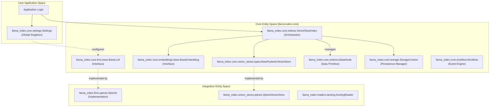
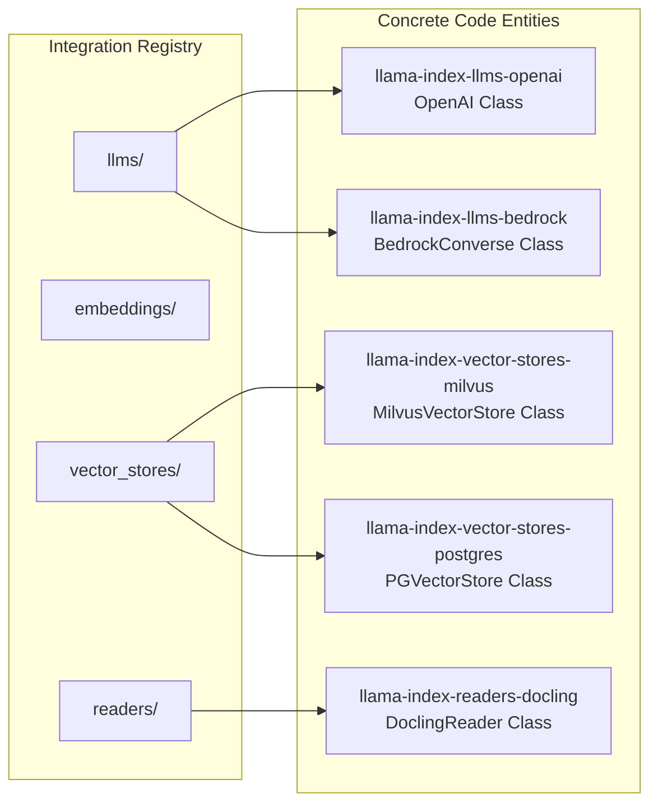
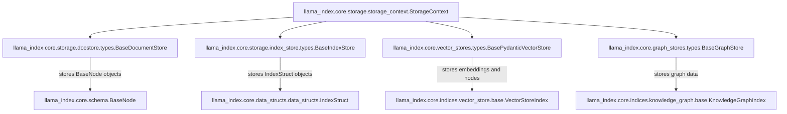

<!-- source: DeepWiki mcp.deepwiki.com · repo run-llama/llama_index · page 2 Architecture · fetched 2026-11-09 -->

# Architecture

Relevant source files

The following files were used as context for generating this wiki page:

- [.github/workflows/close_new_integration_prs.yml](.github/workflows/close_new_integration_prs.yml)
- [CHANGELOG.md](CHANGELOG.md)
- [CONTRIBUTING.md](CONTRIBUTING.md)
- [README.md](README.md)
- [docs/DOCS_README.md](docs/DOCS_README.md)
- [docs/api_reference/api_reference/llms/azure_openai.md](docs/api_reference/api_reference/llms/azure_openai.md)
- [docs/api_reference/api_reference/llms/minimax.md](docs/api_reference/api_reference/llms/minimax.md)
- [docs/api_reference/api_reference/llms/openai_like.md](docs/api_reference/api_reference/llms/openai_like.md)
- [docs/api_reference/api_reference/llms/sarvam.md](docs/api_reference/api_reference/llms/sarvam.md)
- [docs/api_reference/api_reference/memory/bedrock_agentcore.md](docs/api_reference/api_reference/memory/bedrock_agentcore.md)
- [docs/api_reference/api_reference/postprocessor/google_rerank.md](docs/api_reference/api_reference/postprocessor/google_rerank.md)
- [docs/api_reference/api_reference/storage/vector_store/solr.md](docs/api_reference/api_reference/storage/vector_store/solr.md)
- [docs/api_reference/api_reference/tools/aws_bedrock_agentcore.md](docs/api_reference/api_reference/tools/aws_bedrock_agentcore.md)
- [docs/api_reference/mkdocs.yml](docs/api_reference/mkdocs.yml)
- [docs/src/content/docs/framework/CHANGELOG.md](docs/src/content/docs/framework/CHANGELOG.md)
- [docs/src/content/docs/framework/CONTRIBUTING.md](docs/src/content/docs/framework/CONTRIBUTING.md)
- [llama-index-core/llama_index/core/__init__.py](llama-index-core/llama_index/core/__init__.py)
- [llama-index-core/llama_index/core/indices/base.py](llama-index-core/llama_index/core/indices/base.py)
- [llama-index-core/llama_index/core/indices/vector_store/base.py](llama-index-core/llama_index/core/indices/vector_store/base.py)
- [llama-index-core/llama_index/core/storage/index_store/keyval_index_store.py](llama-index-core/llama_index/core/storage/index_store/keyval_index_store.py)
- [llama-index-core/llama_index/core/storage/index_store/types.py](llama-index-core/llama_index/core/storage/index_store/types.py)
- [llama-index-core/pyproject.toml](llama-index-core/pyproject.toml)
- [llama-index-core/tests/indices/list/test_index.py](llama-index-core/tests/indices/list/test_index.py)
- [llama-index-core/tests/indices/vector_store/test_simple.py](llama-index-core/tests/indices/vector_store/test_simple.py)
- [llama-index-core/tests/indices/vector_store/test_simple_async.py](llama-index-core/tests/indices/vector_store/test_simple_async.py)
- [llama-index-core/uv.lock](llama-index-core/uv.lock)
- [llama-index-integrations/storage/index_store/llama-index-storage-index-store-dynamodb/llama_index/storage/index_store/dynamodb/base.py](llama-index-integrations/storage/index_store/llama-index-storage-index-store-dynamodb/llama_index/storage/index_store/dynamodb/base.py)
- [llama-index-integrations/storage/index_store/llama-index-storage-index-store-elasticsearch/llama_index/storage/index_store/elasticsearch/base.py](llama-index-integrations/storage/index_store/llama-index-storage-index-store-elasticsearch/llama_index/storage/index_store/elasticsearch/base.py)
- [llama-index-integrations/storage/index_store/llama-index-storage-index-store-elasticsearch/pyproject.toml](llama-index-integrations/storage/index_store/llama-index-storage-index-store-elasticsearch/pyproject.toml)
- [llama-index-integrations/storage/index_store/llama-index-storage-index-store-firestore/llama_index/storage/index_store/firestore/base.py](llama-index-integrations/storage/index_store/llama-index-storage-index-store-firestore/llama_index/storage/index_store/firestore/base.py)
- [llama-index-integrations/storage/index_store/llama-index-storage-index-store-mongodb/llama_index/storage/index_store/mongodb/base.py](llama-index-integrations/storage/index_store/llama-index-storage-index-store-mongodb/llama_index/storage/index_store/mongodb/base.py)
- [llama-index-integrations/storage/index_store/llama-index-storage-index-store-postgres/llama_index/storage/index_store/postgres/base.py](llama-index-integrations/storage/index_store/llama-index-storage-index-store-postgres/llama_index/storage/index_store/postgres/base.py)
- [llama-index-integrations/storage/index_store/llama-index-storage-index-store-redis/llama_index/storage/index_store/redis/base.py](llama-index-integrations/storage/index_store/llama-index-storage-index-store-redis/llama_index/storage/index_store/redis/base.py)
- [pyproject.toml](pyproject.toml)
- [uv.lock](uv.lock)

This document describes the overall system architecture of LlamaIndex, including its layered design, package structure, core abstractions, and how components interact to enable LLM applications. For information about specific subsystems, see [Package Structure](#2.1) for organization details, [Integration Ecosystem](#2.2) for the plugin system, and [Data Flow Pipeline](#2.3) for RAG execution patterns.

## Overview

LlamaIndex follows a **three-tier plugin architecture** designed to provide flexibility and extensibility for building LLM applications. The system separates core abstractions from concrete implementations, allowing developers to swap components (LLMs, vector stores, embeddings, etc.) without changing application logic.

The architecture consists of:
1.  **Core Foundation Layer** (`llama-index-core`): Base abstractions, orchestration systems, and framework primitives. [llama-index-core/pyproject.toml:35-87]()
2.  **Integration Ecosystem** (`llama-index-integrations`): 300+ plugin implementations for LLMs, vector stores, embeddings, readers, and tools. [CHANGELOG.md:7-135]()
3.  **Application Layer**: High-level components like indices, query engines, retrievers, and agents that compose lower layers. [llama-index-core/llama_index/core/__init__.py:26-48]()

Sources: [pyproject.toml:34-71](), [llama-index-core/pyproject.toml:35-87](), [llama-index-core/llama_index/core/__init__.py:1-140]()

## Core Architecture Diagram

This diagram bridges Natural Language concepts to the specific Code Entities used in the framework.

**LlamaIndex System to Code Entity Mapping**

Sources: [llama-index-core/llama_index/core/__init__.py:78-81](), [llama-index-core/llama_index/core/schema.py:81-223](), [llama-index-core/llama_index/core/indices/base.py:25-86]()

## Layered Architecture

### Foundation Layer

The foundation layer in `llama-index-core` provides base abstractions that define contracts for all integrations. Most core components inherit from `BaseComponent` to support unified serialization via Pydantic. [llama-index-core/llama_index/core/schema.py:81-108]()

| Abstraction | Module Path | Purpose |
|-------------|-------------|---------|
| `BaseLLM` | `llama_index.core.llms.base` | Interface for language models (chat, completion, streaming). |
| `BaseEmbedding` | `llama_index.core.embeddings.base` | Interface for embedding models. |
| `BasePydanticVectorStore` | `llama_index.core.vector_stores.types` | Interface for vector databases. |
| `BaseNode` | `llama_index.core.schema` | Atomic data unit containing text/metadata. [llama-index-core/llama_index/core/schema.py:207-223]() |
| `Workflow` | `llama_index.core.workflow` | Event-driven orchestration engine. [llama-index-core/pyproject.toml:83]() |
| `TransformComponent` | `llama_index.core.schema` | Base for node transformations and parsers. [llama-index-core/llama_index/core/schema.py:191-206]() |

Sources: [llama-index-core/llama_index/core/schema.py:81-223](), [llama-index-core/llama_index/core/__init__.py:16-85]()

### Integration Layer

Integrations implement core abstractions and are distributed as separate packages. They follow the naming convention `llama-index-{category}-{provider}`. [CHANGELOG.md:7-135]()

**Integration Taxonomy and Code Associations**

Sources: [CHANGELOG.md:45-86](), [pyproject.toml:42-46]()

## Configuration and Settings

The `Settings` object is a global singleton providing defaults for LLMs, embeddings, and tokenizers. [llama-index-core/llama_index/core/__init__.py:78]()

- **Global Defaults**: Setting `Settings.llm` updates the default model for all query engines and agents. [llama-index-core/llama_index/core/indices/base.py:69]()
- **Transformation Management**: Global transformations (like node parsers) can be configured via `Settings.transformations`. [llama-index-core/llama_index/core/indices/base.py:86]()
- **Callback Manager**: Instrumentation and observability are managed via `Settings.callback_manager`. [llama-index-core/llama_index/core/indices/base.py:69]()

Sources: [llama-index-core/llama_index/core/indices/base.py:64-86](), [llama-index-core/llama_index/core/__init__.py:78-87]()

## Data and Storage Architecture

LlamaIndex uses a multi-part storage system managed via `StorageContext`. [llama-index-core/llama_index/core/__init__.py:81]()

- **Document Store**: Stores `BaseNode` objects and their metadata via `BaseDocumentStore`. [llama-index-core/llama_index/core/indices/base.py:65-161]()
- **Index Store**: Stores `IndexStruct` data defining how nodes are organized (e.g., Tree, VectorStore) via `BaseIndexStore`. [llama-index-core/llama_index/core/indices/base.py:84](), [llama-index-core/llama_index/core/storage/index_store/types.py:12-55]()
- **Vector Store**: Specialized store for embedding vectors and similarity search. [llama-index-core/llama_index/core/indices/base.py:67]()
- **Graph Store**: Specialized store for property graphs and knowledge graph triplets. [llama-index-core/llama_index/core/indices/base.py:68]()

**Storage Context Components**

Sources: [llama-index-core/llama_index/core/indices/base.py:64-86](), [llama-index-core/llama_index/core/__init__.py:21-48](), [llama-index-core/llama_index/core/storage/index_store/types.py:12-55](), [llama-index-core/llama_index/core/indices/vector_store/base.py:36-48]()

## Execution Frameworks

The architecture supports three distinct execution patterns:

1.  **Pipeline Pattern (RAG)**: Linear flow from `SimpleDirectoryReader` -> `run_transformations` -> `VectorStoreIndex` -> `BaseRetriever` -> `ResponseSynthesizer`. [llama-index-core/llama_index/core/__init__.py:67-71](), [llama-index-core/llama_index/core/indices/base.py:115-121]()
2.  **Workflow Pattern**: Event-driven execution using `llama-index-workflows`. This is the modern engine for complex, non-linear LLM logic involving steps and events. [llama-index-core/pyproject.toml:83](), [llama-index-core/CHANGELOG.md:38-38]()
3.  **Agentic Pattern**: Autonomous loops where an LLM uses tools (like `FunctionTool`) to fulfill queries, often implemented as workflow-based agents. [CHANGELOG.md:27-32]()

For details, see:
- [Package Structure](#2.1) — Organization of the core and integration packages.
- [Integration Ecosystem](#2.2) — How the 300+ plugins connect to the core.
- [Data Flow Pipeline](#2.3) — The internal mechanics of the RAG and Workflow pipelines.

Sources: [llama-index-core/pyproject.toml:57-87](), [llama-index-core/llama_index/core/__init__.py:1-140](), [llama-index-core/llama_index/core/indices/base.py:89-130]()

---

