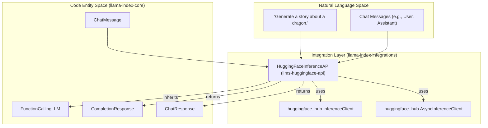
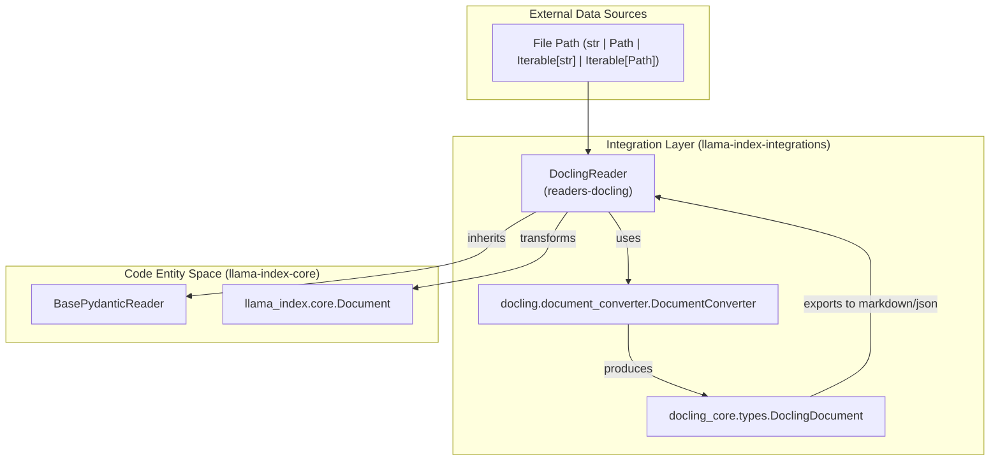
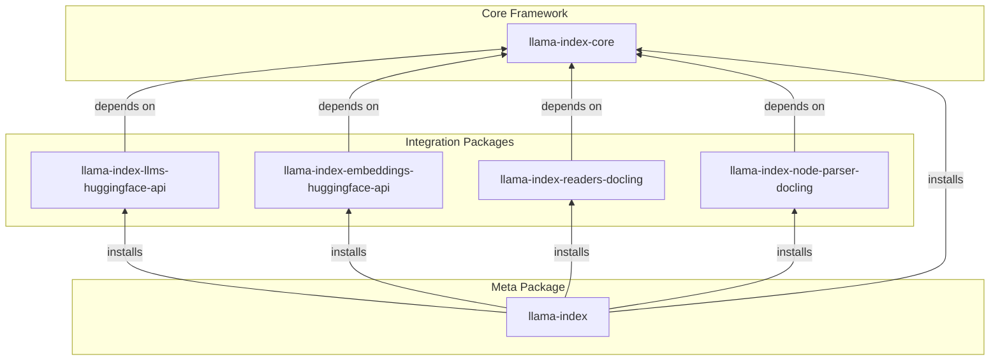

<!-- source: DeepWiki mcp.deepwiki.com · repo run-llama/llama_index · page 2.2 Integration Ecosystem · fetched 2026-11-09 -->

# Integration Ecosystem

<details>
<summary>Relevant source files</summary>

The following files were used as context for generating this wiki page:

- [llama-index-integrations/embeddings/llama-index-embeddings-huggingface-api/llama_index/embeddings/huggingface_api/base.py](llama-index-integrations/embeddings/llama-index-embeddings-huggingface-api/llama_index/embeddings/huggingface_api/base.py)
- [llama-index-integrations/embeddings/llama-index-embeddings-huggingface-api/pyproject.toml](llama-index-integrations/embeddings/llama-index-embeddings-huggingface-api/pyproject.toml)
- [llama-index-integrations/embeddings/llama-index-embeddings-huggingface-api/tests/test_hf_inference.py](llama-index-integrations/embeddings/llama-index-embeddings-huggingface-api/tests/test_hf_inference.py)
- [llama-index-integrations/llms/llama-index-llms-huggingface-api/README.md](llama-index-integrations/llms/llama-index-llms-huggingface-api/README.md)
- [llama-index-integrations/llms/llama-index-llms-huggingface-api/llama_index/llms/huggingface_api/base.py](llama-index-integrations/llms/llama-index-llms-huggingface-api/llama_index/llms/huggingface_api/base.py)
- [llama-index-integrations/llms/llama-index-llms-huggingface-api/pyproject.toml](llama-index-integrations/llms/llama-index-llms-huggingface-api/pyproject.toml)
- [llama-index-integrations/llms/llama-index-llms-huggingface-api/tests/test_huggingface_api.py](llama-index-integrations/llms/llama-index-llms-huggingface-api/tests/test_huggingface_api.py)
- [llama-index-integrations/node_parser/llama-index-node-parser-docling/README.md](llama-index-integrations/node_parser/llama-index-node-parser-docling/README.md)
- [llama-index-integrations/node_parser/llama-index-node-parser-docling/llama_index/node_parser/docling/base.py](llama-index-integrations/node_parser/llama-index-node-parser-docling/llama_index/node_parser/docling/base.py)
- [llama-index-integrations/node_parser/llama-index-node-parser-docling/pyproject.toml](llama-index-integrations/node_parser/llama-index-node-parser-docling/pyproject.toml)
- [llama-index-integrations/readers/llama-index-readers-couchbase/pyproject.toml](llama-index-integrations/readers/llama-index-readers-couchbase/pyproject.toml)
- [llama-index-integrations/readers/llama-index-readers-couchdb/pyproject.toml](llama-index-integrations/readers/llama-index-readers-couchdb/pyproject.toml)
- [llama-index-integrations/readers/llama-index-readers-dad-jokes/pyproject.toml](llama-index-integrations/readers/llama-index-readers-dad-jokes/pyproject.toml)
- [llama-index-integrations/readers/llama-index-readers-dashscope/pyproject.toml](llama-index-integrations/readers/llama-index-readers-dashscope/pyproject.toml)
- [llama-index-integrations/readers/llama-index-readers-dashvector/pyproject.toml](llama-index-integrations/readers/llama-index-readers-dashvector/pyproject.toml)
- [llama-index-integrations/readers/llama-index-readers-database/pyproject.toml](llama-index-integrations/readers/llama-index-readers-database/pyproject.toml)
- [llama-index-integrations/readers/llama-index-readers-deeplake/pyproject.toml](llama-index-integrations/readers/llama-index-readers-deeplake/pyproject.toml)
- [llama-index-integrations/readers/llama-index-readers-discord/pyproject.toml](llama-index-integrations/readers/llama-index-readers-discord/pyproject.toml)
- [llama-index-integrations/readers/llama-index-readers-docling/README.md](llama-index-integrations/readers/llama-index-readers-docling/README.md)
- [llama-index-integrations/readers/llama-index-readers-docling/llama_index/readers/docling/base.py](llama-index-integrations/readers/llama-index-readers-docling/llama_index/readers/docling/base.py)
- [llama-index-integrations/readers/llama-index-readers-docling/pyproject.toml](llama-index-integrations/readers/llama-index-readers-docling/pyproject.toml)
- [llama-index-integrations/readers/llama-index-readers-docstring-walker/pyproject.toml](llama-index-integrations/readers/llama-index-readers-docstring-walker/pyproject.toml)
- [llama-index-integrations/readers/llama-index-readers-docugami/llama_index/readers/docugami/base.py](llama-index-integrations/readers/llama-index-readers-docugami/llama_index/readers/docugami/base.py)
- [llama-index-integrations/readers/llama-index-readers-docugami/pyproject.toml](llama-index-integrations/readers/llama-index-readers-docugami/pyproject.toml)
- [llama-index-integrations/readers/llama-index-readers-file/llama_index/readers/file/flat/base.py](llama-index-integrations/readers/llama-index-readers-file/llama_index/readers/file/flat/base.py)
- [llama-index-utils/llama-index-utils-huggingface/pyproject.toml](llama-index-utils/llama-index-utils-huggingface/pyproject.toml)

</details>


This document describes LlamaIndex's integration ecosystem of 300+ packages that provide connectivity to external LLMs, vector stores, data sources, and other services. It covers the plugin architecture, package organization by category, naming conventions, implementation patterns, and shared utility packages.

## Overview

LlamaIndex follows a **plugin architecture** where the core framework [llama-index-integrations/llms/llama-index-llms-huggingface-api/pyproject.toml:2-3]() provides abstract base classes, and integration packages provide concrete implementations. This design enables minimal dependencies, independent versioning, and provider flexibility.

The framework is decoupled into a core library, `llama-index-core` [llama-index-integrations/llms/llama-index-llms-huggingface-api/pyproject.toml:37](), and hundreds of specialized integration packages located in the `llama-index-integrations/` directory of the monorepo.

**Sources:** [llama-index-integrations/llms/llama-index-llms-huggingface-api/pyproject.toml:2-3](), [llama-index-integrations/llms/llama-index-llms-huggingface-api/pyproject.toml:37]()

## Package Structure and Naming

### Naming Convention

All integration packages follow a consistent naming pattern to ensure discoverability and clarity:

```
llama-index-{category}-{provider}
```

Where:
- `{category}` identifies the integration type (e.g., `llms`, `embeddings`, `vector-stores`, `readers`, `callbacks`, `indices`).
- `{provider}` identifies the specific service or implementation (e.g., `openai`, `anthropic`, `milvus`, `cohere`).

**Examples:**
- `llama-index-llms-huggingface-api` [llama-index-integrations/llms/llama-index-llms-huggingface-api/pyproject.toml:28]()
- `llama-index-embeddings-huggingface-api` [llama-index-integrations/embeddings/llama-index-embeddings-huggingface-api/pyproject.toml:28]()
- `llama-index-readers-docling` [llama-index-integrations/readers/llama-index-readers-docling/pyproject.toml:30]()

### Import Path Structure

The Python import path generally mirrors the package name to maintain clear namespaces.

```python
# Core abstraction
from llama_index.core.llms.llm import LLM

# Integration implementation
from llama_index.llms.huggingface_api import HuggingFaceInferenceAPI
```

LlamaIndex exposes key abstractions through the top-level `llama_index.core` namespace to simplify user interaction while keeping implementations segregated.

**Sources:** [llama-index-integrations/llms/llama-index-llms-huggingface-api/llama_index/llms/huggingface_api/base.py:39](), [llama-index-integrations/llms/llama-index-llms-huggingface-api/pyproject.toml:55]()

## Integration Categories

### Major Abstractions

Integrations plug into the framework by inheriting from and implementing core base classes defined in `llama-index-core`.

| Category | Base Class | Purpose |
|----------|------------|---------|
| **LLMs** | `FunctionCallingLLM` | Text generation and tool calling [llama-index-integrations/llms/llama-index-llms-huggingface-api/llama_index/llms/huggingface_api/base.py:46]() |
| **Vector Stores** | `BasePydanticVectorStore` | Similarity search and persistence |
| **Embeddings** | `BaseEmbedding` | Text/Image-to-vector transformation [llama-index-integrations/embeddings/llama-index-embeddings-huggingface-api/llama_index/embeddings/huggingface_api/base.py:29]() |
| **Readers** | `BasePydanticReader` | Data ingestion from external sources [llama-index-integrations/readers/llama-index-readers-docling/llama_index/readers/docling/base.py:10]() |
| **Node Parsers** | `BaseNodeParser` | Document splitting and node creation [llama-index-integrations/node_parser/llama-index-node-parser-docling/llama_index/node_parser/docling/base.py:10]() |
| **Managed Indices** | `BaseManagedIndex` | Hosted retrieval and indexing services |

### Shared Utility Packages (`llama-index-utils`)

To minimize code duplication across integrations for major cloud and AI providers, LlamaIndex uses shared utility packages. These provide common authentication, client management, and helper functions.

*   **Azure**: Common utilities for Azure OpenAI, AI Search, and Storage.
*   **HuggingFace**: Shared logic for model loading and tokenization [llama-index-integrations/embeddings/llama-index-embeddings-huggingface-api/pyproject.toml:36]().
*   **OracleAI**: Utilities for Oracle Database and AI service connectivity.
*   **Qianfan**: Shared helpers for Baidu's Qianfan platform.

### Integration Data Flow

The following diagram illustrates how natural language and media requests flow through code entities into external service integrations, using `HuggingFaceInferenceAPI` as a concrete example for LLMs.

**Diagram: Natural Language to Code Entity Mapping (HuggingFace LLM)**



**Sources:** [llama-index-integrations/llms/llama-index-llms-huggingface-api/llama_index/llms/huggingface_api/base.py:46](), [llama-index-integrations/llms/llama-index-llms-huggingface-api/llama_index/llms/huggingface_api/base.py:3](), [llama-index-integrations/llms/llama-index-llms-huggingface-api/llama_index/llms/huggingface_api/base.py:23-32]()

The `HuggingFaceInferenceAPI` class [llama-index-integrations/llms/llama-index-llms-huggingface-api/llama_index/llms/huggingface_api/base.py:46-46]() acts as a wrapper around the `huggingface_hub.InferenceClient` and `huggingface_hub.AsyncInferenceClient` [llama-index-integrations/llms/llama-index-llms-huggingface-api/llama_index/llms/huggingface_api/base.py:133-134](). It supports both chat and completion tasks, dynamically selecting the appropriate Hugging Face model if not specified [llama-index-integrations/llms/llama-index-llms-huggingface-api/llama_index/llms/huggingface_api/base.py:162-173]().

**Diagram: Docling Reader Data Flow**



**Sources:** [llama-index-integrations/readers/llama-index-readers-docling/llama_index/readers/docling/base.py:15](), [llama-index-integrations/readers/llama-index-readers-docling/llama_index/readers/docling/base.py:8](), [llama-index-integrations/readers/llama-index-readers-docling/llama_index/readers/docling/base.py:11](), [llama-index-integrations/readers/llama-index-readers-docling/llama_index/readers/docling/base.py:70-75]()

The `DoclingReader` [llama-index-integrations/readers/llama-index-readers-docling/llama_index/readers/docling/base.py:15-15]() leverages `docling-core` to convert various document formats (PDF, DOCX) into LlamaIndex `Document` objects. It supports exporting content as Markdown or JSON [llama-index-integrations/readers/llama-index-readers-docling/llama_index/readers/docling/base.py:41-42]().

## Plugin Architecture Implementation

### Dependency Flow

The ecosystem is structured to prevent "dependency bloat." The meta-package `llama-index` acts as a coordinator that bundles core and a set of default integrations.

**Diagram: Package Dependency and Inheritance**



**Sources:** [llama-index-integrations/llms/llama-index-llms-huggingface-api/pyproject.toml:37](), [llama-index-integrations/embeddings/llama-index-embeddings-huggingface-api/pyproject.toml:37](), [llama-index-integrations/readers/llama-index-readers-docling/pyproject.toml:38](), [llama-index-integrations/node_parser/llama-index-node-parser-docling/pyproject.toml:35]()

### LlamaHub Integration

LlamaHub serves as the central registry. Integration packages include specific metadata in their `pyproject.toml` to define how they are displayed and attributed on LlamaHub.

```toml
[tool.llamahub]
contains_example = false
import_path = "llama_index.llms.huggingface_api"

[tool.llamahub.class_authors]
HuggingFaceInferenceAPI = "llama-index"
```

**Sources:** [llama-index-integrations/llms/llama-index-llms-huggingface-api/pyproject.toml:53-59]()

## Ingestion and Data Sources

Integrations also extend the `IngestionPipeline` through specialized readers and transformations. The framework provides a `ConfigurableComponent` enum to dynamically build data sources when the corresponding integration is installed.

**Configurable Data Sources include:**
- **DashScope**: `DashScopeParse` [llama-index-integrations/readers/llama-index-readers-dashscope/pyproject.toml:61]()
- **DashVector**: `DashVectorReader` [llama-index-integrations/readers/llama-index-readers-dashvector/pyproject.toml:57]()
- **Database**: `DatabaseReader` [llama-index-integrations/readers/llama-index-readers-database/pyproject.toml:63]()
- **Discord**: `DiscordReader` [llama-index-integrations/readers/llama-index-readers-discord/pyproject.toml:56]()
- **Docling**: `DoclingReader` [llama-index-integrations/readers/llama-index-readers-docling/pyproject.toml:61]()
- **Docugami**: `DocugamiReader` [llama-index-integrations/readers/llama-index-readers-docugami/pyproject.toml:67]()

**Sources:** [llama-index-integrations/readers/llama-index-readers-dashscope/pyproject.toml:61](), [llama-index-integrations/readers/llama-index-readers-dashvector/pyproject.toml:57](), [llama-index-integrations/readers/llama-index-readers-database/pyproject.toml:63](), [llama-index-integrations/readers/llama-index-readers-discord/pyproject.toml:56](), [llama-index-integrations/readers/llama-index-readers-docling/pyproject.toml:61](), [llama-index-integrations/readers/llama-index-readers-docugami/pyproject.toml:67]()

## Popular Integrations

The ecosystem includes over 300 integrations. Major providers include:

### LLM Providers
- **HuggingFace**: `HuggingFaceInferenceAPI` for models hosted on Hugging Face Hub or deployed Inference Endpoints [llama-index-integrations/llms/llama-index-llms-huggingface-api/llama_index/llms/huggingface_api/base.py:46-50]().
- **OpenAI**: Primary default provider.
- **Google**: Gemini models via `google-genai` 2.0+ SDK.
- **Anthropic**: Claude models integration.
- **Ollama**: Local model deployment support.

### Embedding Providers
- **HuggingFace**: `HuggingFaceInferenceAPIEmbedding` for embeddings via Hugging Face Inference API [llama-index-integrations/embeddings/llama-index-embeddings-huggingface-api/pyproject.toml:59]().
- **Cohere**: Supports text and multimodal (image) embeddings.

### Observability and Callbacks
- **WandB**: Experiment tracking and visualization.
- **Argilla**: Data labeling and feedback loops.
- **Langfuse**: Tracing and evaluation.

## Development and Contribution

The repository is organized as a **monorepo** to facilitate cross-package testing and consistent versioning.

- **Core package**: `llama-index-core/`.
- **Integrations**: `llama-index-integrations/`.
- **Testing**: Managed via `pytest` [llama-index-integrations/llms/llama-index-llms-huggingface-api/pyproject.toml:16]() and `pytest-mock` [llama-index-integrations/llms/llama-index-llms-huggingface-api/pyproject.toml:17]() for mocking external dependencies [llama-index-integrations/llms/llama-index-llms-huggingface-api/tests/test_huggingface_api.py:1-2]().

**Sources:** [llama-index-integrations/llms/llama-index-llms-huggingface-api/llama_index/llms/huggingface_api/base.py:46-50](), [llama-index-integrations/embeddings/llama-index-embeddings-huggingface-api/pyproject.toml:59](), [llama-index-integrations/llms/llama-index-llms-huggingface-api/pyproject.toml:16-17](), [llama-index-integrations/llms/llama-index-llms-huggingface-api/tests/test_huggingface_api.py:1-2]()

---

