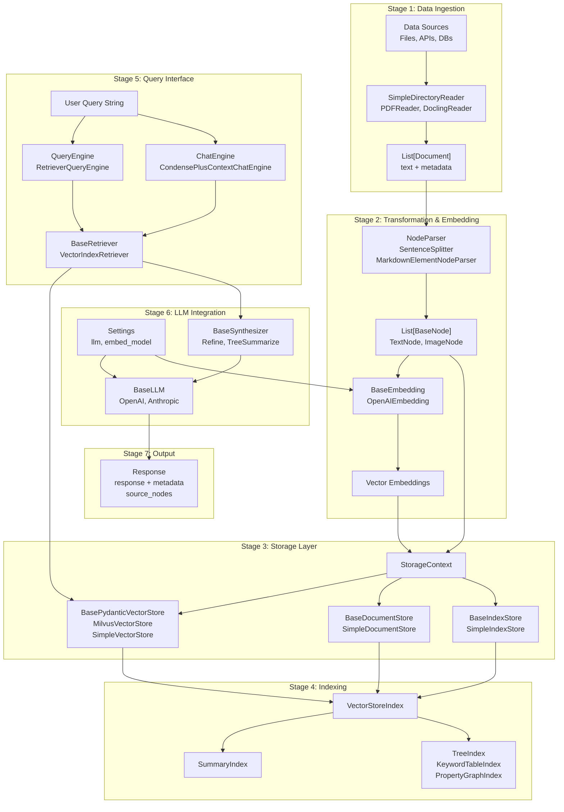
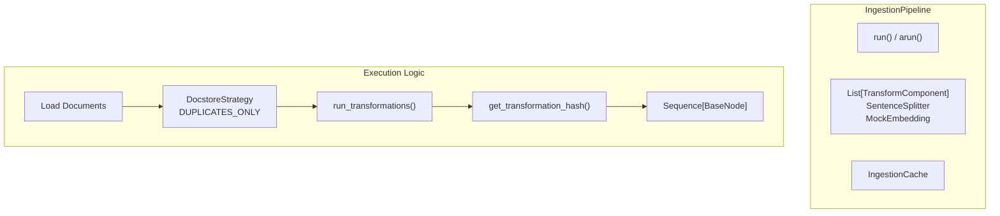
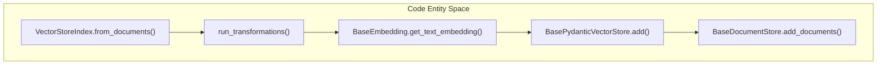
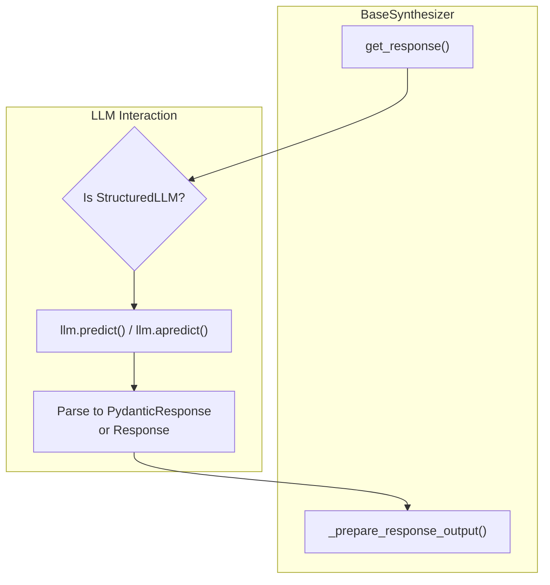

<!-- source: DeepWiki mcp.deepwiki.com · repo run-llama/llama_index · page 2.3 Data Flow Pipeline · fetched 2026-11-09 -->

# Data Flow Pipeline

Relevant source files

The following files were used as context for generating this wiki page:

- [docs/examples/ingestion/ray_ingestion_pipeline.ipynb](docs/examples/ingestion/ray_ingestion_pipeline.ipynb)
- [llama-index-core/llama_index/core/base/response/schema.py](llama-index-core/llama_index/core/base/response/schema.py)
- [llama-index-core/llama_index/core/ingestion/pipeline.py](llama-index-core/llama_index/core/ingestion/pipeline.py)
- [llama-index-core/llama_index/core/instrumentation/events/synthesis.py](llama-index-core/llama_index/core/instrumentation/events/synthesis.py)
- [llama-index-core/llama_index/core/query_engine/citation_query_engine.py](llama-index-core/llama_index/core/query_engine/citation_query_engine.py)
- [llama-index-core/llama_index/core/query_engine/multi_modal.py](llama-index-core/llama_index/core/query_engine/multi_modal.py)
- [llama-index-core/llama_index/core/query_engine/retriever_query_engine.py](llama-index-core/llama_index/core/query_engine/retriever_query_engine.py)
- [llama-index-core/llama_index/core/response/utils.py](llama-index-core/llama_index/core/response/utils.py)
- [llama-index-core/llama_index/core/response_synthesizers/base.py](llama-index-core/llama_index/core/response_synthesizers/base.py)
- [llama-index-core/llama_index/core/response_synthesizers/context_only.py](llama-index-core/llama_index/core/response_synthesizers/context_only.py)
- [llama-index-core/llama_index/core/response_synthesizers/factory.py](llama-index-core/llama_index/core/response_synthesizers/factory.py)
- [llama-index-core/llama_index/core/response_synthesizers/simple_summarize.py](llama-index-core/llama_index/core/response_synthesizers/simple_summarize.py)
- [llama-index-core/llama_index/core/response_synthesizers/type.py](llama-index-core/llama_index/core/response_synthesizers/type.py)
- [llama-index-core/llama_index/core/tools/tool_spec/base.py](llama-index-core/llama_index/core/tools/tool_spec/base.py)
- [llama-index-core/llama_index/core/types.py](llama-index-core/llama_index/core/types.py)
- [llama-index-core/tests/ingestion/test_pipeline.py](llama-index-core/tests/ingestion/test_pipeline.py)
- [llama-index-core/tests/query_engine/test_citation_query_engine.py](llama-index-core/tests/query_engine/test_citation_query_engine.py)
- [llama-index-core/tests/query_engine/test_retriever_query_engine.py](llama-index-core/tests/query_engine/test_retriever_query_engine.py)
- [llama-index-core/tests/response_synthesizers/test_factory.py](llama-index-core/tests/response_synthesizers/test_factory.py)
- [llama-index-core/tests/test_types.py](llama-index-core/tests/test_types.py)
- [llama-index-core/tests/tools/tool_spec/test_base.py](llama-index-core/tests/tools/tool_spec/test_base.py)
- [llama-index-integrations/ingestion/llama-index-ingestion-ray/.gitignore](llama-index-integrations/ingestion/llama-index-ingestion-ray/.gitignore)
- [llama-index-integrations/ingestion/llama-index-ingestion-ray/LICENSE](llama-index-integrations/ingestion/llama-index-ingestion-ray/LICENSE)
- [llama-index-integrations/ingestion/llama-index-ingestion-ray/Makefile](llama-index-integrations/ingestion/llama-index-ingestion-ray/Makefile)
- [llama-index-integrations/ingestion/llama-index-ingestion-ray/README.md](llama-index-integrations/ingestion/llama-index-ingestion-ray/README.md)
- [llama-index-integrations/ingestion/llama-index-ingestion-ray/llama_index/ingestion/ray/__init__.py](llama-index-integrations/ingestion/llama-index-ingestion-ray/llama_index/ingestion/ray/__init__.py)
- [llama-index-integrations/ingestion/llama-index-ingestion-ray/llama_index/ingestion/ray/base.py](llama-index-integrations/ingestion/llama-index-ingestion-ray/llama_index/ingestion/ray/base.py)
- [llama-index-integrations/ingestion/llama-index-ingestion-ray/llama_index/ingestion/ray/transform.py](llama-index-integrations/ingestion/llama-index-ingestion-ray/llama_index/ingestion/ray/transform.py)
- [llama-index-integrations/ingestion/llama-index-ingestion-ray/llama_index/ingestion/ray/utils.py](llama-index-integrations/ingestion/llama-index-ingestion-ray/llama_index/ingestion/ray/utils.py)

## Purpose and Scope

This document explains the complete RAG (Retrieval Augmented Generation) pipeline in LlamaIndex, from raw data ingestion through retrieval to response generation. The pipeline follows a multi-stage architecture that transforms unstructured data into AI-generated responses through: **data ingestion, transformation and embedding, storage, indexing, query processing, LLM integration, and output generation**.

For details on specific LLM providers, see page 6 (LLM Integrations). For vector store implementations, see page 7 (Vector Store Integrations). For workflow orchestration, see page 4 (Workflow System). For the overall architecture context, see page 2 (Architecture).

## Pipeline Architecture Overview

The LlamaIndex data flow implements a structured RAG pipeline. Each stage has well-defined input/output contracts through core abstractions (`Document`, `BaseNode`, `QueryBundle`, `Response`).

**Pipeline Architecture: Data Flow Stages**

**Core Data Structures:**

| Class | Purpose | Module |
|-------|---------|--------|
| `Document` | Raw data with metadata and hash | `llama_index.core.schema` |
| `BaseNode` | Chunked text/image unit with metadata | `llama_index.core.schema` |
| `TextNode` | Text chunk with embeddings | `llama_index.core.schema` |
| `ImageNode` | Image with optional embeddings | `llama_index.core.schema` |
| `QueryBundle` | Query string + metadata | `llama_index.core.schema` |
| `Response` | Answer text + source nodes | `llama_index.core.base.response.schema` |

**Sources:**
- [llama-index-core/llama_index/core/schema.py:26-31]()
- [llama-index-core/llama_index/core/base/response/schema.py:14-141]()

## Stage 1-2: Data Ingestion and IngestionPipeline

While `SimpleDirectoryReader` provides a simple entry point, the `IngestionPipeline` offers a structured way to handle complex data flows, including caching and deduplication [llama-index-core/llama_index/core/ingestion/pipeline.py:348-420]().

### IngestionPipeline: Transformation Orchestration

The `IngestionPipeline` manages a sequence of `TransformComponent` objects applied to data. It supports asynchronous execution via `arun()` and document deduplication through `DocstoreStrategy` options.

**Deduplication Strategies:**
- **UPSERTS**: Updates the document in the doc store if the ID exists but the hash has changed [llama-index-core/llama_index/core/ingestion/pipeline.py:317-318]().
- **DUPLICATES_ONLY**: Only processes the document if its hash is not already in the doc store [llama-index-core/llama_index/core/ingestion/pipeline.py:319-320]().
- **UPSERTS_AND_DELETE**: Similar to UPSERTS but also removes non-existing documents from the store [llama-index-core/llama_index/core/ingestion/pipeline.py:321-322]().

**Sources:**
- [llama-index-core/llama_index/core/ingestion/pipeline.py:72-112]()
- [llama-index-core/llama_index/core/ingestion/pipeline.py:307-330]()
- [llama-index-core/tests/ingestion/test_pipeline.py:43-63]()

## Stage 3-4: Storage and Indexing

The indexing stage bridges the gap between raw nodes and queryable structures. The `VectorStoreIndex` is the most common implementation, coordinating with `StorageContext` to persist nodes and embeddings.

### VectorStoreIndex Construction

When building from documents via `from_documents()`, `VectorStoreIndex` runs transformations (like splitting and embedding) and then inserts the resulting nodes into the configured vector store [llama-index-core/llama_index/core/indices/vector_store/base.py:86-130]().

**Sources:**
- [llama-index-core/llama_index/core/indices/vector_store/base.py:176-210]()
- [llama-index-core/llama_index/core/indices/base.py:89-130]()
- [llama-index-core/tests/indices/vector_store/test_simple_async.py:17-22]()

## Stage 5-6: Querying and Response Synthesis

### Retriever and Query Engine

The `RetrieverQueryEngine` orchestrates the retrieval of nodes via a `BaseRetriever` and the subsequent synthesis of a response via a `BaseSynthesizer` [llama-index-core/llama_index/core/query_engine/retriever_query_engine.py:36-49](). `VectorStoreIndex.as_retriever()` returns a `VectorIndexRetriever` which interfaces directly with the `BasePydanticVectorStore` [llama-index-core/llama_index/core/indices/vector_store/base.py:112-124]().

The `CitationQueryEngine` is a specialized `BaseQueryEngine` that focuses on generating responses with explicit source citations. It uses a `BaseRetriever` to fetch relevant nodes and a `BaseSynthesizer` configured with specific citation-aware prompt templates (`CITATION_QA_TEMPLATE`, `CITATION_REFINE_TEMPLATE`, `CITATION_CHAT_CONTENT_QA_TEMPLATE`, `CITATION_CHAT_CONTENT_REFINE_TEMPLATE`) to ensure that the generated answer includes references to the provided sources [llama-index-core/llama_index/core/query_engine/citation_query_engine.py:158-174]().

### ResponseSynthesizer and Synthesis Strategies

The `BaseSynthesizer` coordinates context assembly and LLM prompting [llama-index-core/llama_index/core/response_synthesizers/base.py:64-107](). Key strategies include:

- **Refine**: Iteratively updates an answer by processing chunks sequentially. It uses a `StructuredRefineResponse` model to determine if the query is satisfied [llama-index-core/llama_index/core/response_synthesizers/refine.py:52-71]().
- **TreeSummarize**: Recursively merges text chunks and summarizes them in a bottom-up fashion (building a tree from leaves to root) [llama-index-core/llama_index/core/response_synthesizers/tree_summarize.py:20-31]().
- **SimpleSummarize**: Concatenates all text chunks into a single string and passes it to the LLM for summarization [llama-index-core/llama_index/core/response_synthesizers/simple_summarize.py:60-93]().
- **CompactAndRefine**: Similar to Refine, but first compacts the text chunks to fit within the LLM's context window.
- **Accumulate**: Accumulates responses from multiple text chunks without refinement.
- **Generation**: Generates a response directly from the query and context without any specific summarization or refinement strategy.
- **ContextOnly**: Returns the raw context without any LLM interaction.
- **NoText**: Returns an empty response.

The `get_response_synthesizer` factory function allows dynamic selection of the synthesis mode based on the `ResponseMode` enum [llama-index-core/llama_index/core/response_synthesizers/factory.py:38-60]().

**Structured Output:**
If the LLM is an instance of `StructuredLLM`, the synthesizer automatically validates the response against a Pydantic model (`output_cls`) [llama-index-core/llama_index/core/response_synthesizers/base.py:194-202]().

**Sources:**
- [llama-index-core/llama_index/core/response_synthesizers/base.py:132-150]()
- [llama-index-core/llama_index/core/response_synthesizers/refine.py:79-113]()
- [llama-index-core/llama_index/core/response_synthesizers/tree_summarize.py:77-117]()
- [llama-index-core/llama_index/core/response_synthesizers/simple_summarize.py:60-93]()
- [llama-index-core/llama_index/core/response_synthesizers/factory.py:38-60]()
- [llama-index-core/llama_index/core/query_engine/retriever_query_engine.py:36-49]()
- [llama-index-core/llama_index/core/query_engine/citation_query_engine.py:158-174]()

## Stage 7: Output and Response Structure

The final stage produces a `Response`, `PydanticResponse`, or `StreamingResponse`.

**Response Object Comparison:**

| Class | Primary Attribute | Use Case |
|-------|-------------------|----------|
| `Response` | `response: str` | Standard text completion [llama-index-core/llama_index/core/base/response/schema.py:15-28]() |
| `PydanticResponse` | `response: BaseModel` | Structured extraction/validation [llama-index-core/llama_index/core/base/response/schema.py:46-59]() |
| `StreamingResponse` | `response_gen: TokenGen` | Real-time UI updates via generator [llama-index-core/llama_index/core/base/response/schema.py:108-123]() |
| `AsyncStreamingResponse` | `response_gen: TokenAsyncGen` | Asynchronous real-time updates [llama-index-core/llama_index/core/base/response/schema.py:167-182]() |

**Sources:**
- [llama-index-core/llama_index/core/base/response/schema.py:15-43]()
- [llama-index-core/llama_index/core/base/response/schema.py:46-105]()
- [llama-index-core/llama_index/core/base/response/schema.py:108-165]()
- [llama-index-core/llama_index/core/base/response/schema.py:167-206]()

---

