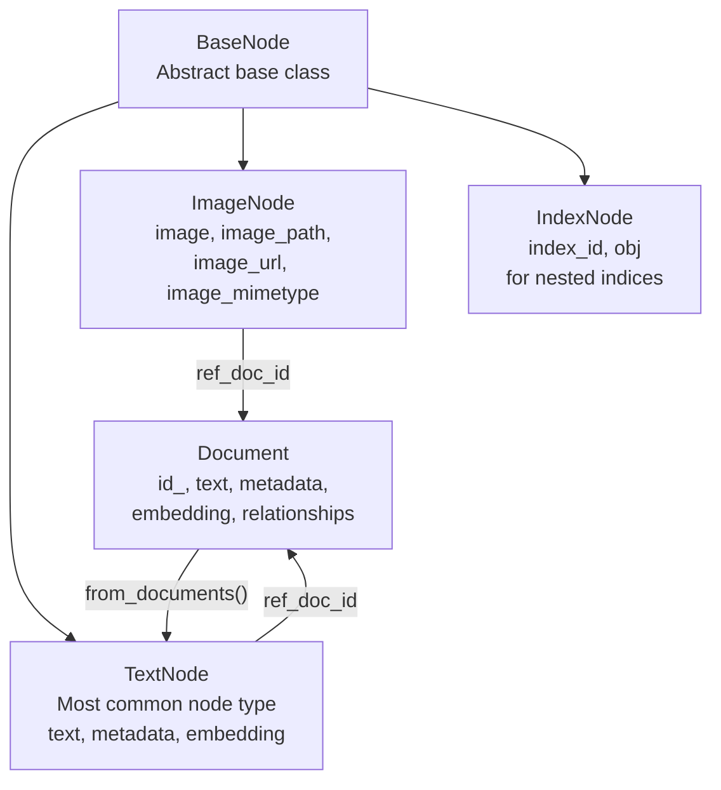
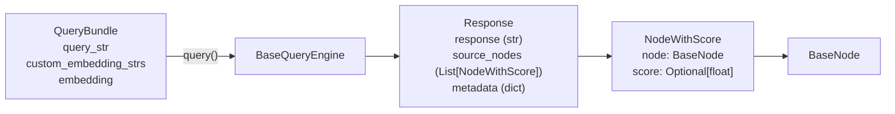
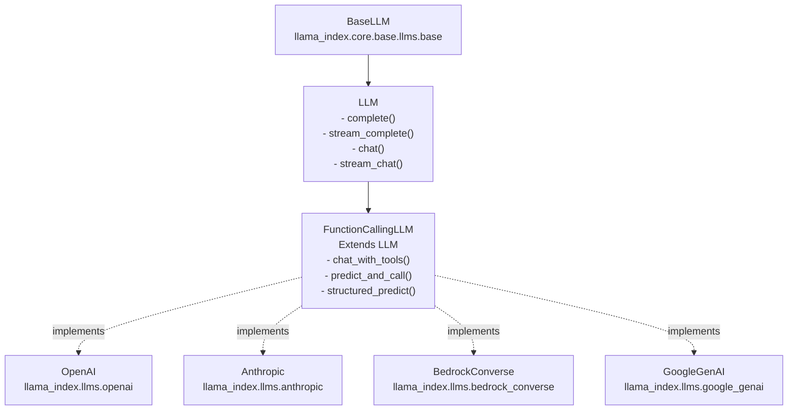

<!-- source: DeepWiki mcp.deepwiki.com · repo run-llama/llama_index · page 3 Core Framework · fetched 2026-11-09 -->

# Core Framework

Relevant source files

The following files were used as context for generating this wiki page:

- [.github/workflows/close_new_integration_prs.yml](.github/workflows/close_new_integration_prs.yml)
- [CONTRIBUTING.md](CONTRIBUTING.md)
- [README.md](README.md)
- [docs/DOCS_README.md](docs/DOCS_README.md)
- [llama-index-core/llama_index/core/bridge/pydantic.py](llama-index-core/llama_index/core/bridge/pydantic.py)
- [llama-index-core/llama_index/core/img_utils.py](llama-index-core/llama_index/core/img_utils.py)
- [llama-index-core/llama_index/core/indices/base.py](llama-index-core/llama_index/core/indices/base.py)
- [llama-index-core/llama_index/core/indices/vector_store/base.py](llama-index-core/llama_index/core/indices/vector_store/base.py)
- [llama-index-core/llama_index/core/multi_modal_llms/base.py](llama-index-core/llama_index/core/multi_modal_llms/base.py)
- [llama-index-core/llama_index/core/multi_modal_llms/generic_utils.py](llama-index-core/llama_index/core/multi_modal_llms/generic_utils.py)
- [llama-index-core/llama_index/core/node_parser/node_utils.py](llama-index-core/llama_index/core/node_parser/node_utils.py)
- [llama-index-core/llama_index/core/node_parser/text/code.py](llama-index-core/llama_index/core/node_parser/text/code.py)
- [llama-index-core/llama_index/core/node_parser/text/semantic_double_merging_splitter.py](llama-index-core/llama_index/core/node_parser/text/semantic_double_merging_splitter.py)
- [llama-index-core/llama_index/core/node_parser/text/utils.py](llama-index-core/llama_index/core/node_parser/text/utils.py)
- [llama-index-core/llama_index/core/postprocessor/optimizer.py](llama-index-core/llama_index/core/postprocessor/optimizer.py)
- [llama-index-core/llama_index/core/prompts/__init__.py](llama-index-core/llama_index/core/prompts/__init__.py)
- [llama-index-core/llama_index/core/response/notebook_utils.py](llama-index-core/llama_index/core/response/notebook_utils.py)
- [llama-index-core/llama_index/core/schema.py](llama-index-core/llama_index/core/schema.py)
- [llama-index-core/llama_index/core/storage/index_store/keyval_index_store.py](llama-index-core/llama_index/core/storage/index_store/keyval_index_store.py)
- [llama-index-core/llama_index/core/storage/index_store/types.py](llama-index-core/llama_index/core/storage/index_store/types.py)
- [llama-index-core/tests/indices/list/test_index.py](llama-index-core/tests/indices/list/test_index.py)
- [llama-index-core/tests/indices/vector_store/test_simple.py](llama-index-core/tests/indices/vector_store/test_simple.py)
- [llama-index-core/tests/indices/vector_store/test_simple_async.py](llama-index-core/tests/indices/vector_store/test_simple_async.py)
- [llama-index-core/tests/multi_modal_llms/test_base_multi_modal_llm_metadata.py](llama-index-core/tests/multi_modal_llms/test_base_multi_modal_llm_metadata.py)
- [llama-index-core/tests/multi_modal_llms/test_generic_utils.py](llama-index-core/tests/multi_modal_llms/test_generic_utils.py)
- [llama-index-core/tests/node_parser/test_semantic_double_merging_splitter.py](llama-index-core/tests/node_parser/test_semantic_double_merging_splitter.py)
- [llama-index-core/tests/schema/test_image_document.py](llama-index-core/tests/schema/test_image_document.py)
- [llama-index-core/tests/schema/test_media_resource.py](llama-index-core/tests/schema/test_media_resource.py)
- [llama-index-core/tests/schema/test_node.py](llama-index-core/tests/schema/test_node.py)
- [llama-index-core/tests/schema/test_schema.py](llama-index-core/tests/schema/test_schema.py)
- [llama-index-core/tests/text_splitter/test_code_splitter.py](llama-index-core/tests/text_splitter/test_code_splitter.py)
- [llama-index-integrations/readers/llama-index-readers-kibela/llama_index/readers/kibela/base.py](llama-index-integrations/readers/llama-index-readers-kibela/llama_index/readers/kibela/base.py)
- [llama-index-integrations/storage/index_store/llama-index-storage-index-store-dynamodb/llama_index/storage/index_store/dynamodb/base.py](llama-index-integrations/storage/index_store/llama-index-storage-index-store-dynamodb/llama_index/storage/index_store/dynamodb/base.py)
- [llama-index-integrations/storage/index_store/llama-index-storage-index-store-elasticsearch/llama_index/storage/index_store/elasticsearch/base.py](llama-index-integrations/storage/index_store/llama-index-storage-index-store-elasticsearch/llama_index/storage/index_store/elasticsearch/base.py)
- [llama-index-integrations/storage/index_store/llama-index-storage-index-store-elasticsearch/pyproject.toml](llama-index-integrations/storage/index_store/llama-index-storage-index-store-elasticsearch/pyproject.toml)
- [llama-index-integrations/storage/index_store/llama-index-storage-index-store-firestore/llama_index/storage/index_store/firestore/base.py](llama-index-integrations/storage/index_store/llama-index-storage-index-store-firestore/llama_index/storage/index_store/firestore/base.py)
- [llama-index-integrations/storage/index_store/llama-index-storage-index-store-mongodb/llama_index/storage/index_store/mongodb/base.py](llama-index-integrations/storage/index_store/llama-index-storage-index-store-mongodb/llama_index/storage/index_store/mongodb/base.py)
- [llama-index-integrations/storage/index_store/llama-index-storage-index-store-postgres/llama_index/storage/index_store/postgres/base.py](llama-index-integrations/storage/index_store/llama-index-storage-index-store-postgres/llama_index/storage/index_store/postgres/base.py)
- [llama-index-integrations/storage/index_store/llama-index-storage-index-store-redis/llama_index/storage/index_store/redis/base.py](llama-index-integrations/storage/index_store/llama-index-storage-index-store-redis/llama_index/storage/index_store/redis/base.py)

The **Core Framework** (`llama-index-core`) is the foundational library of LlamaIndex, providing the base abstractions, data structures, and architectural patterns upon which all integration packages are built. This package contains no concrete LLM or vector store implementations—instead, it defines the interfaces and core logic that integration packages extend.

**Scope**: This page documents the `llama-index-core` package structure, fundamental data types, base classes for integrations, and core architectural patterns. For specific implementations of indices and query engines, see [Indices and Query Engines](#3.1). For storage abstractions, see [Storage System](#3.2). For configuration patterns, see [Settings and Configuration](#3.3). For the workflow engine that core depends on, see [Workflow System](#4).

---

## Core Architecture Overview

The Core Framework provides three fundamental layers: (1) data structures for representing documents and queries, (2) abstract base classes that integration packages extend, and (3) orchestration components for indexing and retrieval.

### High-Level Component Diagram

```mermaid
graph TB
    subgraph "Core Data Structures"
        Document["Document<br/>text + metadata"]
        Node["BaseNode<br/>TextNode, ImageNode"]
        QueryBundle["QueryBundle<br/>query text + embeddings"]
        Response["Response<br/>answer + source nodes"]
    end
    
    subgraph "Base Abstractions"
        BaseLLM["BaseLLM / FunctionCallingLLM<br/>Abstract LLM interface"]
        BaseEmbedding["BaseEmbedding<br/>Abstract embedding interface"]
        BaseVectorStore["BasePydanticVectorStore<br/>Abstract vector store interface"]
        BaseReader["BaseReader<br/>Abstract data loader interface"]
        BaseTool["BaseTool<br/>Abstract tool interface"]
    end
    
    subgraph "Core Orchestration"
        VectorStoreIndex["VectorStoreIndex"]
        SummaryIndex["SummaryIndex"]
        TreeIndex["TreeIndex"]
        PropertyGraphIndex["PropertyGraphIndex"]
        QueryEngine["BaseQueryEngine"]
        ChatEngine["BaseChatEngine"]
        Retriever["BaseRetriever"]
    end
    
    subgraph "Configuration & Storage"
        Settings["Settings<br/>Global configuration"]
        StorageContext["StorageContext<br/>Persistence facade"]
        PromptTemplate["PromptTemplate<br/>Templating system"]
    end
    
    subgraph "Core Dependency"
        Workflow["llama-index-workflows 2.14.x<br/>Event-driven execution"]
    end
    
    Document --> Node
    QueryBundle --> QueryEngine
    QueryEngine --> Response
    
    VectorStoreIndex --> BaseVectorStore
    VectorStoreIndex --> BaseEmbedding
    QueryEngine --> BaseLLM
    
    Settings --> BaseLLM
    Settings --> BaseEmbedding
    
    VectorStoreIndex --> Workflow
    QueryEngine --> Workflow
```

Sources: [llama-index-core/llama_index/core/__init__.py:1-151](), [llama-index-core/pyproject.toml:35-87](), [README.md:28-33]()

---

## Fundamental Data Structures

### Document and Node Hierarchy

The core data model centers around `Document` and `BaseNode` types. Documents represent raw input data, while nodes are the processed chunks used in indices.

**Key Classes**:
- `Document`: Input documents with text and metadata [llama-index-core/llama_index/core/schema.py:224]().
- `BaseNode`: Abstract base for all node types [llama-index-core/llama_index/core/schema.py:207-223]().
- `TextNode`: Text chunks with embeddings, most commonly used [llama-index-core/llama_index/core/schema.py:300]().
- `ImageNode`: Multimodal image nodes [llama-index-core/llama_index/core/schema.py:301]().
- `IndexNode`: References to sub-indices for hierarchical structures [llama-index-core/llama_index/core/schema.py:302]().

All nodes inherit from `BaseNode` and share common fields:
- `id_`: Unique identifier [llama-index-core/llama_index/core/schema.py:230]().
- `embedding`: Optional vector embedding [llama-index-core/llama_index/core/schema.py:232]().
- `metadata`: Dict of arbitrary metadata [llama-index-core/llama_index/core/schema.py:233]().
- `relationships`: Dict mapping `NodeRelationship` types to related node IDs [llama-index-core/llama_index/core/schema.py:234]().

Sources: [llama-index-core/llama_index/core/schema.py:1-1492](), [llama-index-core/llama_index/core/__init__.py:71-122]()

### Query and Response Structures

**Key Classes**:
- `QueryBundle`: Encapsulates query string and optional embeddings [llama-index-core/llama_index/core/schema.py:10]().
- `Response`: Synthesized answer with source attribution [llama-index-core/llama_index/core/base/response/schema.py:17]().
- `NodeWithScore`: Node paired with relevance score [llama-index-core/llama_index/core/schema.py:15-16]().

Sources: [llama-index-core/llama_index/core/schema.py:1-1492](), [llama-index-core/llama_index/core/__init__.py:17-143]()

---

## Base Abstractions for Integrations

The Core Framework defines abstract base classes that all integration packages extend. This enables the plugin architecture where users can swap LLMs, vector stores, and embeddings without changing application code.

### LLM Abstraction Layer

LlamaIndex uses a block-based message system to support multimodal inputs. Recent updates have introduced enhanced support for `DocumentBlock` and `VideoBlock`.

**Core Content Blocks**:
Blocks represent discrete parts of a `ChatMessage`:
- `TextBlock`: Standard text content.
- `ImageBlock`: Multimodal image data.
- `AudioBlock`: Multimodal audio data.
- `VideoBlock`: Multimodal video data.
- `DocumentBlock`: Support for documents as content blocks.
- `ThinkingBlock`: Used for reasoning models (e.g., O1, Claude Thinking).

Sources: [llama-index-core/llama_index/core/multi_modal_llms/base.py:1-100](), [llama-index-core/llama_index/core/schema.py:62-63]()

### Embedding Abstraction Layer

**Core Methods**:
- `get_text_embedding()`: Embed single text.
- `get_text_embedding_batch()`: Embed multiple texts.
- `get_query_embedding()`: Embed query (may differ from text embedding).
- `aget_text_embedding()` / `aget_text_embedding_batch()`: Async variants.

Sources: [llama-index-core/llama_index/core/embeddings/mock_embed_model.py:22](), [llama-index-core/llama_index/core/__init__.py:22]()

---

## Core Dependencies

The Core Framework has several key dependencies that shape its architecture.

### Dependency Overview Table

| Dependency | Version | Purpose | Impact |
|------------|---------|---------|--------|
| `llama-index-workflows` | `>=2.14.0,<3` | Event-driven workflow engine | **Hard dependency**. Core execution model [llama-index-core/pyproject.toml:83](). |
| `pydantic` | `>=2.8.0` | Data validation | All core classes are Pydantic models [llama-index-core/pyproject.toml:78](). |
| `SQLAlchemy` | `>=1.4.49` | Database abstraction | Used for SQL-based storage and chat history [llama-index-core/pyproject.toml:58](). |
| `tiktoken` | `>=0.7.0` | Tokenization | Token counting for OpenAI models [llama-index-core/pyproject.toml:67](). |
| `nltk` | `>=3.9.3` | NLP | Sentence splitting and stopwords [llama-index-core/pyproject.toml:64](). |
| `networkx` | `>=3.0` | Graph operations | Used by knowledge graph indices [llama-index-core/pyproject.toml:72](). |

**Critical Insight**: The `llama-index-workflows` dependency marks a strategic architectural decision. All modern execution patterns (agents, query engines) are built on the workflow engine's event-driven model [llama-index-core/pyproject.toml:83]().

Sources: [llama-index-core/pyproject.toml:55-87]()

### Static Asset Caching

Core includes pre-downloaded caches in `_static` to enable offline operation:
- **NLTK Cache**: Includes stopwords and punkt tokenizers.
- **Tiktoken Cache**: Includes model encodings.

These caches are included in the wheel distribution to avoid runtime downloads in restricted environments [llama-index-core/pyproject.toml:110-124]().

Sources: [llama-index-core/pyproject.toml:109-124]()

---

## Package Organization

### Top-Level Exports

The `__init__.py` file exposes the primary public API [llama-index-core/llama_index/core/__init__.py:1-151]():

| Export Category | Key Classes |
|----------------|-------------|
| **Indices** | `VectorStoreIndex`, `SummaryIndex`, `TreeIndex`, `PropertyGraphIndex`, `KnowledgeGraphIndex` |
| **Data Structures** | `Document`, `QueryBundle`, `Response` |
| **Storage** | `StorageContext` |
| **Configuration** | `Settings` |
| **Readers** | `SimpleDirectoryReader` |

Sources: [llama-index-core/llama_index/core/__init__.py:1-151]()

---

## Versioning and Release Strategy

The Core Framework follows semantic versioning:
- **Current Version**: `0.14.23` [llama-index-core/pyproject.toml:37]().
- **Release Propagation**: `llama-index-core` is published first, followed by the `llama-index` meta-package and integration packages [README.md:28-33]().

Sources: [llama-index-core/pyproject.toml:37](), [README.md:28-33]()

---

## Summary

The Core Framework provides:
- **Foundational data structures**: `Document`, `BaseNode`, `QueryBundle`, `Response`.
- **Abstract interfaces**: `BaseLLM`, `BaseEmbedding`, `BaseReader`.
- **Hard dependency on workflows**: All modern execution paths use `llama-index-workflows >=2.14.x`.
- **Pydantic-first**: All data structures are validated models.

For detailed coverage of specific subsystems, see:
- [Indices and Query Engines](#3.1)
- [Storage System](#3.2)  
- [Settings and Configuration](#3.3)
- [Workflow System](#4) (the execution engine core depends on)
- [Node Parsers and Ingestion](#3.5)

Sources: [llama-index-core/pyproject.toml:1-154](), [llama-index-core/llama_index/core/__init__.py:1-151]()

---

