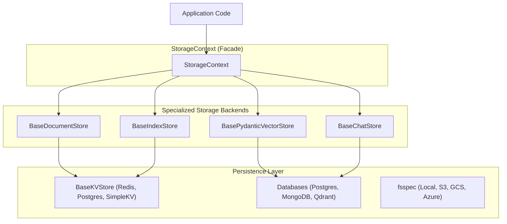
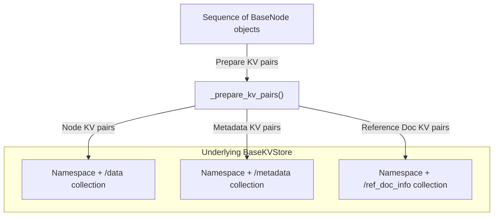
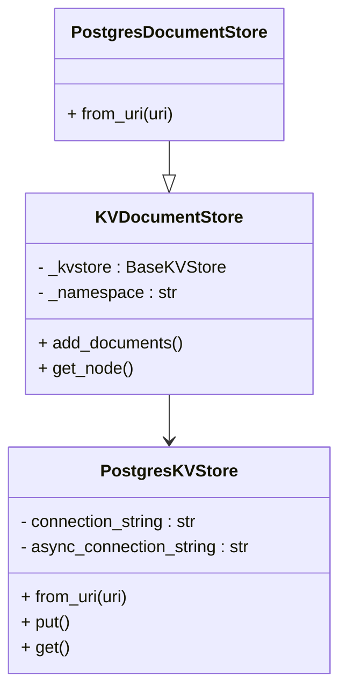
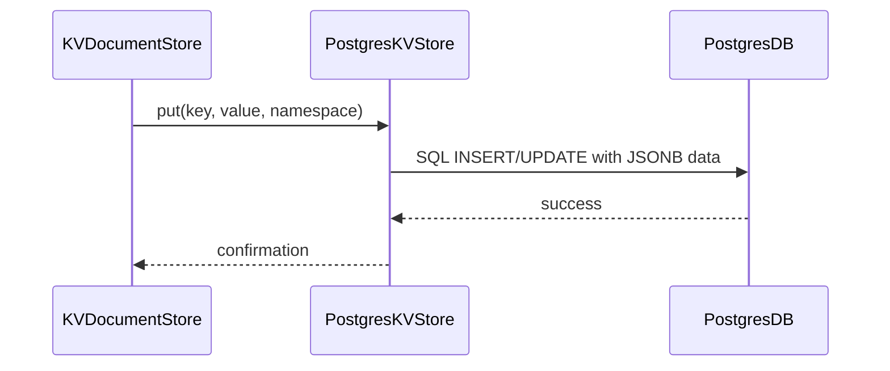
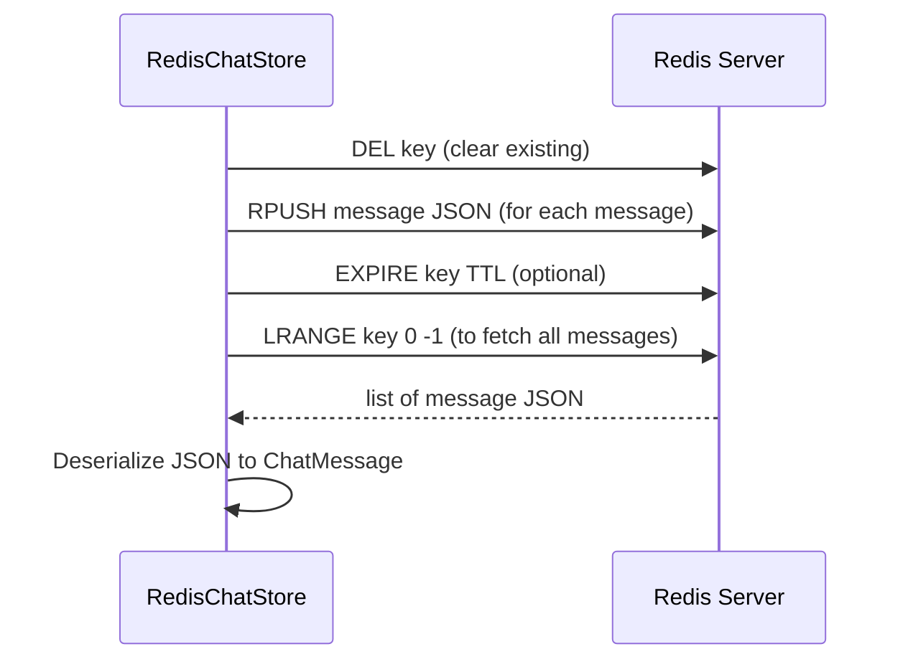

<!-- source: DeepWiki mcp.deepwiki.com · repo run-llama/llama_index · page 3.2 Storage System · fetched 2026-11-09 -->

# Storage System

<details>
<summary>Relevant source files</summary>

The following files were used as context for generating this wiki page:

- [llama-index-core/llama_index/core/storage/docstore/keyval_docstore.py](llama-index-core/llama_index/core/storage/docstore/keyval_docstore.py)
- [llama-index-core/tests/storage/docstore/test_simple_docstore.py](llama-index-core/tests/storage/docstore/test_simple_docstore.py)
- [llama-index-integrations/storage/chat_store/llama-index-storage-chat-store-dynamodb/.gitignore](llama-index-integrations/storage/chat_store/llama-index-storage-chat-store-dynamodb/.gitignore)
- [llama-index-integrations/storage/chat_store/llama-index-storage-chat-store-dynamodb/Makefile](llama-index-integrations/storage/chat_store/llama-index-storage-chat-store-dynamodb/Makefile)
- [llama-index-integrations/storage/chat_store/llama-index-storage-chat-store-dynamodb/README.md](llama-index-integrations/storage/chat_store/llama-index-storage-chat-store-dynamodb/README.md)
- [llama-index-integrations/storage/chat_store/llama-index-storage-chat-store-dynamodb/llama_index/storage/chat_store/dynamodb/__init__.py](llama-index-integrations/storage/chat_store/llama-index-storage-chat-store-dynamodb/llama_index/storage/chat_store/dynamodb/__init__.py)
- [llama-index-integrations/storage/chat_store/llama-index-storage-chat-store-dynamodb/llama_index/storage/chat_store/dynamodb/base.py](llama-index-integrations/storage/chat_store/llama-index-storage-chat-store-dynamodb/llama_index/storage/chat_store/dynamodb/base.py)
- [llama-index-integrations/storage/chat_store/llama-index-storage-chat-store-dynamodb/pyproject.toml](llama-index-integrations/storage/chat_store/llama-index-storage-chat-store-dynamodb/pyproject.toml)
- [llama-index-integrations/storage/chat_store/llama-index-storage-chat-store-dynamodb/tests/__init__.py](llama-index-integrations/storage/chat_store/llama-index-storage-chat-store-dynamodb/tests/__init__.py)
- [llama-index-integrations/storage/chat_store/llama-index-storage-chat-store-dynamodb/tests/test_chat_store_dynamodb_chat_store.py](llama-index-integrations/storage/chat_store/llama-index-storage-chat-store-dynamodb/tests/test_chat_store_dynamodb_chat_store.py)
- [llama-index-integrations/storage/chat_store/llama-index-storage-chat-store-dynamodb/uv.lock](llama-index-integrations/storage/chat_store/llama-index-storage-chat-store-dynamodb/uv.lock)
- [llama-index-integrations/storage/chat_store/llama-index-storage-chat-store-redis/llama_index/storage/chat_store/redis/base.py](llama-index-integrations/storage/chat_store/llama-index-storage-chat-store-redis/llama_index/storage/chat_store/redis/base.py)
- [llama-index-integrations/storage/chat_store/llama-index-storage-chat-store-redis/pyproject.toml](llama-index-integrations/storage/chat_store/llama-index-storage-chat-store-redis/pyproject.toml)
- [llama-index-integrations/storage/chat_store/llama-index-storage-chat-store-redis/tests/conftest.py](llama-index-integrations/storage/chat_store/llama-index-storage-chat-store-redis/tests/conftest.py)
- [llama-index-integrations/storage/chat_store/llama-index-storage-chat-store-redis/tests/test_chat_store_redis_chat_store.py](llama-index-integrations/storage/chat_store/llama-index-storage-chat-store-redis/tests/test_chat_store_redis_chat_store.py)
- [llama-index-integrations/storage/docstore/llama-index-storage-docstore-mongodb/llama_index/storage/docstore/mongodb/base.py](llama-index-integrations/storage/docstore/llama-index-storage-docstore-mongodb/llama_index/storage/docstore/mongodb/base.py)
- [llama-index-integrations/storage/docstore/llama-index-storage-docstore-mongodb/pyproject.toml](llama-index-integrations/storage/docstore/llama-index-storage-docstore-mongodb/pyproject.toml)
- [llama-index-integrations/storage/docstore/llama-index-storage-docstore-postgres/llama_index/storage/docstore/postgres/base.py](llama-index-integrations/storage/docstore/llama-index-storage-docstore-postgres/llama_index/storage/docstore/postgres/base.py)
- [llama-index-integrations/storage/docstore/llama-index-storage-docstore-postgres/pyproject.toml](llama-index-integrations/storage/docstore/llama-index-storage-docstore-postgres/pyproject.toml)
- [llama-index-integrations/storage/index_store/llama-index-storage-index-store-postgres/pyproject.toml](llama-index-integrations/storage/index_store/llama-index-storage-index-store-postgres/pyproject.toml)
- [llama-index-integrations/storage/kvstore/llama-index-storage-kvstore-postgres/llama_index/storage/kvstore/postgres/base.py](llama-index-integrations/storage/kvstore/llama-index-storage-kvstore-postgres/llama_index/storage/kvstore/postgres/base.py)
- [llama-index-integrations/storage/kvstore/llama-index-storage-kvstore-postgres/pyproject.toml](llama-index-integrations/storage/kvstore/llama-index-storage-kvstore-postgres/pyproject.toml)
- [llama-index-integrations/storage/kvstore/llama-index-storage-kvstore-postgres/tests/test_postgres.py](llama-index-integrations/storage/kvstore/llama-index-storage-kvstore-postgres/tests/test_postgres.py)
- [llama-index-integrations/storage/kvstore/llama-index-storage-kvstore-postgres/tests/test_storage_kvstore_postgres.py](llama-index-integrations/storage/kvstore/llama-index-storage-kvstore-postgres/tests/test_storage_kvstore_postgres.py)
- [llama-index-integrations/storage/kvstore/llama-index-storage-kvstore-postgres/uv.lock](llama-index-integrations/storage/kvstore/llama-index-storage-kvstore-postgres/uv.lock)
- [llama-index-integrations/tools/llama-index-tools-serpex/.gitignore](llama-index-integrations/tools/llama-index-tools-serpex/.gitignore)
- [llama-index-integrations/tools/llama-index-tools-serpex/LICENSE](llama-index-integrations/tools/llama-index-tools-serpex/LICENSE)
- [llama-index-integrations/tools/llama-index-tools-serpex/Makefile](llama-index-integrations/tools/llama-index-tools-serpex/Makefile)
- [llama-index-integrations/tools/llama-index-tools-serpex/README.md](llama-index-integrations/tools/llama-index-tools-serpex/README.md)
- [llama-index-integrations/tools/llama-index-tools-serpex/examples/serpex_example.py](llama-index-integrations/tools/llama-index-tools-serpex/examples/serpex_example.py)
- [llama-index-integrations/tools/llama-index-tools-serpex/llama_index/tools/serpex/__init__.py](llama-index-integrations/tools/llama-index-tools-serpex/llama_index/tools/serpex/__init__.py)
- [llama-index-integrations/tools/llama-index-tools-serpex/llama_index/tools/serpex/base.py](llama-index-integrations/tools/llama-index-tools-serpex/llama_index/tools/serpex/base.py)
- [llama-index-integrations/tools/llama-index-tools-serpex/pyproject.toml](llama-index-integrations/tools/llama-index-tools-serpex/pyproject.toml)
- [llama-index-integrations/tools/llama-index-tools-serpex/test_local.py](llama-index-integrations/tools/llama-index-tools-serpex/test_local.py)
- [llama-index-integrations/tools/llama-index-tools-serpex/tests/test_serpex.py](llama-index-integrations/tools/llama-index-tools-serpex/tests/test_serpex.py)

</details>


## Purpose and Scope

The Storage System in LlamaIndex provides a unified interface for persisting and retrieving various types of data used in retrieval-augmented generation (RAG) applications. It is designed around the `StorageContext` class, which orchestrates specialized storage backends for different logical data domains: nodes/documents, indices, chat history, and key-value pairs.

This page describes the core storage abstractions (Document Stores, Index Stores, Chat Stores, KV Stores), the persistence ecosystem supporting them, and the main implementation classes and data flows.

Sources: [llama-index-core/llama_index/core/storage/docstore/keyval_docstore.py:24-80](), [llama-index-integrations/storage/chat_store/llama-index-storage-chat-store-redis/llama_index/storage/chat_store/redis/base.py:19-178](), [llama-index-integrations/storage/kvstore/llama-index-storage-kvstore-postgres/llama_index/storage/kvstore/postgres/base.py:61-185]()

---

## Architecture Overview

LlamaIndex storage is architected using the **Facade pattern**, exposed by the `StorageContext` class, which integrates various specialized stores under a uniform interface. Each underlying store targets a particular type of data:

- **Document Store**: Persists raw documents or segmented nodes, including metadata.
- **Index Store**: Stores index-specific data structures.
- **Vector Store**: Manages vector embeddings and similarity search.
- **Chat Store**: Maintains conversation history (sessions).
- **Key-Value Store (KV Store)**: Provides a simple dictionary-like persistent interface, commonly layered beneath Document and Index Stores.

### High-Level Architecture Diagram



- `StorageContext` acts as the single entry point managing backends.
- Document and Index Stores frequently rely on Key-Value stores for flexibility.
- Vector Stores use specialized vector databases or vector-optimized persistence.
- Chat Stores make use of low-latency backends like Redis or DynamoDB.

Sources: [llama-index-core/llama_index/core/storage/docstore/keyval_docstore.py:24-80](), [llama-index-integrations/storage/chat_store/llama-index-storage-chat-store-redis/llama_index/storage/chat_store/redis/base.py:19-178](), [llama-index-integrations/storage/kvstore/llama-index-storage-kvstore-postgres/llama_index/storage/kvstore/postgres/base.py:61-185]()

---

## StorageContext

`StorageContext` is the main facade to configure and access storage backends.

- It is typically constructed with `StorageContext.from_defaults()`, which creates standard store implementations.
- It provides methods such as `persist()` to persist current in-memory state.
- Holds references to document store, index store, vector store, and chat store.

This class abstracts application-level storage operations directing them to the appropriate backend.

Sources: [llama-index-core/llama_index/core/storage/context.py:24-60]() (not shown here, but typical context)

---

## Document Store

The Document Store persists **Node** objects, which contain document content, metadata, and structure.

### KVDocumentStore

`KVDocumentStore` is the main concrete Document Store implementation backed by a key-value store (`BaseKVStore`).

- Uses a configurable namespace prefix (`"docstore"` by default) and suffixes to organize three collections:
  - `/data`: Stores serialized node content (text and metadata).
  - `/ref_doc_info`: Maps documents to node IDs representing document-to-node mapping and document metadata.
  - `/metadata`: Stores node-level metadata like data hashes and references.

- The class supports batch insertion and retrieval of nodes with consistent updates of all three collections in one atomic transaction on the underlying `BaseKVStore`.

- Nodes are serialized to JSON using helper functions `doc_to_json()` and deserialized via `json_to_doc()`. This serialization encapsulates node content and metadata.

- Same underlying docstore instance can be reused across multiple index structures to avoid duplication.

**Key Functions and Dataflow:**

- `_get_kv_pairs_for_insert(node, ref_doc_info, store_text)`: Prepares key-value pairs for all three collections for a node.
- `_prepare_kv_pairs(nodes, allow_update, store_text)`: Processes multiple nodes, preparing KV pairs for bulk insertion and consolidating reference doc info.
- `docs` property returns all stored nodes by fetching and deserializing their JSON representation.



Sources: [llama-index-core/llama_index/core/storage/docstore/keyval_docstore.py:24-164]()

---

### PostgresDocumentStore

A specialized `KVDocumentStore` that uses `PostgresKVStore` as the underlying KV store.

- Supports PostgreSQL storage with JSON or JSONB column types.
- Created via factory methods such as `from_uri()` which accepts a PostgreSQL connection URI.
- Leverages SQLAlchemy ORM for schema management, automatic table creation, and CRUD operations.



Sources: [llama-index-integrations/storage/docstore/llama-index-storage-docstore-postgres/llama_index/storage/docstore/postgres/base.py:8-84](), [llama-index-integrations/storage/kvstore/llama-index-storage-kvstore-postgres/llama_index/storage/kvstore/postgres/base.py:61-185]()

---

## Key-Value Stores (KVStore)

KV stores provide a simple dictionary-like persistent interface with support for batch operations.

### PostgresKVStore

An advanced `BaseKVStore` implementation that uses PostgreSQL tables with JSON/JSONB columns to store key-value pairs:

- Supports synchronous and asynchronous connection strings.
- Uses `SQLAlchemy` models dynamically generated for specific tables and schemas.
- Enforces uniqueness on `(key, namespace)` pairs.
- Supports batch inserts and updates.
- Allows configuration of JSON vs JSONB storage for performance tuning.



Sources: [llama-index-integrations/storage/kvstore/llama-index-storage-kvstore-postgres/llama_index/storage/kvstore/postgres/base.py:61-185]()

---

## Chat Store

Chat Stores manage conversation histories for chat-based applications and agents.

### RedisChatStore

- Implements `BaseChatStore` interface backed by Redis.
- Stores each conversation keyed by a session or chat ID.
- Stores ordered list of `ChatMessage` JSON representations in Redis lists.
- Supports synchronous and asynchronous Redis clients.
- Supports time-to-live (TTL) for automatic session expiry.
- Provides:

  - `set_messages(key, messages)`: Overwrites messages for a chat.
  - `get_messages(key)`: Retrieves all messages.
  - `add_message(key, message)`: Appends a message.
  - `delete_message(key, idx)`: Deletes a message by index.
  - `delete_last_message(key)`: Deletes the last message.
  - Key retrieval and batch deletion.

**Data flow:**



Sources: [llama-index-integrations/storage/chat_store/llama-index-storage-chat-store-redis/llama_index/storage/chat_store/redis/base.py:19-178]()

---

## Persistence and Loading

- Storage classes support persistence to durable stores (disk, cloud, DB).
- Typical serialization formats are JSON for documents and chat messages.
- `StorageContext` supports exporting to dict or JSON and loading from persisted data.
- Example: Vector stores can load from a directory of namespaced JSON files.

```python
# Load vector stores from persisted files
vector_stores = SimpleVectorStore.from_namespaced_persist_dir(persist_dir="./storage")
```

Sources: [llama-index-core/llama_index/core/vector_stores/simple.py:109-113]()

---

# Summary Mermaid Diagram: Natural Language to Code Mapping

The following two diagrams map conceptual domain terms to their key code entities, facilitating clear understanding of how user data and queries transit through the storage system.

### 1. Document Storage Flow

```mermaid
graph LR
    "UserDocument" --> "Node(s)"
    "Node(s)" --> "KVDocumentStore.add_documents()"
    "KVDocumentStore" --> "BaseKVStore.put()"
    "BaseKVStore" --> "PostgresKVStore (Table: data_<namespace>)"
    subgraph CodeEntities
        KVDocStore["KVDocumentStore (llama-index-core/...)"]
        KVStore["BaseKVStore (llama-index-core/core/storage/kvstore)"]
        PGKVStore["PostgresKVStore (llama-index-storage-kvstore-postgres)"]
    end
```

### 2. Chat History Storage Flow

```mermaid
graph LR
    "ChatSession" --> "RedisChatStore.set_messages()"
    "RedisChatStore" --> "redis-py.lrange()/rpush()"
    subgraph CodeEntities
        RedisChat["RedisChatStore (llama-index-storage-chat-store-redis)"]
        RedisClient["Redis Client"]
    end
```

---

## References

- `llama-index-core/llama_index/core/storage/docstore/keyval_docstore.py` : `KVDocumentStore` implementation details.
- `llama-index-integrations/storage/kvstore/llama-index-storage-kvstore-postgres/llama_index/storage/kvstore/postgres/base.py` : `PostgresKVStore` with SQLAlchemy model.
- `llama-index-integrations/storage/docstore/llama-index-storage-docstore-postgres/llama_index/storage/docstore/postgres/base.py` : `PostgresDocumentStore`.
- `llama-index-integrations/storage/chat_store/llama-index-storage-chat-store-redis/llama_index/storage/chat_store/redis/base.py` : `RedisChatStore` implementation.
- `llama-index-core/llama_index/core/vector_stores/simple.py` : Persistence pattern for vector stores.
- `llama-index-core/llama_index/core/vector_stores/types.py` : Metadata filtering.

---

# Summary Table of Key Storage Classes

| Storage Type      | Class Name           | Backend Type                      | File Path (Partial)                              | Main Role                             |
|-------------------|----------------------|---------------------------------|-------------------------------------------------|-------------------------------------|
| Document Store    | `KVDocumentStore`    | Generic KVStore (e.g. Postgres) | `core/storage/docstore/keyval_docstore.py`      | Stores nodes and document metadata  |
| Document Store    | `PostgresDocumentStore` | PostgresKVStore (Postgres DB) | `storage/docstore/postgres/base.py`              | Postgres document backend adapter   |
| KV Store          | `PostgresKVStore`    | Postgres with JSONB             | `storage/kvstore/postgres/base.py`               | KV persistence via PostgreSQL       |
| Chat Store        | `RedisChatStore`     | Redis                          | `storage/chat_store/redis/base.py`                | Stores chat conversation messages   |

Sources: All above files as noted per section.

---

This concludes the detailed technical overview of the `Storage System` in LlamaIndex, encompassing key abstractions, implementations, and the data flow through persistent backends.

---

