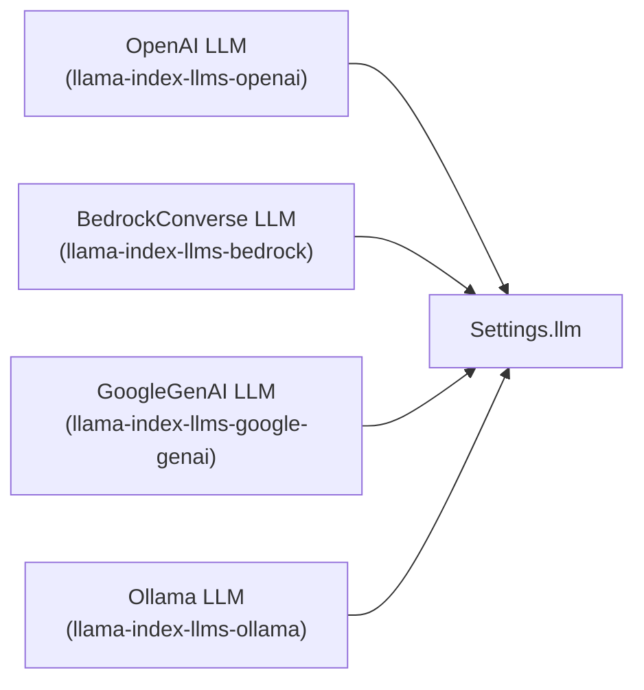

<!-- source: DeepWiki mcp.deepwiki.com · repo run-llama/llama_index · page 3.3 Settings and Configuration · fetched 2026-11-09 -->

# Settings and Configuration

<details>
<summary>Relevant source files</summary>

The following files were used as context for generating this wiki page:

- [CHANGELOG.md](CHANGELOG.md)
- [docs/api_reference/api_reference/llms/azure_openai.md](docs/api_reference/api_reference/llms/azure_openai.md)
- [docs/api_reference/api_reference/llms/minimax.md](docs/api_reference/api_reference/llms/minimax.md)
- [docs/api_reference/api_reference/llms/openai_like.md](docs/api_reference/api_reference/llms/openai_like.md)
- [docs/api_reference/api_reference/llms/sarvam.md](docs/api_reference/api_reference/llms/sarvam.md)
- [docs/api_reference/api_reference/memory/bedrock_agentcore.md](docs/api_reference/api_reference/memory/bedrock_agentcore.md)
- [docs/api_reference/api_reference/postprocessor/google_rerank.md](docs/api_reference/api_reference/postprocessor/google_rerank.md)
- [docs/api_reference/api_reference/storage/vector_store/solr.md](docs/api_reference/api_reference/storage/vector_store/solr.md)
- [docs/api_reference/api_reference/tools/aws_bedrock_agentcore.md](docs/api_reference/api_reference/tools/aws_bedrock_agentcore.md)
- [docs/api_reference/mkdocs.yml](docs/api_reference/mkdocs.yml)
- [docs/examples/customization/prompts/chat_prompts.ipynb](docs/examples/customization/prompts/chat_prompts.ipynb)
- [docs/src/content/docs/framework/CHANGELOG.md](docs/src/content/docs/framework/CHANGELOG.md)
- [docs/src/content/docs/framework/CONTRIBUTING.md](docs/src/content/docs/framework/CONTRIBUTING.md)
- [llama-index-core/llama_index/core/__init__.py](llama-index-core/llama_index/core/__init__.py)
- [llama-index-core/llama_index/core/indices/common/struct_store/base.py](llama-index-core/llama_index/core/indices/common/struct_store/base.py)
- [llama-index-core/llama_index/core/indices/common_tree/base.py](llama-index-core/llama_index/core/indices/common_tree/base.py)
- [llama-index-core/llama_index/core/indices/prompt_helper.py](llama-index-core/llama_index/core/indices/prompt_helper.py)
- [llama-index-core/llama_index/core/indices/tree/inserter.py](llama-index-core/llama_index/core/indices/tree/inserter.py)
- [llama-index-core/llama_index/core/prompts/base.py](llama-index-core/llama_index/core/prompts/base.py)
- [llama-index-core/llama_index/core/prompts/prompt_utils.py](llama-index-core/llama_index/core/prompts/prompt_utils.py)
- [llama-index-core/llama_index/core/prompts/rich.py](llama-index-core/llama_index/core/prompts/rich.py)
- [llama-index-core/llama_index/core/prompts/utils.py](llama-index-core/llama_index/core/prompts/utils.py)
- [llama-index-core/llama_index/core/utilities/token_counting.py](llama-index-core/llama_index/core/utilities/token_counting.py)
- [llama-index-core/pyproject.toml](llama-index-core/pyproject.toml)
- [llama-index-core/tests/indices/test_prompt_helper.py](llama-index-core/tests/indices/test_prompt_helper.py)
- [llama-index-core/tests/prompts/test_base.py](llama-index-core/tests/prompts/test_base.py)
- [llama-index-core/tests/prompts/test_rich.py](llama-index-core/tests/prompts/test_rich.py)
- [llama-index-core/tests/test_prompt_helper_empty_input.py](llama-index-core/tests/test_prompt_helper_empty_input.py)
- [llama-index-core/uv.lock](llama-index-core/uv.lock)
- [pyproject.toml](pyproject.toml)
- [uv.lock](uv.lock)

</details>


This page documents the configuration system in LlamaIndex, focusing on the `Settings` global object as the central hub for configuring core framework components such as LLMs, embedding models, tokenizers, prompt helpers, and callback managers. The page also covers prompt helper utilities for token counting and chunk management, environment variables, and the deprecation relationship with `ServiceContext`.

---

## Overview

LlamaIndex adopts a centralized configuration design centered around a singleton `Settings` object. This object enables global management and dependency injection of frequently used components such as LLMs, embeddings, and prompt helpers to ensure consistent defaults throughout the system.

Key characteristics of the `Settings` object include:

- **Global singleton**: There is one canonical instance accessed globally via imports.
- **Lazy initialization and validation**: Components like `PromptHelper` instantiate on demand based on current LLM metadata.
- **Allowing local override**: Developers may override the global settings per instance or call.
- **Type-safe and extensible**: Configuration fields are validated and annotated with Pydantic, making it easier to extend or replace models.

This design facilitates cohesive configuration management while allowing flexibility for specific use cases such as specialized prompt templates or LLM models.

Sources:  
[llama-index-core/llama_index/core/settings.py:1-63](),  
[llama-index-core/llama_index/core/__init__.py:78-79]()

---

## Configuration Architecture

The `Settings` object sits at the heart of the configuration layer and acts as a provider for several foundational abstractions across the llama_index framework. Other system modules import and consume these configured components transparently.

### Configuration Component Relationships

```mermaid
graph TB
  subgraph Configuration Layer ("llama_index.core.settings")
    Settings["Settings<br/>(Global Singleton)"]
    LLM["llm<br/>(BaseLLM instance)"]
    Embed["embed_model<br/>(BaseEmbedding instance)"]
    Tokenizer["tokenizer<br/>(Callable)"]
    Callback["callback_manager<br/>(CallbackManager)"]
    NodeParser["node_parser<br/>(NodeParser)"]
    PromptHelper["prompt_helper<br/>(PromptHelper)"]
  end

  subgraph Consumer Layer
    Index["VectorStoreIndex and other indices<br/>(llama_index.core.indices)"]
    QueryEngine["QueryEngines<br/>(llama_index.core.query_engine)"]
    Synthesizer["ResponseSynthesizer<br/>(llama_index.core.response_synthesizers)"]
  end

  Settings --> LLM
  Settings --> Embed
  Settings --> Tokenizer
  Settings --> Callback
  Settings --> NodeParser
  Settings --> PromptHelper

  LLM --> Index
  LLM --> QueryEngine
  LLM --> Synthesizer

  Embed --> Index
  Tokenizer --> PromptHelper
  NodeParser --> Index
```

**Flow of configuration usage**:

1. The user configures the `Settings` singleton, assigning model instances and parameters.
2. Core components such as indices and query engines retrieve these global settings seamlessly.
3. Optional local overrides at invocation or construction supersede the global settings when provided.

This architecture centralizes configuration and reduces boilerplate, improving consistency across components.

Sources:  
[llama-index-core/llama_index/core/settings.py:10-80](),  
[llama-index-core/llama_index/core/__init__.py:78-150]()

---

## The Settings Object

`Settings` is the key global configuration holder for critical system components and options.

### Instantiation and Usage

The `Settings` singleton is imported from `llama_index.core`:

```python
from llama_index.core import Settings
```

You can assign your desired implementations or specific model parameters to configure the system:

```python
from llama_index.llms.openai import OpenAI
from llama_index.embeddings.openai import OpenAIEmbedding

# Set OpenAI GPT-4 LLM with low temperature sampling
Settings.llm = OpenAI(model="gpt-4", temperature=0.1)

# Set OpenAI embeddings with custom embedding model
Settings.embed_model = OpenAIEmbedding(model="text-embedding-3-small")
```

### Core Properties of Settings

| Property           | Type             | Default Value / Behavior           | Role / Purpose                                         |
|--------------------|------------------|-----------------------------------|--------------------------------------------------------|
| `llm`              | `BaseLLM`        | `OpenAI()` instance by default    | The LLM provider used for text generation and tools    |
| `embed_model`       | `BaseEmbedding`  | `OpenAIEmbedding()` instance default | Embedding model for texts used in indexes and retrieval |
| `tokenizer`         | `Callable`       | Default tokenizer from `get_tokenizer()` (tiktoken) | Tokenizer function used for prompt helper and token counting |
| `callback_manager`  | `CallbackManager`| Default empty callback manager    | Orchestrates event callbacks and instrumentation       |
| `node_parser`       | `NodeParser`     | Default `SentenceSplitter`        | Converts raw documents into nodes                        |
| `prompt_helper`     | `PromptHelper`   | Lazily constructed based on LLM metadata | Utility for prompt sizing, chunk splitting, and token budgeting |
| `chunk_size`        | `int`            | 1024 tokens                      | Default chunk size controlling document splitting       |
| `chunk_overlap`     | `int`            | 20 tokens                       | Number of tokens overlapped between chunks               |

The `PromptHelper` instance in settings recalculates limits based on `llm` metadata, ensuring harmony with the LLM's context window.

Sources:  
[llama-index-core/llama_index/core/settings.py:15-60](),  
[llama-index-core/llama_index/core/__init__.py:128-140]()

---

## Model Configurations

### LLM Setup and Providers

LLMs are configured by assigning an instance of a subclass of `BaseLLM` to `Settings.llm`. Common providers include OpenAI, Anthropic, Bedrock, and Ollama, each implemented in separate integration packages.



Every LLM request is wrapped with callback instrumentation, enabling detailed event tracking for debugging and observability through the internal event system (e.g., `LLMChatStartEvent` / `LLMChatEndEvent`).

This design allows easy swapping of LLM backends by just changing the global `Settings.llm` reference.

Sources:  
[llama-index-core/llama_index/core/llms/callbacks.py:39-65](),  
[llama-index-core/llama_index/core/instrumentation/events/llm.py:187-266](),  
[CHANGELOG.md:25-43]()

---

### Embedding Models

Embedding models conform to the `BaseEmbedding` interface and are configured via `Settings.embed_model`. They provide vector representations for documents and queries involved in indexing and search.

Key features of embedding configuration include:

- **Batching support**: Embedding calls can be batched for efficiency. Configurable by `embed_batch_size`.
- **Cacheable outputs**: Optionally cache embeddings using a `BaseKVStore` to avoid recomputing for repeated inputs.
- **Event instrumentation**: Emit `EmbeddingStartEvent` and `EmbeddingEndEvent` to track embedding operations.

Example:

```python
Settings.embed_model = OpenAIEmbedding(model="text-embedding-3-large")
```

Sources:  
[llama-index-core/llama_index/core/base/embeddings/base.py:72-130](),  
[llama-index-core/llama_index/core/embeddings/mock_embed_model.py:22]()

---

## Tokenization and Prompt Helper

### Global Tokenizer Management

The tokenizer is a `Callable` that splits strings into tokens, critical for managing LLM context window usage in prompt construction.

- `set_global_tokenizer(tokenizer: Callable[[str], list])` sets the global tokenizer.
- `get_tokenizer()` retrieves the current global tokenizer, defaulting to the `tiktoken` tokenizer if none was set explicitly.

The tokenizer is consumed by the `PromptHelper` and some node parsers for token counting.

Sources:  
[llama-index-core/llama_index/core/utils.py:144-182]()

---

### PromptHelper

`PromptHelper` is a specialized utility managing prompt size calculations related to the LLM’s context window and output token budget. It helps in "repacking" or truncating text chunks to maximize LLM calls' efficiency without exceeding token limits.

#### Core Responsibilities:

- Calculate the available context size (`context_window_len - num_prompt_tokens - output_token_budget`)
- Compute maximum chunk sizes with optional padding and per chunk overlap
- Support token-based splitting and overlap of text chunks
- Helper method to construct from `LLMMetadata` for seamless adaptation to LLM characteristics

#### Key methods and attributes:

| Method / Attribute          | Description                                                        |
|-----------------------------|------------------------------------------------------------------|
| `context_window` (int)      | LLM context window token limit                                   |
| `num_output` (int)          | Number of tokens reserved for LLM output generation              |
| `chunk_overlap_ratio` (float) | Fraction of chunk size to overlap between chunks                  |
| `chunk_size_limit` (int)    | Max chunk size override (optional)                               |
| `separator` (str)           | Token separator for split chunks                                 |
| `_get_available_context_size(num_prompt_tokens: int)` | Computes available tokens left for context                     |
| `from_llm_metadata(...)`    | Factory method creating `PromptHelper` from LLM metadata         |

```python
# Example creating a prompt helper from LLM metadata with optional chunk size limit
prompt_helper = PromptHelper.from_llm_metadata(
    llm_metadata=Settings.llm.metadata,
    chunk_overlap_ratio=0.1,
    chunk_size_limit=1024,
)
```

This utility is often auto-instantiated and available in `Settings.prompt_helper` for use in prompt management and chunk processing.

Sources:  
[llama-index-core/llama_index/core/indices/prompt_helper.py:45-165]()

---

## ServiceContext (Legacy)

`ServiceContext` was the original global context before switching to the current `Settings` object. It acts as a lightweight wrapper that redirects legacy users to adopt `Settings`.

- Deprecated since version 0.14.x.
- Deprecated attributes like `ServiceContext.llm` now correspond to `Settings.llm`.
- The utility function `set_global_service_context()` updates the global `Settings` singleton based on a provided `ServiceContext`.

```python
from llama_index.core import set_global_service_context
from llama_index.core import ServiceContext

svc_ctx = ServiceContext(...)
set_global_service_context(svc_ctx)
```

This bridge ensures backward compatibility while encouraging migration to the improved `Settings` management.

Sources:  
[llama-index-core/llama_index/core/__init__.py:72-75](),  
[llama-index-core/llama_index/core/service_context.py:48]()

---

## Environment Variables

LlamaIndex reads certain environment variables to configure external integrations and data paths when explicit configuration is absent.

| Environment Variable  | Description                                             | Used By                             |
|----------------------|---------------------------------------------------------|-----------------------------------|
| `OPENAI_API_KEY`      | API key for OpenAI LLM and embeddings                   | OpenAI LLM, OpenAI Embeddings     |
| `TIKTOKEN_CACHE_DIR`  | Directory for caching Tiktoken BPE rank files           | Tokenizer utility                  |
| `NLTK_DATA`           | Path for NLTK resource files                             | `GlobalsHelper` and NLTK library  |

The `GlobalsHelper` class in utilities manages initialization of such resources based on these environment variables.

Sources:  
[pyproject.toml:41-46](),  
[llama-index-core/llama_index/core/utils.py:44-82]()

---

# Summary

- `Settings` serves as the global singleton for managing key configurations related to LLMs, embeddings, tokenizers, prompt helpers, and callbacks.
- It enables easy swapping and customization of core building blocks with consistent access patterns.
- `PromptHelper` streamlines token budgeting and chunk handling respecting LLM context windows.
- Embedding and LLM instances follow integration patterns for extensibility.
- Legacy `ServiceContext` exists as a compatibility shim.
- Configuration may also leverage environment variables to control external dependencies.

---

This centralized settings and configuration design simplifies LlamaIndex usage, enabling consistent, type-safe, and extensible configuration management across all components.

---

Sources:  
[llama-index-core/llama_index/core/settings.py:1-63](),  
[llama-index-core/llama_index/core/__init__.py:72-150](),  
[llama-index-core/llama_index/core/indices/prompt_helper.py:45-165](),  
[llama-index-core/llama_index/core/base/embeddings/base.py:72-130](),  
[llama-index-core/llama_index/core/utils.py:44-182](),  
[llama-index-core/llama_index/core/llms/callbacks.py:39-65](),  
[llama-index-core/llama_index/core/instrumentation/events/llm.py:187-266]()

---

