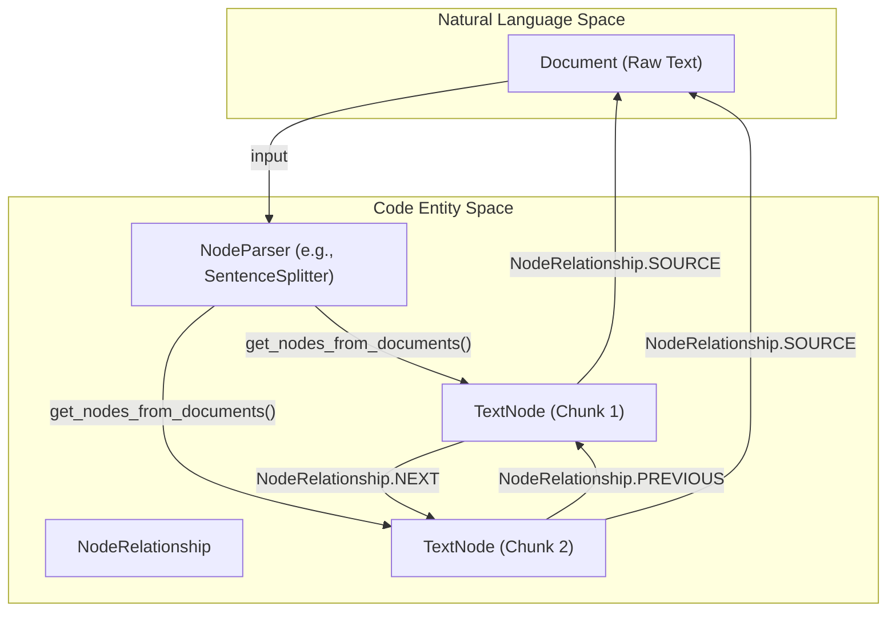
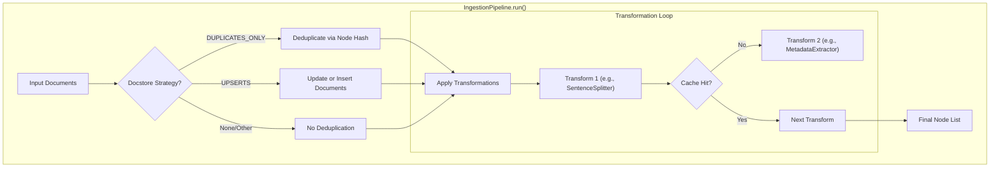

<!-- source: DeepWiki mcp.deepwiki.com · repo run-llama/llama_index · page 3.5 Node Parsers and Ingestion · fetched 2026-11-09 -->

# Node Parsers and Ingestion

Relevant source files

The following files were used as context for generating this wiki page:

- [docs/examples/ingestion/ray_ingestion_pipeline.ipynb](docs/examples/ingestion/ray_ingestion_pipeline.ipynb)
- [llama-index-core/llama_index/core/composability/joint_qa_summary.py](llama-index-core/llama_index/core/composability/joint_qa_summary.py)
- [llama-index-core/llama_index/core/ingestion/pipeline.py](llama-index-core/llama_index/core/ingestion/pipeline.py)
- [llama-index-core/llama_index/core/node_parser/__init__.py](llama-index-core/llama_index/core/node_parser/__init__.py)
- [llama-index-core/llama_index/core/node_parser/interface.py](llama-index-core/llama_index/core/node_parser/interface.py)
- [llama-index-core/llama_index/core/node_parser/relational/__init__.py](llama-index-core/llama_index/core/node_parser/relational/__init__.py)
- [llama-index-core/llama_index/core/node_parser/relational/base_element.py](llama-index-core/llama_index/core/node_parser/relational/base_element.py)
- [llama-index-core/llama_index/core/node_parser/relational/llama_parse_json_element.py](llama-index-core/llama_index/core/node_parser/relational/llama_parse_json_element.py)
- [llama-index-core/llama_index/core/node_parser/relational/markdown_element.py](llama-index-core/llama_index/core/node_parser/relational/markdown_element.py)
- [llama-index-core/llama_index/core/node_parser/relational/unstructured_element.py](llama-index-core/llama_index/core/node_parser/relational/unstructured_element.py)
- [llama-index-core/llama_index/core/node_parser/relational/utils.py](llama-index-core/llama_index/core/node_parser/relational/utils.py)
- [llama-index-core/llama_index/core/node_parser/text/__init__.py](llama-index-core/llama_index/core/node_parser/text/__init__.py)
- [llama-index-core/llama_index/core/node_parser/text/sentence.py](llama-index-core/llama_index/core/node_parser/text/sentence.py)
- [llama-index-core/llama_index/core/node_parser/text/token.py](llama-index-core/llama_index/core/node_parser/text/token.py)
- [llama-index-core/llama_index/core/query_engine/router_query_engine.py](llama-index-core/llama_index/core/query_engine/router_query_engine.py)
- [llama-index-core/llama_index/core/response_synthesizers/__init__.py](llama-index-core/llama_index/core/response_synthesizers/__init__.py)
- [llama-index-core/llama_index/core/tools/tool_spec/base.py](llama-index-core/llama_index/core/tools/tool_spec/base.py)
- [llama-index-core/tests/ingestion/test_pipeline.py](llama-index-core/tests/ingestion/test_pipeline.py)
- [llama-index-core/tests/node_parser/test_duplicate_text_positions.py](llama-index-core/tests/node_parser/test_duplicate_text_positions.py)
- [llama-index-core/tests/node_parser/test_markdown_element.py](llama-index-core/tests/node_parser/test_markdown_element.py)
- [llama-index-core/tests/node_parser/test_node_parser.py](llama-index-core/tests/node_parser/test_node_parser.py)
- [llama-index-core/tests/query_engine/test_router_query_engine.py](llama-index-core/tests/query_engine/test_router_query_engine.py)
- [llama-index-core/tests/text_splitter/test_sentence_splitter.py](llama-index-core/tests/text_splitter/test_sentence_splitter.py)
- [llama-index-core/tests/text_splitter/test_splitter_oversized_unit.py](llama-index-core/tests/text_splitter/test_splitter_oversized_unit.py)
- [llama-index-core/tests/tools/tool_spec/test_base.py](llama-index-core/tests/tools/tool_spec/test_base.py)
- [llama-index-integrations/ingestion/llama-index-ingestion-ray/.gitignore](llama-index-integrations/ingestion/llama-index-ingestion-ray/.gitignore)
- [llama-index-integrations/ingestion/llama-index-ingestion-ray/LICENSE](llama-index-integrations/ingestion/llama-index-ingestion-ray/LICENSE)
- [llama-index-integrations/ingestion/llama-index-ingestion-ray/Makefile](llama-index-integrations/ingestion/llama-index-ingestion-ray/Makefile)
- [llama-index-integrations/ingestion/llama-index-ingestion-ray/README.md](llama-index-integrations/ingestion/llama-index-ingestion-ray/README.md)
- [llama-index-integrations/ingestion/llama-index-ingestion-ray/llama_index/ingestion/ray/__init__.py](llama-index-integrations/ingestion/llama-index-ingestion-ray/llama_index/ingestion/ray/__init__.py)
- [llama-index-integrations/ingestion/llama-index-ingestion-ray/llama_index/ingestion/ray/base.py](llama-index-integrations/ingestion/llama-index-ingestion-ray/llama_index/ingestion/ray/base.py)
- [llama-index-integrations/ingestion/llama-index-ingestion-ray/llama_index/ingestion/ray/transform.py](llama-index-integrations/ingestion/llama-index-ingestion-ray/llama_index/ingestion/ray/transform.py)
- [llama-index-integrations/ingestion/llama-index-ingestion-ray/llama_index/ingestion/ray/utils.py](llama-index-integrations/ingestion/llama-index-ingestion-ray/llama_index/ingestion/ray/utils.py)
- [llama-index-integrations/readers/llama-index-readers-file/llama_index/readers/file/docs/base.py](llama-index-integrations/readers/llama-index-readers-file/llama_index/readers/file/docs/base.py)
- [llama-index-integrations/readers/llama-index-readers-file/llama_index/readers/file/image_deplot/base.py](llama-index-integrations/readers/llama-index-readers-file/llama_index/readers/file/image_deplot/base.py)
- [llama-index-integrations/readers/llama-index-readers-file/tests/test_docs.py](llama-index-integrations/readers/llama-index-readers-file/tests/test_docs.py)
- [llama-index-integrations/readers/llama-index-readers-file/tests/test_readers_file.py](llama-index-integrations/readers/llama-index-readers-file/tests/test_readers_file.py)
- [llama-index-integrations/readers/llama-index-readers-hwp/llama_index/readers/hwp/base.py](llama-index-integrations/readers/llama-index-readers-hwp/llama_index/readers/hwp/base.py)
- [llama-index-integrations/readers/llama-index-readers-hwp/tests/test_readers_hwp.py](llama-index-integrations/readers/llama-index-readers-hwp/tests/test_readers_hwp.py)

The ingestion layer in LlamaIndex is responsible for transforming raw `Document` objects into `BaseNode` objects, which serve as the fundamental data units for indexing and retrieval. This transformation involves parsing text, splitting into smaller node chunks, extracting metadata, and managing relationships between nodes. The ingestion pipeline centralizes these operations for streamlined processing.

---

### Core Abstractions: Documents and Nodes

- **Document**: Represents an entire piece of source data (text, images, etc.) with associated metadata. Defined in `llama_index/core/schema.py` [llama-index-core/llama_index/core/schema.py:1492]().

- **BaseNode**: Represents a chunk of a document, mapped from a larger `Document`. Nodes maintain relationships (e.g., `SOURCE`, `PREVIOUS`, `NEXT`) back to their original document or sibling nodes. Defined in the same schema module [llama-index-core/llama_index/core/schema.py:191-223]().

Key node attributes:

| Attribute       | Description                                 |
|-----------------|---------------------------------------------|
| `id_`           | Unique identifier for the node              |
| `relationships` | Maps relationship types (e.g., `SOURCE`) to related nodes |
| `metadata`      | Metadata key-value dict for node context    |
| `hash`          | Hash of node content and metadata, used for deduplication |

---

### Node Parsers

`NodeParser` inherits from `TransformComponent` and defines how a sequence of `Document` objects is parsed into a sequence of `BaseNode` objects. This abstraction supports synchronous and asynchronous parsing, metadata handling, and node relationship setup [llama-index-core/llama_index/core/node_parser/interface.py:50-181]().

#### Text Splitters

Text splitters are specialized node parsers that chunk raw text according to strategies optimized for downstream usage:

- **SentenceSplitter**  
  Splits text into chunks preserving sentence boundaries using tokenization, regex, and paragraph separators. Supports chunk size limits and chunk overlap to maintain context. Implements metadata-aware splitting as well [llama-index-core/llama_index/core/node_parser/text/sentence.py:34-178]().

- **CodeSplitter**  
  Splits code snippets using AST parsing with `tree-sitter`. Supports language-specific syntax, chunking by characters or tokens, and hierarchical node generation [llama-index-core/llama_index/core/node_parser/text/code.py:19-56]().

- **SemanticDoubleMergingSplitterNodeParser**  
  Uses semantic similarity embeddings or spaCy models to group sentences into semantically coherent nodes. Applies a two-pass approach with initial thresholding and merging by similarity threshold [llama-index-core/llama_index/core/node_parser/text/semantic_double_merging_splitter.py:61-145]().

#### Relational Parsers

Designed for documents with structured content and embedded objects such as tables:

- **BaseElementNodeParser**  
  Abstract class that splits documents into TextNodes and IndexNodes for embedded elements like tables. Supports LLM-based summarization of tables for better indexing [llama-index-core/llama_index/core/node_parser/relational/base_element.py:71-130]().

- **MarkdownElementNodeParser**  
  Specialized for Markdown documents. Extracts tables (including HTML within markdown), creates appropriate nodes, and uses table summarization to guide relevance [llama-index-core/llama_index/core/node_parser/relational/markdown_element.py:11-43]().

- **UnstructuredElementNodeParser**  
  Utilizes the `unstructured` library to partition HTML or unstructured text into elements, distinguishing tables and text with filtering. Summarization is also supported [llama-index-core/llama_index/core/node_parser/relational/unstructured_element.py:18-100]().

---

### Document-to-Node Transformation Flow

This diagram captures the flow where a raw `Document` is parsed by a `NodeParser` (e.g., SentenceSplitter), resulting in multiple linked `TextNode` instances that maintain source and adjacency relationships.

**Sources:**  
[llama-index-core/llama_index/core/node_parser/interface.py:157-181](),  
[llama-index-core/llama_index/core/schema.py:207-223]()

---

### Ingestion Pipeline

`IngestionPipeline` orchestrates the end-to-end processing of documents into nodes, including reading, parsing, transforming (splitting, extraction, embedding), and caching results to improve efficiency [llama-index-core/llama_index/core/ingestion/pipeline.py:71-156]().

#### Key Features:

- **Transformations**: A sequential list of transformation components (`TransformComponent`) such as node parsers, metadata extractors, and embedding generators. Pipeline applies them in order to the documents/nodes.

- **Caching**: Uses `IngestionCache` keyed by hashes that represent both input nodes and transformation configurations (via `get_transformation_hash`). This allows skipping redundant re-computation.

- **Docstore Strategy**: Supports strategies like `DUPLICATES_ONLY` (deduplication based on node hash) to avoid reindexing unchanged content or `UPSERTS` for updates [llama-index-core/tests/ingestion/test_pipeline.py:83-110]().

- **Persistence**: Pipeline state, particularly documents and caches, can be persisted and reloaded to maintain ingestion context across runs.

---

### Ingestion Pipeline Execution Flow

This diagram illustrates how the pipeline applies a docstore strategy for deduplication, then runs through each transformation in sequence, checking cache hits before executing transformations.

**Sources:**  
[llama-index-core/llama_index/core/ingestion/pipeline.py:72-112](),  
[llama-index-core/llama_index/core/ingestion/pipeline.py:115-156](),  
[llama-index-core/tests/ingestion/test_pipeline.py:83-110]()

---

### Metadata Extraction and Node Postprocessing

During node parsing, metadata from the source `Document` is merged into each `BaseNode` unless disabled. Furthermore, nodes receive `start_char_idx` and `end_char_idx` values that track their positional spans in the original document text.

The node parser also establishes bidirectional relationships between nodes based on adjacency and source linkage. This enriched metadata and relationship map is vital for downstream indexing and retrieval [llama-index-core/llama_index/core/node_parser/interface.py:84-155]().

---

### Implementation Overview of Key Functions and Classes

| Name                                  | Responsibility                                                                                                             | Location (Lines)                                |
|-------------------------------------|---------------------------------------------------------------------------------------------------------------------------|------------------------------------------------|
| `NodeParser`                        | Abstract base class for components that transform documents into nodes; supports metadata and relationships management.    | `core/node_parser/interface.py:50-181`         |
| `SentenceSplitter`                  | Text splitter that chunks text based on sentences and paragraphs, allowing controlled chunk size and overlap.             | `core/node_parser/text/sentence.py:34-178`     |
| `BaseElementNodeParser`             | Abstract base parser for documents with structured elements; supports tables and LLM-based table summaries.                | `core/node_parser/relational/base_element.py:71-130` |
| `MarkdownElementNodeParser`         | Specialized parser for Markdown; extracts tables, splits nodes, and annotates relationships.                               | `core/node_parser/relational/markdown_element.py:11-43` |
| `UnstructuredElementNodeParser`     | Node parser that leverages the `unstructured` library to partition HTML and other documents into nodes with element types. | `core/node_parser/relational/unstructured_element.py:18-100` |
| `run_transformations`               | Runs a list of transformations (including node parsing and embedding) on nodes; integrates caching logic.                   | `core/ingestion/pipeline.py:72-112`             |
| `get_transformation_hash`           | Computes a hash for a given nodes list and transformation config to uniquely identify transformation output for caching.   | `core/ingestion/pipeline.py:58-69`              |
| `IngestionPipeline`                 | Encapsulates the entire ingestion process: reading, transforming, caching, and persisting documents/nodes.                 | `core/ingestion/pipeline.py:210-883` (partial) |
| `IngestionCache`                   | Cache to store transformation outputs keyed by transformation hashes for deduplication.                                   | `core/ingestion/cache.py` (cited indirectly)   |

---

### Summary

The Node Parsers and Ingestion system is critical for converting raw input documents into manageable, semantically meaningful chunks (nodes) enriched with metadata and linked relationships. Various node parsers—from simple sentence-based splitters to sophisticated relational parsers handling tables—serve different document types and use cases. The ingestion pipeline organizes these transformations and manages caching and deduplication to optimize index building workflows.

---

**Sources:**  
- [llama-index-core/llama_index/core/schema.py:191-223](), [llama-index-core/llama_index/core/schema.py:1492]()  
- [llama-index-core/llama_index/core/node_parser/interface.py:50-181]()  
- [llama-index-core/llama_index/core/node_parser/text/sentence.py:34-178]()  
- [llama-index-core/llama_index/core/node_parser/relational/base_element.py:71-130]()  
- [llama-index-core/llama_index/core/node_parser/relational/markdown_element.py:11-43]()  
- [llama-index-core/llama_index/core/node_parser/relational/unstructured_element.py:18-100]()  
- [llama-index-core/llama_index/core/ingestion/pipeline.py:58-183]()  
- [llama-index-core/tests/ingestion/test_pipeline.py:83-110]()

---

