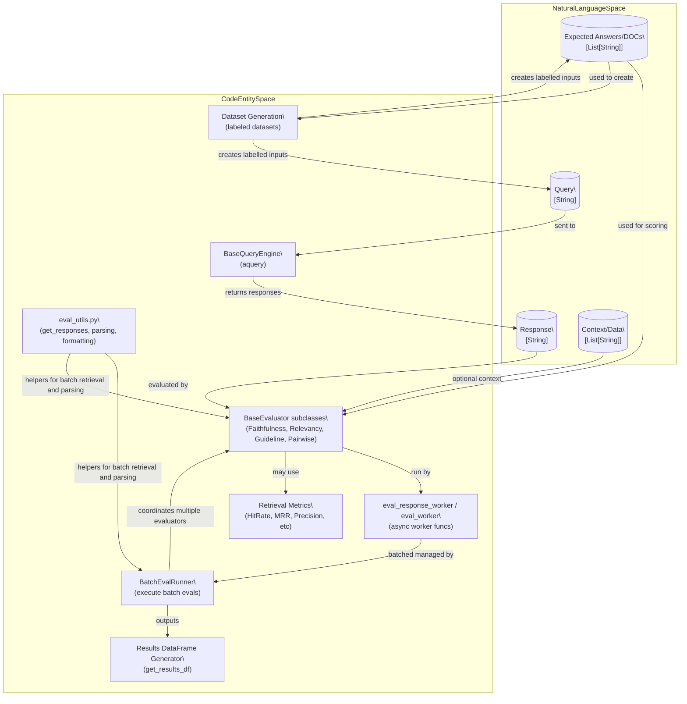

<!-- source: DeepWiki mcp.deepwiki.com · repo run-llama/llama_index · page 3.7 Evaluation Framework · fetched 2026-11-09 -->

# 3.7 Evaluation Framework

<details>
<summary>Relevant source files</summary>

The following files were used as context for generating this wiki page:

- [docs/examples/retrievers/composable_retrievers.ipynb](docs/examples/retrievers/composable_retrievers.ipynb)
- [llama-index-core/llama_index/core/agent/react/prompts.py](llama-index-core/llama_index/core/agent/react/prompts.py)
- [llama-index-core/llama_index/core/agent/react/templates/system_header_template.md](llama-index-core/llama_index/core/agent/react/templates/system_header_template.md)
- [llama-index-core/llama_index/core/command_line/upgrade.py](llama-index-core/llama_index/core/command_line/upgrade.py)
- [llama-index-core/llama_index/core/embeddings/utils.py](llama-index-core/llama_index/core/embeddings/utils.py)
- [llama-index-core/llama_index/core/evaluation/batch_runner.py](llama-index-core/llama_index/core/evaluation/batch_runner.py)
- [llama-index-core/llama_index/core/evaluation/context_relevancy.py](llama-index-core/llama_index/core/evaluation/context_relevancy.py)
- [llama-index-core/llama_index/core/evaluation/dataset_generation.py](llama-index-core/llama_index/core/evaluation/dataset_generation.py)
- [llama-index-core/llama_index/core/evaluation/eval_utils.py](llama-index-core/llama_index/core/evaluation/eval_utils.py)
- [llama-index-core/llama_index/core/evaluation/faithfulness.py](llama-index-core/llama_index/core/evaluation/faithfulness.py)
- [llama-index-core/llama_index/core/evaluation/guideline.py](llama-index-core/llama_index/core/evaluation/guideline.py)
- [llama-index-core/llama_index/core/evaluation/pairwise.py](llama-index-core/llama_index/core/evaluation/pairwise.py)
- [llama-index-core/llama_index/core/evaluation/relevancy.py](llama-index-core/llama_index/core/evaluation/relevancy.py)
- [llama-index-core/llama_index/core/evaluation/retrieval/metrics.py](llama-index-core/llama_index/core/evaluation/retrieval/metrics.py)
- [llama-index-core/llama_index/core/evaluation/retrieval/metrics_base.py](llama-index-core/llama_index/core/evaluation/retrieval/metrics_base.py)
- [llama-index-core/llama_index/core/indices/multi_modal/retriever.py](llama-index-core/llama_index/core/indices/multi_modal/retriever.py)
- [llama-index-core/llama_index/core/ingestion/api_utils.py](llama-index-core/llama_index/core/ingestion/api_utils.py)
- [llama-index-core/llama_index/core/question_gen/llm_generators.py](llama-index-core/llama_index/core/question_gen/llm_generators.py)
- [llama-index-core/tests/embeddings/test_utils.py](llama-index-core/tests/embeddings/test_utils.py)
- [llama-index-core/tests/evaluation/test_batch_runner.py](llama-index-core/tests/evaluation/test_batch_runner.py)
- [llama-index-core/tests/evaluation/test_dataset_generation.py](llama-index-core/tests/evaluation/test_dataset_generation.py)
- [llama-index-core/tests/evaluation/test_metrics.py](llama-index-core/tests/evaluation/test_metrics.py)
- [llama-index-core/tests/question_gen/test_llm_generators.py](llama-index-core/tests/question_gen/test_llm_generators.py)
- [llama-index-integrations/callbacks/llama-index-callbacks-wandb/llama_index/callbacks/wandb/base.py](llama-index-integrations/callbacks/llama-index-callbacks-wandb/llama_index/callbacks/wandb/base.py)
- [llama-index-integrations/callbacks/llama-index-callbacks-wandb/pyproject.toml](llama-index-integrations/callbacks/llama-index-callbacks-wandb/pyproject.toml)
- [llama-index-integrations/callbacks/llama-index-callbacks-wandb/tests/test_wandb_callback.py](llama-index-integrations/callbacks/llama-index-callbacks-wandb/tests/test_wandb_callback.py)
- [llama-index-integrations/indices/llama-index-indices-managed-llama-cloud/README.md](llama-index-integrations/indices/llama-index-indices-managed-llama-cloud/README.md)
- [llama-index-integrations/indices/llama-index-indices-managed-llama-cloud/pyproject.toml](llama-index-integrations/indices/llama-index-indices-managed-llama-cloud/pyproject.toml)
- [llama-index-integrations/indices/llama-index-indices-managed-llama-cloud/uv.lock](llama-index-integrations/indices/llama-index-indices-managed-llama-cloud/uv.lock)
- [llama-index-integrations/readers/llama-index-readers-llama-parse/README.md](llama-index-integrations/readers/llama-index-readers-llama-parse/README.md)
- [llama-index-integrations/readers/llama-index-readers-llama-parse/pyproject.toml](llama-index-integrations/readers/llama-index-readers-llama-parse/pyproject.toml)

</details>


The Evaluation Framework in LlamaIndex provides a comprehensive system for assessing the performance and quality of various components in the LLM-powered data framework, such as retrieval, response generation, and alignment with user or task guidelines. It supports multiple evaluator types, retrieval metrics, batch evaluation execution, and dataset generation to facilitate both automated and human-in-the-loop evaluation workflows.

---

## Overview

Evaluation is critical to ensure that information retrieval, response synthesis, and other LlamaIndex components produce outputs that are relevant, faithful, and guideline-compliant. The framework includes:

- **Evaluators:** Modular classes that calculate evaluation scores against defined criteria — faithfulness, relevancy, guideline adherence, and pairwise comparisons.
- **Retrieval Metrics:** Metrics such as Hit Rate, Mean Reciprocal Rank (MRR), Precision, Recall, Average Precision, and Normalized Discounted Cumulative Gain (NDCG) designed to quantitatively assess retrieval effectiveness.
- **Batch Evaluation Runner:** A component that enables asynchronous and parallel batch evaluation of queries and responses with multiple evaluators, handling input validation, retries, and result aggregation.
- **Dataset Generation:** Tools for creating labeled datasets required for evaluation tasks.

This page details the implementation of these components and the data flow within evaluation, with emphasis on key classes, functions, and their interconnections.

---

## 1. Evaluators

Evaluators are subclasses of a base evaluator abstraction (`BaseEvaluator`) that implement evaluation logic for different criteria. The main evaluator categories include:

- **Faithfulness Evaluator:** Measures how well the generated output aligns factually with source content.
- **Relevancy Evaluator:** Assesses if responses or retrieved documents are relevant to the queries.
- **Guideline Evaluator:** Checks outputs for compliance with specific guidelines or instructions.
- **Pairwise Evaluator:** Compares two outputs and determines preference or ranking between them.

Each evaluator provides methods to score inputs either synchronously or asynchronously.

### Key Evaluator Interface

- `BaseEvaluator` (defined in `llama_index/core/evaluation/base.py` - not shown here) provides core async methods such as `aevaluate_response` and `aevaluate` to score single responses with optional query and context inputs.
- Evaluators return `EvaluationResult` objects encapsulating a score and optional reasoning/explanation.

---

## 2. Retrieval Metrics

Retrieval performance is assessed with standard IR metrics implemented as subclasses of `BaseRetrievalMetric`. These calculate scores by comparing expected document identifiers with retrieved document identifiers.

### Important Metric Classes (in `llama_index/core/evaluation/retrieval/metrics.py` [lines 1-185]):

- **HitRate:** Measures the presence of relevant documents in retrieved results. Supports two modes:
  - *Default:* Returns 1.0 if at least one relevant document is retrieved.
  - *Granular:* Computes the fraction of expected documents retrieved.
  
- **MRR (Mean Reciprocal Rank):** Measures the rank position of the first relevant document among retrieved documents or, optionally, averages reciprocal ranks of all relevant documents.
  
- **Precision:** Calculates the precision of retrieved relevant documents over retrieved documents.

- **Recall:** Calculates the fraction of expected documents that were successfully retrieved.

- **Average Precision (AP):** Computes the average precision across all relevant documents weighted by their rank positions.

- **NDCG (Normalized Discounted Cumulative Gain):** Measures usefulness using a graded relevance scale with linear or exponential discounting by rank.

These metrics expose a `compute()` method accepting optional query string, expected and retrieved IDs/texts, and other arguments. They enforce the presence of expected and retrieved IDs with exception handling.

### Example: HitRate Metric Computation

```python
def compute(
    self,
    expected_ids: Optional[List[str]],
    retrieved_ids: Optional[List[str]],
    ...
) -> RetrievalMetricResult:
    if self.use_granular_hit_rate:
        hits = sum(1 for id in retrieved_ids if id in set(expected_ids))
        score = hits / len(expected_ids) if expected_ids else 0.0
    else:
        score = 1.0 if any(id in expected_ids for id in retrieved_ids) else 0.0
    return RetrievalMetricResult(score=score)
```

Refer to `llama_index/core/evaluation/retrieval/metrics.py:16-185` for complete implementations.

---

## 3. Batch Evaluation Runner

The `BatchEvalRunner` class orchestrates the parallel execution of multiple evaluators on batches of queries and responses. This is essential for large-scale evaluation across datasets.

### Features:

- **Concurrent Evaluation:** Uses asyncio with semaphores to limit concurrency and retries with exponential backoff (`tenacity` library).
- **Input Validation:** Ensures all input lists have the same length or fill missing inputs with `None`.
- **Flexible Arguments:** Supports passing separate or nested dictionaries for evaluator-specific keyword arguments.
- **Result Aggregation:** Formats results mapping evaluator names to lists of `EvaluationResult` objects.

### Core Methods

```python
class BatchEvalRunner:
    def __init__(self, evaluators: Dict[str, BaseEvaluator], workers: int = 2, show_progress: bool = False):
        ...
    async def aevaluate_response_strs(...):
        # Runs asynchronous batch evaluation on response strings
        ...
    def evaluate_response_strs(...):
        # Synchronous wrapper for async batch evaluation
        ...
```

#### Internal Async Worker Functions

- `eval_response_worker(...)`: Evaluates a single response asynchronously.
- `eval_worker(...)`: Evaluates using a raw response string with optional contexts.
- `response_worker(...)`: Executes queries against a `BaseQueryEngine` asynchronously (to obtain responses for evaluation).

All worker methods implement retry logic with `tenacity` and use a semaphore to manage concurrency.

Refer to `llama_index/core/evaluation/batch_runner.py:1-196` for the full `BatchEvalRunner` implementation.

---

## 4. Dataset Generation

Dataset generation utilities assist in producing labeled evaluation datasets—such as query-response pairs with ground-truth labels—which can then be fed into evaluators or retrievers for automated benchmarking.

Relevant dataset generation logic is in `llama_index/core/evaluation/dataset_generation.py` (not shown in detail). This module facilitates creating datasets suitable for different evaluation tasks, including retrieval and generation quality.

---

## 5. Evaluation Utilities

Complementing the evaluators and metrics, the framework provides utilities for batch response retrieval, result formatting, and response parsing.

### Key Utility Functions (`llama_index/core/evaluation/eval_utils.py`):

- `aget_responses(questions, query_engine, show_progress)`: Asynchronously queries a batch of questions to obtain responses from a `BaseQueryEngine`.
- `get_responses()`: Synchronous wrapper around `aget_responses`.
- `get_results_df()`: Converts a batch of evaluation results for multiple evaluators into a Pandas DataFrame summarizing average scores by metric.
- `default_parser(eval_response)`: Parses evaluator text responses into a numeric score and reasoning string, handling edge cases gracefully.

These utilities streamline benchmarking pipelines and integration with standard data science tooling.

Refer to `llama_index/core/evaluation/eval_utils.py:18-101` for implementation details.

---

## 6. Data Flow and System Interaction Diagram

Below is a detailed mermaid diagram illustrating evaluation-related components interaction, spanning the natural language space (queries, documents, responses) and the corresponding LlamaIndex code entities involved in the evaluation pipeline.



---

## 7. Summary

The Evaluation Framework is a robust and extensible system that enables:

- Quantitative measurement of retrieval results with standard metrics.
- Qualitative assessment of generated responses along faithfulness, relevance, and guideline adherence axes.
- Batch execution with concurrency and retry handling for scalable evaluation.
- Integration with dataset generation for benchmark building.
- Utilities to ease batching, async control, and result reporting.

This framework supports comprehensive validation strategies needed to maintain quality and alignment in LLM-driven data systems like LlamaIndex.

---

## References

- Evaluation metrics implementations: `llama_index/core/evaluation/retrieval/metrics.py:1-185`  
- Batch evaluation runner and async workers: `llama_index/core/evaluation/batch_runner.py:1-196`  
- Evaluation utilities for batch querying and parsing: `llama_index/core/evaluation/eval_utils.py:18-101`  
- Dataset generation: `llama_index/core/evaluation/dataset_generation.py` (module overview)  
- Tests demonstrating metric correctness: `llama_index-core/tests/evaluation/test_metrics.py:1-200`  
- Base evaluator interface and evaluation logic (not shown fully in files provided but foundational)

---

# End of 3.7 Evaluation Framework page

---

