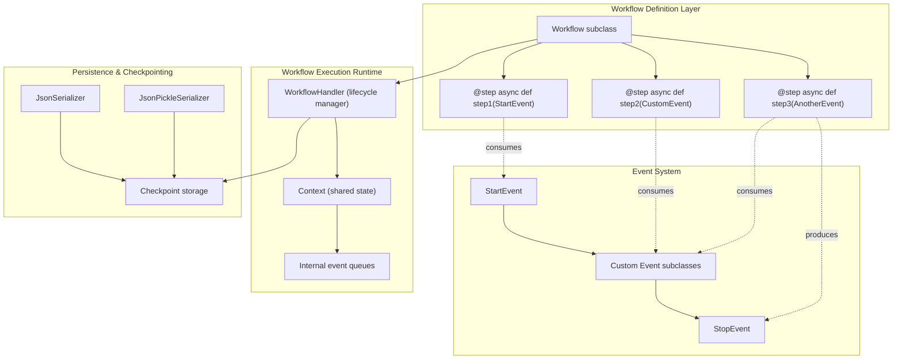
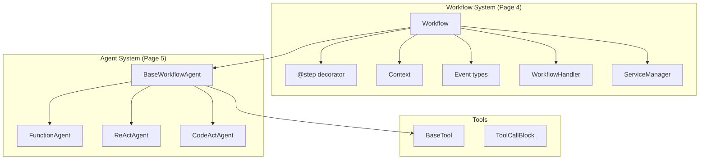
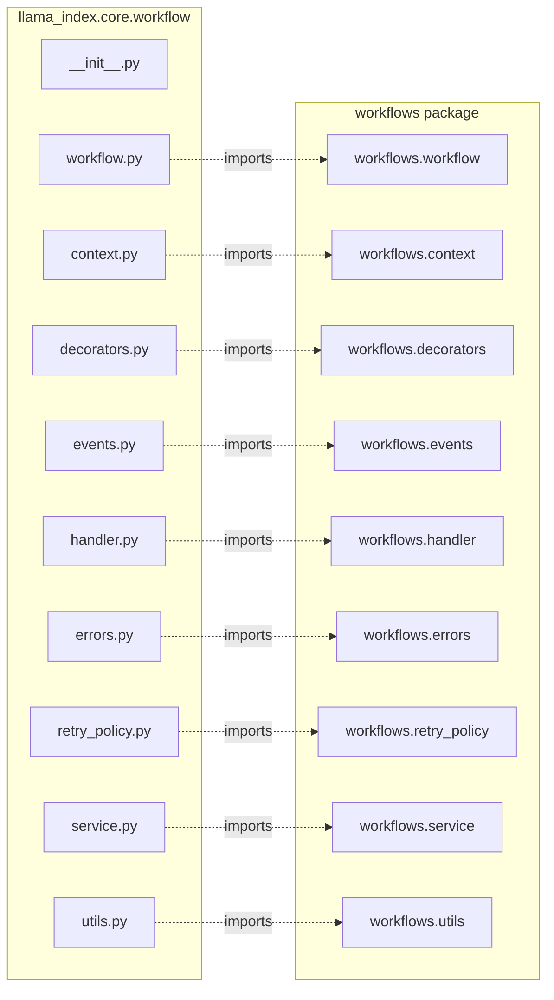

<!-- source: DeepWiki mcp.deepwiki.com · repo run-llama/llama_index · page 4 Workflow System · fetched 2026-11-09 -->

# Workflow System

Relevant source files

The following files were used as context for generating this wiki page:

- [llama-index-core/llama_index/core/workflow/__init__.py](llama-index-core/llama_index/core/workflow/__init__.py)
- [llama-index-core/llama_index/core/workflow/context.py](llama-index-core/llama_index/core/workflow/context.py)
- [llama-index-core/llama_index/core/workflow/decorators.py](llama-index-core/llama_index/core/workflow/decorators.py)
- [llama-index-core/llama_index/core/workflow/errors.py](llama-index-core/llama_index/core/workflow/errors.py)
- [llama-index-core/llama_index/core/workflow/events.py](llama-index-core/llama_index/core/workflow/events.py)
- [llama-index-core/llama_index/core/workflow/handler.py](llama-index-core/llama_index/core/workflow/handler.py)
- [llama-index-core/llama_index/core/workflow/retry_policy.py](llama-index-core/llama_index/core/workflow/retry_policy.py)
- [llama-index-core/llama_index/core/workflow/service.py](llama-index-core/llama_index/core/workflow/service.py)
- [llama-index-core/llama_index/core/workflow/utils.py](llama-index-core/llama_index/core/workflow/utils.py)
- [llama-index-core/llama_index/core/workflow/workflow.py](llama-index-core/llama_index/core/workflow/workflow.py)

The Workflow System provides an event-driven orchestration engine for building complex multi-step processes in LlamaIndex applications. It enables the definition of asynchronous, reactive processing pipelines where individual steps are triggered by and emit typed events. This architecture supports shared workflow state management, fault tolerance through retries, checkpointing for durability, and extensibility to advanced patterns such as streaming and service integration.

As a foundational subsystem, the workflow system powers LlamaIndex’s agent implementations and enables flexible orchestration scenarios beyond simple LLM prompts or query pipelines.

The workflow system is encapsulated within the `llama_index.core.workflow` module, which re-exports core components from an underlying `workflows` package. Its key abstractions include the `Workflow` base class, the `@step` decorator for defining asynchronous steps, the event type hierarchy, and management classes like `Context` and `WorkflowHandler`.

**For detailed explanations of specific areas, see the child pages:**

- [Workflow Fundamentals](#4.1) — Details on the `Workflow` class, `@step` decorator, context handling, and basic execution.
- [Event-Driven Architecture](#4.2) — Exploration of event types, `WorkflowHandler`, event routing, and flow control.
- [Advanced Workflow Features](#4.3) — Covering retry policies, checkpointing, streaming, and service management.
- [MCP and Protocol Integrations](#4.4) — Documenting the MCP tool integration, AG-UI support, and workflow exposure protocols.

---

## Architecture Overview

The system implements an event-driven design where workflow steps asynchronously consume specific event types and produce other events, driving the workflow state machine forward. This reactive pattern enables loosely coupled step orchestration with fine-grained control over execution flows.

### High-Level Architecture Diagram

### Explanation

- **Workflow Definition Layer:** Users define subclasses of `Workflow` with async `@step` methods. Each step handles incoming event types and emits output events.
- **Event System:** Events are the typed messages passed between steps, driving state transitions.
- **Runtime Layer:** `WorkflowHandler` manages execution, pulling events from queues stored in the shared `Context`.
- **Persistence Layer:** Workflow state and context can be serialized and checkpointed for fault tolerance and resuming.

Sources: [llama-index-core/llama_index/core/workflow/__init__.py:1-22](), [llama-index-core/llama_index/core/workflow/workflow.py:1](), [llama-index-core/llama_index/core/workflow/context.py:1](), [llama-index-core/llama_index/core/workflow/handler.py:1](), [llama-index-core/llama_index/core/workflow/events.py:1-8](), [llama-index-core/llama_index/core/workflow/decorators.py:1-10]()

---

## Core Components

### Workflow Class

The `Workflow` base class provides the framework to define orchestrated multi-step asynchronous pipelines. Subclasses define one or more `@step` decorated methods. The metaclass `WorkflowMeta` preprocesses these for registration and validation.

This class controls the workflow lifecycle and event propagation.

_Source: `workflows.workflow` via llama-index-core/llama_index/core/workflow/workflow.py:1_

### Step Decorator

The `@step` decorator marks async methods as event handlers (“steps”). It wraps the corresponding upstream decorator from `workflows.decorators`, ensuring backward compatibility by removing deprecated parameters.

It supports declarative step definition and automatic signature validation to enforce event consumption and output conventions.

_Source: llama-index-core/llama_index/core/workflow/decorators.py:7-10_

### Event System

Events are specialized classes representing typed messages exchanged between steps. Base event types included are:

- `StartEvent` — signals workflow start
- `StopEvent` — signals workflow termination
- `InputRequiredEvent` — indicates external input needed
- `HumanResponseEvent` — encapsulates human feedback in workflow

Custom event types extend the base `Event` class.

_Source: llama-index-core/llama_index/core/workflow/events.py:1-8_

### Context

The `Context` object is a persistent key-value store shared across the workflow’s lifecycle to maintain state between steps. It supports serialization with `JsonSerializer` and `JsonPickleSerializer` for checkpointing.

_Source: `workflows.context` via llama-index-core/llama_index/core/workflow/context.py:1_

### WorkflowHandler

The `WorkflowHandler` manages the execution lifecycle for each workflow run. This includes:

- Event queue management
- Dispatching events to appropriate step methods
- Timeout enforcement and cancellations
- Integration with streaming output and checkpointing subsystems

_Source: `workflows.handler` via llama-index-core/llama_index/core/workflow/handler.py:1_

---

## Integration with LlamaIndex

### Agent System Foundation

The workflow system underpins the LlamaIndex agent implementations:

- `BaseWorkflowAgent` (see page 5.1) extends workflow primitives for agent-specific behaviors including memory management and tool invocation.
- Agents like `FunctionAgent`, `ReActAgent`, and `CodeActAgent` (see pages 5.2) are implemented as specialized workflows with customized `@step` logic.

This layering enables reusable asynchronous control flow and event-driven reasoning inside agents.

### Service Management

Workflows can access external services via the `ServiceManager`, facilitating integration with:

- LLM providers (see page 6)
- Embedding models (see page 8)
- Vector stores and other infrastructure

This modular service integration supports expanded capabilities inside workflow steps.

_Source: `workflows.service` via llama-index-core/llama_index/core/workflow/service.py:1_

---

## Package Structure and API Surface

The `llama_index.core.workflow` package acts as a wrapper re-exporting core workflow components from the underlying `workflows` library, maintaining consistency and seamless integration.

### Public API

The `__init__.py` exports the key symbols:

| Symbol                     | Type        | Source           |
|----------------------------|-------------|------------------|
| `Workflow`                 | Class       | `workflow.py`    |
| `Context`                  | Class       | `context.py`     |
| `Event`, `StartEvent`, `StopEvent` | Classes     | `events.py`     |
| `InputRequiredEvent`, `HumanResponseEvent` | Classes | `events.py` |
| `step`                     | Decorator   | `decorators.py`  |
| `WorkflowRuntimeError`     | Exception   | `errors.py`      |
| `WorkflowTimeoutError`     | Exception   | `errors.py`      |
| `WorkflowValidationError`  | Exception   | `errors.py`      |
| `JsonSerializer`, `JsonPickleSerializer` | Serializers | `context_serializers.py` (re-exported) |

Sources: [llama-index-core/llama_index/core/workflow/__init__.py:1-22]()

---

## Error Handling and Fault Tolerance

### Exception Hierarchy

Specialized exception classes provide clear handling of workflow-related errors:

| Exception                      | Description                        |
|------------------------------|----------------------------------|
| `WorkflowRuntimeError`        | General runtime exceptions        |
| `WorkflowTimeoutError`         | Raised on timeout during execution|
| `WorkflowValidationError`      | Invalid workflow configuration    |
| `WorkflowConfigurationError`  | Setup or definition errors        |
| `WorkflowStepDoesNotExistError`| Missing step handler              |
| `WorkflowCancelledByUser`     | Manual cancellation               |
| `ContextSerdeError`            | Serialization / deserialization failures |

_Source: `workflows.errors` via llama-index-core/llama_index/core/workflow/errors.py:1-10_

### Retry Policies

The system supports retry mechanisms for transient failures using configurable policies such as `RetryPolicy` and `ConstantDelayRetryPolicy`.

_Source: `workflows.retry_policy` via llama-index-core/llama_index/core/workflow/retry_policy.py:1_

---

## Utilities

Helper utilities support inspection and validation of step signatures and workflow classes:

- `inspect_signature()` — analyzes method annotations
- `validate_step_signature()` — enforces step interface correctness
- `get_steps_from_class()` & `get_steps_from_instance()` — enumerate `@step` methods
- Serialization utilities like `get_qualified_name` and dynamic import functions

These utilities assist with static analysis and runtime checks to maintain workflow correctness.

_Source: llama-index-core/llama_index/core/workflow/utils.py:1-15_

---

By modularizing workflow orchestration with event-driven async steps, flexible context, and robust management, the Workflow System in LlamaIndex enables building scalable, composable multi-step LLM applications and agents.

---

# References

- llama-index-core/llama_index/core/workflow/__init__.py:1-22  
- llama-index-core/llama_index/core/workflow/workflow.py:1  
- llama-index-core/llama_index/core/workflow/context.py:1  
- llama-index-core/llama_index/core/workflow/decorators.py:1-10  
- llama-index-core/llama_index/core/workflow/events.py:1-8  
- llama-index-core/llama_index/core/workflow/handler.py:1  
- llama-index-core/llama_index/core/workflow/errors.py:1-10  
- llama-index-core/llama_index/core/workflow/retry_policy.py:1  
- llama-index-core/llama_index/core/workflow/service.py:1  
- llama-index-core/llama_index/core/workflow/utils.py:1-15

---

