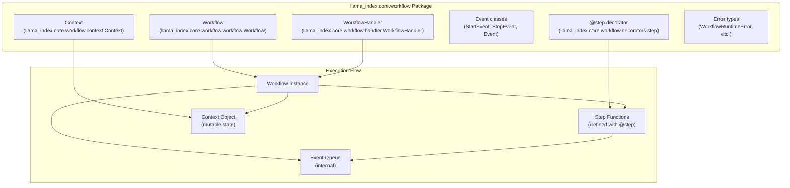
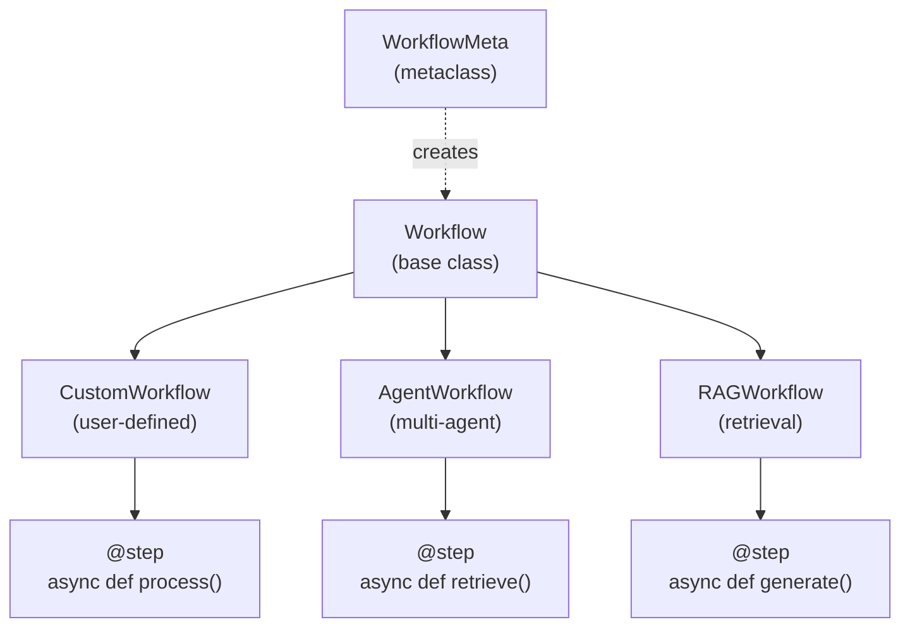
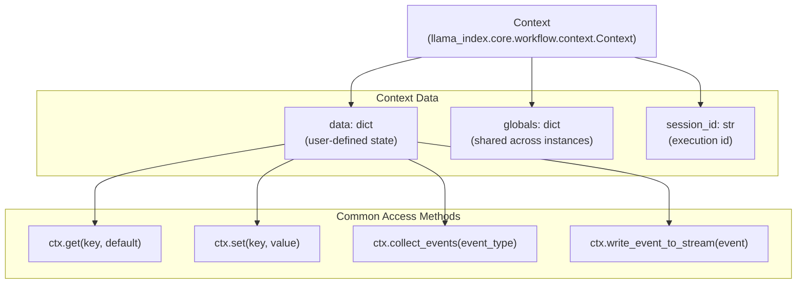
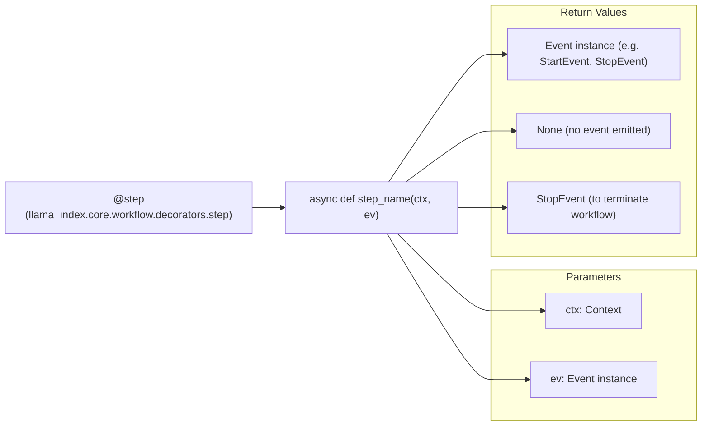
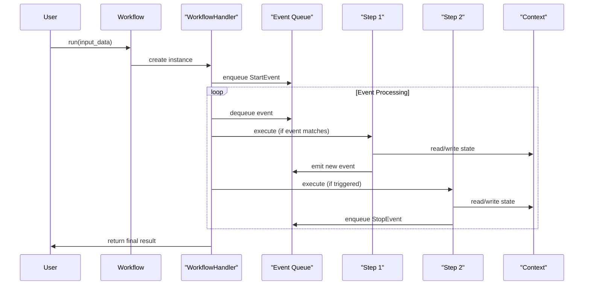
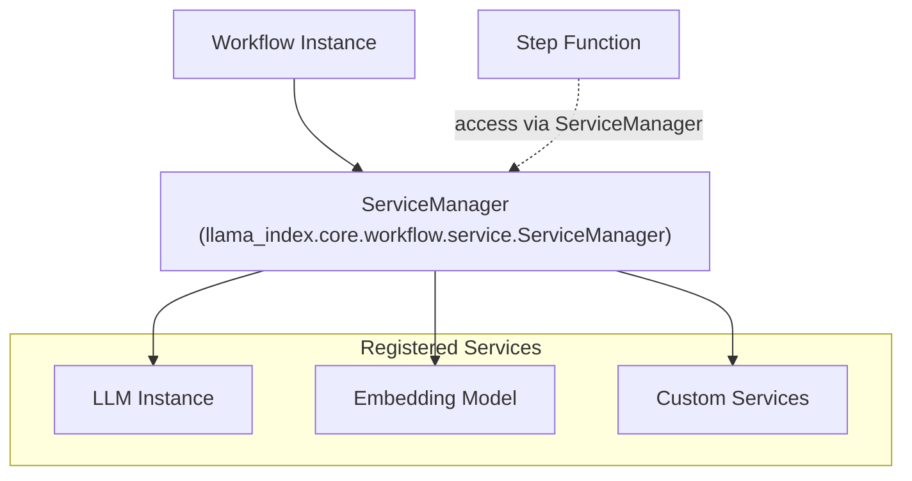

<!-- source: DeepWiki mcp.deepwiki.com · repo run-llama/llama_index · page 4.1 Workflow Fundamentals · fetched 2026-11-09 -->

# Workflow Fundamentals

<details>
<summary>Relevant source files</summary>

The following files were used as context for generating this wiki page:

- [llama-index-core/llama_index/core/workflow/__init__.py](llama-index-core/llama_index/core/workflow/__init__.py)
- [llama-index-core/llama_index/core/workflow/context.py](llama-index-core/llama_index/core/workflow/context.py)
- [llama-index-core/llama_index/core/workflow/decorators.py](llama-index-core/llama_index/core/workflow/decorators.py)
- [llama-index-core/llama_index/core/workflow/errors.py](llama-index-core/llama_index/core/workflow/errors.py)
- [llama-index-core/llama_index/core/workflow/events.py](llama-index-core/llama_index/core/workflow/events.py)
- [llama-index-core/llama_index/core/workflow/handler.py](llama-index-core/llama_index/core/workflow/handler.py)
- [llama-index-core/llama_index/core/workflow/retry_policy.py](llama-index-core/llama_index/core/workflow/retry_policy.py)
- [llama-index-core/llama_index/core/workflow/service.py](llama-index-core/llama_index/core/workflow/service.py)
- [llama-index-core/llama_index/core/workflow/utils.py](llama-index-core/llama_index/core/workflow/utils.py)
- [llama-index-core/llama_index/core/workflow/workflow.py](llama-index-core/llama_index/core/workflow/workflow.py)

</details>


## Purpose and Scope

This document covers the foundational components of the LlamaIndex workflow system: the `Workflow` base class, `Context` for state management, the `@step` decorator, and basic execution patterns. These components form the building blocks for creating event-driven, asynchronous workflows in LlamaIndex.

For information about the event system and event routing patterns, see [Event-Driven Architecture](#4.2). For advanced features including retry policies, error handling, and checkpointing, see [Advanced Workflow Features](#4.3). For agent implementations built on workflows, see [Agent Architecture](#5.1).

---

## Core Components Overview

The workflow system in `llama-index-core` provides a layer over an upstream `workflows` package. All essential workflow functionality is re-exported through the `llama_index.core.workflow` namespace, enabling a consistent interface for users and internal components [llama-index-core/llama_index/core/workflow/__init__.py:1-22]().

### Component Architecture

The following diagram associates high-level workflow concepts with concrete code entities within the `llama-index-core` package:



**Sources:** [llama-index-core/llama_index/core/workflow/__init__.py:1-22](), [llama-index-core/llama_index/core/workflow/workflow.py:1](), [llama-index-core/llama_index/core/workflow/context.py:1](), [llama-index-core/llama_index/core/workflow/decorators.py:7-10]()

### Key Abstractions

| Component | Module | Purpose |
|-----------|--------|---------|
| `Workflow` | `workflows.workflow` | Base class for defining event-driven workflows [llama-index-core/llama_index/core/workflow/workflow.py:1]() |
| `Context` | `workflows.context` | Mutable state container shared across steps [llama-index-core/llama_index/core/workflow/context.py:1]() |
| `@step` | `llama_index.core.workflow.decorators` | Decorator to register async functions as workflow steps [llama-index-core/llama_index/core/workflow/decorators.py:7-10]() |
| `Event` | `workflows.events` | Base class for events that trigger steps [llama-index-core/llama_index/core/workflow/events.py:2-2]() |
| `StartEvent` | `workflows.events` | Built-in event to initiate workflow execution [llama-index-core/llama_index/core/workflow/events.py:6-6]() |
| `StopEvent` | `workflows.events` | Built-in event to signal workflow completion [llama-index-core/llama_index/core/workflow/events.py:7-7]() |
| `WorkflowHandler` | `workflows.handler` | Orchestrates workflow execution and manages event routing [llama-index-core/llama_index/core/workflow/handler.py:1-1]() |

**Sources:** [llama-index-core/llama_index/core/workflow/__init__.py:1-22](), [llama-index-core/llama_index/core/workflow/events.py:1-8]()

---

## Workflow Base Class

The `Workflow` class is the foundation for creating event-driven workflows. All custom workflows inherit from this base class which incorporates a metaclass `WorkflowMeta` to facilitate step discovery and registration at class creation time [llama-index-core/llama_index/core/workflow/workflow.py:1]().

### Workflow Class Hierarchy



**Sources:** [llama-index-core/llama_index/core/workflow/workflow.py:1]()

### Workflow Instantiation and Step Discovery

User-defined workflows create subclasses of `Workflow`, specifying asynchronous methods decorated with `@step`. The `WorkflowMeta` metaclass automatically inspects these subclasses upon definition, registering step functions into an internal routing map.

Supporting utility functions include:
- `get_steps_from_class` and `get_steps_from_instance`: To extract step metadata from class definitions or instances.
- `validate_step_signature`: Ensures each step conforms to the required `async def step(ctx, ev)` signature with appropriate return types.

These utilities reside in the `llama_index.core.workflow.utils` module [llama-index-core/llama_index/core/workflow/utils.py:1-15]().

**Sources:** [llama-index-core/llama_index/core/workflow/workflow.py:1](), [llama-index-core/llama_index/core/workflow/utils.py:1-15]()

### Workflow Execution Methods

Actual execution of workflows is coordinated by the `WorkflowHandler` class, which manages events and step invocation. Methods exposed for execution control typically include:

| Method | Behavior | Location |
|--------|----------|----------|
| `run()` | Execute the workflow from start to stop, returning the final result asynchronously | [llama-index-core/llama_index/core/workflow/handler.py:1-1]() |
| `run_step()` | Execute a specific workflow step directly and return its output | Internal use |
| `stream_events()` | Stream intermediate events asynchronously during execution | Internal use |

**Sources:** [llama-index-core/llama_index/core/workflow/handler.py:1-1](), [llama-index-core/llama_index/core/workflow/__init__.py:1-22]()

---

## Context Management

The `Context` class encapsulates mutable state passed across workflow steps during execution. It is created per workflow invocation and serves as the primary mechanism to share and mutate data during the workflow lifecycle [llama-index-core/llama_index/core/workflow/context.py:1]().

### Context Object Structure



**Sources:** [llama-index-core/llama_index/core/workflow/context.py:1](), [llama-index-core/llama_index/core/workflow/utils.py:1-4]()

### Context Operations

The `Context` API supports:

- **State access and mutation:** `get()` to retrieve values safely, and `set()` to assign or update state entries.
- **Event collection:** `collect_events(event_type, expected=None)` to synchronously or asynchronously wait for one or many events matching a given type.
- **Event streaming:** `write_event_to_stream(event)` for emitting asynchronous events to consumers during streaming execution patterns.

This shared mutable context allows different steps, triggered by different event types, to coordinate and share execution state easily.

**Sources:** [llama-index-core/llama_index/core/workflow/context.py:1](), [llama-index-core/llama_index/core/workflow/utils.py:1-5]()

### Context Serialization

For checkpointing and resuming workflows, context objects can be serialized and deserialized using built-in serializers:

| Serializer | Module | Remarks |
|------------|--------|---------|
| `JsonSerializer` | `llama_index.core.workflow.context_serializers` | Efficient serialization for primitive JSON-compatible data [llama-index-core/llama_index/core/workflow/__init__.py:21-21]() |
| `JsonPickleSerializer` | `llama_index.core.workflow.context_serializers` | Supports complex Python objects beyond standard JSON with jsonpickle [llama-index-core/llama_index/core/workflow/__init__.py:20-20]() |

**Sources:** [llama-index-core/llama_index/core/workflow/__init__.py:20-21]()

---

## Step Decorator

The `@step` decorator marks asynchronous methods as workflow steps. Steps are event handlers that receive the current `Context` and an triggering event, execute logic, and return an event or `None` to control workflow progression [llama-index-core/llama_index/core/workflow/decorators.py:7-10]().

### Step Function Signature and Behavior



**Sources:** [llama-index-core/llama_index/core/workflow/decorators.py:7-10]()

### Step Decorator Implementation Details

The decorator in `llama-index-core` wraps the upstream `workflows.decorators.step`, removing legacy parameters like `pass_context` before forwarding to the core decorators implementation:

```python
# llama-index-core/llama_index/core/workflow/decorators.py:7-10
def step(*args: Any, **kwargs: Any) -> Callable:
    # Remove old, unused parameter
    kwargs.pop("pass_context", None)
    return upstream_step(*args, **kwargs)
```

Step functions are validated for signature correctness using utilities like `inspect_signature` and `validate_step_signature`, ensuring they conform to expected async patterns and proper event return types. This validation helps maintain consistency and prevents runtime errors [llama-index-core/llama_index/core/workflow/utils.py:10-12]().

**Sources:** [llama-index-core/llama_index/core/workflow/decorators.py:7-10](), [llama-index-core/llama_index/core/workflow/utils.py:10-12]()

### Step Configuration

Advanced step customization is available through the `StepConfig` class, enabling features such as:

- Specifying retry policies on failure (e.g., `ConstantDelayRetryPolicy`) for robust execution.
- Defining step-specific parameters controlling concurrency, timeout, and other operational behaviors.

These configurations enable detailed control of workflow step execution environment [llama-index-core/llama_index/core/workflow/decorators.py:1-2](), [llama-index-core/llama_index/core/workflow/retry_policy.py:1]().

**Sources:** [llama-index-core/llama_index/core/workflow/decorators.py:1-2](), [llama-index-core/llama_index/core/workflow/retry_policy.py:1]()

---

## Basic Execution Patterns

### Event-Driven Workflow Execution

Workflows are executed by instantiating the `Workflow` subclass and calling methods such as `run()`. The `WorkflowHandler` manages the event queue that drives step executions.



**Sources:** [llama-index-core/llama_index/core/workflow/handler.py:1-1](), [llama-index-core/llama_index/core/workflow/utils.py:6-7]()

### Error Handling and Exceptions

Workflow execution has dedicated error classes to handle and signal various failure modes:

| Exception Type | Module | Purpose |
|----------------|--------|---------|
| `WorkflowRuntimeError` | `errors` | General execution failures in step functions |
| `WorkflowTimeoutError` | `errors` | Workflow exceeding time limits |
| `WorkflowValidationError` | `errors` | Invalid workflow or step configuration |
| `WorkflowDone` | `errors` | Workflow completion signal |
| `ContextSerdeError` | `errors` | Serialization/deserialization failures for context |
| `WorkflowCancelledByUser` | `errors` | Execution terminated by user intervention |

These exceptions assist in error reporting and enable structured error recovery or cancellation with clarity [llama-index-core/llama_index/core/workflow/errors.py:1-10](), [llama-index-core/llama_index/core/workflow/__init__.py:4-5]()

---

## Service Management

Workflows can integrate with external services such as LLMs or embedding models through a centralized `ServiceManager` dependency injection framework [llama-index-core/llama_index/core/workflow/service.py:1-1]().



Services are registered and made available to steps during workflow execution. Attempting to access an unregistered service raises a `ServiceNotFoundError`. This capability facilitates clean separation of concerns and modular workflow definitions.

**Sources:** [llama-index-core/llama_index/core/workflow/service.py:1]()

---

# Summary

This page has covered the fundamentals of the LlamaIndex workflow system, focusing on:

- The `Workflow` base class and how custom workflows define async step functions decorated with `@step`.
- Management of mutable state via the `Context` object passed across steps.
- Implementation details of the `@step` decorator and step configuration including retry policies.
- Execution patterns illustrating event queue processing managed by `WorkflowHandler`.
- Error and exception types governing workflow lifecycle and failures.
- Service manager integration enabling external service utilization within workflows.

These elements provide a powerful foundation for orchestrating complex, asynchronous data flows and logic in the LlamaIndex ecosystem.

---

**All source citations for this page:**

- [llama-index-core/llama_index/core/workflow/__init__.py:1-22]()
- [llama-index-core/llama_index/core/workflow/workflow.py:1]()
- [llama-index-core/llama_index/core/workflow/context.py:1]()
- [llama-index-core/llama_index/core/workflow/decorators.py:1-10]()
- [llama-index-core/llama_index/core/workflow/events.py:1-8]()
- [llama-index-core/llama_index/core/workflow/handler.py:1-1]()
- [llama-index-core/llama_index/core/workflow/utils.py:1-15]()
- [llama-index-core/llama_index/core/workflow/errors.py:1-10]()
- [llama-index-core/llama_index/core/workflow/retry_policy.py:1-1]()
- [llama-index-core/llama_index/core/workflow/service.py:1-1]()

---

