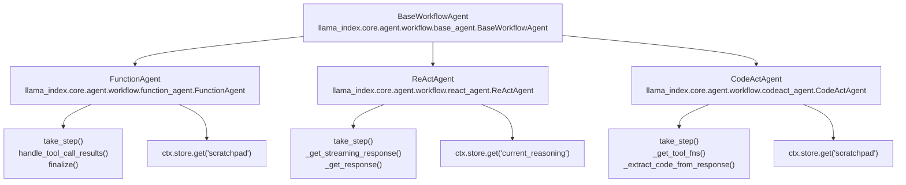
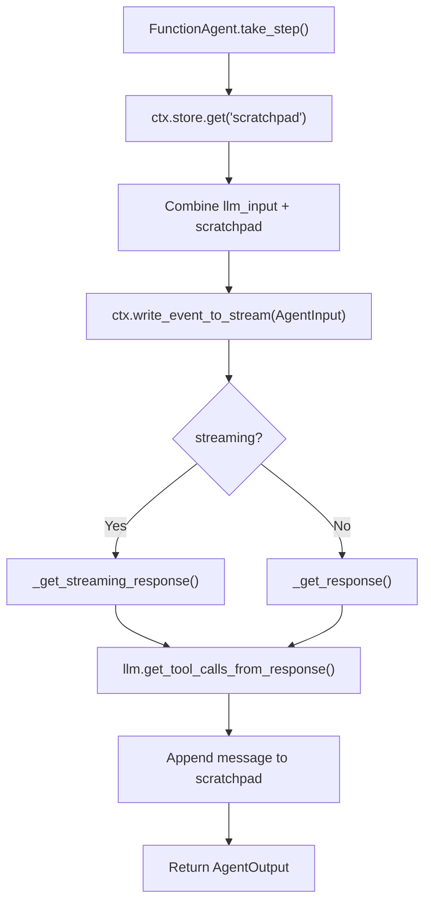
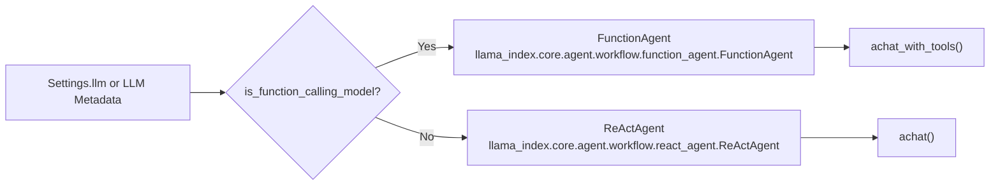

<!-- source: DeepWiki mcp.deepwiki.com · repo run-llama/llama_index · page 5.2 Agent Types · fetched 2026-11-09 -->

# Agent Types

Relevant source files

The following files were used as context for generating this wiki page:

- [llama-index-core/llama_index/core/agent/utils.py](llama-index-core/llama_index/core/agent/utils.py)
- [llama-index-core/llama_index/core/agent/workflow/__init__.py](llama-index-core/llama_index/core/agent/workflow/__init__.py)
- [llama-index-core/llama_index/core/agent/workflow/base_agent.py](llama-index-core/llama_index/core/agent/workflow/base_agent.py)
- [llama-index-core/llama_index/core/agent/workflow/codeact_agent.py](llama-index-core/llama_index/core/agent/workflow/codeact_agent.py)
- [llama-index-core/llama_index/core/agent/workflow/function_agent.py](llama-index-core/llama_index/core/agent/workflow/function_agent.py)
- [llama-index-core/llama_index/core/agent/workflow/multi_agent_workflow.py](llama-index-core/llama_index/core/agent/workflow/multi_agent_workflow.py)
- [llama-index-core/llama_index/core/agent/workflow/prompts.py](llama-index-core/llama_index/core/agent/workflow/prompts.py)
- [llama-index-core/llama_index/core/agent/workflow/react_agent.py](llama-index-core/llama_index/core/agent/workflow/react_agent.py)
- [llama-index-core/llama_index/core/agent/workflow/workflow_events.py](llama-index-core/llama_index/core/agent/workflow/workflow_events.py)
- [llama-index-core/llama_index/core/llms/__init__.py](llama-index-core/llama_index/core/llms/__init__.py)
- [llama-index-core/llama_index/core/llms/mock.py](llama-index-core/llama_index/core/llms/mock.py)
- [llama-index-core/tests/agent/react/test_prompt_customization.py](llama-index-core/tests/agent/react/test_prompt_customization.py)
- [llama-index-core/tests/agent/utils/test_agent_utils.py](llama-index-core/tests/agent/utils/test_agent_utils.py)
- [llama-index-core/tests/agent/workflow/test_agent_with_structured_output.py](llama-index-core/tests/agent/workflow/test_agent_with_structured_output.py)
- [llama-index-core/tests/agent/workflow/test_code_act_agent.py](llama-index-core/tests/agent/workflow/test_code_act_agent.py)
- [llama-index-core/tests/agent/workflow/test_events.py](llama-index-core/tests/agent/workflow/test_events.py)
- [llama-index-core/tests/agent/workflow/test_multi_agent_workflow.py](llama-index-core/tests/agent/workflow/test_multi_agent_workflow.py)
- [llama-index-core/tests/agent/workflow/test_single_agent_workflow.py](llama-index-core/tests/agent/workflow/test_single_agent_workflow.py)
- [llama-index-core/tests/agent/workflow/test_thinking_delta.py](llama-index-core/tests/agent/workflow/test_thinking_delta.py)
- [llama-index-core/tests/llms/test_mock.py](llama-index-core/tests/llms/test_mock.py)

This page documents the concrete agent implementations within LlamaIndex's workflow-based agent system: `FunctionAgent`, `ReActAgent`, and `CodeActAgent`. These agents inherit from `BaseWorkflowAgent` and implement specific reasoning strategies for tool use and autonomous task execution.

For details on the base agent architecture and lifecycle, see [Agent Architecture (Section 5.1)](). For multi-agent orchestration, see [Multi-Agent Orchestration (Section 5.3)]().

## Overview

LlamaIndex provides three primary agent types, each optimized for different LLM capabilities and reasoning patterns:

| Agent Type | Reasoning Strategy | LLM Requirements | Primary Use Case |
|------------|-------------------|------------------|------------------|
| `FunctionAgent` | Native Tool Calling | Must support function calling APIs | High-performance, parallel tool execution |
| `ReActAgent` | Thought-Action-Observation | Any LLM (Text-only support) | Step-by-step reasoning with verbose traces |
| `CodeActAgent` | Code Generation & Execution | Any LLM | Complex math, data processing, and algorithms |

All agents share a common inheritance from `BaseWorkflowAgent`, which combines `Workflow` logic with `BaseModel` configuration [llama-index-core/llama_index/core/agent/workflow/base_agent.py:87-89]().

Sources: [llama-index-core/llama_index/core/agent/workflow/base_agent.py:87-89](), [llama-index-core/llama_index/core/agent/workflow/function_agent.py:19-20](), [llama-index-core/llama_index/core/agent/workflow/react_agent.py:38-39](), [llama-index-core/llama_index/core/agent/workflow/codeact_agent.py:63-66]()

## Agent Type Hierarchy

This diagram bridges natural language execution concepts to specific code entities, displaying class paths, method overrides, and state storage keys defined in the codebase.

Title: Agent Type Hierarchy and Code Entity Mapping

Sources: [llama-index-core/llama_index/core/agent/workflow/base_agent.py:87-89](), [llama-index-core/llama_index/core/agent/workflow/function_agent.py:19-22](), [llama-index-core/llama_index/core/agent/workflow/react_agent.py:38-41](), [llama-index-core/llama_index/core/agent/workflow/codeact_agent.py:63-68]()

## FunctionAgent

`FunctionAgent` is implemented in `llama_index.core.agent.workflow.function_agent` and is designed for LLMs that natively support function calling (e.g., GPT-4, Claude 3.5). It is the most efficient type for structured tool use.

### Key Characteristics
- **Parallel Execution**: Supports calling multiple tools in a single turn via `allow_parallel_tool_calls` [llama-index-core/llama_index/core/agent/workflow/function_agent.py:27-30]().
- **Initial Tool Choice**: Can force a specific tool on the first iteration using `initial_tool_choice` [llama-index-core/llama_index/core/agent/workflow/function_agent.py:23-26]().
- **State Management**: Uses a `scratchpad` key via `ctx.store.get(self.scratchpad_key)` to store intermediate `ChatMessage` objects [llama-index-core/llama_index/core/agent/workflow/function_agent.py:22-22](), [llama-index-core/llama_index/core/agent/workflow/function_agent.py:112-114]().

### Data Flow: FunctionAgent.take_step()
The `take_step` method manages the core iteration loop, building the LLM input from the current history and the scratchpad [llama-index-core/llama_index/core/agent/workflow/function_agent.py:101-146]().

Title: FunctionAgent Step Execution Data Flow

Sources: [llama-index-core/llama_index/core/agent/workflow/function_agent.py:101-146]()

### Finalization
Upon completion, the `finalize` method commits all messages from the scratchpad to the agent's long-term memory and clears the scratchpad [llama-index-core/llama_index/core/agent/workflow/function_agent.py:180-196]().

Sources: [llama-index-core/llama_index/core/agent/workflow/function_agent.py:19-51](), [llama-index-core/llama_index/core/agent/workflow/function_agent.py:101-146](), [llama-index-core/llama_index/core/agent/workflow/function_agent.py:180-196]()

## ReActAgent

`ReActAgent` implements the Reasoning and Acting pattern and is defined in `llama_index.core.agent.workflow.react_agent`. It works with any LLM by using a specific prompt format to generate "Thoughts", "Actions", and "Answers".

### Key Characteristics
- **Output Parsing**: Uses `ReActOutputParser` to interpret text-based reasoning steps [llama-index-core/llama_index/core/agent/workflow/react_agent.py:42-44]().
- **Formatting**: Uses `ReActChatFormatter` to inject the reasoning history into the prompt [llama-index-core/llama_index/core/agent/workflow/react_agent.py:45-48]().
- **Retry Logic**: If the LLM fails to follow the ReAct format, the agent can provide error feedback in the next turn [llama-index-core/tests/agent/workflow/test_single_agent_workflow.py:151-164]().

### Reasoning Steps
The agent maintains state as a list of reasoning steps in `ctx.store` under the `reasoning_key` (defaulting to `current_reasoning`) [llama-index-core/llama_index/core/agent/workflow/react_agent.py:41-41](). It uses types defined in `llama_index.core.agent.react.types`:
- `ActionReasoningStep`: Represents a decision to call a tool [llama-index-core/llama_index/core/agent/react/types.py:8-8]().
- `ObservationReasoningStep`: Represents the result returned by a tool [llama-index-core/llama_index/core/agent/react/types.py:10-10]().
- `ResponseReasoningStep`: Represents the final answer to the user [llama-index-core/llama_index/core/agent/react/types.py:11-11]().

Sources: [llama-index-core/llama_index/core/agent/workflow/react_agent.py:38-86](), [llama-index-core/llama_index/core/agent/workflow/react_agent.py:121-162]()

## CodeActAgent

`CodeActAgent` is defined in `llama_index.core.agent.workflow.codeact_agent` and solves tasks by generating and executing Python code. It treats code execution as a specialized tool interaction.

### Key Characteristics
- **Code Execution**: Requires a `code_execute_fn` (e.g., a sandbox or local interpreter) passed via configuration [llama-index-core/llama_index/core/agent/workflow/codeact_agent.py:70-75]().
- **Tool Mapping**: Available tools are mapped to Python function signatures in the system prompt [llama-index-core/llama_index/core/agent/workflow/codeact_agent.py:125-149]().
- **Extraction**: Uses XML-style `<execute>` tags to identify code blocks within LLM responses via `_extract_code_from_response()` [llama-index-core/llama_index/core/agent/workflow/codeact_agent.py:151-168]().

### Implementation Details
- **System Prompt**: Uses `DEFAULT_CODE_ACT_PROMPT` to instruct the model on how to wrap code and use provided functions [llama-index-core/llama_index/core/agent/workflow/codeact_agent.py:25-58]().
- **Tool Selection**: When code is detected, it creates a `ToolSelection` for the `execute` tool (`EXECUTE_TOOL_NAME`) [llama-index-core/llama_index/core/agent/workflow/codeact_agent.py:60-60](). The agent appends a `FunctionTool` wrapping the provided `code_execute_fn` to its toolset during initialization [llama-index-core/llama_index/core/agent/workflow/codeact_agent.py:98-101]().

Sources: [llama-index-core/llama_index/core/agent/workflow/codeact_agent.py:63-123](), [llama-index-core/llama_index/core/agent/workflow/codeact_agent.py:151-168]()

## Comparison and Selection

This diagram maps selection strategies based on LLM execution metadata to specific code classes (`FunctionAgent` vs `ReActAgent`), bridging configuration parameters to concrete agent classes.

Title: Agent Selection and Code Entity Mapping

Sources: [llama-index-core/llama_index/core/agent/workflow/multi_agent_workflow.py:100-115](), [llama-index-core/llama_index/core/agent/workflow/function_agent.py:109-110]()

### Feature Matrix

| Feature | `FunctionAgent` | `ReActAgent` | `CodeActAgent` |
|---------|-----------------|--------------|----------------|
| **LLM Method** | `achat_with_tools` [llama-index-core/llama_index/core/agent/workflow/function_agent.py:48-50]() | `achat` [llama-index-core/llama_index/core/agent/workflow/react_agent.py:84-85]() | `achat` [llama-index-core/llama_index/core/agent/workflow/codeact_agent.py:14-18]() |
| **Tool Definition** | JSON Schema | Text Description | Python Signature |
| **State Key** | `scratchpad` [llama-index-core/llama_index/core/agent/workflow/function_agent.py:22-22]() | `current_reasoning` [llama-index-core/llama_index/core/agent/workflow/react_agent.py:41-41]() | `scratchpad` [llama-index-core/llama_index/core/agent/workflow/codeact_agent.py:68-68]() |
| **Parallelism** | Supported [llama-index-core/llama_index/core/agent/workflow/function_agent.py:27-30]() | Sequential | Sequential |

Sources: [llama-index-core/llama_index/core/agent/workflow/function_agent.py:22-50](), [llama-index-core/llama_index/core/agent/workflow/react_agent.py:41-85](), [llama-index-core/llama_index/core/agent/workflow/codeact_agent.py:68-75]()

## Workflow Events

Agents communicate their internal state and progress through specialized `Event` types defined in `llama_index.core.agent.workflow.workflow_events`:

- `AgentInput`: Emitted when the LLM is about to be called, containing the full prompt [llama-index-core/llama_index/core/agent/workflow/workflow_events.py:24-29]().
- `AgentStream`: Emitted during streaming responses, containing deltas and tool calls [llama-index-core/llama_index/core/agent/workflow/workflow_events.py:38-46]().
- `AgentOutput`: Emitted when an agent finishes a step, containing the `ChatMessage` and any tool calls [llama-index-core/llama_index/core/agent/workflow/workflow_events.py:71-79]().
- `ToolCall` / `ToolCallResult`: Represent the execution and outcome of tool usage [llama-index-core/llama_index/core/agent/workflow/workflow_events.py:98-114]().

Sources: [llama-index-core/llama_index/core/agent/workflow/workflow_events.py:24-114]()

---

