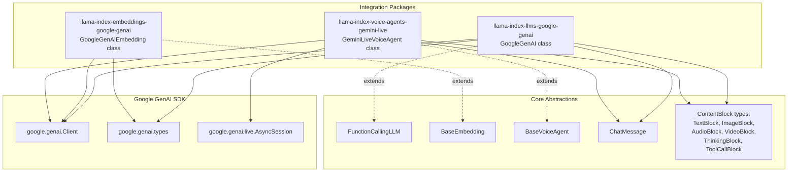
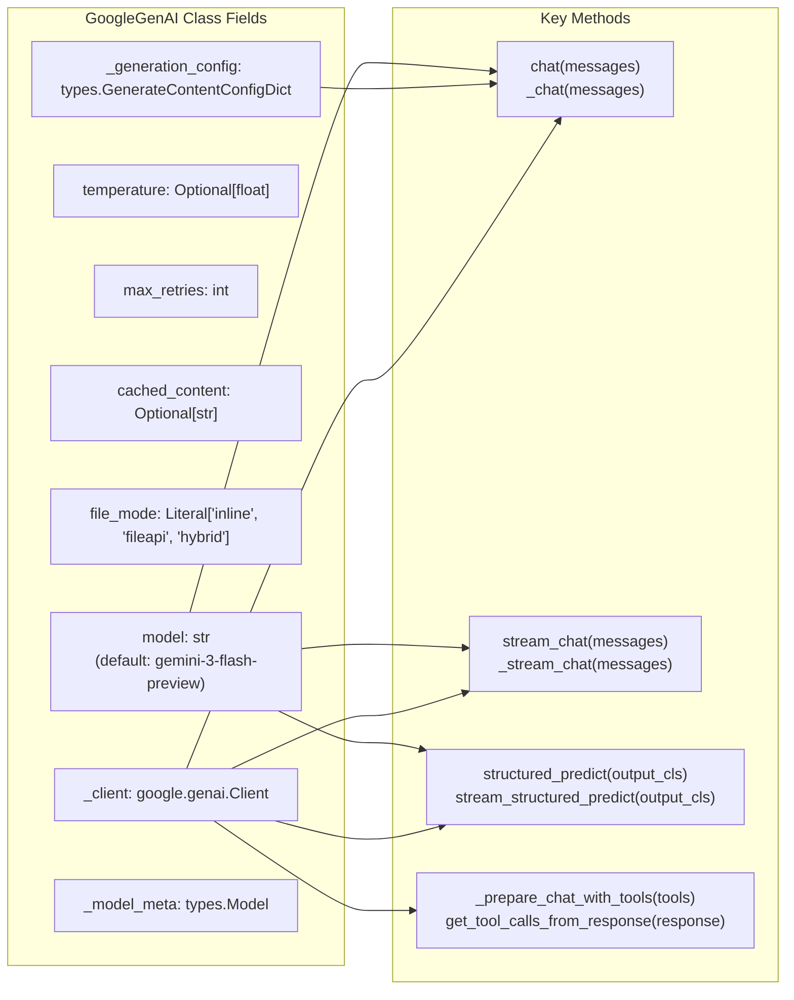
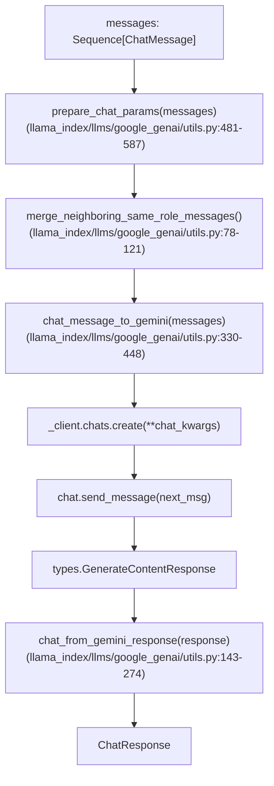
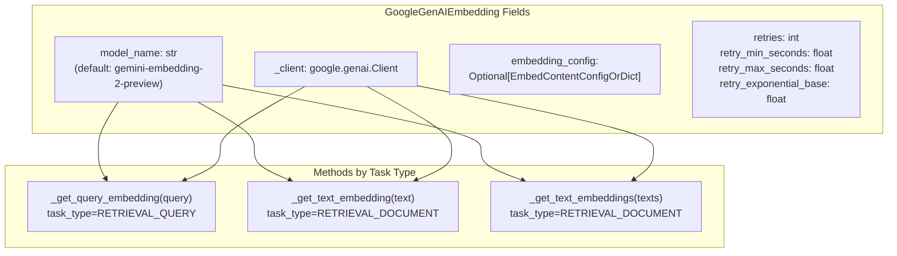
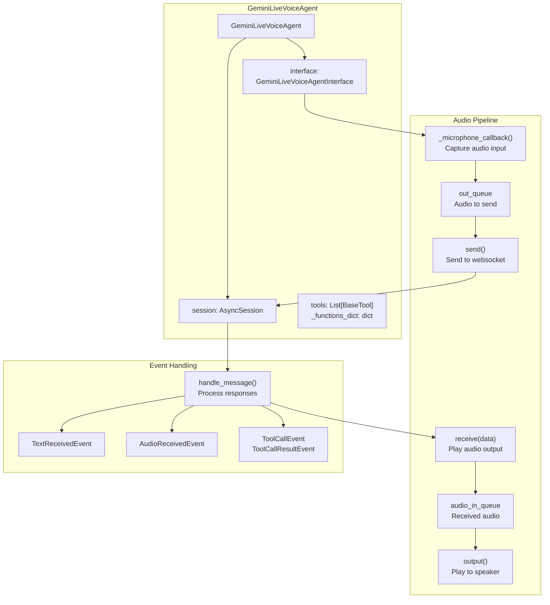

<!-- source: DeepWiki mcp.deepwiki.com · repo run-llama/llama_index · page 6.5 Google GenAI Integration · fetched 2026-11-09 -->

# Google GenAI Integration

<details>
<summary>Relevant source files</summary>

The following files were used as context for generating this wiki page:

- [docs/examples/embeddings/google_genai.ipynb](docs/examples/embeddings/google_genai.ipynb)
- [docs/examples/llm/google_genai.ipynb](docs/examples/llm/google_genai.ipynb)
- [llama-index-core/llama_index/core/utilities/gemini_utils.py](llama-index-core/llama_index/core/utilities/gemini_utils.py)
- [llama-index-integrations/embeddings/llama-index-embeddings-google-genai/.gitignore](llama-index-integrations/embeddings/llama-index-embeddings-google-genai/.gitignore)
- [llama-index-integrations/embeddings/llama-index-embeddings-google-genai/LICENSE](llama-index-integrations/embeddings/llama-index-embeddings-google-genai/LICENSE)
- [llama-index-integrations/embeddings/llama-index-embeddings-google-genai/Makefile](llama-index-integrations/embeddings/llama-index-embeddings-google-genai/Makefile)
- [llama-index-integrations/embeddings/llama-index-embeddings-google-genai/README.md](llama-index-integrations/embeddings/llama-index-embeddings-google-genai/README.md)
- [llama-index-integrations/embeddings/llama-index-embeddings-google-genai/llama_index/embeddings/google_genai/__init__.py](llama-index-integrations/embeddings/llama-index-embeddings-google-genai/llama_index/embeddings/google_genai/__init__.py)
- [llama-index-integrations/embeddings/llama-index-embeddings-google-genai/llama_index/embeddings/google_genai/base.py](llama-index-integrations/embeddings/llama-index-embeddings-google-genai/llama_index/embeddings/google_genai/base.py)
- [llama-index-integrations/embeddings/llama-index-embeddings-google-genai/pyproject.toml](llama-index-integrations/embeddings/llama-index-embeddings-google-genai/pyproject.toml)
- [llama-index-integrations/embeddings/llama-index-embeddings-google-genai/tests/test_embeddings_gemini.py](llama-index-integrations/embeddings/llama-index-embeddings-google-genai/tests/test_embeddings_gemini.py)
- [llama-index-integrations/embeddings/llama-index-embeddings-google-genai/uv.lock](llama-index-integrations/embeddings/llama-index-embeddings-google-genai/uv.lock)
- [llama-index-integrations/llms/llama-index-llms-google-genai/.gitignore](llama-index-integrations/llms/llama-index-llms-google-genai/.gitignore)
- [llama-index-integrations/llms/llama-index-llms-google-genai/CHANGELOG.md](llama-index-integrations/llms/llama-index-llms-google-genai/CHANGELOG.md)
- [llama-index-integrations/llms/llama-index-llms-google-genai/Makefile](llama-index-integrations/llms/llama-index-llms-google-genai/Makefile)
- [llama-index-integrations/llms/llama-index-llms-google-genai/README.md](llama-index-integrations/llms/llama-index-llms-google-genai/README.md)
- [llama-index-integrations/llms/llama-index-llms-google-genai/llama_index/llms/google_genai/__init__.py](llama-index-integrations/llms/llama-index-llms-google-genai/llama_index/llms/google_genai/__init__.py)
- [llama-index-integrations/llms/llama-index-llms-google-genai/llama_index/llms/google_genai/base.py](llama-index-integrations/llms/llama-index-llms-google-genai/llama_index/llms/google_genai/base.py)
- [llama-index-integrations/llms/llama-index-llms-google-genai/llama_index/llms/google_genai/utils.py](llama-index-integrations/llms/llama-index-llms-google-genai/llama_index/llms/google_genai/utils.py)
- [llama-index-integrations/llms/llama-index-llms-google-genai/pyproject.toml](llama-index-integrations/llms/llama-index-llms-google-genai/pyproject.toml)
- [llama-index-integrations/llms/llama-index-llms-google-genai/tests/test_base_cleanup.py](llama-index-integrations/llms/llama-index-llms-google-genai/tests/test_base_cleanup.py)
- [llama-index-integrations/llms/llama-index-llms-google-genai/tests/test_llms_google_genai.py](llama-index-integrations/llms/llama-index-llms-google-genai/tests/test_llms_google_genai.py)
- [llama-index-integrations/llms/llama-index-llms-google-genai/tests/test_llms_google_genai_vertex.py](llama-index-integrations/llms/llama-index-llms-google-genai/tests/test_llms_google_genai_vertex.py)
- [llama-index-integrations/llms/llama-index-llms-google-genai/uv.lock](llama-index-integrations/llms/llama-index-llms-google-genai/uv.lock)
- [llama-index-integrations/llms/llama-index-llms-vertex/llama_index/llms/vertex/base.py](llama-index-integrations/llms/llama-index-llms-vertex/llama_index/llms/vertex/base.py)
- [llama-index-integrations/llms/llama-index-llms-vertex/llama_index/llms/vertex/gemini_utils.py](llama-index-integrations/llms/llama-index-llms-vertex/llama_index/llms/vertex/gemini_utils.py)
- [llama-index-integrations/llms/llama-index-llms-vertex/llama_index/llms/vertex/utils.py](llama-index-integrations/llms/llama-index-llms-vertex/llama_index/llms/vertex/utils.py)
- [llama-index-integrations/llms/llama-index-llms-vertex/pyproject.toml](llama-index-integrations/llms/llama-index-llms-vertex/pyproject.toml)
- [llama-index-integrations/llms/llama-index-llms-vertex/tests/test_gemini_utils.py](llama-index-integrations/llms/llama-index-llms-vertex/tests/test_gemini_utils.py)
- [llama-index-integrations/voice_agents/llama-index-voice-agents-gemini-live/llama_index/voice_agents/gemini_live/base.py](llama-index-integrations/voice_agents/llama-index-voice-agents-gemini-live/llama_index/voice_agents/gemini_live/base.py)
- [llama-index-integrations/voice_agents/llama-index-voice-agents-gemini-live/pyproject.toml](llama-index-integrations/voice_agents/llama-index-voice-agents-gemini-live/pyproject.toml)
- [llama-index-integrations/voice_agents/llama-index-voice-agents-gemini-live/tests/test_gemini_live.py](llama-index-integrations/voice_agents/llama-index-voice-agents-gemini-live/tests/test_gemini_live.py)
- [llama-index-integrations/voice_agents/llama-index-voice-agents-gemini-live/uv.lock](llama-index-integrations/voice_agents/llama-index-voice-agents-gemini-live/uv.lock)

</details>


This document details LlamaIndex's integration with Google's Generative AI platform, focusing on the `GoogleGenAI` LLM class, Gemini models, Vertex AI support, GeminiLive voice agents, and the multimodal capabilities offered. The integration leverages Google's unified `google-genai` Python SDK alongside LlamaIndex abstractions for seamless usage.

---

## Integration Architecture

The Google GenAI integration is organized across three main packages providing LLM, embedding, and voice-agent capabilities:

- `llama-index-llms-google-genai` for the `GoogleGenAI` LLM class
- `llama-index-embeddings-google-genai` for the `GoogleGenAIEmbedding` class
- `llama-index-voice-agents-gemini-live` for the `GeminiLiveVoiceAgent`

These integrate with the Google GenAI SDK components, including chat generation, content generation, live session APIs, and type definitions, while mapping to core LlamaIndex abstractions like `FunctionCallingLLM`, `BaseEmbedding`, and `BaseVoiceAgent`.



Sources:  
[llama-index-integrations/llms/llama-index-llms-google-genai/llama_index/llms/google_genai/base.py:119-171]()  
[llama-index-integrations/embeddings/llama-index-embeddings-google-genai/llama_index/embeddings/google_genai/base.py:119-167]()  
[llama-index-integrations/voice_agents/llama-index-voice-agents-gemini-live/llama_index/voice_agents/gemini_live/base.py:28-40]()

---

## GoogleGenAI LLM Class

The `GoogleGenAI` class is a full-featured LLM implementation offering:

- Support for Google's Gemini models (e.g., gemini-3-flash, gemini-2.0-flash)
- Multimodal input with comprehensive content blocks (Text, Image, Video, Document, Thinking, ToolCall)
- Structured output with flexible schema parsing and function calling
- Streaming and synchronous generation interfaces
- Integration with Google AI Studio (API key) and Google Vertex AI (OAuth / Service Account) authentication methods

### Class Structure and Key Fields



Sources:  
[llama-index-integrations/llms/llama-index-llms-google-genai/llama_index/llms/google_genai/base.py:136-171]()

### Initialization and Authentication

`GoogleGenAI` supports multiple authentication flows:

| Authentication Method | Configuration Parameter(s)            | Relevant Environment Variables                   |
|--------------------- |-------------------------------------|-------------------------------------------------|
| Google AI Studio     | `api_key` (optional, fallback from env) | `GOOGLE_API_KEY`                                 |
| Vertex AI            | `vertexai_config` (includes credentials, project, location) | `GOOGLE_GENAI_USE_VERTEXAI=true`, `GOOGLE_CLOUD_PROJECT`, `GOOGLE_CLOUD_LOCATION` |

If no API key is provided explicitly, the environment variable `GOOGLE_API_KEY` is used. For Vertex AI, OAuth or service account credentials are used via `vertexai_config`. This dual support allows seamless usage in cloud environments or local dev.

Sources:  
[llama-index-integrations/llms/llama-index-llms-google-genai/llama_index/llms/google_genai/base.py:173-239]()

### Data Flow and Message Handling

Messages passed as `ChatMessage` sequences are processed carefully to conform to Gemini API roles and chat context requirements:

1. **Preparation**: The `prepare_chat_params` utility parses and formats the input messages into the Gemini-compatible payload, converting `ChatMessage` content blocks into Gemini `Content` parts.
2. **Role Merging**: Since Gemini disallows multiple consecutive messages with the same role (except tools), `merge_neighboring_same_role_messages` combines messages with identical roles for efficient API transmission.
3. **Conversion**: Messages are transformed to Gemini's SDK `Content` objects with appropriate roles (`user` or `model`).
4. **Send and Receive**: This payload is sent via the Google GenAI client chat API.
5. **Response Wrapping**: The Gemini API response is parsed into LlamaIndex `ChatResponse` objects, including extracted content blocks such as text, images, thinking blocks, and tool calls.



Sources:  
[llama-index-integrations/llms/llama-index-llms-google-genai/llama_index/llms/google_genai/utils.py:78-587]()  
[llama-index-integrations/llms/llama-index-llms-google-genai/llama_index/llms/google_genai/base.py:319-339]()

### Multimodal and File Support

The `file_mode` setting controls how files (images, documents, videos) are transmitted to Gemini models:

- `"inline"`: file content is included inline as base64 encoded data in chat message parts.
- `"fileapi"`: files larger than a threshold (default 20 MB) are uploaded to Google's File API, referencing a remote file instead of embedding data.
- `"hybrid"`: automatically chooses between inline or FileAPI based on file size.

This design enables efficient multimodal inputs including:

- `ImageBlock` for images (via path, bytes, or URL)
- `VideoBlock` for video inputs
- `DocumentBlock` with a mapped `title` → `display_name` field to maintain proper naming in prompts and responses.

The integration leverages both direct content and file uploads based on this mode, optimizing performance and compatibility.

Sources:  
[llama-index-integrations/llms/llama-index-llms-google-genai/llama_index/llms/google_genai/utils.py:276-328]()  
[llama-index-integrations/llms/llama-index-llms-google-genai/CHANGELOG.md:13]()

### ThinkingBlock Support

Some Gemini models (e.g., `gemini-2.0-flash`) return internal model reasoning as special `ThinkingBlock` content blocks. These reasoning parts are parsed from the `GenerateContentResponse` candidates' parts with the `thought` flag set.

Token usage accounting integrates reasoning token counts via `usage_metadata.thoughts_token_count` for observability and analysis.

Sources:  
[llama-index-integrations/llms/llama-index-llms-google-genai/llama_index/llms/google_genai/utils.py:192-202]()  
[llama-index-integrations/llms/llama-index-llms-google-genai/llama_index/llms/google_genai/utils.py:177-179]()

---

## GoogleGenAIEmbedding Class

The `GoogleGenAIEmbedding` class wraps Gemini embedding models such as `"gemini-embedding-2-preview"`, providing:

- Batched text embedding with retry logic
- Query vs Document task differentiation using `task_type` metadata to inform API calls
- Support for HTTP options, debug configs, and Vertex AI credentials

### Class Diagram and Methods



Sources:  
[llama-index-integrations/embeddings/llama-index-embeddings-google-genai/llama_index/embeddings/google_genai/base.py:119-248]()

---

## GeminiLiveVoiceAgent

The `GeminiLiveVoiceAgent` facilitates real-time, low-latency conversational AI experiences with audio input/output streamed through WebSockets to Google's Gemini Live voice API.

### Audio Pipeline and Event Loop

- Audio from microphone is captured via a callback, enqueued for transmission.
- Audio frames are sent asynchronously to the Gemini Live session.
- Incoming messages including audio playback, text events, and tool call results are handled with event callbacks.
- An asyncio `TaskGroup` manages concurrency and clean shutdowns.



Sources:  
[llama-index-integrations/voice_agents/llama-index-voice-agents-gemini-live/llama_index/voice_agents/gemini_live/base.py:28-222]()

---

## Utility Functions

### Message Role Handling and Merging

Gemini chat mode accepts only two roles: `user` and `model`.

- LlamaIndex `MessageRole` enums are mapped accordingly (`SYSTEM`, `TOOL`, `FUNCTION` roles map to `user`).
- Consecutive messages with the same role are merged except for `TOOL` to preserve function-call semantics.
- This merging occurs before sending chat messages to Gemin.

```python
def merge_neighboring_same_role_messages(messages: Sequence[ChatMessage]) -> Sequence[ChatMessage]:
    # Merge consecutive messages of the same role except TOOL role messages
    # Returns merged list of ChatMessage suitable for Gemini
```

Sources:  
[llama-index-integrations/llms/llama-index-llms-google-genai/llama_index/llms/google_genai/utils.py:78-121]()

### Error Handling and Retry Logic

- Both LLM and Embedding classes use `tenacity` for robust retry with exponential backoff on transient errors.
- The retry logic targets HTTP 429 (rate limit) and 5xx server errors plus connection issues.
- This ensures stable behavior under API rate limits or intermittent network conditions.

Sources:  
[llama-index-integrations/embeddings/llama-index-embeddings-google-genai/llama_index/embeddings/google_genai/base.py:38-79]()  
[llama-index-integrations/llms/llama-index-llms-google-genai/llama_index/llms/google_genai/base.py:83-115]()

---

# Summary

The Google GenAI integration in LlamaIndex offers a comprehensive interface for accessing Google Gemini models via both AI Studio and Vertex AI, supporting modern multimodal inputs, structured outputs, interactive voice agents, and robust retry/error handling. This integration leverages the unified `google-genai` SDK with thoughtful bridging to LlamaIndex abstractions for scalable use in advanced LLM applications.

# End of Google GenAI Integration Documentation

---

