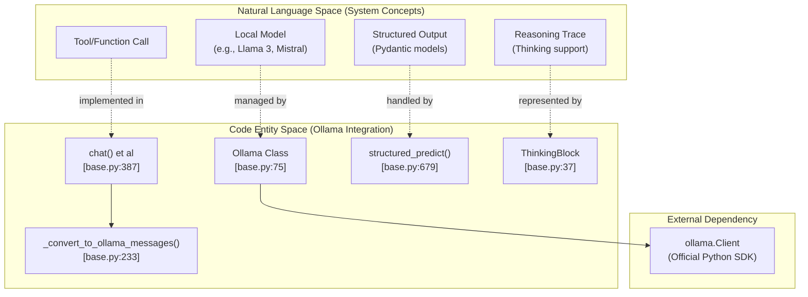
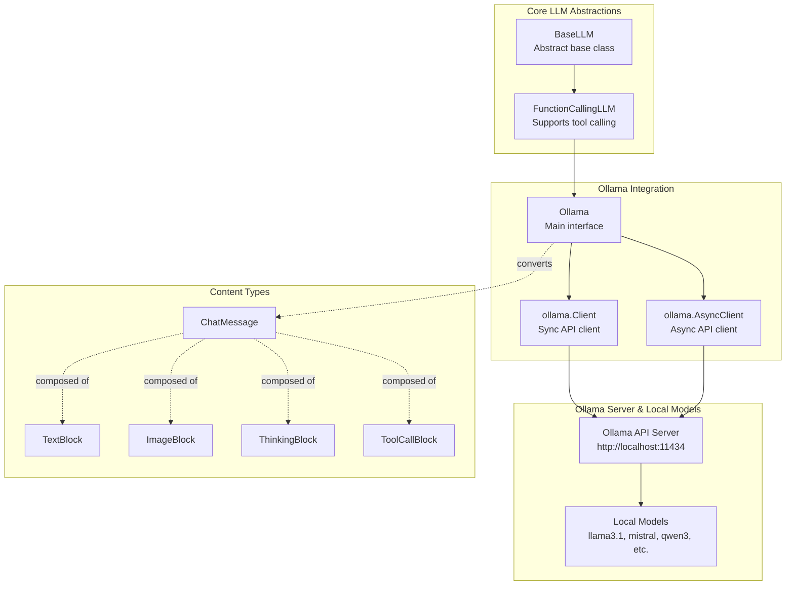
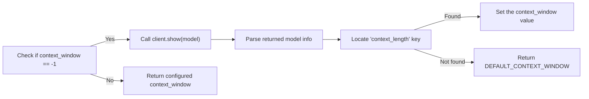
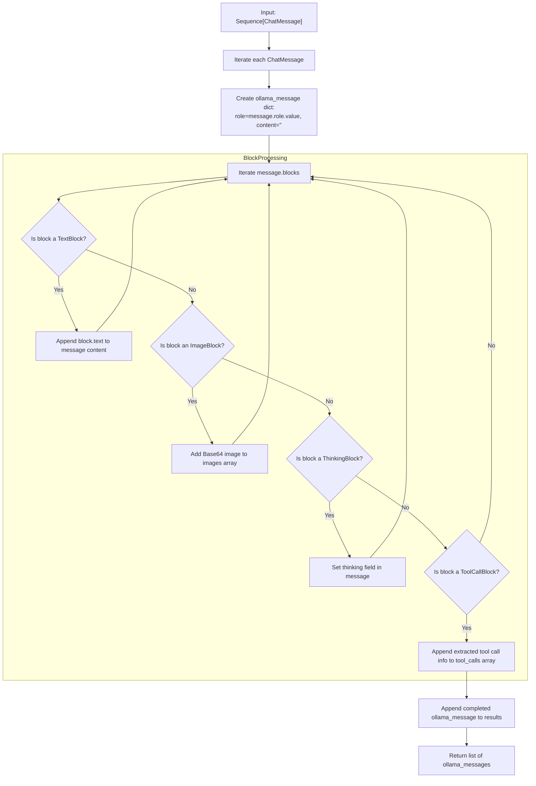
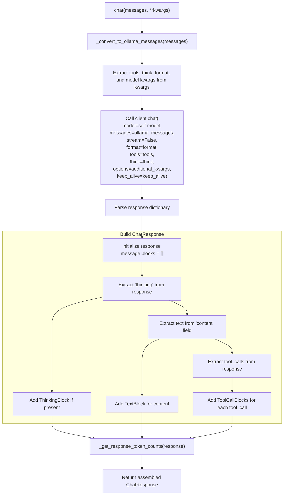
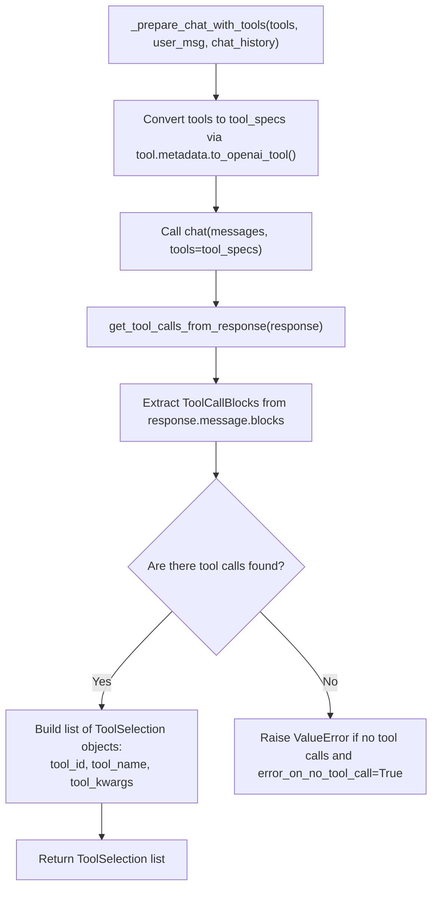
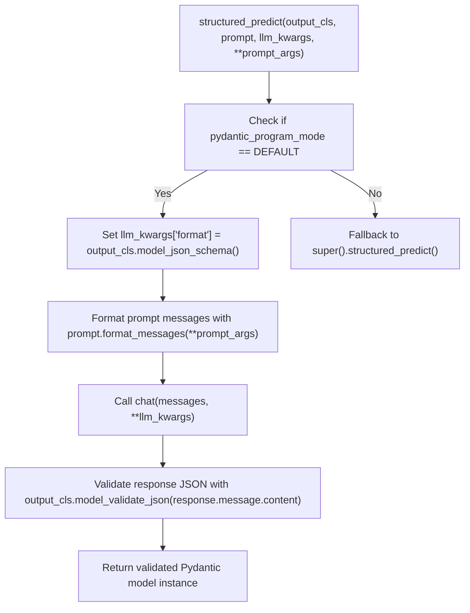
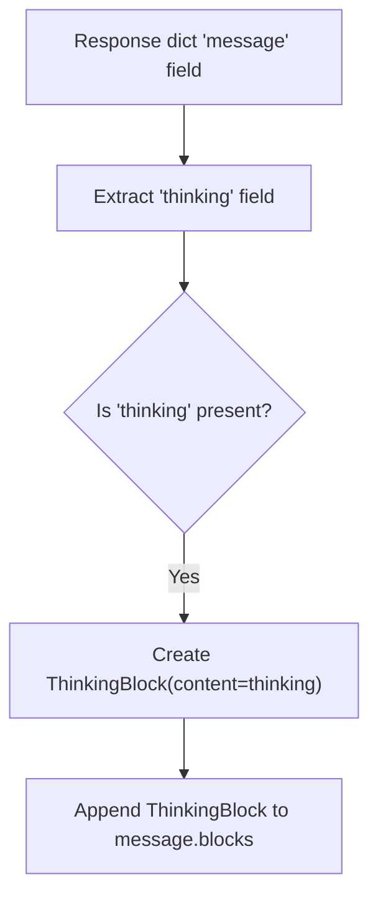
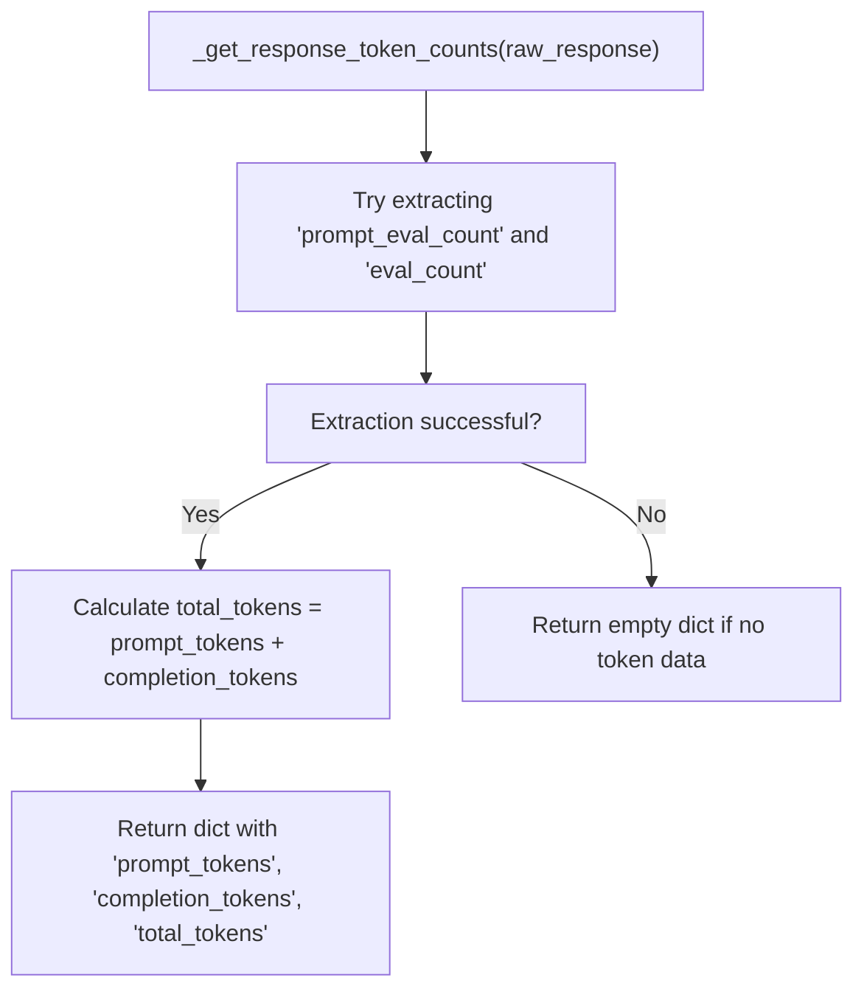

<!-- source: DeepWiki mcp.deepwiki.com · repo run-llama/llama_index · page 6.6 Ollama Integration · fetched 2026-11-09 -->

# Ollama Integration

Relevant source files

The following files were used as context for generating this wiki page:

- [docs/examples/llm/vllm.ipynb](docs/examples/llm/vllm.ipynb)
- [llama-index-core/llama_index/core/bridge/langchain.py](llama-index-core/llama_index/core/bridge/langchain.py)
- [llama-index-core/llama_index/core/evaluation/retrieval/evaluator.py](llama-index-core/llama_index/core/evaluation/retrieval/evaluator.py)
- [llama-index-core/llama_index/core/extractors/metadata_extractors.py](llama-index-core/llama_index/core/extractors/metadata_extractors.py)
- [llama-index-core/llama_index/core/langchain_helpers/__init__.py](llama-index-core/llama_index/core/langchain_helpers/__init__.py)
- [llama-index-core/llama_index/core/llms/structured_llm.py](llama-index-core/llama_index/core/llms/structured_llm.py)
- [llama-index-core/llama_index/core/llms/utils.py](llama-index-core/llama_index/core/llms/utils.py)
- [llama-index-core/llama_index/core/node_parser/text/langchain.py](llama-index-core/llama_index/core/node_parser/text/langchain.py)
- [llama-index-core/llama_index/core/output_parsers/__init__.py](llama-index-core/llama_index/core/output_parsers/__init__.py)
- [llama-index-core/llama_index/core/output_parsers/pydantic.py](llama-index-core/llama_index/core/output_parsers/pydantic.py)
- [llama-index-core/llama_index/core/postprocessor/sbert_rerank.py](llama-index-core/llama_index/core/postprocessor/sbert_rerank.py)
- [llama-index-core/llama_index/core/program/function_program.py](llama-index-core/llama_index/core/program/function_program.py)
- [llama-index-core/llama_index/core/program/llm_program.py](llama-index-core/llama_index/core/program/llm_program.py)
- [llama-index-core/llama_index/core/program/utils.py](llama-index-core/llama_index/core/program/utils.py)
- [llama-index-core/llama_index/core/query_engine/retry_source_query_engine.py](llama-index-core/llama_index/core/query_engine/retry_source_query_engine.py)
- [llama-index-core/tests/bridge/test_langchain.py](llama-index-core/tests/bridge/test_langchain.py)
- [llama-index-core/tests/llms/test_structured_llm.py](llama-index-core/tests/llms/test_structured_llm.py)
- [llama-index-core/tests/output_parsers/test_pydantic.py](llama-index-core/tests/output_parsers/test_pydantic.py)
- [llama-index-core/tests/program/test_function_program.py](llama-index-core/tests/program/test_function_program.py)
- [llama-index-core/tests/program/test_utils.py](llama-index-core/tests/program/test_utils.py)
- [llama-index-integrations/llms/llama-index-llms-langchain/llama_index/llms/langchain/utils.py](llama-index-integrations/llms/llama-index-llms-langchain/llama_index/llms/langchain/utils.py)
- [llama-index-integrations/llms/llama-index-llms-ollama/README.md](llama-index-integrations/llms/llama-index-llms-ollama/README.md)
- [llama-index-integrations/llms/llama-index-llms-ollama/llama_index/llms/ollama/base.py](llama-index-integrations/llms/llama-index-llms-ollama/llama_index/llms/ollama/base.py)
- [llama-index-integrations/llms/llama-index-llms-ollama/pyproject.toml](llama-index-integrations/llms/llama-index-llms-ollama/pyproject.toml)
- [llama-index-integrations/llms/llama-index-llms-ollama/tests/test_llms_ollama.py](llama-index-integrations/llms/llama-index-llms-ollama/tests/test_llms_ollama.py)
- [llama-index-integrations/llms/llama-index-llms-ollama/tests/test_utils.py](llama-index-integrations/llms/llama-index-llms-ollama/tests/test_utils.py)
- [llama-index-integrations/llms/llama-index-llms-ollama/uv.lock](llama-index-integrations/llms/llama-index-llms-ollama/uv.lock)
- [llama-index-integrations/llms/llama-index-llms-vllm/llama_index/llms/vllm/base.py](llama-index-integrations/llms/llama-index-llms-vllm/llama_index/llms/vllm/base.py)
- [llama-index-integrations/llms/llama-index-llms-vllm/llama_index/llms/vllm/utils.py](llama-index-integrations/llms/llama-index-llms-vllm/llama_index/llms/vllm/utils.py)
- [llama-index-integrations/llms/llama-index-llms-vllm/pyproject.toml](llama-index-integrations/llms/llama-index-llms-vllm/pyproject.toml)
- [llama-index-integrations/llms/llama-index-llms-vllm/tests/test_integration.py](llama-index-integrations/llms/llama-index-llms-vllm/tests/test_integration.py)
- [llama-index-integrations/llms/llama-index-llms-vllm/tests/test_llms_vllm.py](llama-index-integrations/llms/llama-index-llms-vllm/tests/test_llms_vllm.py)
- [llama-index-integrations/llms/llama-index-llms-vllm/tests/test_vllm_server_modes.py](llama-index-integrations/llms/llama-index-llms-vllm/tests/test_vllm_server_modes.py)

## Purpose and Scope

The Ollama integration enables LlamaIndex to interact with locally-hosted large language models (LLMs) via the Ollama runtime. This integration provides a privacy-focused, self-contained alternative to cloud providers by allowing users to deploy models such as Llama 3, Mistral, and others on their infrastructure.

This integration implements the `FunctionCallingLLM` interface from LlamaIndex, thus supporting chat, completion, streaming responses, structured output generation through Pydantic models, and seamless tool (function) calling.

For context on other LLM integrations and function calling patterns, see the related pages for [LLM Integration Architecture](#6.1) and [Tool Calling Patterns](#6.8). The content block types and messaging formats are discussed in [Content Blocks and Messages](#6.7).

---

## Integration Architecture

The Ollama integration class `Ollama` inherits from `FunctionCallingLLM` and provides a local client interface to Ollama's RESTful API server for executing models. It supports synchronous and asynchronous calls and handles conversion between LlamaIndex chat message formats and Ollama's expected message schema.

### System to Code Entity Mapping

**Sources:** [llama-index-integrations/llms/llama-index-llms-ollama/llama_index/llms/ollama/base.py:37-75](), [llama-index-integrations/llms/llama-index-llms-ollama/llama_index/llms/ollama/base.py:233-679]()

---

### Architecture Overview

**Sources:** [llama-index-integrations/llms/llama-index-llms-ollama/llama_index/llms/ollama/base.py:75-180]()

---

## Core Ollama Class

The `Ollama` class is the main entrypoint for interacting with the Ollama local LLM runtime. It is highly configurable with parameters for model selection, connection details, and capability toggles such as function calling and structured output.

### Class Structure

```mermaid
graph TB
    subgraph "Ollama Class Fields"
        BaseURL["base_url: str<br/>Default: http://localhost:11434"]
        Model["model: str<br/>Model identifier"]
        Temperature["temperature: Optional[float]<br/>Sampling temperature"]
        ContextWindow["context_window: int<br/>Token context limit, -1 = auto"]
        RequestTimeout["request_timeout: float<br/>API timeout (default 30s)"]
        JSONMode["json_mode: bool<br/>Force JSON output"]
        IsFunctionCalling["is_function_calling_model: bool<br/>Tool call support enabled"]
        KeepAlive["keep_alive: Union[float, str]<br/>Model persistence duration"]
        Thinking["thinking: Optional[Union[bool, 'low'|'medium'|'high']]<br/>Reasoning trace control"]
        AdditionalKwargs["additional_kwargs: Dict[str, Any]<br/>Extra parameters for model"]
    end
    
    subgraph "Private Attributes"
        ClientPriv["_client: Optional[Client]<br/>Synchronous Ollama client"]
        AsyncClientPriv["_async_client: Optional[AsyncClient]<br/>Asynchronous client"]
    end
    
    BaseURL --> Ollama
    Model --> Ollama
    Temperature --> Ollama
    ContextWindow --> Ollama
    RequestTimeout --> Ollama
    JSONMode --> Ollama
    IsFunctionCalling --> Ollama
    KeepAlive --> Ollama
    Thinking --> Ollama
    AdditionalKwargs --> Ollama
    
    ClientPriv --> Ollama
    AsyncClientPriv --> Ollama
```

**Sources:** [llama-index-integrations/llms/llama-index-llms-ollama/llama_index/llms/ollama/base.py:99-141]()

---

### Configuration Parameters

| Parameter              | Type                                    | Default                | Description                                              |
|------------------------|-----------------------------------------|------------------------|----------------------------------------------------------|
| `model`                | `str`                                  | Required               | Name/identifier of the Ollama model (e.g., "llama3.1:latest") |
| `base_url`             | `str`                                  | `"http://localhost:11434"` | URL of the local Ollama API server                        |
| `temperature`          | `Optional[float]`                      | `None`                 | Controls sampling diversity for generation               |
| `context_window`       | `int`                                  | `-1`                   | Maximum context tokens, `-1` to auto detect              |
| `request_timeout`      | `float`                                | `30.0`                 | Timeout in seconds for API requests                       |
| `json_mode`            | `bool`                                | `False`                | Force Ollama to output JSON format                        |
| `additional_kwargs`    | `Dict[str, Any]`                       | `{}`                   | Extra model parameters to pass to Ollama API             |
| `is_function_calling_model` | `bool`                           | `True`                 | Enables function/tool calling support                     |
| `keep_alive`           | `Optional[Union[float, str]]`          | `"5m"`                 | Duration to keep model loaded in memory after request    |
| `thinking`             | `Optional[Union[bool, Literal["low","medium","high"]]]` | `None` | Controls reasoning trace output level                     |

**Sources:** [llama-index-integrations/llms/llama-index-llms-ollama/llama_index/llms/ollama/base.py:99-138](), [llama-index-integrations/llms/llama-index-llms-ollama/llama_index/llms/ollama/base.py:143-173]()

---

### Context Window Detection

If the `context_window` is set to `-1`, the `Ollama` class automatically queries the Ollama API for the model's metadata to detect the supported context window. If unavailable, it returns a default value from LlamaIndex constants.

**Sources:** [llama-index-integrations/llms/llama-index-llms-ollama/llama_index/llms/ollama/base.py:219-231]()

---

## Message Conversion and Content Blocks

LlamaIndex uses content blocks (`TextBlock`, `ImageBlock`, `ThinkingBlock`, `ToolCallBlock`) to compose messages. The Ollama integration provides the `_convert_to_ollama_messages` method to transform a sequence of LlamaIndex `ChatMessage`s into the Ollama messages format expected by the API.

### Message Conversion Flow

**Sources:** [llama-index-integrations/llms/llama-index-llms-ollama/llama_index/llms/ollama/base.py:233-297]()

---

### Supported Content Block Types and Corresponding Ollama Fields

| Content Block Type | Ollama Processing | Ollama Message Field |
|--------------------|-------------------|----------------------|
| `TextBlock`        | Concatenate `.text` to message `content` string | `content` (string) |
| `ImageBlock`       | Resolve base64 content and append to array | `images` (list of base64 strings) |
| `ThinkingBlock`    | Extract thinking information for reasoning trace | `thinking` (string or structured trace) |
| `ToolCallBlock`    | Extract function/tool call info including `name` and `kwargs` | `tool_calls` (list of dicts) |

**Sources:** [llama-index-integrations/llms/llama-index-llms-ollama/llama_index/llms/ollama/base.py:242-276]()

---

## Chat and Completion Methods

The `Ollama` class implements the full set of synchronous and asynchronous chat and completion methods defined in the LLM interface, supporting streaming and structured outputs where applicable.

### Method Implementation Overview

| Method                 | Sync | Async | Streaming | Description                          |
|------------------------|------|-------|-----------|------------------------------------|
| `chat`                 | ✓    | ✓     | No        | Returns a single chat response      |
| `stream_chat`          | ✓    | ✓     | Yes       | Streaming chat responses             |
| `complete`             | ✓    | ✓     | No        | Text completion (via decorator)     |
| `stream_complete`      | ✓    | ✓     | Yes       | Streaming text completion            |

These methods handle content & thinking extraction, and tool call detection.

**Sources:** [llama-index-integrations/llms/llama-index-llms-ollama/llama_index/llms/ollama/base.py:387-677]()

---

### Chat Method Flow

**Sources:** [llama-index-integrations/llms/llama-index-llms-ollama/llama_index/llms/ollama/base.py:387-433]()

---

## Tool Calling Support

The Ollama integration supports function/tool calling using the `FunctionCallingLLM` interface. It transforms LlamaIndex tools into Ollama-compatible tool specifications and parses tool calls out of the model responses.

### Tool Call Workflow

**Sources:** [llama-index-integrations/llms/llama-index-llms-ollama/llama_index/llms/ollama/base.py:315-385]()

---

## Structured Output

The `Ollama` class supports structured output generation by leveraging Ollama's native JSON/schema response capabilities. It uses Pydantic models as output classes and validates the LLM responses accordingly.

### Structured Prediction Flow

**Sources:** [llama-index-integrations/llms/llama-index-llms-ollama/llama_index/llms/ollama/base.py:679-698]()

---

## Thinking and Reasoning Support

Ollama exposes advanced reasoning or "thinking" capability optionally enabled through the `thinking` parameter, which can be a boolean or one of the reasoning levels `"low"`, `"medium"`, or `"high"`.

### Thinking Parameter Modes

| Value    | Type                          | Description                                        |
|----------|-------------------------------|--------------------------------------------------|
| `None`   | `None`                        | No explicit thinking control                       |
| `True`   | `bool`                        | Enable thinking (default level)                    |
| `False`  | `bool`                        | Disable thinking                                   |
| `"low"`  | `Literal`                     | Low-detail reasoning traces                        |
| `"medium"`| `Literal`                    | Medium-detail reasoning traces                     |
| `"high"` | `Literal`                     | High-detail reasoning traces                       |

This reasoning trace data is captured from the Ollama response and represented within LlamaIndex as a `ThinkingBlock`.

### ThinkingBlock Extraction Flow

**Sources:** [llama-index-integrations/llms/llama-index-llms-ollama/llama_index/llms/ollama/base.py:410-413](), [llama-index-integrations/llms/llama-index-llms-ollama/llama_index/llms/ollama/base.py:250-252]()

---

## Token Counting and Usage Extraction

The integration attempts to extract token usage information from the Ollama API responses if available. The `_get_response_token_counts` method parses token statistics from fields such as `"prompt_eval_count"` and `"eval_count"` respectively.

### Token Usage Extraction Flow

**Sources:** [llama-index-integrations/llms/llama-index-llms-ollama/llama_index/llms/ollama/base.py:299-313]()

---

## Configuration Best Practices

### Keep Alive Management

The `keep_alive` parameter controls how long the model stays loaded in Ollama's memory after a request completes.

- Default is `"5m"` (five minutes)
- Setting `keep_alive=0` unloads the model immediately after the request to free memory.
- Setting `keep_alive=-1` keeps the model loaded indefinitely.

Managing this parameter allows careful balancing of memory usage and latency for frequent requests.

### Request Timeout Tuning

The `request_timeout` parameter controls the HTTP timeout for calls to the Ollama server.

- Default is `30.0` seconds.
- For large models or complex queries, increasing this timeout may be necessary to avoid premature failures.

---

# Summary

The Ollama integration offers a rich, local LLM interface supporting advanced features like tool calling, structured JSON output, reasoning traces, and both synchronous and asynchronous operation. It converts between LlamaIndex message abstractions and the Ollama API's formats, enabling seamless interaction with powerful, self-hosted LLMs using the familiar LlamaIndex framework.

**Sources:**

- llama-index-integrations/llms/llama-index-llms-ollama/llama_index/llms/ollama/base.py:1-204, 219-297, 299-385, 387-698  
- llama-index-integrations/llms/llama-index-llms-ollama/tests/test_llms_ollama.py (test coverage)

---

