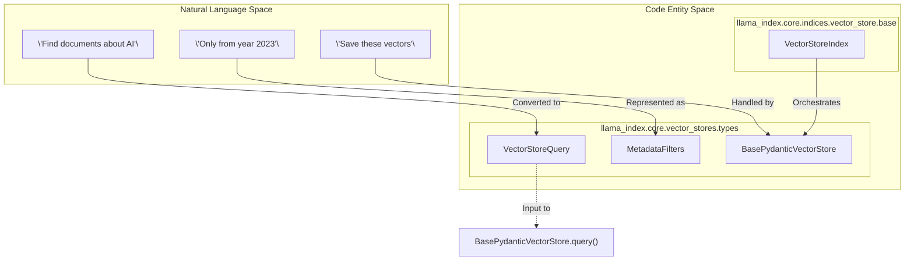
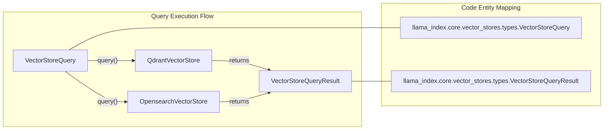
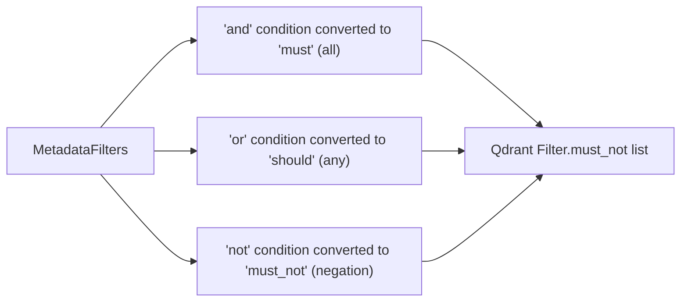
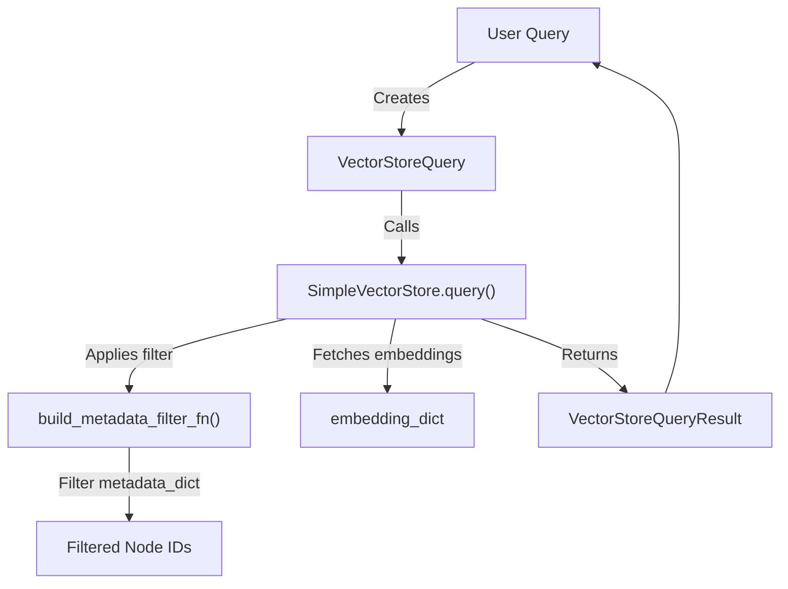

<!-- source: DeepWiki mcp.deepwiki.com · repo run-llama/llama_index · page 7.1 Vector Store Architecture · fetched 2026-11-09 -->

# Vector Store Architecture

<details>
<summary>Relevant source files</summary>

The following files were used as context for generating this wiki page:

- [docs/examples/vector_stores/OpensearchDemo.ipynb](docs/examples/vector_stores/OpensearchDemo.ipynb)
- [llama-index-core/llama_index/core/base/base_retriever.py](llama-index-core/llama_index/core/base/base_retriever.py)
- [llama-index-core/llama_index/core/graph_stores/simple.py](llama-index-core/llama_index/core/graph_stores/simple.py)
- [llama-index-core/llama_index/core/graph_stores/simple_labelled.py](llama-index-core/llama_index/core/graph_stores/simple_labelled.py)
- [llama-index-core/llama_index/core/storage/chat_store/simple_chat_store.py](llama-index-core/llama_index/core/storage/chat_store/simple_chat_store.py)
- [llama-index-core/llama_index/core/storage/docstore/utils.py](llama-index-core/llama_index/core/storage/docstore/utils.py)
- [llama-index-core/llama_index/core/storage/index_store/simple_index_store.py](llama-index-core/llama_index/core/storage/index_store/simple_index_store.py)
- [llama-index-core/llama_index/core/storage/kvstore/simple_kvstore.py](llama-index-core/llama_index/core/storage/kvstore/simple_kvstore.py)
- [llama-index-core/llama_index/core/storage/kvstore/types.py](llama-index-core/llama_index/core/storage/kvstore/types.py)
- [llama-index-core/llama_index/core/storage/storage_context.py](llama-index-core/llama_index/core/storage/storage_context.py)
- [llama-index-core/llama_index/core/vector_stores/simple.py](llama-index-core/llama_index/core/vector_stores/simple.py)
- [llama-index-core/llama_index/core/vector_stores/types.py](llama-index-core/llama_index/core/vector_stores/types.py)
- [llama-index-core/llama_index/core/vector_stores/utils.py](llama-index-core/llama_index/core/vector_stores/utils.py)
- [llama-index-core/tests/graph_stores/test_simple_lpg.py](llama-index-core/tests/graph_stores/test_simple_lpg.py)
- [llama-index-core/tests/retrievers/test_composable_retriever.py](llama-index-core/tests/retrievers/test_composable_retriever.py)
- [llama-index-core/tests/storage/chat_store/test_simple_chat_store.py](llama-index-core/tests/storage/chat_store/test_simple_chat_store.py)
- [llama-index-core/tests/storage/docstore/test_legacy_json_to_doc.py](llama-index-core/tests/storage/docstore/test_legacy_json_to_doc.py)
- [llama-index-core/tests/storage/kvstore/test_mutable_mapping_kvstore.py](llama-index-core/tests/storage/kvstore/test_mutable_mapping_kvstore.py)
- [llama-index-core/tests/vector_stores/test_metadata_filters_logic.py](llama-index-core/tests/vector_stores/test_metadata_filters_logic.py)
- [llama-index-core/tests/vector_stores/test_simple.py](llama-index-core/tests/vector_stores/test_simple.py)
- [llama-index-core/tests/vector_stores/test_utils.py](llama-index-core/tests/vector_stores/test_utils.py)
- [llama-index-integrations/retrievers/llama-index-retrievers-bm25/llama_index/retrievers/bm25/base.py](llama-index-integrations/retrievers/llama-index-retrievers-bm25/llama_index/retrievers/bm25/base.py)
- [llama-index-integrations/retrievers/llama-index-retrievers-bm25/pyproject.toml](llama-index-integrations/retrievers/llama-index-retrievers-bm25/pyproject.toml)
- [llama-index-integrations/retrievers/llama-index-retrievers-bm25/tests/test_retrievers_bm25_retriever.py](llama-index-integrations/retrievers/llama-index-retrievers-bm25/tests/test_retrievers_bm25_retriever.py)
- [llama-index-integrations/vector_stores/llama-index-vector-stores-opensearch/CHANGELOG.md](llama-index-integrations/vector_stores/llama-index-vector-stores-opensearch/CHANGELOG.md)
- [llama-index-integrations/vector_stores/llama-index-vector-stores-opensearch/llama_index/vector_stores/opensearch/__init__.py](llama-index-integrations/vector_stores/llama-index-vector-stores-opensearch/llama_index/vector_stores/opensearch/__init__.py)
- [llama-index-integrations/vector_stores/llama-index-vector-stores-opensearch/llama_index/vector_stores/opensearch/base.py](llama-index-integrations/vector_stores/llama-index-vector-stores-opensearch/llama_index/vector_stores/opensearch/base.py)
- [llama-index-integrations/vector_stores/llama-index-vector-stores-opensearch/pyproject.toml](llama-index-integrations/vector_stores/llama-index-vector-stores-opensearch/pyproject.toml)
- [llama-index-integrations/vector_stores/llama-index-vector-stores-opensearch/tests/docker-compose.yml](llama-index-integrations/vector_stores/llama-index-vector-stores-opensearch/tests/docker-compose.yml)
- [llama-index-integrations/vector_stores/llama-index-vector-stores-opensearch/tests/test_opensearch_client.py](llama-index-integrations/vector_stores/llama-index-vector-stores-opensearch/tests/test_opensearch_client.py)
- [llama-index-integrations/vector_stores/llama-index-vector-stores-opensearch/tests/test_opensearch_filters_unit.py](llama-index-integrations/vector_stores/llama-index-vector-stores-opensearch/tests/test_opensearch_filters_unit.py)
- [llama-index-integrations/vector_stores/llama-index-vector-stores-opensearch/tests/test_vector_stores_opensearch.py](llama-index-integrations/vector_stores/llama-index-vector-stores-opensearch/tests/test_vector_stores_opensearch.py)
- [llama-index-integrations/vector_stores/llama-index-vector-stores-qdrant/llama_index/vector_stores/qdrant/base.py](llama-index-integrations/vector_stores/llama-index-vector-stores-qdrant/llama_index/vector_stores/qdrant/base.py)
- [llama-index-integrations/vector_stores/llama-index-vector-stores-qdrant/llama_index/vector_stores/qdrant/utils.py](llama-index-integrations/vector_stores/llama-index-vector-stores-qdrant/llama_index/vector_stores/qdrant/utils.py)
- [llama-index-integrations/vector_stores/llama-index-vector-stores-qdrant/pyproject.toml](llama-index-integrations/vector_stores/llama-index-vector-stores-qdrant/pyproject.toml)
- [llama-index-integrations/vector_stores/llama-index-vector-stores-qdrant/tests/conftest.py](llama-index-integrations/vector_stores/llama-index-vector-stores-qdrant/tests/conftest.py)
- [llama-index-integrations/vector_stores/llama-index-vector-stores-qdrant/tests/test_vector_stores_qdrant.py](llama-index-integrations/vector_stores/llama-index-vector-stores-qdrant/tests/test_vector_stores_qdrant.py)
- [llama-index-integrations/vector_stores/llama-index-vector-stores-qdrant/uv.lock](llama-index-integrations/vector_stores/llama-index-vector-stores-qdrant/uv.lock)
- [llama-index-integrations/vector_stores/llama-index-vector-stores-solr/llama_index/vector_stores/solr/base.py](llama-index-integrations/vector_stores/llama-index-vector-stores-solr/llama_index/vector_stores/solr/base.py)
- [llama-index-integrations/vector_stores/llama-index-vector-stores-solr/llama_index/vector_stores/solr/query_utils.py](llama-index-integrations/vector_stores/llama-index-vector-stores-solr/llama_index/vector_stores/solr/query_utils.py)
- [llama-index-integrations/vector_stores/llama-index-vector-stores-solr/pyproject.toml](llama-index-integrations/vector_stores/llama-index-vector-stores-solr/pyproject.toml)
- [llama-index-integrations/vector_stores/llama-index-vector-stores-solr/tests/test_solr_vector_store_query_utils.py](llama-index-integrations/vector_stores/llama-index-vector-stores-solr/tests/test_solr_vector_store_query_utils.py)

</details>


This document describes the unified vector store architecture in LlamaIndex, including the `BasePydanticVectorStore` interface, the query system (`VectorStoreQuery`, query modes), and metadata filtering mechanisms. This architecture provides a consistent abstraction layer that enables 300+ vector store integrations to work seamlessly with the rest of the framework.

---

## Core Interface Design

The vector store architecture is built around the `BasePydanticVectorStore` abstract base class, which defines a standard contract that all vector store implementations must follow. This abstraction enables users to swap between different vector store backends without changing application code.

### Natural Language to Code Entity Mapping

The following diagram bridges the gap between high-level retrieval concepts expressed in natural language and the specific Python classes and methods implemented in the code.



This diagram illustrates how a user's natural language query and metadata restrictions are converted into the codebase's vector store query objects and filters, which the vector store implementations consume through a unified API.

**Sources:**  
[llama-index-core/llama_index/core/vector_stores/types.py:1-438](),  
[llama-index-core/llama_index/core/indices/vector_store/base.py:10-10]()

### BasePydanticVectorStore Interface

The `BasePydanticVectorStore` is the core abstract class that all vector store implementations inherit from (directly or indirectly). It is a Pydantic `BaseModel`, allowing automatic serialization, validation, and loading of configuration.

Key methods defined by `BasePydanticVectorStore` include:

| Method | Purpose | Async Variant |
|--------|---------|---------------|
| `add(nodes, **kwargs)` | Add nodes with embeddings to the store | `async_add(nodes, **kwargs)` |
| `delete(ref_doc_id, **kwargs)` | Delete nodes by document reference ID (ref_doc_id) | `adelete(ref_doc_id, **kwargs)` |
| `delete_nodes(node_ids, filters, **kwargs)` | Delete nodes by node IDs or metadata filters | `adelete_nodes(node_ids, filters, **kwargs)` |
| `get_nodes(node_ids, filters)` | Retrieve nodes by node IDs or metadata filters | `aget_nodes(node_ids, filters)` |
| `query(query, **kwargs)` | Execute a vector store query | `aquery(query, **kwargs)` |
| `clear()` | Clear all nodes in the store | `aclear()` |

These methods provide a consistent contract so different vector store backends (e.g., Qdrant, Opensearch, Simple) can be used interchangeably by the rest of the system.

**Sources:**  
[llama-index-core/llama_index/core/vector_stores/types.py:334-438]()

---

## Query System Architecture

The query system is centered around two primary data structures:

- `VectorStoreQuery` represents the input query parameters.
- `VectorStoreQueryResult` represents the search results.



**Sources:**  
[llama-index-core/llama_index/core/vector_stores/types.py:37-266](),  
[llama-index-integrations/vector_stores/llama-index-vector-stores-qdrant/llama_index/vector_stores/qdrant/base.py:79-138](),  
[llama-index-integrations/vector_stores/llama-index-vector-stores-opensearch/llama_index/vector_stores/opensearch/base.py:246-260]()

### VectorStoreQuery

This data class encapsulates all parameters required for a vector store retrieval. Important fields include:

- `query_embedding`: The query vector used for similarity search.
- `similarity_top_k`: The number of top similar nodes to return.
- `mode`: The retrieval mode, selected from the `VectorStoreQueryMode` enum (e.g., `DEFAULT`, `SPARSE`, `HYBRID`, `MMR`).
- `filters`: Optional metadata filters that restrict the search results.

These fields enable flexible querying patterns, including dense vector searches, sparse vector searches, hybrid searches, MMR re-ranking, and more.

### VectorStoreQueryResult

The result of a query contains:

- `nodes`: The sequence of `BaseNode` instances retrieved.
- `similarities`: Optional similarity scores corresponding to each node.
- `ids`: Optional unique identifiers for each retrieved node.

This output facilitates downstream processing such as response synthesis, ranking, or further filtering.

---

## Metadata Filtering System

To refine search results, LlamaIndex supports expressive metadata filtering through the `MetadataFilter` and `MetadataFilters` classes.

### MetadataFilter and Operators

A `MetadataFilter` specifies a single key-value operator condition on node metadata:

| Operator           | Symbol          | Description                                      |
|--------------------|-----------------|------------------------------------------------|
| Equal              | `==`            | Exact equality (default)                        |
| Not Equal          | `!=`            | Inequality                                     |
| Greater Than       | `>`             | Greater than                                   |
| Greater or Equal   | `>=`            | Greater or equal                               |
| Less Than          | `<`             | Less than                                      |
| Less or Equal      | `<=`            | Less or equal                                  |
| In                 | `in`            | Value in a list                                |
| Not In             | `nin`           | Value not in a list                            |
| Contains           | `contains`      | Metadata array contains value                  |
| Text Match         | `text_match`    | Full substring match on string values          |
| Text Match Insensitive | `text_match_insensitive` | Case-insensitive substring match        |
| Is Empty           | `is_empty`      | Field is missing or empty                       |

These operators support a broad range of use cases for filtering metadata.

### Logical Conditions with MetadataFilters

Multiple `MetadataFilter` items can be combined into a `MetadataFilters` object. This supports logical conditions:

| Condition | Description                       |
|-----------|---------------------------------|
| AND       | All filters must be satisfied   |
| OR        | Any filter must be satisfied    |
| NOT       | Negates the filter(s)            |

Filters can be nested to express complex boolean logic. This is key for supporting advanced filtering during retrieval.

Vector stores like the `QdrantVectorStore` implement backend-specific translation of these filters. For example, in Qdrant, the `_build_subfilter` private method recursively converts LlamaIndex metadata filters into `qdrant_client.http.models.Filter` objects with `must`, `should`, and `must_not` clauses corresponding to AND, OR, NOT logic.



**Sources:**  
[llama-index-core/llama_index/core/vector_stores/types.py:63-201](),  
[llama-index-integrations/vector_stores/llama-index-vector-stores-qdrant/tests/test_vector_stores_qdrant.py:139-202]()

---

## Implementation Patterns

### Data Flow: Ingestion to Retrieval

1. **Node Metadata Conversion**  
   Nodes (e.g., `TextNode`) are converted to flat metadata dictionaries using `node_to_metadata_dict`. This includes serializing node content and storing document IDs for filtering [llama-index-core/llama_index/core/vector_stores/utils.py:40-75]().

2. **Storage in Vector Store**  
   The vector store `add` method consumes nodes and stores embeddings and associated metadata. For instance, `SimpleVectorStore` stores embeddings and metadata in Python dictionaries, while `QdrantVectorStore` persists them in an external Qdrant collection [llama-index-core/llama_index/core/vector_stores/simple.py:174-189](), [llama-index-integrations/vector_stores/llama-index-vector-stores-qdrant/llama_index/vector_stores/qdrant/base.py:79-138]().

3. **Querying and Reconstruction**  
   When querying, `VectorStoreQuery` objects specify query vectors and filters. The store returns raw results, which are parsed back into `BaseNode` instances via `metadata_dict_to_node` and similarity scores are retained for ranking or thresholding [llama-index-core/llama_index/core/vector_stores/utils.py:78-98]().

---

### Example: SimpleVectorStore

`SimpleVectorStore` is an in-memory implementation storing a mapping from node IDs to embeddings and metadata. It does not store complete nodes but can retrieve metadata-filtered IDs by applying `build_metadata_filter_fn` locally on the `metadata_dict`.

- Addition of nodes converts them to metadata dicts with `remove_text=True` to optimize storage.
- Query results are filtered in Python code since there is no external query engine.
- Async variants delegate to synchronous methods.



**Sources:**  
[llama-index-core/llama_index/core/vector_stores/simple.py:64-203](),  
[llama-index-core/llama_index/core/vector_stores/utils.py:101-188]()

---

### Example: QdrantVectorStore

The `QdrantVectorStore` integrates with the Qdrant vector database, supporting dense, sparse, and hybrid search modes with embeddings stored as vectors inside Qdrant collections.

- The class wraps `qdrant_client.QdrantClient` or `AsyncQdrantClient`.
- Supports batch insertion, setting vector field names (`dense_vector_name`, `sparse_vector_name`).
- Metadata filters are transformed recursively into Qdrant's filter model, with `must`, `should`, and `must_not` fields mapped to LlamaIndex's `AND`, `OR`, and `NOT` conditions.
- Supports indexing and querying with sparse and hybrid vector fusion using fastembed and custom sparse encoder callbacks.
- Robust retry and parallelism configurations.

```mermaid
flowchart TD
    User["User Query"] -->|"Init VectorStoreQuery"| VSQ["VectorStoreQuery"]
    VSQ -->|query() call| QdrantVS["QdrantVectorStore.query()"]
    QdrantVS -->|Convert filters| buildFilterQd["_build_subfilter()"]
    QdrantVS -->|Send to Qdrant| QdrantClient["QdrantClient.query()"]
    QdrantClient -->|Return raw results| RawResult["Raw Qdrant Results"]
    QdrantVS -->|Parse results| parseResult["parse_to_query_result()"]
    parseResult -->|Return VectorStoreQueryResult| VSQR["VectorStoreQueryResult"]
    VSQR --> User
```

This shows the full flow from query construction, filter translation to the native filter model, communication with the Qdrant vector DB, and wrapping results into LlamaIndex query objects.

**Sources:**  
[llama-index-integrations/vector_stores/llama-index-vector-stores-qdrant/llama_index/vector_stores/qdrant/base.py:79-175](),  
[llama-index-core/llama_index/core/vector_stores/utils.py:40-75]()

---

# Summary Table of Core Classes

| Class Name                | Purpose                                                   | File Path and Lines                            |
|---------------------------|-----------------------------------------------------------|-----------------------------------------------|
| `BasePydanticVectorStore` | Abstract base class defining the vector store interface   | `llama_index/core/vector_stores/types.py:334-438` |
| `VectorStoreQuery`        | Input query data class for vector searches                 | `llama_index/core/vector_stores/types.py:237-271` |
| `VectorStoreQueryResult`  | Result wrapper for vector store query results              | `llama_index/core/vector_stores/types.py:36-45`    |
| `MetadataFilter`          | Represents a single metadata filtering condition            | `llama_index/core/vector_stores/types.py:94-115`   |
| `MetadataFilters`         | Container for multiple filters with logical conditions      | `llama_index/core/vector_stores/types.py:142-201`  |

---

# Concluding Notes

This architecture enables a consistent API across many vector store backends, supports complex metadata filtering with boolean logic, and flexible query modes. The use of Pydantic models provides serialization, validation, and ease of configuration. These patterns enable the powerful RAG data pipeline architecture of LlamaIndex.

**Sources:**  
- [llama-index-core/llama_index/core/vector_stores/types.py:1-438]()  
- [llama-index-core/llama_index/core/vector_stores/utils.py:26-188]()  
- [llama-index-core/llama_index/core/vector_stores/simple.py:64-203]()  
- [llama-index-integrations/vector_stores/llama-index-vector-stores-qdrant/llama_index/vector_stores/qdrant/base.py:79-175]()  
- [llama-index-integrations/vector_stores/llama-index-vector-stores-qdrant/tests/test_vector_stores_qdrant.py:139-202]()  
- [llama-index-integrations/vector_stores/llama-index-vector-stores-opensearch/llama_index/vector_stores/opensearch/base.py:40-147]()

---

