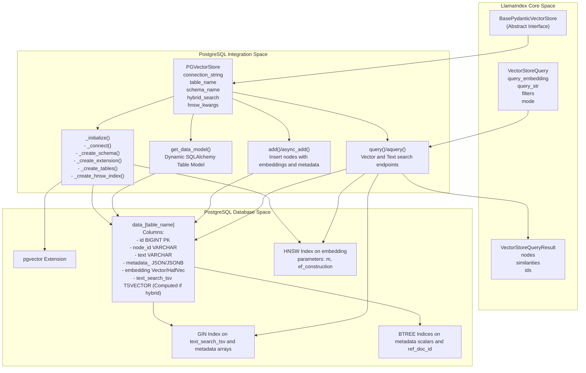
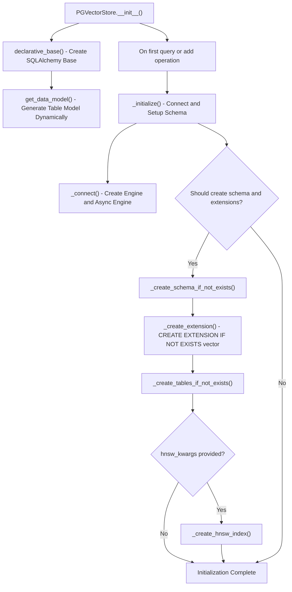
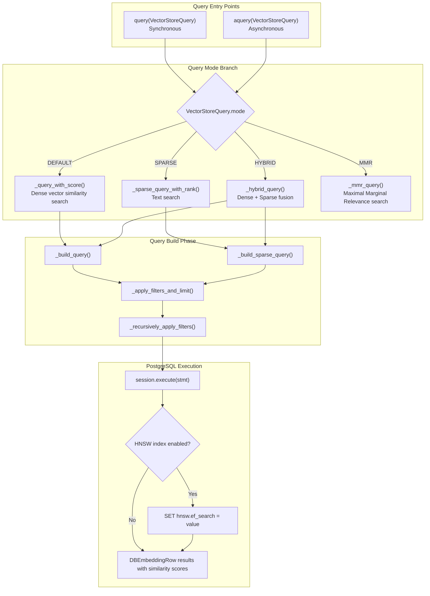

<!-- source: DeepWiki mcp.deepwiki.com · repo run-llama/llama_index · page 7.3 PostgreSQL Integration · fetched 2026-11-09 -->

# PostgreSQL Integration

<details>
<summary>Relevant source files</summary>

The following files were used as context for generating this wiki page:

- [docs/examples/vector_stores/postgres.ipynb](docs/examples/vector_stores/postgres.ipynb)
- [llama-index-integrations/vector_stores/llama-index-vector-stores-postgres/README.md](llama-index-integrations/vector_stores/llama-index-vector-stores-postgres/README.md)
- [llama-index-integrations/vector_stores/llama-index-vector-stores-postgres/llama_index/vector_stores/postgres/base.py](llama-index-integrations/vector_stores/llama-index-vector-stores-postgres/llama_index/vector_stores/postgres/base.py)
- [llama-index-integrations/vector_stores/llama-index-vector-stores-postgres/pyproject.toml](llama-index-integrations/vector_stores/llama-index-vector-stores-postgres/pyproject.toml)
- [llama-index-integrations/vector_stores/llama-index-vector-stores-postgres/tests/README.md](llama-index-integrations/vector_stores/llama-index-vector-stores-postgres/tests/README.md)
- [llama-index-integrations/vector_stores/llama-index-vector-stores-postgres/tests/test_postgres.py](llama-index-integrations/vector_stores/llama-index-vector-stores-postgres/tests/test_postgres.py)
- [llama-index-integrations/vector_stores/llama-index-vector-stores-postgres/uv.lock](llama-index-integrations/vector_stores/llama-index-vector-stores-postgres/uv.lock)

</details>


## Purpose and Scope

The PostgreSQL integration provides a production-ready vector store implementation for LlamaIndex using PostgreSQL with the `pgvector` extension. This page documents the `PGVectorStore` class, dynamic schema generation via SQLAlchemy models, hybrid vector-text search capabilities, advanced indexing features such as HNSW and GIN, metadata filtering, and customizable queries.

This integration supports multiple query modes, including standard similarity search, hybrid dense plus sparse search, full-text search, and Maximal Marginal Relevance (MMR) for diverse retrieval.

For general vector store architecture and concepts, see [Vector Store Architecture](#7.1).

**Sources:**  
[llama-index-integrations/vector_stores/llama-index-vector-stores-postgres/llama_index/vector_stores/postgres/base.py:233-491, 498-511, 552-586, 588-618, 793-857, 987-1166]()  
[llama-index-integrations/vector_stores/llama-index-vector-stores-postgres/pyproject.toml:36-42]()  

---

## Architecture Overview

### System Components and Data Flow



This flowchart shows how the `PGVectorStore` class in LlamaIndex interfaces with PostgreSQL. It manages connection setup, creates a dynamic table schema using SQLAlchemy (`get_data_model`), inserts embedded nodes, and executes vector and text queries with support for multiple indexing strategies.

**Sources:**  
[llama-index-integrations/vector_stores/llama-index-vector-stores-postgres/llama_index/vector_stores/postgres/base.py:233-491, 552-618]()  

---

## Core Components

### PGVectorStore Class

`PGVectorStore` implements the LlamaIndex `BasePydanticVectorStore` interface for PostgreSQL storage with vector search via `pgvector` and optional full-text and hybrid search.

| Parameter              | Type                        | Default    | Description                                        |
|------------------------|-----------------------------|------------|----------------------------------------------------|
| `connection_string`    | `str`                       | Required   | Sync connection string for psycopg2                 |
| `async_connection_string` | `str`                    | Required   | Async connection string for asyncpg                  |
| `table_name`           | `str`                       | `"llamaindex"` | Table name (lowercase)                             |
| `schema_name`          | `str`                       | `"public"` | Database schema name (lowercase)                     |
| `embed_dim`            | `int`                       | `1536`     | Embedding dimension size                            |
| `hybrid_search`        | `bool`                      | `False`    | Adds a `TSVECTOR` computed column and enables hybrid search |
| `text_search_config`   | `str`                       | `"english"`| PostgreSQL text search configuration                 |
| `use_jsonb`            | `bool`                      | `False`    | Use JSONB type for metadata storage                  |
| `use_halfvec`          | `bool`                      | `False`    | Use half-precision embedding vector storage          |
| `hnsw_kwargs`          | `Dict[str, Any]`            | `None`     | Parameters for HNSW index creation                    |
| `indexed_metadata_keys`| `Set[Tuple[str, PGType]]`   | `None`     | Metadata keys/types to create BTREE/GIN indices on    |
| `customize_query_fn`   | `Callable`                  | `None`     | Custom function to modify query statements            |

The class handles connection setup synchronously and asynchronously, creates database schemas and tables on demand, and supports dropping and recreating indexes. It abstracts vector similarity, sparse text search, and combined hybrid queries.

#### Initialization Flow



This chart illustrates the lazy initialization and deployment flow where connection engines and database objects are set up before any data operations.

**Sources:**  
[llama-index-integrations/vector_stores/llama-index-vector-stores-postgres/llama_index/vector_stores/postgres/base.py:498-511, 588-618]()  

---

### Dynamic Schema Generation

The function `get_data_model()` dynamically creates a SQLAlchemy ORM model class to represent the PostgreSQL table for storing documents, embeddings, and metadata. It supports hybrid search, half-precision embedding vectors, and configurable metadata indices.

#### Table Structure and Indexing

```mermaid
erDiagram
    "data_[table_name]" {
        BIGINT id PK "Auto-generated primary key"
        VARCHAR node_id "Unique node identifier"
        VARCHAR text "Raw text content"
        JSON/JSONB metadata_ "Metadata dictionary"
        VECTOR/HALFVEC embedding "Embedding vector"
        TSVECTOR text_search_tsv "Computed column for text search (in hybrid mode)"
    }
    
    "BTREE Index (Scalar Metadata)" ||--o{ "data_[table_name]" : "Indexes scalar keys like text, int"
    "GIN Index (Array Metadata)" ||--o{ "data_[table_name]" : "Indexes JSON arrays and TSVECTOR"
    "HNSW Index (Vector Embeddings)" ||--o{ "data_[table_name]" : "Vector similarity search with approximate nearest neighbor"
```

#### Details of Schema Generation

- Maps supported PostgreSQL types to SQLAlchemy column types: text, int, float, boolean, date, timestamp, uuid, and arrays (text[]).
- Creates BTREE indices for metadata scalar keys and GIN indices for array-type metadata.
- Embedding stored as `Vector(embed_dim)` or `HALFVEC(embed_dim)` (half precision).
- Hybrid search mode adds a computed TSVECTOR column for efficient full-text search using PostgreSQL text search.
- All dynamic metadata indexing and table options are applied with SQLAlchemy's `__table_args__`.

**Supported PostgreSQL Types and Index Types:**

| PGType           | SQLAlchemy Type          | Index Type  |
|------------------|-------------------------|-------------|
| `"text"`         | `String`                | BTREE       |
| `"int"` / `"integer"` | `Integer`            | BTREE       |
| `"numeric"`      | `Numeric`                | BTREE       |
| `"float"`       | `Float`                  | BTREE       |
| `"double precision"` | `DOUBLE_PRECISION`    | BTREE       |
| `"boolean"`     | `Boolean`                | BTREE       |
| `"date"`        | `Date`                   | BTREE       |
| `"timestamp"`   | `DateTime`               | BTREE       |
| `"uuid"`        | `UUID`                   | BTREE       |
| `"text[]"`      | `ARRAY(String)`          | GIN         |

**Sources:**  
[llama-index-integrations/vector_stores/llama-index-vector-stores-postgres/llama_index/vector_stores/postgres/base.py:72-230]()

---

## Storage Features

### Vector Storage Formats

`PGVectorStore` supports two vector data types from the `pgvector` extension:

| Format               | Column Type          | Description                 | Precision     | Storage Size         |
|----------------------|---------------------|-----------------------------|---------------|---------------------|
| Full Precision Vector | `Vector(embed_dim)`  | 32-bit float vector storage | 32-bit float  | 4 bytes per dimension |
| Half Precision Vector | `HALFVEC(embed_dim)` | 16-bit float vector storage | 16-bit float  | 2 bytes per dimension |

Half-precision format halves storage requirements with minor loss of accuracy, enabled by `use_halfvec=True`.

**Sources:**  
[llama-index-integrations/vector_stores/llama-index-vector-stores-postgres/llama_index/vector_stores/postgres/base.py:138-141, 274-275]()

### Metadata Storage

Metadata is stored in the `metadata_` column, either as JSON or JSONB:

- **JSON** preserves original formatting and inserts faster but is slower for queries.
- **JSONB** is binary JSON, faster for querying and supports GIN indexing but slightly slower inserts.

Enable JSONB with `use_jsonb=True` for production workloads needing frequent filtering.

### Custom Metadata Indexing

Users can specify metadata keys and their PostgreSQL types to index for faster filtering via the `indexed_metadata_keys` parameter. The integration automatically generates appropriate BTREE or GIN indices for these keys.

Text arrays (`text[]` PostgreSQL type) receive a GIN index with JSONB casting for efficient array containment checks (`@>`, `?|`, `?&` operators). Scalars use BTREE indices.

**Sources:**  
[llama-index-integrations/vector_stores/llama-index-vector-stores-postgres/llama_index/vector_stores/postgres/base.py:82-168]()  
[llama-index-integrations/vector_stores/llama-index-vector-stores-postgres/tests/test_postgres.py:141-150]()

---

## Query Capabilities

### Query Modes and Execution Flow



The `PGVectorStore` routes a query based on its `VectorStoreQuery.mode` to a dedicated method implementing the appropriate logic:

- **DEFAULT:** Vector similarity search using cosine distance with pgvector operators.
- **SPARSE:** Full-text search using PostgreSQL's `tsvector` and BM25 ranking.
- **HYBRID:** Fuses vector and text scores from dense and sparse queries.
- **MMR:** Uses Maximal Marginal Relevance to balance relevance and diversity.

**Sources:**  
[llama-index-integrations/vector_stores/llama-index-vector-stores-postgres/llama_index/vector_stores/postgres/base.py:793-857, 987-1032]()

---

### Dense Vector Search

Dense vector queries compute cosine distances between query embedding and stored embeddings via:

```python
embedding.cosine_distance(query_embedding).label("distance")
```

Results are ordered ascending by distance (lower means more similar) and converted to similarity as:

```python
similarity = 1 - distance
```

Filters are applied to metadata columns as applicable, and results are limited to the specified top-k.

**Sources:**  
[llama-index-integrations/vector_stores/llama-index-vector-stores-postgres/llama_index/vector_stores/postgres/base.py:793-857]()  

---

### Hybrid Vector + Text Search

Hybrid search combines vector similarity and sparse text search scores to yield better recall and relevance.

Steps in hybrid query:

1. Perform densest vector query for top-k candidates.
2. Perform sparse (BM25) query for top-k candidates.
3. Merge and deduplicate candidates by `node_id`.
4. Compute combined score:  
   \[
   \text{hybrid_score} = \alpha \times \text{vector_similarity} + (1-\alpha) \times \text{text_rank_score}
   \]
   where \(\alpha\) is a fusion weight (default 0.5).
5. Sort by combined hybrid score descending and limit final results.

The combined retrieval benefits from both semantic embedding similarity and lexical term relevance.

**Sources:**  
[llama-index-integrations/vector_stores/llama-index-vector-stores-postgres/llama_index/vector_stores/postgres/base.py:1034-1078]()

---

### Maximal Marginal Relevance (MMR)

MMR retrieval balances relevance and diversity by selecting results that are relevant to the query but diverse among themselves.

Implementation details:

- Fetch a candidate pool of nodes (size configurable via `mmr_prefetch_factor` or `mmr_prefetch_k`).
- Use the embedding similarity function to calculate pairwise similarities.
- Greedily select the next node maximizing the trade-off:
  \[
  \lambda \times \text{similarity to query} - (1-\lambda) \times \max_{\text{already selected}} \text{similarity}
  \]
- Return top-k diverse results.

MMR helps avoid redundant or overly similar results in retrieval.

**Sources:**  
[llama-index-integrations/vector_stores/llama-index-vector-stores-postgres/llama_index/vector_stores/postgres/base.py:40, 1103-1166]()

---

## Metadata Filtering

### Supported Filter Operators and PostgreSQL Mappings

The `PGVectorStore` supports a range of metadata filtering operators mapped from LlamaIndex's `FilterOperator` enums to efficient PostgreSQL syntax:

| FilterOperator   | PostgreSQL Operator | Usage                                    |
|------------------|---------------------|------------------------------------------|
| `EQ` (equal)     | `=`                 | Exact match                              |
| `NE` (not equal) | `!=`                | Not equal                               |
| `GT` / `GTE`     | `>` / `>=`          | Numeric greater than (or equal)          |
| `LT` / `LTE`     | `<` / `<=`          | Numeric less than (or equal)             |
| `IN` / `NIN`     | `IN` / `NOT IN`     | Membership in list (scalar values)      |
| `CONTAINS`       | `@>`                | Array contains value(s)                  |
| `ANY`            | `?|`                | Array overlaps with list of values       |
| `ALL`            | `?&`                | Array contains all values of list         |
| `TEXT_MATCH`     | `LIKE`               | Case-sensitive pattern matching          |
| `IS_EMPTY`       | `IS NULL`           | Checks for NULL or empty                 |

These filters are recursively applied to both scalar metadata columns and JSONB typed columns.

**Sources:**  
[llama-index-integrations/vector_stores/llama-index-vector-stores-postgres/llama_index/vector_stores/postgres/base.py:654-685]()

---

## Performance and Indexing

### HNSW Index Creation and Usage

The integration supports Hierarchical Navigable Small World (HNSW) indexing on the embedding vector column to accelerate approximate nearest neighbor queries.

Key parameters controlling the HNSW index:

| Parameter           | Description                           | Default / Example |
|---------------------|-------------------------------------|-------------------|
| `hnsw_m`            | Maximum number of connections per node | e.g. 16          |
| `hnsw_ef_construction` | Size of the candidate list during index building | e.g. 64          |
| `hnsw_ef_search`    | Size of the candidate list during query (dynamic) | e.g. 40          |

When performing a query, the parameter `hnsw_ef_search` is configured dynamically via SQL:

```sql
SET hnsw.ef_search = 40;
```

This allows tuning the search accuracy vs speed tradeoff.

**Sources:**  
[llama-index-integrations/vector_stores/llama-index-vector-stores-postgres/llama_index/vector_stores/postgres/base.py:552-586, 832-839]()

---

### Dependency Stack

The PostgreSQL vector store relies on the following primary Python packages:

| Package           | Version Range        | Purpose                                |
|-------------------|----------------------|--------------------------------------|
| `pgvector`        | `>=0.3.6,<1.0.0`     | PostgreSQL vector extension binding   |
| `psycopg2-binary` | `>=2.9.9,<3.0.0`     | Synchronous PostgreSQL database driver|
| `asyncpg`         | `>=0.29.0,<1.0.0`    | Asynchronous PostgreSQL driver        |
| `sqlalchemy[asyncio]` | `>=1.4.49,<2.1`   | ORM with async support                 |

These dependencies are declared in the integration's `pyproject.toml`.

**Sources:**  
[llama-index-integrations/vector_stores/llama-index-vector-stores-postgres/pyproject.toml:36-42]()

---

## Summary Table: Query Modes

| Mode       | Description                                  | Technical Detail                          |
|------------|----------------------------------------------|-------------------------------------------|
| DEFAULT    | Dense vector similarity search               | Uses cosine distance on `embedding`      |
| SPARSE     | Full-text search over `text_search_tsv`      | Uses PostgreSQL `tsvector` and BM25      |
| HYBRID     | Combined dense + sparse search with weighted fusion | Fuses similarity and BM25 scores         |
| MMR        | Maximal Marginal Relevance retrieval for diversity | Retrieves diverse set balancing relevance|

---

## References and Further Reading

- For usage examples in Jupyter notebooks, see `docs/examples/vector_stores/postgres.ipynb`.  
- Testing setup and database instantiation instructions are in `llama-index-integrations/vector_stores/llama-index-vector-stores-postgres/tests/README.md`.

---

# End of Document

**Sources for entire page:**  
[llama-index-integrations/vector_stores/llama-index-vector-stores-postgres/llama_index/vector_stores/postgres/base.py:1-618, 793-857, 987-1166]()  
[llama-index-integrations/vector_stores/llama-index-vector-stores-postgres/pyproject.toml]()  
[llama-index-integrations/vector_stores/llama-index-vector-stores-postgres/tests/test_postgres.py]()

---

