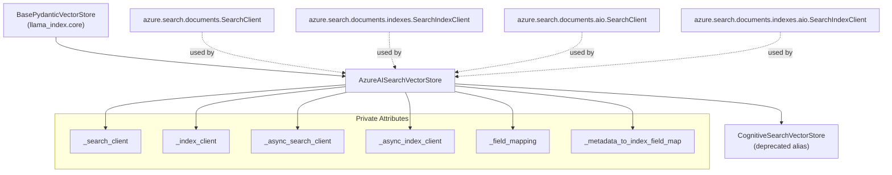
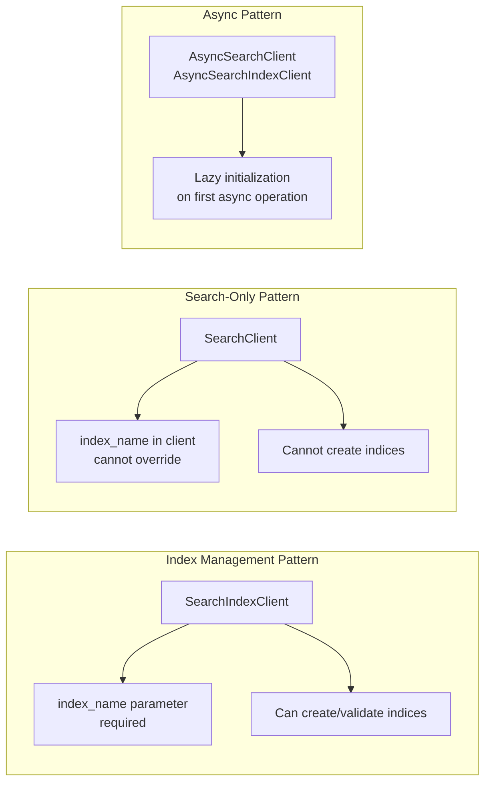
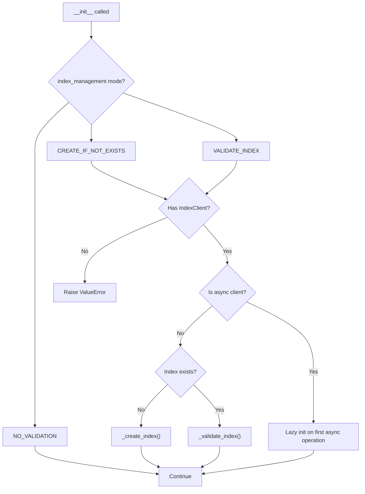
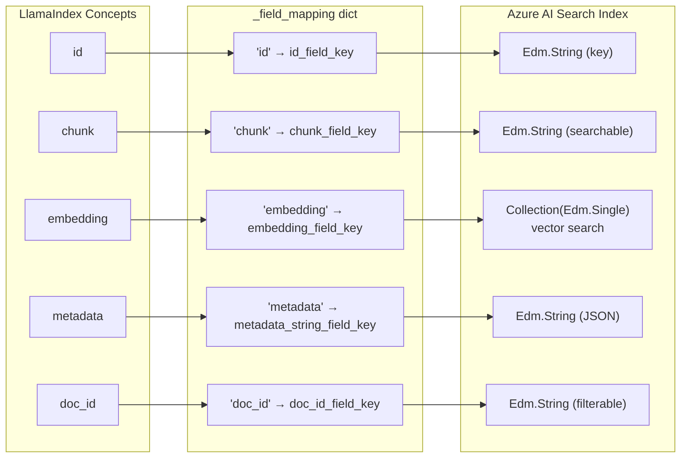
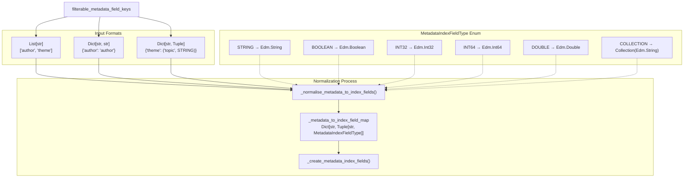
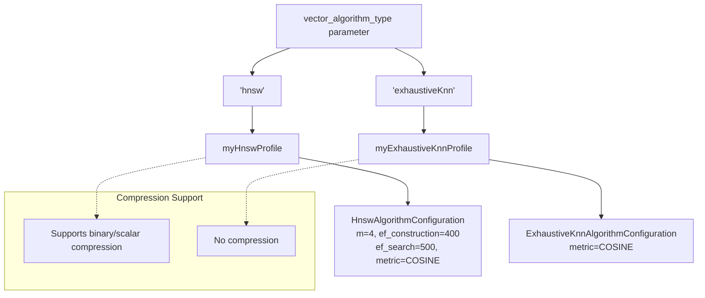
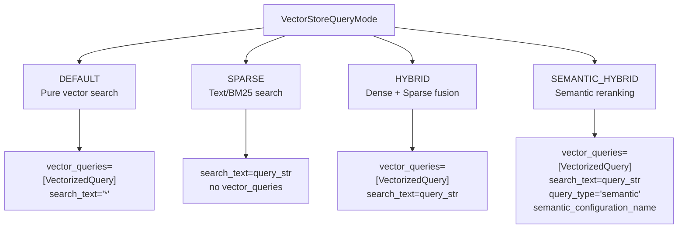
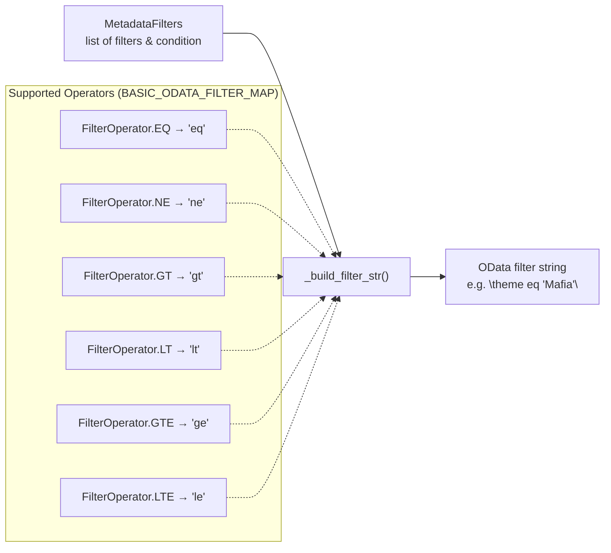
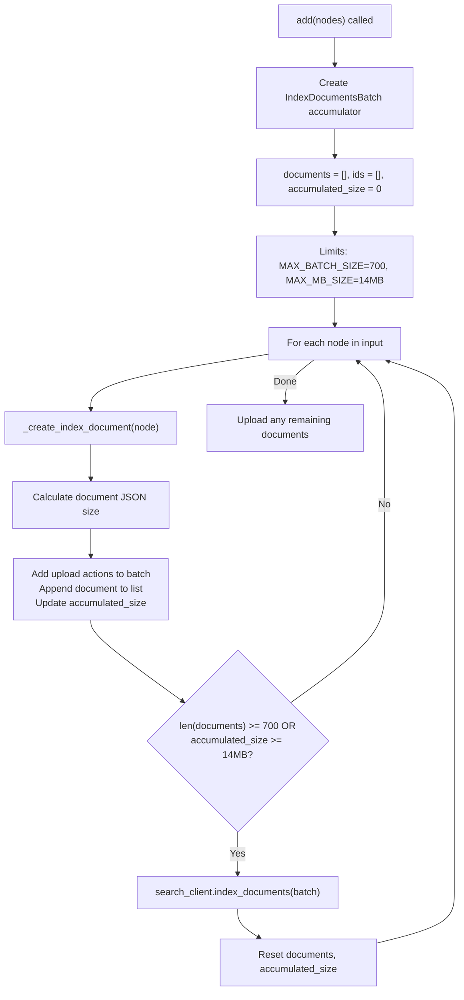
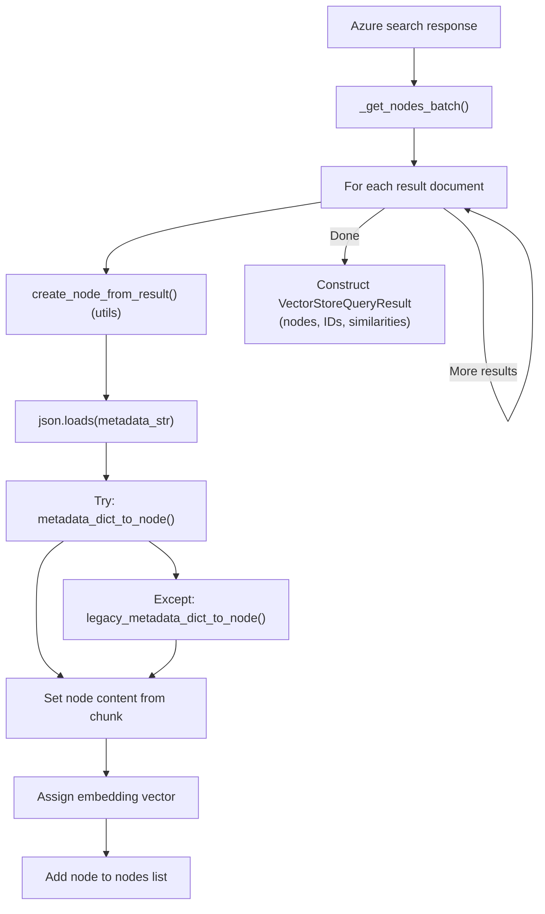

<!-- source: DeepWiki mcp.deepwiki.com · repo run-llama/llama_index · page 7.5 Azure AI Search Integration · fetched 2026-11-09 -->

# Azure AI Search Integration

<details>
<summary>Relevant source files</summary>

The following files were used as context for generating this wiki page:

- [docs/examples/vector_stores/AzureAISearchIndexDemo.ipynb](docs/examples/vector_stores/AzureAISearchIndexDemo.ipynb)
- [llama-index-integrations/vector_stores/llama-index-vector-stores-azureaisearch/llama_index/vector_stores/azureaisearch/__init__.py](llama-index-integrations/vector_stores/llama-index-vector-stores-azureaisearch/llama_index/vector_stores/azureaisearch/__init__.py)
- [llama-index-integrations/vector_stores/llama-index-vector-stores-azureaisearch/llama_index/vector_stores/azureaisearch/azureaisearch_utils.py](llama-index-integrations/vector_stores/llama-index-vector-stores-azureaisearch/llama_index/vector_stores/azureaisearch/azureaisearch_utils.py)
- [llama-index-integrations/vector_stores/llama-index-vector-stores-azureaisearch/llama_index/vector_stores/azureaisearch/base.py](llama-index-integrations/vector_stores/llama-index-vector-stores-azureaisearch/llama_index/vector_stores/azureaisearch/base.py)
- [llama-index-integrations/vector_stores/llama-index-vector-stores-azureaisearch/pyproject.toml](llama-index-integrations/vector_stores/llama-index-vector-stores-azureaisearch/pyproject.toml)
- [llama-index-integrations/vector_stores/llama-index-vector-stores-azureaisearch/tests/test_azureaisearch.py](llama-index-integrations/vector_stores/llama-index-vector-stores-azureaisearch/tests/test_azureaisearch.py)
- [llama-index-integrations/vector_stores/llama-index-vector-stores-azureaisearch/tests/test_vector_stores_cogsearch.py](llama-index-integrations/vector_stores/llama-index-vector-stores-azureaisearch/tests/test_vector_stores_cogsearch.py)
- [llama-index-integrations/vector_stores/llama-index-vector-stores-azurecosmosmongo/llama_index/vector_stores/azurecosmosmongo/base.py](llama-index-integrations/vector_stores/llama-index-vector-stores-azurecosmosmongo/llama_index/vector_stores/azurecosmosmongo/base.py)
- [llama-index-integrations/vector_stores/llama-index-vector-stores-azurecosmosmongo/pyproject.toml](llama-index-integrations/vector_stores/llama-index-vector-stores-azurecosmosmongo/pyproject.toml)
- [llama-index-integrations/vector_stores/llama-index-vector-stores-azurecosmosmongo/tests/test_vector_stores_azurecosmosmongo.py](llama-index-integrations/vector_stores/llama-index-vector-stores-azurecosmosmongo/tests/test_vector_stores_azurecosmosmongo.py)
- [llama-index-integrations/vector_stores/llama-index-vector-stores-azurecosmosnosql/llama_index/vector_stores/azurecosmosnosql/base.py](llama-index-integrations/vector_stores/llama-index-vector-stores-azurecosmosnosql/llama_index/vector_stores/azurecosmosnosql/base.py)
- [llama-index-integrations/vector_stores/llama-index-vector-stores-azurecosmosnosql/pyproject.toml](llama-index-integrations/vector_stores/llama-index-vector-stores-azurecosmosnosql/pyproject.toml)
- [llama-index-integrations/vector_stores/llama-index-vector-stores-azurecosmosnosql/tests/test_azurecosmosnosql.py](llama-index-integrations/vector_stores/llama-index-vector-stores-azurecosmosnosql/tests/test_azurecosmosnosql.py)

</details>


This document describes the Azure AI Search vector store integration in LlamaIndex, which provides enterprise-grade vector search capabilities including hybrid search, semantic reranking, vector compression, and rich index management. This integration enables scalable vector storage and retrieval leveraging Microsoft Azure AI Search infrastructure.

For foundational vector store concepts, see [7.1](). For comparisons to other vector store implementations, see [7.2]() (Milvus), [7.3]() (PostgreSQL), and [7.4]() (Qdrant).

---

## Overview

The `AzureAISearchVectorStore` class implements the `BasePydanticVectorStore` interface for storing and querying vector embeddings in Azure AI Search.

### Features
- **Multiple vector algorithms:** Supports HNSW and Exhaustive KNN [base.py:129-130]()
- **Vector compression:** Binary and scalar quantization compression for HNSW [base.py:259-275]()
- **Semantic Search:** Supports semantic hybrid query mode with LLM-based reranking [base.py:1138-1151]()
- **Dynamic index schema generation:** Metadata fields and their types are configurable [base.py:159-198]()
- **Paging and batching:** Manages batch upload and retrieval within Azure API limits [base.py:75-77, 845-901]()
- **Full-text with analyzers:** Supports language analyzers for text search [base.py:128]()

The integration includes asynchronous support with Azure SDK async clients for all major operations.

---

## Architecture

### Class and Client Relationships



**Explanation:**  
- The core vector store class extends `BasePydanticVectorStore` from LlamaIndex core abstractions.
- It wraps both search and index clients from the Azure SDK to handle indexing (creation, validation) and search operations.
- Both synchronous and asynchronous clients are supported for improved performance and concurrency.

Sources: [llama_index/vector_stores/azureaisearch/base.py:10-15, 79-161]()  

---

### Client Initialization Patterns



**Details:**
- When the user provides a `SearchIndexClient`, the vector store requires an explicit `index_name` parameter. This client allows index creation and validation.
- Using a `SearchClient` (tied to an index) means the index name is embedded and immutable at initialization; index creation and validation are unsupported.
- Async clients initialize lazily on the first async call to optimize resource usage.

Sources: [llama_index/vector_stores/azureaisearch/base.py:558-810](), [tests/test_azureaisearch.py:153-198]()

---

## Index Management

### `IndexManagement` Enum

The enum controls behavior on startup regarding index existence and schema validation:

| Mode               | Value       | Description                                                   |
|--------------------|-------------|---------------------------------------------------------------|
| `NO_VALIDATION`     | auto()      | No check; assumes index exists                                 |
| `VALIDATE_INDEX`    | auto()      | Checks index exists; raises if not                            |
| `CREATE_IF_NOT_EXISTS` | auto()  | Creates default index schema if missing                        |

Sources: [llama_index/vector_stores/azureaisearch/base.py:68-73]()

---

### Index Creation Flow



**Notes:**
- Index creation and validation require the presence of an `SearchIndexClient` or its async variant.
- Asynchronous clients defer checking/creating the index until the first usage.
- Using `SearchClient` alone forbids index creation.

Sources: [llama_index/vector_stores/azureaisearch/base.py:200-221, 804-810]()

---

## Field Configuration

### Field Mapping Between LlamaIndex and Azure AI Search



Each important semantic field in LlamaIndex nodes is mapped to a configurable Azure Search index field. This includes primary keys, chunk text, embedding vectors, a JSON string for metadata, and a separate doc ID for filtering.

The vector store constructs index documents from nodes using this mapping [base.py:303-336, 827-843]().  

Sources: [llama_index/vector_stores/azureaisearch/base.py:303-336, 827-843]()

---

### `MetadataIndexFieldType` Normalization

This enum enumerates data types supported in Azure AI Search metadata fields:

| Enum               | Corresponding Azure Data Type        |
|--------------------|-------------------------------------|
| STRING             | Edm.String                          |
| BOOLEAN            | Edm.Boolean                         |
| INT32              | Edm.Int32                          |
| INT64              | Edm.Int64                          |
| DOUBLE             | Edm.Double                         |
| COLLECTION         | Collection(Edm.String)              |



This process standardizes user input of metadata filterable keys into explicit Azure index fields with associated types, enabling accurate filtering and queries.

Sources: [llama_index/vector_stores/azureaisearch/base.py:53-65, 159-198, 222-257]()

---

## Vector Search Configuration

### Vector Algorithms

Azure AI Search supports two vector search algorithms:

| Algorithm         | Profile Name              | Features                                  | Compression Support       |
|-------------------|---------------------------|-------------------------------------------|--------------------------|
| HNSW              | `myHnswProfile`           | Approximate nearest neighbors, parameters (m, efConstruction, efSearch) | Supports binary/scalar compression |
| Exhaustive KNN    | `myExhaustiveKnnProfile`  | Exact KNN search                          | No compression supported  |



The vector profile is referenced internally as `_vector_profile_name` and used during index creation for embedding fields.

Sources: [llama_index/vector_stores/azureaisearch/base.py:664-671, 348-383]()

---

### Vector Compression Types

| Compression Type | Description                     | Compression Class                   |
|------------------|--------------------------------|-----------------------------------|
| `"none"`         | No compression                 | None                              |
| `"binary"`       | Binary quantization (1-bit)    | `BinaryQuantizationCompression`   |
| `"scalar"`       | Scalar quantization (8-bit)    | `ScalarQuantizationCompression`   |

**Note:** Only HNSW supports compression. Exhaustive KNN algorithm disables compression [base.py:259-275, 369-381]().  

Sources: [llama_index/vector_stores/azureaisearch/base.py:259-275, 369-381]()

---

## Query Modes

Azure AI Search supports four distinct query modes via the `VectorStoreQueryMode` enum:

| Mode                | Description                              | Azure API Usage                                |
|---------------------|------------------------------------------|------------------------------------------------|
| `DEFAULT`           | Pure vector search                       | `vector_queries=[VectorizedQuery]`, `search_text="*"` |
| `SPARSE`            | BM25 or textual search                   | `search_text=query_str`, no vector queries     |
| `HYBRID`            | Fusion of dense + sparse                 | vector queries + `search_text=query_str`      |
| `SEMANTIC_HYBRID`   | Hybrid with semantic reranking           | semantic query (`query_type="semantic"`), semantic config, vector queries and `search_text=query_str` |



Semantic hybrid mode enables powerful reranking of results using Azure's semantic configurations.

Sources: [llama_index/vector_stores/azureaisearch/base.py:1036-1165]()

---

## Metadata Filtering

Azure AI Search supports filtering with OData syntax. The vector store converts LlamaIndex `MetadataFilters` into OData filter strings.

### Operator Mapping and Filter String Construction



Filters support equality, inequality, greater/less comparisons, and are combined per user condition (e.g., AND/OR).

Sources: [llama_index/vector_stores/azureaisearch/base.py:42-50, 1203-1241]()

---

## Data Operations

### Batch Document Upload with Size Management

Azure AI Search restricts upload batch sizes (max 700 documents, max ~14MB payload). The `add()` method intelligently batches nodes for indexing.



This ensures uploads conform to API constraints for reliability and efficiency.

Sources: [llama_index/vector_stores/azureaisearch/base.py:75-77, 845-901]()

---

### Query Result Processing

Query responses return JSON documents including metadata strings and embeddings. Nodes are reconstructed from these fields.



Legacy and new metadata formats are handled for backward compatibility by utility functions (`create_node_from_result`) in `azureaisearch_utils.py`.

Sources: [llama_index/vector_stores/azureaisearch/base.py:1167-1201](), [azureaisearch_utils.py:13-49]()

---

## Usage Example

Here is a snippet demonstrating creating an `AzureAISearchVectorStore` using the `SearchIndexClient` with index creation enabled:

```python
from azure.core.credentials import AzureKeyCredential
from azure.search.documents.indexes import SearchIndexClient
from llama_index.vector_stores.azureaisearch import AzureAISearchVectorStore, IndexManagement

credential = AzureKeyCredential("YOUR-AZURE-SEARCH-SERVICE-ADMIN-KEY")
index_client = SearchIndexClient(
    endpoint="YOUR-AZURE-SEARCH-SERVICE-ENDPOINT",
    credential=credential,
)

vector_store = AzureAISearchVectorStore(
    search_or_index_client=index_client,
    index_name="llamaindex-vector-demo",
    index_management=IndexManagement.CREATE_IF_NOT_EXISTS,
    embedding_dimensionality=1536,
    vector_algorithm_type="hnsw",
)
```

This example includes minimal configuration with embedding dimensionality and algorithm selection.

Sources: [llama_index/vector_stores/azureaisearch/base.py:87-132](), [docs/examples/vector_stores/AzureAISearchIndexDemo.ipynb:177-198]()

---

## Implementation Details

- **User Agent Augmentation:** All Azure SDK clients used internally add a custom user agent string (`"llamaindex-python"`) to assist telemetry and usage tracking [base.py:657-660](), verified in integration tests [tests/test_azureaisearch.py:83-106]().
  
- **Asynchronous Support:** Every main CRUD operation has async counterparts (e.g., `async_add()`, `aquery()`, `adelete()`) using Azure's async clients. Initialization of async clients is lazy and handled transparently [base.py:903-1034]().
  
- **Utilities:** Helpers in `azureaisearch_utils.py` facilitate node creation from search results, search request formulation, and error handling.

---

This completes the documentation for Azure AI Search vector store integration within LlamaIndex, covering all aspects of vector storage, semantic reranking, metadata management, and index lifecycle control.

---

# Sources

- `llama-index-integrations/vector_stores/llama-index-vector-stores-azureaisearch/llama_index/vector_stores/azureaisearch/base.py:1-134, 42-50, 53-77, 159-198, 222-275, 303-383, 558-810, 845-901, 903-1034, 1036-1165, 1167-1241`  
- `llama-index-integrations/vector_stores/llama-index-vector-stores-azureaisearch/llama_index/vector_stores/azureaisearch/azureaisearch_utils.py:1-49`  
- `llama-index-integrations/vector_stores/llama-index-vector-stores-azureaisearch/tests/test_azureaisearch.py:83-106, 153-198`  
- `docs/examples/vector_stores/AzureAISearchIndexDemo.ipynb:1-205`  
- `llama-index-integrations/vector_stores/llama-index-vector-stores-azureaisearch/pyproject.toml:28-38`

---

