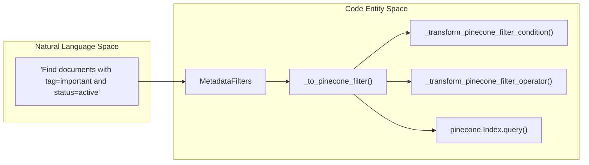
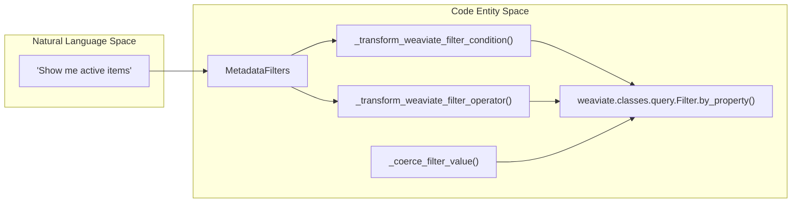

<!-- source: DeepWiki mcp.deepwiki.com · repo run-llama/llama_index · page 7.6 Additional Vector Stores · fetched 2026-11-09 -->

# Additional Vector Stores

Relevant source files

The following files were used as context for generating this wiki page:

- [docs/examples/cookbooks/mongodb_retrieval_strategies.ipynb](docs/examples/cookbooks/mongodb_retrieval_strategies.ipynb)
- [docs/examples/multi_modal/llamaindex_mongodb_voyageai_multimodal.ipynb](docs/examples/multi_modal/llamaindex_mongodb_voyageai_multimodal.ipynb)
- [docs/examples/vector_stores/ChromaFireworksNomic.ipynb](docs/examples/vector_stores/ChromaFireworksNomic.ipynb)
- [docs/examples/vector_stores/KDBAI_Advanced_RAG_Demo.ipynb](docs/examples/vector_stores/KDBAI_Advanced_RAG_Demo.ipynb)
- [docs/examples/vector_stores/MongoDBAtlasVectorSearch.ipynb](docs/examples/vector_stores/MongoDBAtlasVectorSearch.ipynb)
- [docs/examples/vector_stores/MongoDBAtlasVectorSearchRAGFireworks.ipynb](docs/examples/vector_stores/MongoDBAtlasVectorSearchRAGFireworks.ipynb)
- [docs/examples/vector_stores/MongoDBAtlasVectorSearchRAGOpenAI.ipynb](docs/examples/vector_stores/MongoDBAtlasVectorSearchRAGOpenAI.ipynb)
- [llama-index-core/tests/memory/blocks/test_static.py](llama-index-core/tests/memory/blocks/test_static.py)
- [llama-index-integrations/readers/llama-index-readers-astra-db/Makefile](llama-index-integrations/readers/llama-index-readers-astra-db/Makefile)
- [llama-index-integrations/readers/llama-index-readers-astra-db/llama_index/readers/astra_db/base.py](llama-index-integrations/readers/llama-index-readers-astra-db/llama_index/readers/astra_db/base.py)
- [llama-index-integrations/readers/llama-index-readers-astra-db/pyproject.toml](llama-index-integrations/readers/llama-index-readers-astra-db/pyproject.toml)
- [llama-index-integrations/readers/llama-index-readers-astra-db/tests/test_astra_db.py](llama-index-integrations/readers/llama-index-readers-astra-db/tests/test_astra_db.py)
- [llama-index-integrations/readers/llama-index-readers-astra-db/tests/test_readers_astra_db.py](llama-index-integrations/readers/llama-index-readers-astra-db/tests/test_readers_astra_db.py)
- [llama-index-integrations/readers/llama-index-readers-astra-db/uv.lock](llama-index-integrations/readers/llama-index-readers-astra-db/uv.lock)
- [llama-index-integrations/readers/llama-index-readers-athena/pyproject.toml](llama-index-integrations/readers/llama-index-readers-athena/pyproject.toml)
- [llama-index-integrations/readers/llama-index-readers-athena/uv.lock](llama-index-integrations/readers/llama-index-readers-athena/uv.lock)
- [llama-index-integrations/readers/llama-index-readers-wordlift/pyproject.toml](llama-index-integrations/readers/llama-index-readers-wordlift/pyproject.toml)
- [llama-index-integrations/readers/llama-index-readers-wordlift/uv.lock](llama-index-integrations/readers/llama-index-readers-wordlift/uv.lock)
- [llama-index-integrations/selectors/llama-index-selectors-notdiamond/uv.lock](llama-index-integrations/selectors/llama-index-selectors-notdiamond/uv.lock)
- [llama-index-integrations/storage/kvstore/llama-index-storage-kvstore-duckdb/llama_index/storage/kvstore/duckdb/base.py](llama-index-integrations/storage/kvstore/llama-index-storage-kvstore-duckdb/llama_index/storage/kvstore/duckdb/base.py)
- [llama-index-integrations/storage/kvstore/llama-index-storage-kvstore-duckdb/pyproject.toml](llama-index-integrations/storage/kvstore/llama-index-storage-kvstore-duckdb/pyproject.toml)
- [llama-index-integrations/storage/kvstore/llama-index-storage-kvstore-duckdb/tests/test_storage_kvstore_duckdb.py](llama-index-integrations/storage/kvstore/llama-index-storage-kvstore-duckdb/tests/test_storage_kvstore_duckdb.py)
- [llama-index-integrations/storage/kvstore/llama-index-storage-kvstore-duckdb/uv.lock](llama-index-integrations/storage/kvstore/llama-index-storage-kvstore-duckdb/uv.lock)
- [llama-index-integrations/tools/llama-index-tools-multion/uv.lock](llama-index-integrations/tools/llama-index-tools-multion/uv.lock)
- [llama-index-integrations/tools/llama-index-tools-text-to-image/pyproject.toml](llama-index-integrations/tools/llama-index-tools-text-to-image/pyproject.toml)
- [llama-index-integrations/tools/llama-index-tools-text-to-image/uv.lock](llama-index-integrations/tools/llama-index-tools-text-to-image/uv.lock)
- [llama-index-integrations/vector_stores/llama-index-vector-stores-astra-db/Makefile](llama-index-integrations/vector_stores/llama-index-vector-stores-astra-db/Makefile)
- [llama-index-integrations/vector_stores/llama-index-vector-stores-astra-db/llama_index/vector_stores/astra_db/base.py](llama-index-integrations/vector_stores/llama-index-vector-stores-astra-db/llama_index/vector_stores/astra_db/base.py)
- [llama-index-integrations/vector_stores/llama-index-vector-stores-astra-db/pyproject.toml](llama-index-integrations/vector_stores/llama-index-vector-stores-astra-db/pyproject.toml)
- [llama-index-integrations/vector_stores/llama-index-vector-stores-astra-db/tests/test_astra_db.py](llama-index-integrations/vector_stores/llama-index-vector-stores-astra-db/tests/test_astra_db.py)
- [llama-index-integrations/vector_stores/llama-index-vector-stores-astra-db/tests/test_vector_stores_astra_db.py](llama-index-integrations/vector_stores/llama-index-vector-stores-astra-db/tests/test_vector_stores_astra_db.py)
- [llama-index-integrations/vector_stores/llama-index-vector-stores-azurepostgresql/Makefile](llama-index-integrations/vector_stores/llama-index-vector-stores-azurepostgresql/Makefile)
- [llama-index-integrations/vector_stores/llama-index-vector-stores-azurepostgresql/README.md](llama-index-integrations/vector_stores/llama-index-vector-stores-azurepostgresql/README.md)
- [llama-index-integrations/vector_stores/llama-index-vector-stores-azurepostgresql/llama_index/vector_stores/azure_postgres/__init__.py](llama-index-integrations/vector_stores/llama-index-vector-stores-azurepostgresql/llama_index/vector_stores/azure_postgres/__init__.py)
- [llama-index-integrations/vector_stores/llama-index-vector-stores-azurepostgresql/llama_index/vector_stores/azure_postgres/base.py](llama-index-integrations/vector_stores/llama-index-vector-stores-azurepostgresql/llama_index/vector_stores/azure_postgres/base.py)
- [llama-index-integrations/vector_stores/llama-index-vector-stores-azurepostgresql/llama_index/vector_stores/azure_postgres/common/__init__.py](llama-index-integrations/vector_stores/llama-index-vector-stores-azurepostgresql/llama_index/vector_stores/azure_postgres/common/__init__.py)
- [llama-index-integrations/vector_stores/llama-index-vector-stores-azurepostgresql/llama_index/vector_stores/azure_postgres/common/_base.py](llama-index-integrations/vector_stores/llama-index-vector-stores-azurepostgresql/llama_index/vector_stores/azure_postgres/common/_base.py)
- [llama-index-integrations/vector_stores/llama-index-vector-stores-azurepostgresql/llama_index/vector_stores/azure_postgres/common/_connection.py](llama-index-integrations/vector_stores/llama-index-vector-stores-azurepostgresql/llama_index/vector_stores/azure_postgres/common/_connection.py)
- [llama-index-integrations/vector_stores/llama-index-vector-stores-azurepostgresql/llama_index/vector_stores/azure_postgres/common/_shared.py](llama-index-integrations/vector_stores/llama-index-vector-stores-azurepostgresql/llama_index/vector_stores/azure_postgres/common/_shared.py)
- [llama-index-integrations/vector_stores/llama-index-vector-stores-azurepostgresql/llama_index/vector_stores/azure_postgres/common/aio/__init__.py](llama-index-integrations/vector_stores/llama-index-vector-stores-azurepostgresql/llama_index/vector_stores/azure_postgres/common/aio/__init__.py)
- [llama-index-integrations/vector_stores/llama-index-vector-stores-azurepostgresql/pyproject.toml](llama-index-integrations/vector_stores/llama-index-vector-stores-azurepostgresql/pyproject.toml)
- [llama-index-integrations/vector_stores/llama-index-vector-stores-azurepostgresql/tests/llama_index/test_vectorstore.py](llama-index-integrations/vector_stores/llama-index-vector-stores-azurepostgresql/tests/llama_index/test_vectorstore.py)
- [llama-index-integrations/vector_stores/llama-index-vector-stores-azurepostgresql/uv.lock](llama-index-integrations/vector_stores/llama-index-vector-stores-azurepostgresql/uv.lock)
- [llama-index-integrations/vector_stores/llama-index-vector-stores-chroma/llama_index/vector_stores/chroma/base.py](llama-index-integrations/vector_stores/llama-index-vector-stores-chroma/llama_index/vector_stores/chroma/base.py)
- [llama-index-integrations/vector_stores/llama-index-vector-stores-chroma/pyproject.toml](llama-index-integrations/vector_stores/llama-index-vector-stores-chroma/pyproject.toml)
- [llama-index-integrations/vector_stores/llama-index-vector-stores-chroma/tests/test_chromadb.py](llama-index-integrations/vector_stores/llama-index-vector-stores-chroma/tests/test_chromadb.py)
- [llama-index-integrations/vector_stores/llama-index-vector-stores-chroma/tests/test_mmr.py](llama-index-integrations/vector_stores/llama-index-vector-stores-chroma/tests/test_mmr.py)
- [llama-index-integrations/vector_stores/llama-index-vector-stores-chroma/tests/test_vector_stores_chroma.py](llama-index-integrations/vector_stores/llama-index-vector-stores-chroma/tests/test_vector_stores_chroma.py)
- [llama-index-integrations/vector_stores/llama-index-vector-stores-chroma/uv.lock](llama-index-integrations/vector_stores/llama-index-vector-stores-chroma/uv.lock)
- [llama-index-integrations/vector_stores/llama-index-vector-stores-clickhouse/llama_index/vector_stores/clickhouse/base.py](llama-index-integrations/vector_stores/llama-index-vector-stores-clickhouse/llama_index/vector_stores/clickhouse/base.py)
- [llama-index-integrations/vector_stores/llama-index-vector-stores-clickhouse/pyproject.toml](llama-index-integrations/vector_stores/llama-index-vector-stores-clickhouse/pyproject.toml)
- [llama-index-integrations/vector_stores/llama-index-vector-stores-clickhouse/tests/test_clickhouse.py](llama-index-integrations/vector_stores/llama-index-vector-stores-clickhouse/tests/test_clickhouse.py)
- [llama-index-integrations/vector_stores/llama-index-vector-stores-couchbase/README.md](llama-index-integrations/vector_stores/llama-index-vector-stores-couchbase/README.md)
- [llama-index-integrations/vector_stores/llama-index-vector-stores-couchbase/llama_index/vector_stores/couchbase/__init__.py](llama-index-integrations/vector_stores/llama-index-vector-stores-couchbase/llama_index/vector_stores/couchbase/__init__.py)
- [llama-index-integrations/vector_stores/llama-index-vector-stores-couchbase/llama_index/vector_stores/couchbase/base.py](llama-index-integrations/vector_stores/llama-index-vector-stores-couchbase/llama_index/vector_stores/couchbase/base.py)
- [llama-index-integrations/vector_stores/llama-index-vector-stores-couchbase/pyproject.toml](llama-index-integrations/vector_stores/llama-index-vector-stores-couchbase/pyproject.toml)
- [llama-index-integrations/vector_stores/llama-index-vector-stores-couchbase/tests/test_couchbase_query_vector_store.py](llama-index-integrations/vector_stores/llama-index-vector-stores-couchbase/tests/test_couchbase_query_vector_store.py)
- [llama-index-integrations/vector_stores/llama-index-vector-stores-couchbase/tests/test_couchbase_search_vector_stores.py](llama-index-integrations/vector_stores/llama-index-vector-stores-couchbase/tests/test_couchbase_search_vector_stores.py)
- [llama-index-integrations/vector_stores/llama-index-vector-stores-couchbase/tests/vector_index.json](llama-index-integrations/vector_stores/llama-index-vector-stores-couchbase/tests/vector_index.json)
- [llama-index-integrations/vector_stores/llama-index-vector-stores-deeplake/llama_index/vector_stores/deeplake/base.py](llama-index-integrations/vector_stores/llama-index-vector-stores-deeplake/llama_index/vector_stores/deeplake/base.py)
- [llama-index-integrations/vector_stores/llama-index-vector-stores-deeplake/pyproject.toml](llama-index-integrations/vector_stores/llama-index-vector-stores-deeplake/pyproject.toml)
- [llama-index-integrations/vector_stores/llama-index-vector-stores-deeplake/tests/test_vector_stores_deeplake.py](llama-index-integrations/vector_stores/llama-index-vector-stores-deeplake/tests/test_vector_stores_deeplake.py)
- [llama-index-integrations/vector_stores/llama-index-vector-stores-docarray/pyproject.toml](llama-index-integrations/vector_stores/llama-index-vector-stores-docarray/pyproject.toml)
- [llama-index-integrations/vector_stores/llama-index-vector-stores-docarray/uv.lock](llama-index-integrations/vector_stores/llama-index-vector-stores-docarray/uv.lock)
- [llama-index-integrations/vector_stores/llama-index-vector-stores-duckdb/.gitignore](llama-index-integrations/vector_stores/llama-index-vector-stores-duckdb/.gitignore)
- [llama-index-integrations/vector_stores/llama-index-vector-stores-duckdb/Makefile](llama-index-integrations/vector_stores/llama-index-vector-stores-duckdb/Makefile)
- [llama-index-integrations/vector_stores/llama-index-vector-stores-duckdb/README.md](llama-index-integrations/vector_stores/llama-index-vector-stores-duckdb/README.md)
- [llama-index-integrations/vector_stores/llama-index-vector-stores-duckdb/examples/DuckDBDemo.ipynb](llama-index-integrations/vector_stores/llama-index-vector-stores-duckdb/examples/DuckDBDemo.ipynb)
- [llama-index-integrations/vector_stores/llama-index-vector-stores-duckdb/llama_index/vector_stores/duckdb/__init__.py](llama-index-integrations/vector_stores/llama-index-vector-stores-duckdb/llama_index/vector_stores/duckdb/__init__.py)
- [llama-index-integrations/vector_stores/llama-index-vector-stores-duckdb/llama_index/vector_stores/duckdb/base.py](llama-index-integrations/vector_stores/llama-index-vector-stores-duckdb/llama_index/vector_stores/duckdb/base.py)
- [llama-index-integrations/vector_stores/llama-index-vector-stores-duckdb/pyproject.toml](llama-index-integrations/vector_stores/llama-index-vector-stores-duckdb/pyproject.toml)
- [llama-index-integrations/vector_stores/llama-index-vector-stores-duckdb/tests/test_duckdb.py](llama-index-integrations/vector_stores/llama-index-vector-stores-duckdb/tests/test_duckdb.py)
- [llama-index-integrations/vector_stores/llama-index-vector-stores-duckdb/uv.lock](llama-index-integrations/vector_stores/llama-index-vector-stores-duckdb/uv.lock)
- [llama-index-integrations/vector_stores/llama-index-vector-stores-elasticsearch/llama_index/vector_stores/elasticsearch/__init__.py](llama-index-integrations/vector_stores/llama-index-vector-stores-elasticsearch/llama_index/vector_stores/elasticsearch/__init__.py)
- [llama-index-integrations/vector_stores/llama-index-vector-stores-elasticsearch/llama_index/vector_stores/elasticsearch/base.py](llama-index-integrations/vector_stores/llama-index-vector-stores-elasticsearch/llama_index/vector_stores/elasticsearch/base.py)
- [llama-index-integrations/vector_stores/llama-index-vector-stores-elasticsearch/llama_index/vector_stores/elasticsearch/utils.py](llama-index-integrations/vector_stores/llama-index-vector-stores-elasticsearch/llama_index/vector_stores/elasticsearch/utils.py)
- [llama-index-integrations/vector_stores/llama-index-vector-stores-elasticsearch/pyproject.toml](llama-index-integrations/vector_stores/llama-index-vector-stores-elasticsearch/pyproject.toml)
- [llama-index-integrations/vector_stores/llama-index-vector-stores-elasticsearch/tests/docker-compose.yml](llama-index-integrations/vector_stores/llama-index-vector-stores-elasticsearch/tests/docker-compose.yml)
- [llama-index-integrations/vector_stores/llama-index-vector-stores-elasticsearch/tests/test_vector_stores_elasticsearch.py](llama-index-integrations/vector_stores/llama-index-vector-stores-elasticsearch/tests/test_vector_stores_elasticsearch.py)
- [llama-index-integrations/vector_stores/llama-index-vector-stores-jaguar/llama_index/vector_stores/jaguar/base.py](llama-index-integrations/vector_stores/llama-index-vector-stores-jaguar/llama_index/vector_stores/jaguar/base.py)
- [llama-index-integrations/vector_stores/llama-index-vector-stores-jaguar/pyproject.toml](llama-index-integrations/vector_stores/llama-index-vector-stores-jaguar/pyproject.toml)
- [llama-index-integrations/vector_stores/llama-index-vector-stores-kdbai/Makefile](llama-index-integrations/vector_stores/llama-index-vector-stores-kdbai/Makefile)
- [llama-index-integrations/vector_stores/llama-index-vector-stores-kdbai/README.md](llama-index-integrations/vector_stores/llama-index-vector-stores-kdbai/README.md)
- [llama-index-integrations/vector_stores/llama-index-vector-stores-kdbai/llama_index/vector_stores/kdbai/__init__.py](llama-index-integrations/vector_stores/llama-index-vector-stores-kdbai/llama_index/vector_stores/kdbai/__init__.py)
- [llama-index-integrations/vector_stores/llama-index-vector-stores-kdbai/llama_index/vector_stores/kdbai/base.py](llama-index-integrations/vector_stores/llama-index-vector-stores-kdbai/llama_index/vector_stores/kdbai/base.py)
- [llama-index-integrations/vector_stores/llama-index-vector-stores-kdbai/llama_index/vector_stores/kdbai/utils.py](llama-index-integrations/vector_stores/llama-index-vector-stores-kdbai/llama_index/vector_stores/kdbai/utils.py)
- [llama-index-integrations/vector_stores/llama-index-vector-stores-kdbai/pyproject.toml](llama-index-integrations/vector_stores/llama-index-vector-stores-kdbai/pyproject.toml)
- [llama-index-integrations/vector_stores/llama-index-vector-stores-lancedb/llama_index/vector_stores/lancedb/base.py](llama-index-integrations/vector_stores/llama-index-vector-stores-lancedb/llama_index/vector_stores/lancedb/base.py)
- [llama-index-integrations/vector_stores/llama-index-vector-stores-lancedb/llama_index/vector_stores/lancedb/util.py](llama-index-integrations/vector_stores/llama-index-vector-stores-lancedb/llama_index/vector_stores/lancedb/util.py)
- [llama-index-integrations/vector_stores/llama-index-vector-stores-lancedb/pyproject.toml](llama-index-integrations/vector_stores/llama-index-vector-stores-lancedb/pyproject.toml)
- [llama-index-integrations/vector_stores/llama-index-vector-stores-lancedb/tests/test_vector_stores_lancedb.py](llama-index-integrations/vector_stores/llama-index-vector-stores-lancedb/tests/test_vector_stores_lancedb.py)
- [llama-index-integrations/vector_stores/llama-index-vector-stores-mongodb/CHANGELOG.md](llama-index-integrations/vector_stores/llama-index-vector-stores-mongodb/CHANGELOG.md)
- [llama-index-integrations/vector_stores/llama-index-vector-stores-mongodb/README.md](llama-index-integrations/vector_stores/llama-index-vector-stores-mongodb/README.md)
- [llama-index-integrations/vector_stores/llama-index-vector-stores-mongodb/llama_index/vector_stores/mongodb/base.py](llama-index-integrations/vector_stores/llama-index-vector-stores-mongodb/llama_index/vector_stores/mongodb/base.py)
- [llama-index-integrations/vector_stores/llama-index-vector-stores-mongodb/llama_index/vector_stores/mongodb/index.py](llama-index-integrations/vector_stores/llama-index-vector-stores-mongodb/llama_index/vector_stores/mongodb/index.py)
- [llama-index-integrations/vector_stores/llama-index-vector-stores-mongodb/llama_index/vector_stores/mongodb/pipelines.py](llama-index-integrations/vector_stores/llama-index-vector-stores-mongodb/llama_index/vector_stores/mongodb/pipelines.py)
- [llama-index-integrations/vector_stores/llama-index-vector-stores-mongodb/pyproject.toml](llama-index-integrations/vector_stores/llama-index-vector-stores-mongodb/pyproject.toml)
- [llama-index-integrations/vector_stores/llama-index-vector-stores-mongodb/tests/conftest.py](llama-index-integrations/vector_stores/llama-index-vector-stores-mongodb/tests/conftest.py)
- [llama-index-integrations/vector_stores/llama-index-vector-stores-mongodb/tests/test_filters.py](llama-index-integrations/vector_stores/llama-index-vector-stores-mongodb/tests/test_filters.py)
- [llama-index-integrations/vector_stores/llama-index-vector-stores-mongodb/tests/test_index_commands.py](llama-index-integrations/vector_stores/llama-index-vector-stores-mongodb/tests/test_index_commands.py)
- [llama-index-integrations/vector_stores/llama-index-vector-stores-mongodb/tests/test_integration.py](llama-index-integrations/vector_stores/llama-index-vector-stores-mongodb/tests/test_integration.py)
- [llama-index-integrations/vector_stores/llama-index-vector-stores-mongodb/tests/test_vector_stores_mongodb.py](llama-index-integrations/vector_stores/llama-index-vector-stores-mongodb/tests/test_vector_stores_mongodb.py)
- [llama-index-integrations/vector_stores/llama-index-vector-stores-mongodb/tests/test_vectorstore.py](llama-index-integrations/vector_stores/llama-index-vector-stores-mongodb/tests/test_vectorstore.py)
- [llama-index-integrations/vector_stores/llama-index-vector-stores-mongodb/uv.lock](llama-index-integrations/vector_stores/llama-index-vector-stores-mongodb/uv.lock)
- [llama-index-integrations/vector_stores/llama-index-vector-stores-nile/llama_index/vector_stores/nile/base.py](llama-index-integrations/vector_stores/llama-index-vector-stores-nile/llama_index/vector_stores/nile/base.py)
- [llama-index-integrations/vector_stores/llama-index-vector-stores-nile/pyproject.toml](llama-index-integrations/vector_stores/llama-index-vector-stores-nile/pyproject.toml)
- [llama-index-integrations/vector_stores/llama-index-vector-stores-pinecone/llama_index/vector_stores/pinecone/base.py](llama-index-integrations/vector_stores/llama-index-vector-stores-pinecone/llama_index/vector_stores/pinecone/base.py)
- [llama-index-integrations/vector_stores/llama-index-vector-stores-pinecone/llama_index/vector_stores/pinecone/utils.py](llama-index-integrations/vector_stores/llama-index-vector-stores-pinecone/llama_index/vector_stores/pinecone/utils.py)
- [llama-index-integrations/vector_stores/llama-index-vector-stores-pinecone/pyproject.toml](llama-index-integrations/vector_stores/llama-index-vector-stores-pinecone/pyproject.toml)
- [llama-index-integrations/vector_stores/llama-index-vector-stores-pinecone/tests/test_vector_stores_pinecone.py](llama-index-integrations/vector_stores/llama-index-vector-stores-pinecone/tests/test_vector_stores_pinecone.py)
- [llama-index-integrations/vector_stores/llama-index-vector-stores-pinecone/uv.lock](llama-index-integrations/vector_stores/llama-index-vector-stores-pinecone/uv.lock)
- [llama-index-integrations/vector_stores/llama-index-vector-stores-redis/llama_index/vector_stores/redis/__init__.py](llama-index-integrations/vector_stores/llama-index-vector-stores-redis/llama_index/vector_stores/redis/__init__.py)
- [llama-index-integrations/vector_stores/llama-index-vector-stores-redis/llama_index/vector_stores/redis/base.py](llama-index-integrations/vector_stores/llama-index-vector-stores-redis/llama_index/vector_stores/redis/base.py)
- [llama-index-integrations/vector_stores/llama-index-vector-stores-redis/pyproject.toml](llama-index-integrations/vector_stores/llama-index-vector-stores-redis/pyproject.toml)
- [llama-index-integrations/vector_stores/llama-index-vector-stores-redis/tests/conftest.py](llama-index-integrations/vector_stores/llama-index-vector-stores-redis/tests/conftest.py)
- [llama-index-integrations/vector_stores/llama-index-vector-stores-redis/tests/test_vector_stores_redis.py](llama-index-integrations/vector_stores/llama-index-vector-stores-redis/tests/test_vector_stores_redis.py)
- [llama-index-integrations/vector_stores/llama-index-vector-stores-redis/uv.lock](llama-index-integrations/vector_stores/llama-index-vector-stores-redis/uv.lock)
- [llama-index-integrations/vector_stores/llama-index-vector-stores-vearch/pyproject.toml](llama-index-integrations/vector_stores/llama-index-vector-stores-vearch/pyproject.toml)
- [llama-index-integrations/vector_stores/llama-index-vector-stores-vearch/uv.lock](llama-index-integrations/vector_stores/llama-index-vector-stores-vearch/uv.lock)
- [llama-index-integrations/vector_stores/llama-index-vector-stores-weaviate/llama_index/vector_stores/weaviate/__init__.py](llama-index-integrations/vector_stores/llama-index-vector-stores-weaviate/llama_index/vector_stores/weaviate/__init__.py)
- [llama-index-integrations/vector_stores/llama-index-vector-stores-weaviate/llama_index/vector_stores/weaviate/_exceptions.py](llama-index-integrations/vector_stores/llama-index-vector-stores-weaviate/llama_index/vector_stores/weaviate/_exceptions.py)
- [llama-index-integrations/vector_stores/llama-index-vector-stores-weaviate/llama_index/vector_stores/weaviate/base.py](llama-index-integrations/vector_stores/llama-index-vector-stores-weaviate/llama_index/vector_stores/weaviate/base.py)
- [llama-index-integrations/vector_stores/llama-index-vector-stores-weaviate/llama_index/vector_stores/weaviate/utils.py](llama-index-integrations/vector_stores/llama-index-vector-stores-weaviate/llama_index/vector_stores/weaviate/utils.py)
- [llama-index-integrations/vector_stores/llama-index-vector-stores-weaviate/pyproject.toml](llama-index-integrations/vector_stores/llama-index-vector-stores-weaviate/pyproject.toml)
- [llama-index-integrations/vector_stores/llama-index-vector-stores-weaviate/tests/test_import.py](llama-index-integrations/vector_stores/llama-index-vector-stores-weaviate/tests/test_import.py)
- [llama-index-integrations/vector_stores/llama-index-vector-stores-weaviate/tests/test_to_weaviate_filter.py](llama-index-integrations/vector_stores/llama-index-vector-stores-weaviate/tests/test_to_weaviate_filter.py)
- [llama-index-integrations/vector_stores/llama-index-vector-stores-weaviate/tests/test_utils.py](llama-index-integrations/vector_stores/llama-index-vector-stores-weaviate/tests/test_utils.py)
- [llama-index-integrations/vector_stores/llama-index-vector-stores-weaviate/tests/test_vector_stores_weaviate.py](llama-index-integrations/vector_stores/llama-index-vector-stores-weaviate/tests/test_vector_stores_weaviate.py)
- [llama-index-integrations/vector_stores/llama-index-vector-stores-weaviate/uv.lock](llama-index-integrations/vector_stores/llama-index-vector-stores-weaviate/uv.lock)
- [llama-index-integrations/vector_stores/llama-index-vector-stores-wordlift/llama_index/vector_stores/wordlift/base.py](llama-index-integrations/vector_stores/llama-index-vector-stores-wordlift/llama_index/vector_stores/wordlift/base.py)
- [llama-index-integrations/vector_stores/llama-index-vector-stores-wordlift/llama_index/vector_stores/wordlift/metadata_filters_to_filters.py](llama-index-integrations/vector_stores/llama-index-vector-stores-wordlift/llama_index/vector_stores/wordlift/metadata_filters_to_filters.py)
- [llama-index-integrations/vector_stores/llama-index-vector-stores-wordlift/pyproject.toml](llama-index-integrations/vector_stores/llama-index-vector-stores-wordlift/pyproject.toml)
- [llama-index-integrations/vector_stores/llama-index-vector-stores-wordlift/tests/test_wordlift.py](llama-index-integrations/vector_stores/llama-index-vector-stores-wordlift/tests/test_wordlift.py)
- [llama-index-integrations/vector_stores/llama-index-vector-stores-wordlift/tests/wiremock/mappings/vector-search/queries/request_1.json](llama-index-integrations/vector_stores/llama-index-vector-stores-wordlift/tests/wiremock/mappings/vector-search/queries/request_1.json)
- [llama-index-integrations/vector_stores/llama-index-vector-stores-wordlift/tests/wiremock/mappings/vector-search/queries/request_2.json](llama-index-integrations/vector_stores/llama-index-vector-stores-wordlift/tests/wiremock/mappings/vector-search/queries/request_2.json)
- [llama-index-integrations/vector_stores/llama-index-vector-stores-wordlift/uv.lock](llama-index-integrations/vector_stores/llama-index-vector-stores-wordlift/uv.lock)

## Purpose and Scope

This document covers integration patterns for **Pinecone**, **Weaviate**, **Chroma**, **Elasticsearch**, **MongoDB Atlas Vector Search**, **OpenSearch**, **Redis**, **LanceDB**, **DuckDB**, **ClickHouse**, **AstraDB**, and **KDB.AI** in LlamaIndex. These integrations implement the `BasePydanticVectorStore` interface to provide cloud-managed and self-hosted vector storage options with varying feature sets.

For core vector store abstractions and interfaces, see [Vector Store Architecture](#7.1). For other vector store integrations, see [Milvus Integration](#7.2), [PostgreSQL Integration](#7.3), [Qdrant Integration](#7.4), and [Azure AI Search Integration](#7.5).

---

## Vector Store Comparison

| Feature | Pinecone | Weaviate | Chroma | Elasticsearch | MongoDB Atlas | OpenSearch | LanceDB | Redis | DuckDB | ClickHouse | AstraDB | KDB.AI |
|---------|----------|----------|--------|---------------|---------------|------------|---------|-------|--------|------------|---------|--------|
| **Deployment** | Serverless, Pod-based | Cloud (WCS), Local | Embedded, Server | Cloud, Self-hosted | Cloud (Atlas) | Cloud, Self-hosted | Embedded, Cloud | Cloud, Self-hosted | Embedded | Cloud, Self-hosted | Cloud | Cloud, Self-hosted |
| **Hybrid Search** | Yes (dense + sparse) | Yes (dense + BM25) | No | Yes (RRF/Linear) | Yes (RRF) | Yes | Yes (Tantivy) | Yes | No | No | No | No |
| **Metadata Filtering** | Yes | Yes | Yes | Yes | Yes | Yes | Yes | Yes | Yes | Yes | Yes | Yes |
| **Primary Use Case** | Managed cloud vector DB | Flexible vector search | Simple embedded DB | Enterprise search | Document-centric RAG | Distributed search | Local-first, disk-based | Caching, real-time | Embedded analytics | Real-time analytics | Serverless DB | Time-series, real-time |

Sources: [llama-index-integrations/vector_stores/llama-index-vector-stores-elasticsearch/llama_index/vector_stores/elasticsearch/base.py:124-186](), [llama-index-integrations/vector_stores/llama-index-vector-stores-lancedb/llama_index/vector_stores/lancedb/base.py:95-151]()

---

## Architecture Overview

```mermaid
graph TB
    subgraph "LlamaIndex Core"
        BASE["BasePydanticVectorStore"]
        VSQ["VectorStoreQuery"]
        VSQR["VectorStoreQueryResult"]
        FILTERS["MetadataFilters"]
    end
    
    subgraph "Vector Store Integrations"
        PC_STORE["PineconeVectorStore"]
        WV_STORE["WeaviateVectorStore"]
        CH_STORE["ChromaVectorStore"]
        ES_STORE["ElasticsearchStore"]
MG_STORE["MongoDBAtlasVectorSearch"]
        OS_STORE["OpensearchVectorStore"]
        LC_STORE["LanceDBVectorStore"]
        RD_STORE["RedisVectorStore"]
        DD_STORE["DuckDBVectorStore"]
        CH_STORE_ALT["ClickHouseVectorStore"]
        AD_STORE["AstraDBVectorStore"]
        KDB_STORE["KDBAIVectorStore"]
    end

    subgraph "Client Libraries"
        PC_CLIENT["pinecone.Index"]
        WV_CLIENT["weaviate.WeaviateClient"]
        CH_COLL["chromadb.api.models.Collection.Collection"]
        ES_CLIENT["elasticsearch.helpers.vectorstore.AsyncVectorStore"]
        MG_CLIENT["pymongo.MongoClient"]
        OS_CLIENT["opensearchpy.client.OSClient"]
        LC_CONN["lancedb.db.DBConnection"]
        RD_CLIENT["redis.Redis"]
        DD_CONN["duckdb.DuckDBPyConnection"]
        CH_CLIENT_ALT["clickhouse_connect.driver.client.ClickHouseClient"]
        AD_CLIENT["astrapy.db.AstraDB"]
        KDB_CLIENT["kdbai.Client"]
    end
    
    BASE --> PC_STORE
    BASE --> WV_STORE
    BASE --> CH_STORE
    BASE --> ES_STORE
    BASE --> MG_STORE
    BASE --> OS_STORE
    BASE --> LC_STORE
    BASE --> RD_STORE
    BASE --> DD_STORE
    BASE --> CH_STORE_ALT
    BASE --> AD_STORE
    BASE --> KDB_STORE
    
    PC_STORE --> PC_CLIENT
    WV_STORE --> WV_CLIENT
    CH_STORE --> CH_COLL
    ES_STORE --> ES_CLIENT
    MG_STORE --> MG_CLIENT
    OS_STORE --> OS_CLIENT
    LC_STORE --> LC_CONN
    RD_STORE --> RD_CLIENT
    DD_STORE --> DD_CONN
    CH_STORE_ALT --> CH_CLIENT_ALT
    AD_STORE --> AD_CLIENT
    KDB_STORE --> KDB_CLIENT
```

**Diagram: Vector Store Integration Architecture**

All integrations implement `BasePydanticVectorStore` [llama-index-core/llama_index/core/vector_stores/types.py:17]() and handle the conversion of standard `VectorStoreQuery` [llama-index-core/llama_index/core/vector_stores/types.py:18]() into native database commands.

Sources: [llama-index-integrations/vector_stores/llama-index-vector-stores-elasticsearch/llama_index/vector_stores/elasticsearch/base.py:124-144](), [llama-index-integrations/vector_stores/llama-index-vector-stores-weaviate/llama_index/vector_stores/weaviate/base.py:205-210]()

---

## Pinecone Integration

### Overview
`PineconeVectorStore` provides an interface to Pinecone, a managed vector database. It supports both dense and sparse vector embeddings, allowing for hybrid search capabilities. The integration handles the transformation of LlamaIndex's `MetadataFilters` into Pinecone's query language.

### Filter Transformation

**Diagram: Pinecone Filter Data Flow**

The `_transform_pinecone_filter_condition` function maps logical conditions like "and" and "or" to Pinecone's `$and` and `$or` operators [llama-index-integrations/vector_stores/llama-index-vector-stores-pinecone/llama_index/vector_stores/pinecone/base.py:48-54](). Similarly, `_transform_pinecone_filter_operator` converts standard operators (e.g., `==`, `!=`, `>`, `<`) to their Pinecone equivalents (`$eq`, `$ne`, `$gt`, `$lt`) [llama-index-integrations/vector_stores/llama-index-vector-stores-pinecone/llama_index/vector_stores/pinecone/base.py:57-76](). The `_to_pinecone_filter` function then constructs the complete filter dictionary for Pinecone queries [llama-index-integrations/vector_stores/llama-index-vector-stores-pinecone/llama_index/vector_stores/pinecone/base.py:79-109]().

### Sparse Embeddings
The `PineconeVectorStore` can be configured to add sparse vectors using the `add_sparse_vector` parameter. It can use a provided `sparse_embedding_model` or a default `DefaultPineconeSparseEmbedding` if a `tokenizer` is specified [llama-index-integrations/vector_stores/llama-index-vector-stores-pinecone/llama_index/vector_stores/pinecone/base.py:203-206]().

Sources: [llama-index-integrations/vector_stores/llama-index-vector-stores-pinecone/llama_index/vector_stores/pinecone/base.py:117-206]()

---

## OpenSearch Integration

### Overview
`OpensearchVectorStore` provides an interface to OpenSearch clusters. It utilizes the `OpensearchVectorClient` to encapsulate index management and kNN search configurations.

### Configuration
The store supports various kNN engines including `faiss`, `lucene`, and `nmslib` (deprecated). Index creation is deferred until first use to avoid network calls during initialization.

### Search Pipeline
OpenSearch supports a `search_pipeline` parameter for advanced query processing.

Sources: [llama-index-integrations/vector_stores/llama-index-vector-stores-opensearch/llama_index/vector_stores/opensearch/base.py:40-145]()

---

## Elasticsearch Integration

### Overview
`ElasticsearchStore` leverages the `elasticsearch.helpers.vectorstore.AsyncVectorStore` [llama-index-integrations/vector_stores/llama-index-vector-stores-elasticsearch/llama_index/vector_stores/elasticsearch/base.py:20]() to provide high-level vector search capabilities.

### Retrieval Strategies
Retrieval modes are defined via `AsyncRetrievalStrategy` subclasses [llama-index-integrations/vector_stores/llama-index-vector-stores-elasticsearch/llama_index/vector_stores/elasticsearch/base.py:25]():
- **`AsyncDenseVectorStrategy`**: Used for standard embedding-based retrieval [llama-index-integrations/vector_stores/llama-index-vector-stores-elasticsearch/llama_index/vector_stores/elasticsearch/base.py:24]().
- **`AsyncBM25Strategy`**: Enables keyword-based search [llama-index-integrations/vector_stores/llama-index-vector-stores-elasticsearch/llama_index/vector_stores/elasticsearch/base.py:22]().
- **`AsyncSparseVectorStrategy`**: Supports sparse vector retrieval [llama-index-integrations/vector_stores/llama-index-vector-stores-elasticsearch/llama_index/vector_stores/elasticsearch/base.py:23]().

The store validates that the `VectorStoreQueryMode` matches the configured strategy via `_mode_must_match_retrieval_strategy` [llama-index-integrations/vector_stores/llama-index-vector-stores-elasticsearch/llama_index/vector_stores/elasticsearch/base.py:91-123]().

Sources: [llama-index-integrations/vector_stores/llama-index-vector-stores-elasticsearch/llama_index/vector_stores/elasticsearch/base.py:124-205]()

---

## Weaviate Integration

### Overview
`WeaviateVectorStore` manages interactions with Weaviate's GraphQL-based search. It handles complex type coercion via `_coerce_filter_value` to ensure Python types match Weaviate's strict schema [llama-index-integrations/vector_stores/llama-index-vector-stores-weaviate/llama_index/vector_stores/weaviate/base.py:134-167]().

### Filter Transformation

**Diagram: Weaviate Filter Data Flow**

The integration supports standard operators like `==`, `!=`, `>`, and `is_empty` by mapping them to Weaviate-specific strings like `equal`, `not_equal`, and `is_none` [llama-index-integrations/vector_stores/llama-index-vector-stores-weaviate/llama_index/vector_stores/weaviate/base.py:88-108]().

Sources: [llama-index-integrations/vector_stores/llama-index-vector-stores-weaviate/llama_index/vector_stores/weaviate/base.py:134-205]()

---

## Chroma Integration

### Overview
`ChromaVectorStore` integrates with the Chroma database. It includes a `chunk_list` generator to manage Chroma's maximum batch size limits (`MAX_CHUNK_SIZE`) during node insertion [llama-index-integrations/vector_stores/llama-index-vector-stores-chroma/llama_index/vector_stores/chroma/base.py:102-118]().

### MMR Support
Chroma supports Maximum Marginal Relevance (MMR) for result diversification, utilizing a `DEFAULT_MMR_PREFETCH_FACTOR` of 4.0 [llama-index-integrations/vector_stores/llama-index-vector-stores-chroma/llama_index/vector_stores/chroma/base.py:29]().

Sources: [llama-index-integrations/vector_stores/llama-index-vector-stores-chroma/llama_index/vector_stores/chroma/base.py:120-157]()

---

## MongoDB Atlas Vector Search Integration

### Overview
`MongoDBAtlasVectorSearch` integrates with MongoDB Atlas, leveraging its built-in vector search capabilities. This integration allows storing and querying vector embeddings directly within MongoDB collections.

### Key Features
- **Index Management**: The vector store can create and manage Atlas Vector Search indexes.
- **Hybrid Search**: Supports hybrid search using a combination of vector similarity and keyword search (RRF).
- **Metadata Filtering**: Allows filtering results based on document metadata.

Sources: [llama-index-integrations/vector_stores/llama-index-vector-stores-mongodb/llama_index/vector_stores/mongodb/base.py]()

---

## Redis Integration

### Overview
`RedisVectorStore` integrates with Redis, utilizing its search capabilities for vector storage and retrieval. It supports both Redis Stack and Redis Cloud.

### Key Features
- **Real-time Performance**: Leverages Redis's in-memory data structures for low-latency operations.
- **Flexible Indexing**: Supports various indexing options for vector search.
- **Metadata Filtering**: Enables filtering results based on metadata stored alongside vectors.

Sources: [llama-index-integrations/vector_stores/llama-index-vector-stores-redis/llama_index/vector_stores/redis/base.py]()

---

## LanceDB Integration

### Overview
`LanceDBVectorStore` is a local-first vector store that persists data in the Lance format. It supports full-text search (FTS) via Tantivy and in-memory reranking [llama-index-integrations/vector_stores/llama-index-vector-stores-lancedb/llama_index/vector_stores/lancedb/base.py:130-133]().

### Key Parameters
- `nprobes`: Controls search accuracy vs. speed [llama-index-integrations/vector_stores/llama-index-vector-stores-lancedb/llama_index/vector_stores/lancedb/base.py:108]().
- `refine_factor`: Used for re-ranking results in memory [llama-index-integrations/vector_stores/llama-index-vector-stores-lancedb/llama_index/vector_stores/lancedb/base.py:111]().
- `query_type`: Can be `"vector"`, `"fts"`, or `"hybrid"` [llama-index-integrations/vector_stores/llama-index-vector-stores-lancedb/llama_index/vector_stores/lancedb/base.py:128]().

Sources: [llama-index-integrations/vector_stores/llama-index-vector-stores-lancedb/llama_index/vector_stores/lancedb/base.py:95-151]()

---

## DuckDB Integration

### Overview
`DuckDBVectorStore` provides an embedded, in-process vector database solution using DuckDB. It's ideal for local development, testing, or applications requiring a lightweight, high-performance analytical database with vector capabilities.

### Key Features
- **Embedded Database**: Runs directly within the application process, simplifying deployment.
- **SQL-based Queries**: Leverages DuckDB's SQL engine for flexible data manipulation and filtering.
- **Persistent Storage**: Data can be persisted to disk or kept in-memory.

Sources: [llama-index-integrations/vector_stores/llama-index-vector-stores-duckdb/llama_index/vector_stores/duckdb/base.py]()

---

## ClickHouse Integration

### Overview
`ClickHouseVectorStore` integrates with ClickHouse, a column-oriented database management system, for high-performance vector storage and retrieval. It's designed for analytical workloads and large datasets.

### Key Features
- **Scalability**: Handles massive datasets and high query throughput.
- **Fast Aggregations**: Optimized for analytical queries, which can be beneficial for certain vector search patterns.
- **Metadata Filtering**: Supports efficient filtering based on metadata.

Sources: [llama-index-integrations/vector_stores/llama-index-vector-stores-clickhouse/llama_index/vector_stores/clickhouse/base.py]()

---

## AstraDB Integration

### Overview
`AstraDBVectorStore` integrates with DataStax Astra DB, a serverless cloud database built on Apache Cassandra. It offers a scalable and managed solution for vector storage.

### Key Features
- **Serverless**: Managed service that scales automatically.
- **Global Distribution**: Leverages Cassandra's distributed architecture for high availability and low latency.
- **Metadata Filtering**: Supports filtering based on document metadata.

Sources: [llama-index-integrations/vector_stores/llama-index-vector-stores-astra-db/llama_index/vector_stores/astra_db/base.py]()

---

## KDB.AI Integration

### Overview
`KDBAIVectorStore` integrates with KDB.AI, a vector database optimized for real-time and time-series data. It's built on kdb+ and q, offering high performance for specialized use cases.

### Key Features
- **Real-time Performance**: Designed for extremely fast ingestion and querying of time-series data.
- **Time-series Capabilities**: Strong support for time-based queries and analytics.
- **Metadata Filtering**: Allows filtering results based on metadata.

Sources: [llama-index-integrations/vector_stores/llama-index-vector-stores-kdbai/llama_index/vector_stores/kdbai/base.py]()

---

## Integration Package Installation

| Vector Store | Package Name | Primary Dependency |
|--------------|--------------|--------------------|
| **Pinecone** | `llama-index-vector-stores-pinecone` | `pinecone>=7.0.0` |
| **Weaviate** | `llama-index-vector-stores-weaviate` | `weaviate-client>=4.5.7` |
| **Chroma** | `llama-index-vector-stores-chroma` | `chromadb>=0.5.17` |
| **Elasticsearch** | `llama-index-vector-stores-elasticsearch` | `elasticsearch>=8.13.1` |
| **MongoDB Atlas** | `llama-index-vector-stores-mongodb` | `pymongo>=4.9.0` |
| **OpenSearch** | `llama-index-vector-stores-opensearch` | `opensearch-py>=3.0.0` |
| **Redis** | `llama-index-vector-stores-redis` | `redis>=4.5.0` |
| **LanceDB** | `llama-index-vector-stores-lancedb` | `lancedb>=0.21.1` |
| **DuckDB** | `llama-index-vector-stores-duckdb` | `duckdb>=0.9.0` |
| **ClickHouse** | `llama-index-vector-stores-clickhouse` | `clickhouse-connect>=0.7.0` |
| **AstraDB** | `llama-index-vector-stores-astra-db` | `astrapy>=0.6.0` |
| **KDB.AI** | `llama-index-vector-stores-kdbai` | `kdbai>=0.2.0` |

Sources: [llama-index-integrations/vector_stores/llama-index-vector-stores-pinecone/pyproject.toml:28-38](), [llama-index-integrations/vector_stores/llama-index-vector-stores-weaviate/pyproject.toml:29-39](), [llama-index-integrations/vector_stores/llama-index-vector-stores-chroma/pyproject.toml:29-39](), [llama-index-integrations/vector_stores/llama-index-vector-stores-elasticsearch/pyproject.toml:30-41](), [llama-index-integrations/vector_stores/llama-index-vector-stores-mongodb/pyproject.toml:33-43](), [llama-index-integrations/vector_stores/llama-index-vector-stores-lancedb/pyproject.toml:30-42](), [llama-index-integrations/vector_stores/llama-index-vector-stores-redis/pyproject.toml](), [llama-index-integrations/vector_stores/llama-index-vector-stores-duckdb/pyproject.toml](), [llama-index-integrations/vector_stores/llama-index-vector-stores-clickhouse/pyproject.toml](), [llama-index-integrations/vector_stores/llama-index-vector-stores-astra-db/pyproject.toml](), [llama-index-integrations/vector_stores/llama-index-vector-stores-kdbai/pyproject.toml]()

---

