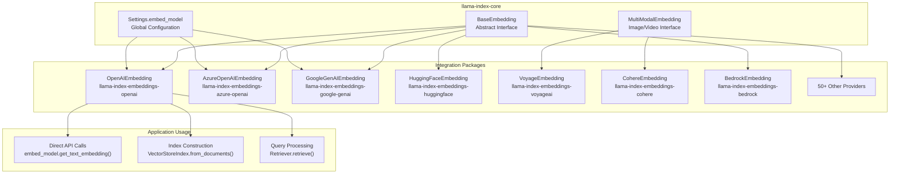
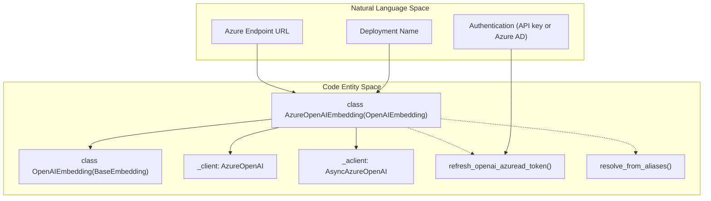
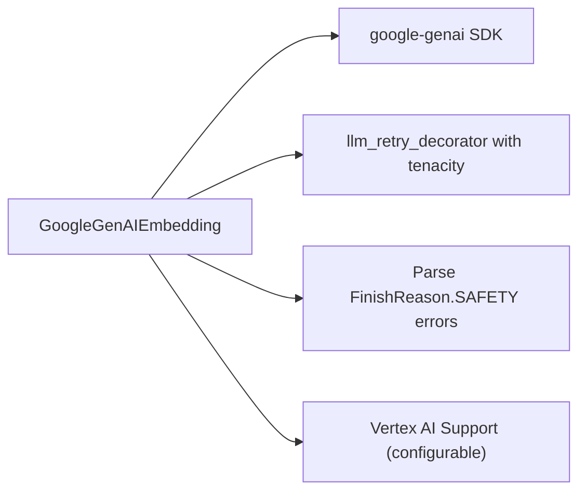
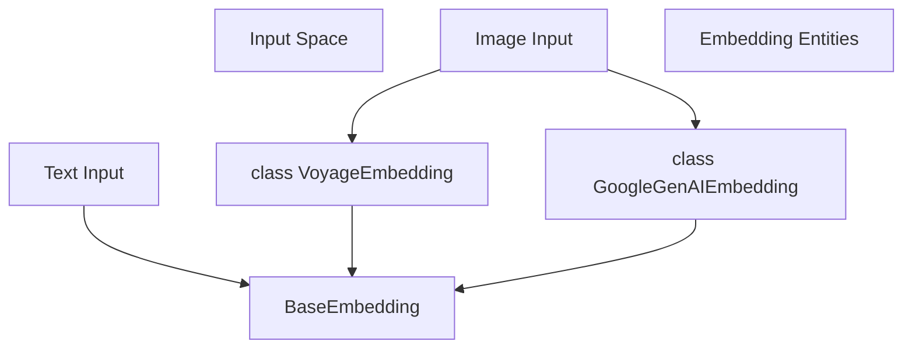
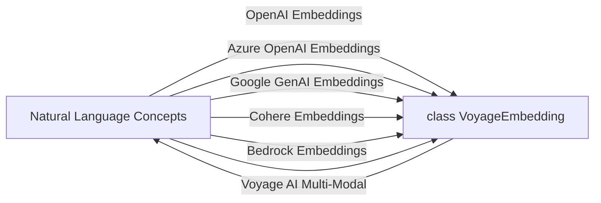
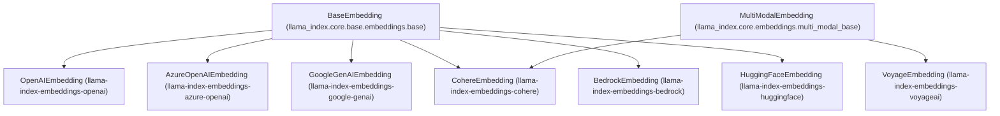

<!-- source: DeepWiki mcp.deepwiki.com · repo run-llama/llama_index · page 8 Embedding Integrations · fetched 2026-11-09 -->

# Embedding Integrations

<details>
<summary>Relevant source files</summary>

The following files were used as context for generating this wiki page:

- [llama-index-core/llama_index/core/base/embeddings/base.py](llama-index-core/llama_index/core/base/embeddings/base.py)
- [llama-index-core/llama_index/core/base/embeddings/base_sparse.py](llama-index-core/llama_index/core/base/embeddings/base_sparse.py)
- [llama-index-core/llama_index/core/base/llms/base.py](llama-index-core/llama_index/core/base/llms/base.py)
- [llama-index-core/llama_index/core/embeddings/multi_modal_base.py](llama-index-core/llama_index/core/embeddings/multi_modal_base.py)
- [llama-index-core/llama_index/core/indices/tree/select_leaf_embedding_retriever.py](llama-index-core/llama_index/core/indices/tree/select_leaf_embedding_retriever.py)
- [llama-index-core/llama_index/core/indices/tree/select_leaf_retriever.py](llama-index-core/llama_index/core/indices/tree/select_leaf_retriever.py)
- [llama-index-core/llama_index/core/ingestion/data_sinks.py](llama-index-core/llama_index/core/ingestion/data_sinks.py)
- [llama-index-core/llama_index/core/ingestion/data_sources.py](llama-index-core/llama_index/core/ingestion/data_sources.py)
- [llama-index-core/llama_index/core/ingestion/transformations.py](llama-index-core/llama_index/core/ingestion/transformations.py)
- [llama-index-core/llama_index/core/instrumentation/events/embedding.py](llama-index-core/llama_index/core/instrumentation/events/embedding.py)
- [llama-index-core/llama_index/core/instrumentation/events/exception.py](llama-index-core/llama_index/core/instrumentation/events/exception.py)
- [llama-index-core/llama_index/core/instrumentation/events/llm.py](llama-index-core/llama_index/core/instrumentation/events/llm.py)
- [llama-index-core/llama_index/core/llms/callbacks.py](llama-index-core/llama_index/core/llms/callbacks.py)
- [llama-index-core/llama_index/core/rate_limiter.py](llama-index-core/llama_index/core/rate_limiter.py)
- [llama-index-core/llama_index/core/sparse_embeddings/__init__.py](llama-index-core/llama_index/core/sparse_embeddings/__init__.py)
- [llama-index-core/llama_index/core/sparse_embeddings/mock_sparse_embedding.py](llama-index-core/llama_index/core/sparse_embeddings/mock_sparse_embedding.py)
- [llama-index-core/tests/embeddings/test_base.py](llama-index-core/tests/embeddings/test_base.py)
- [llama-index-core/tests/embeddings/test_with_cache.py](llama-index-core/tests/embeddings/test_with_cache.py)
- [llama-index-core/tests/indices/tree/test_embedding_retriever.py](llama-index-core/tests/indices/tree/test_embedding_retriever.py)
- [llama-index-core/tests/indices/tree/test_retrievers.py](llama-index-core/tests/indices/tree/test_retrievers.py)
- [llama-index-core/tests/llms/test_callbacks.py](llama-index-core/tests/llms/test_callbacks.py)
- [llama-index-core/tests/sparse_embeddings/__init__.py](llama-index-core/tests/sparse_embeddings/__init__.py)
- [llama-index-core/tests/sparse_embeddings/test_mock_sparse_embeddings.py](llama-index-core/tests/sparse_embeddings/test_mock_sparse_embeddings.py)
- [llama-index-core/tests/test_rate_limiter.py](llama-index-core/tests/test_rate_limiter.py)
- [llama-index-integrations/embeddings/llama-index-embeddings-cohere/llama_index/embeddings/cohere/base.py](llama-index-integrations/embeddings/llama-index-embeddings-cohere/llama_index/embeddings/cohere/base.py)
- [llama-index-integrations/embeddings/llama-index-embeddings-cohere/pyproject.toml](llama-index-integrations/embeddings/llama-index-embeddings-cohere/pyproject.toml)
- [llama-index-integrations/embeddings/llama-index-embeddings-cohere/tests/__init__.py](llama-index-integrations/embeddings/llama-index-embeddings-cohere/tests/__init__.py)
- [llama-index-integrations/embeddings/llama-index-embeddings-cohere/tests/test_embeddings.py](llama-index-integrations/embeddings/llama-index-embeddings-cohere/tests/test_embeddings.py)
- [llama-index-integrations/embeddings/llama-index-embeddings-cohere/uv.lock](llama-index-integrations/embeddings/llama-index-embeddings-cohere/uv.lock)
- [llama-index-integrations/embeddings/llama-index-embeddings-heroku/pyproject.toml](llama-index-integrations/embeddings/llama-index-embeddings-heroku/pyproject.toml)
- [llama-index-integrations/embeddings/llama-index-embeddings-heroku/uv.lock](llama-index-integrations/embeddings/llama-index-embeddings-heroku/uv.lock)
- [llama-index-integrations/embeddings/llama-index-embeddings-ibm/uv.lock](llama-index-integrations/embeddings/llama-index-embeddings-ibm/uv.lock)
- [llama-index-integrations/llms/llama-index-llms-heroku/pyproject.toml](llama-index-integrations/llms/llama-index-llms-heroku/pyproject.toml)
- [llama-index-integrations/llms/llama-index-llms-heroku/uv.lock](llama-index-integrations/llms/llama-index-llms-heroku/uv.lock)
- [llama-index-integrations/sparse_embeddings/llama-index-sparse-embeddings-fastembed/Makefile](llama-index-integrations/sparse_embeddings/llama-index-sparse-embeddings-fastembed/Makefile)
- [llama-index-integrations/sparse_embeddings/llama-index-sparse-embeddings-fastembed/README.md](llama-index-integrations/sparse_embeddings/llama-index-sparse-embeddings-fastembed/README.md)

</details>


This page provides a high-level overview of the embedding model integrations in LlamaIndex. Embeddings map text (and sometimes multi-modal data) into vector spaces that enable semantic retrieval and similarity search. The core of this subsystem is the `BaseEmbedding` interface in `llama-index-core`, which defines the base abstraction for embedding models. Multiple provider-specific integration packages implement this interface to support embedding generation from OpenAI, Azure OpenAI, Google GenAI, Cohere, Bedrock, VoyageAI, HuggingFace, and other sources.

For detailed technical explanations, see the child pages:
- [Embedding Architecture](#8.1) — covers `BaseEmbedding`, sparse embeddings, batching, caching, rate limiting, and multimodal embeddings.
- [Embedding Providers](#8.2) — documents specific integrations like OpenAI/Azure, Google GenAI, HuggingFace, Bedrock, Cohere, VoyageAI, NVIDIA, Ollama, Nomic, and others.

---

## Architecture Overview

The embedding system is designed with a modular and extensible architecture separating core abstractions from provider implementations.

- `BaseEmbedding` defines the core interface for embedding models located in `llama-index-core`.
- `MultiModalEmbedding` extends the base to handle non-text inputs such as images.
- Over 50 integration packages implement embeddings from a variety of providers.
- Global configuration for default embedding model usage is managed by `Settings.embed_model`.

The diagram below illustrates the relationship between the core abstraction, integration packages, and application usage within LlamaIndex:



**Sources:**  
[llama-index-core/llama_index/core/base/embeddings/base.py:72-190]()  
[llama-index-integrations/embeddings/llama-index-embeddings-cohere/llama_index/embeddings/cohere/base.py:160-205]()  
[llama-index-integrations/embeddings/llama-index-embeddings-azure-openai/llama_index/embeddings/azure_openai/base.py:34-64]()  
[llama-index-integrations/embeddings/llama-index-embeddings-bedrock/llama_index/embeddings/bedrock/base.py:29-125]()  
[llama-index-integrations/embeddings/llama-index-embeddings-voyageai/llama_index/embeddings/voyageai/base.py:71-71]()

---

## Core Embedding Interface: `BaseEmbedding`

At the foundation of LlamaIndex's embedding system is the `BaseEmbedding` abstract class, defined in `llama_index.core.base.embeddings.base`. It establishes the common interface that all embedding implementations follow:

| Method                                | Purpose                                   | Return Type    | Detail                                                                                      |
|-------------------------------------|------------------------------------------|----------------|---------------------------------------------------------------------------------------------|
| `_get_text_embedding(text: str)`    | Abstract synchronous text embedding      | `List[float]`  | Subclasses implement to synchronously embed single text                                    |
| `_aget_text_embedding(text: str)`   | Abstract asynchronous text embedding     | `List[float]`  | Async variant for text embedding                                                           |
| `get_text_embedding(text: str)`     | Public synchronous embedding entrypoint | `List[float]`  | Wraps `_get_text_embedding` with callbacks, instrumentation, caching, and rate limiting     |
| `get_text_embedding_batch(texts: List[str], show_progress: bool)` | Synchronous batch embedding           | `List[List[float]]` | Supports batching, optional tqdm progress bar                                              |
| `aget_text_embedding_batch(texts: List[str], **kwargs)` | Async batch embedding with params       | `List[List[float]]` | Allows provider-specific kwargs for advanced batch embedding                               |
| `to_payload()`                      | Metadata for instrumentation              | `Dict[str, Any]` | Must exclude sensitive information like API keys                                           |

`BaseEmbedding` also supports optional caching (`embeddings_cache`), rate-limiting (`rate_limiter`), and parallel asynchronous processing (`num_workers`). Multi-modal embeddings extend this interface to support images and other data types.

**Sources:**  
[llama-index-core/llama_index/core/base/embeddings/base.py:72-190]()  
[llama-index-integrations/embeddings/llama-index-embeddings-cohere/llama_index/embeddings/cohere/base.py:160-205]()

---

## Provider Integrations Overview

Several key embedding provider integrations are available as separate packages. These packages implement `BaseEmbedding` or the multimodal variant, providing access to specialized embedding APIs and handling provider-specific logic.

### OpenAI and Azure OpenAI

- **OpenAIEmbedding:** Implements embeddings via OpenAI's API.
- **AzureOpenAIEmbedding:** Extends OpenAI embedding to support Azure-specific endpoints, authentication modes (API key or Microsoft Entra ID), and deployment configurations.



Global config includes `azure_endpoint`, `azure_deployment`, `use_azure_ad`, and required API version settings.

**Sources:**  
[llama-index-integrations/embeddings/llama-index-embeddings-azure-openai/llama_index/embeddings/azure_openai/base.py:34-64]()  
[llama-index-integrations/embeddings/llama-index-embeddings-azure-openai/llama_index/embeddings/azure_openai/base.py:168-190]()  
[llama-index-integrations/embeddings/llama-index-embeddings-azure-openai/llama_index/embeddings/azure_openai/base.py:102-105]()

---

### AWS Bedrock

The `BedrockEmbedding` integration supports Amazon Titan and Cohere models hosted on AWS Bedrock.

- Supports both synchronous and asynchronous clients (`boto3` & `aioboto3`).
- Uses an enum to define common models like `TITAN_EMBEDDING` and `COHERE_EMBED_ENGLISH_V3`.
- Includes response parsing utilities customized per provider.
- Authenticates via AWS credentials or profiles.
- Can specify `application_inference_profile_arn` for Bedrock Provisioned Throughput.

**Sources:**  
[llama-index-integrations/embeddings/llama-index-embeddings-bedrock/llama_index/embeddings/bedrock/base.py:29-125]()  

---

### Google GenAI (Gemini)

The Google GenAI Embeddings API is integrated via `GoogleGenAIEmbedding` (also used in the LLM integration).

- Utilizes Google’s official `google-genai` SDK.
- Implements retry logic using `tenacity` for API call robustness.
- Handles safety-related errors with detailed exception classes.
- Configurable for standard Gemini API or Google Vertex AI backend.



**Sources:**  
[llama-index-integrations/llms/llama-index-llms-google-genai/llama_index/llms/google_genai/base.py:83-115]()  
[llama-index-integrations/llms/llama-index-llms-google-genai/llama_index/llms/google_genai/utils.py:123-140]()  
[llama-index-integrations/llms/llama-index-llms-google-genai/llama_index/llms/google_genai/base.py:199-209]()  

---

### Voyage AI and Multi-Modal Embeddings

Voyage AI’s embedding integration supports multi-modal inputs, especially images.

- Implements `VoyageEmbedding` deriving from multi-modal embedding base classes.
- Supports specific models with truncation handling.



**Sources:**  
[llama-index-integrations/embeddings/llama-index-embeddings-voyageai/llama_index/embeddings/voyageai/base.py:71-71]()  
[llama-index-integrations/embeddings/llama-index-embeddings-google-genai/llama_index/embeddings/google_genai/base.py:12-12]()

---

### Cohere Embeddings

The Cohere integration supports their V3 and V4 embedding models and advanced input configuration.

- Supports embedding options like truncation (`START`, `END`, `NONE`), input types (e.g. `search_query`, `classification`), and embedding types (`float`, `int8`, etc.).
- Includes rate limiting and retry mechanisms.
- Handles multi-modal support including image embeddings.
- Validates batch size maximum of 96 for API calls.

**Sources:**  
[llama-index-integrations/embeddings/llama-index-embeddings-cohere/llama_index/embeddings/cohere/base.py:1-205]()  
[llama-index-integrations/embeddings/llama-index-embeddings-bedrock/llama_index/embeddings/bedrock/base.py:38-74]()  

---

### Local and Specialized Embeddings

- **HuggingFace:** Runs transformer models locally for text embeddings.
- **FastEmbed:** Highly optimized embeddings on CPU.
- **Ollama:** Embeddings using local Ollama model deployment.

These local embeddings are suitable when privacy, latency, or offline mode is required.

**Sources:**  
[llama-index-integrations/embeddings/llama-index-embeddings-huggingface/pyproject.toml:29-39]()  
[Not fully shown but implied from project structure and naming conventions]()

---

## Global Embedding Model Configuration

LlamaIndex uses a single global `Settings` object to configure the default embedding model used across indices, retrievers, and queries. Changing `Settings.embed_model` applies a new embedding provider seamlessly throughout the application.

Example usage:
```python
from llama_index.core import Settings
from llama_index.embeddings.openai import OpenAIEmbedding

# Set OpenAI embeddings globally
Settings.embed_model = OpenAIEmbedding(model_name="text-embedding-3-small")
```

This design promotes flexibility in swapping embedding providers and consistent instrumentation.

**Sources:**  
[llama-index-integrations/embeddings/llama-index-embeddings-azure-openai/llama_index/embeddings/azure_openai/base.py:13-17]()  
[llama-index-integrations/llms/llama-index-llms-openai/llama_index/llms/openai/base.py:182-184]()

---

# Summary

- LlamaIndex embeds textual and multimodal data into vector spaces through the core `BaseEmbedding` interface.
- Provider implementations for OpenAI, Azure OpenAI, Google GenAI, Cohere, Bedrock, HuggingFace, and others plug into the core abstraction.
- Multi-modal embedding support covers images and videos.
- The system supports batching, caching, rate limiting, retries, and asynchronous calls.
- The global `Settings.embed_model` manages default embedding across the framework.
- For technical details and specific embedding provider docs, see the child pages:
  - [Embedding Architecture](#8.1)
  - [Embedding Providers](#8.2)

This design ensures flexibility, extensibility, and robustness in using embeddings in LLM applications built on LlamaIndex.

---

# Mermaid Diagram: Bridging Natural Language Space to Code Entity Space for Embedding Providers



# Mermaid Diagram: Mapping `BaseEmbedding` Core Interface to Implementation Packages



---

**Sources:**  
- `llama-index-core/llama_index/core/base/embeddings/base.py:72-190`  
- `llama-index-integrations/embeddings/llama-index-embeddings-cohere/llama_index/embeddings/cohere/base.py:1-205`  
- `llama-index-integrations/embeddings/llama-index-embeddings-azure-openai/llama_index/embeddings/azure_openai/base.py:34-64`  
- `llama-index-integrations/embeddings/llama-index-embeddings-bedrock/llama_index/embeddings/bedrock/base.py:29-125`  
- `llama-index-integrations/embeddings/llama-index-embeddings-voyageai/llama_index/embeddings/voyageai/base.py:71-71`  
- `llama-index-integrations/llms/llama-index-llms-google-genai/llama_index/llms/google_genai/base.py:83-115`  
- `llama-index-integrations/llms/llama-index-llms-google-genai/llama_index/llms/google_genai/utils.py:123-140`  
- `llama-index-integrations/embeddings/llama-index-embeddings-huggingface/pyproject.toml:29-39`

---

